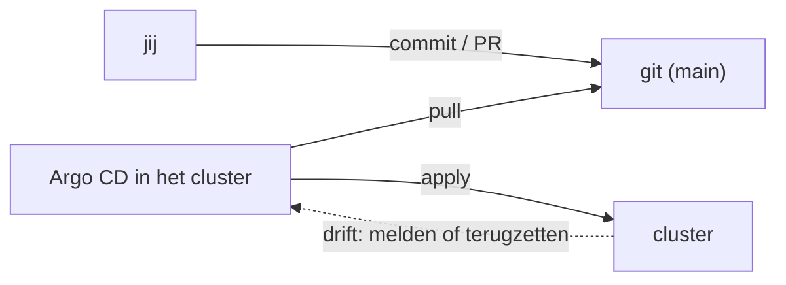
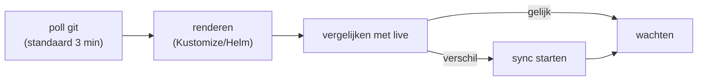
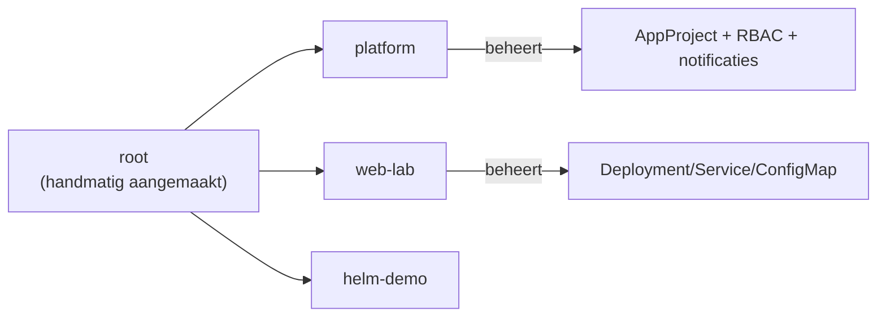

# CONCEPTS — GitOps en Argo CD, begrip per begrip

**Kern van de studiemethode.** Elk begrip staat hier als een los object, met dezelfde vaste opbouw als in de
[hoofdvault](../scripts/kubeadm-lab/CONCEPTS.md): wat het is, waarom het bestaat, waarmee je het kunt
vergelijken, hoe het werkt, hoe je het zelf ziet, valkuilen, samenhang en bronnen.

De labs in [LABS](LABS.md) linken per stap naar deze begrippen. Lees het begrip vóór je de stap doet.

**Inhoud**

**Basis:** [GitOps](#gitops) · [Gewenste toestand vs live toestand](#desired-vs-live) · [Reconciliatie](#reconciliatie) · [Drift](#drift) · [Push vs pull](#push-vs-pull)

**Argo CD:** [Applicatie (Application)](#applicatie) · [De componenten van Argo CD](#argo-architectuur) · [Repo-server en rendering](#repo-server) · [Sync](#sync) · [Sync-status](#sync-status) · [Health-status](#health-status) · [Sync-policy: automated, prune en selfHeal](#sync-policy) · [Resource tracking](#resource-tracking) · [Orphaned resources](#orphaned-resources)

**Inrichting:** [App-of-apps](#app-of-apps) · [AppProject](#appproject) · [ApplicationSet](#applicationset) · [Sync waves](#sync-waves) · [Hooks](#hooks) · [Sync windows](#sync-windows) · [ignoreDifferences, ServerSideApply en Replace](#ignoredifferences)

**Toegang en meldingen:** [RBAC in Argo CD](#rbac-argo) · [SSO met Dex](#sso-dex) · [Notificaties](#notificaties) · [Repo-credentials voor private repo's](#repo-credentials)

**Verder:** [Kustomize als bron](#kustomize-in-argo) · [Helm als bron](#helm-in-argo) · [Eigen health-checks in Lua](#health-check-lua) · [Rollback en history](#rollback) · [Meerdere clusters](#multi-cluster) · [Image updater](#image-updater)

**Werkwijze:** [Omgevingspromotie](#omgevingspromotie) · [Webhooks vs polling](#webhooks-vs-polling) · [Secrets in git](#secrets-in-git) · [Argo CD beheert zichzelf](#self-management) · [Disaster recovery](#disaster-recovery)

---

## gitops

**GitOps** · ✅ uitgewerkt

**Wat is het:** Een werkwijze waarbij de gewenste toestand van je systeem declaratief in git staat en een agent in
het cluster die toestand continu ophaalt en toepast.

**Waarom bestaat het:** Git wordt de enige bron van waarheid. Elke wijziging is een commit: reviewbaar, met
geschiedenis, en terug te draaien. Wat iemand met de hand in het cluster verandert, wordt zichtbaar (of
automatisch teruggezet).

**Vergeleken met wat je kent:** PowerShell DSC met een pull-server en *ApplyAndAutoCorrect*: de agent haalt de
configuratie op en corrigeert afwijkingen. Bij CI/CD met push doet een pipeline `kubectl apply` één keer; bij
GitOps blijft de agent controleren.

**Hoe werkt het** (de vier OpenGitOps-principes):

| Principe | Betekenis |
|---|---|
| Declaratief | de gewenste toestand is beschreven, niet de stappen |
| Versiebeheerd en onveranderlijk | in git, met volledige geschiedenis |
| Automatisch opgehaald | de agent haalt de toestand zelf op (pull) |
| Continu gereconcilieerd | afwijkingen worden opgemerkt en gecorrigeerd |



**Zie het zelf:** [LABS G-02](LABS.md#g-02) en G-03. `argocd app list` toont per app `Synced` of `OutOfSync`.

**Valkuilen:**
- GitOps is geen vervanging van CI: je bouwt images nog steeds in een pipeline. Alleen het *uitrollen* gaat via git.
- Zonder `selfHeal` meldt Argo CD drift alleen; er verandert niets.
- Secrets horen niet als platte YAML in git: [Secrets in git](#secrets-in-git).

**Hangt samen met:** [Gewenste toestand vs live toestand](#desired-vs-live) · [Reconciliatie](#reconciliatie) ·
[Push vs pull](#push-vs-pull) · [GitOps in de hoofdvault](../scripts/kubeadm-lab/CONCEPTS.md#gitops)

**Bronnen:** [OpenGitOps](https://opengitops.dev/) · [Argo CD](https://argo-cd.readthedocs.io/)

---

## desired-vs-live

**Gewenste toestand vs live toestand** · ✅ uitgewerkt

**Wat is het:** De *desired state* is wat er in git staat; de *live state* is wat de API-server nu bevat. Argo CD
vergelijkt die twee en noemt het verschil de *diff*.

**Waarom bestaat het:** Alle beslissingen van Argo CD komen uit dat ene vergelijk: gelijk → `Synced`, verschil →
`OutOfSync`. Zo is "wat wijkt af" een objectieve vraag geworden.

**Vergeleken met wat je kent:** `terraform plan` laat ook het verschil zien tussen je code en de werkelijkheid,
maar dan eenmalig. Argo CD doet dat continu en per object.

**Hoe werkt het:**

| Situatie | Sync-status | Wat Argo CD doet |
|---|---|---|
| gelijk | `Synced` | niets |
| git heeft iets extra | `OutOfSync` | toepassen (bij automated) |
| live heeft iets extra dat uit git is verwijderd | `OutOfSync` | verwijderen als `prune` aan staat |
| live is handmatig gewijzigd | `OutOfSync` | terugzetten als `selfHeal` aan staat |

**Zie het zelf:** `argocd app diff web-lab` (verschil in YAML) en `argocd app get web-lab` (samenvatting).

**Valkuilen:**
- Een lege diff betekent niet automatisch "gezond": een Pod kan CrashLoopBackOff doen terwijl de YAML klopt.
  Daarom zijn er twee assen: [sync-status](#sync-status) en [health-status](#health-status).

**Hangt samen met:** [Sync](#sync) · [Drift](#drift) · [Sync-policy](#sync-policy)

**Bronnen:** [Argo CD: diffing](https://argo-cd.readthedocs.io/en/stable/user-guide/diffing/)

---

## reconciliatie

**Reconciliatie** · ✅ uitgewerkt

**Wat is het:** De lus waarin Argo CD de gewenste toestand ophaalt, vergelijkt, en zo nodig bijstuurt — elke paar
minuten, en bij elke wijziging die hij ziet.

**Waarom bestaat het:** Zonder lus zou GitOps hetzelfde zijn als een pipeline: één keer toepassen en daarna
niets meer. De lus is wat "continu" mogelijk maakt.

**Vergeleken met wat je kent:** De control loop van een Deployment (gewenst 3 replica's, live 2 → maak er 3)
maar dan over je hele applicatieconfiguratie.

**Hoe werkt het:**



**Zie het zelf:** Wijzig iets in git en kijk hoe lang het duurt: standaard tot 3 minuten. Direct kan met
`argocd app get <app> --refresh`.

**Valkuilen:**
- De interval is instelbaar (`timeout.reconciliation` in `argocd-cm`); korter = meer API-verkeer naar git.
- Een reconciliatie die steeds faalt blijft het proberen. Dat zie je als "Retrying attempt #n" in de app-status;
  `argocd app terminate-op <app>` stopt de lus ([LABS G-07](LABS.md#g-07)).

**Hangt samen met:** [Webhooks vs polling](#webhooks-vs-polling) · [Drift](#drift) · [Sync](#sync)

**Bronnen:** [Argo CD: architecture](https://argo-cd.readthedocs.io/en/stable/operator-manual/architecture/)

---

## drift

**Drift** · ✅ uitgewerkt

**Wat is het:** Het verschil dat ontstaat doordat iemand (of iets) het cluster buiten git om wijzigt.

**Waarom bestaat het:** Drift is de reden dat GitOps verder gaat dan "eenmalig uitrollen". Je wilt weten dat de
werkelijkheid afwijkt, en liefst dat het automatisch herstelt.

**Vergeleken met wat je kent:** Een handmatige wijziging op een server die niemand heeft gedocumenteerd. Hier is
de wijziging zichtbaar in de diff en verdwijnt hij bij de volgende reconciliatie.

**Hoe werkt het:**

| Oorzaak van drift | Voorbeeld | Oplossing |
|---|---|---|
| mens | `kubectl edit deployment` | `selfHeal` zet het terug |
| een andere controller | HPA past `replicas` aan | `ignoreDifferences` of HPA uitzetten in git |
| mutating webhook | injecteert een sidecar | `ignoreDifferences` op dat veld |
| noodgreep | `kubectl scale` tijdens een incident | achteraf dezelfde waarde in git zetten |

**Zie het zelf:** `kubectl --namespace=web-lab scale deployment web --replicas=1` en kijk binnen enkele seconden:
Argo CD zet hem terug op 2 ([LABS G-03](LABS.md#g-03)).

**Valkuilen:**
- Drift "repareren" met `kubectl` is dweilen met de kraan open: de volgende reconciliatie draait het terug.
- Selfheal is geen wondermiddel bij een waarde die een ándere controller ook beheert: dan vechten twee
  controllers om hetzelfde veld. Los dat op met `ignoreDifferences` ([#ignoredifferences](#ignoredifferences)).

**Hangt samen met:** [Desired vs live](#desired-vs-live) · [Sync-policy](#sync-policy) · [Reconciliatie](#reconciliatie)

**Bronnen:** [Argo CD: automated sync policy](https://argo-cd.readthedocs.io/en/stable/user-guide/auto_sync/)

---

## push-vs-pull

**Push (CI/CD) vs pull (GitOps)** · ✅ uitgewerkt

**Wat is het:** Bij *push* start een pipeline die zelf in het cluster schrijft. Bij *pull* haalt een agent in het
cluster de configuratie op.

**Waarom bestaat het:** Pull heeft geen cluster-credentials in je pipeline nodig en werkt ook als het cluster
achter een firewall zit. Push is eenvoudiger als je alleen af en toe uitrolt.

**Vergeleken met wat je kent:** `terraform apply` in GitHub Actions (push, met een service principal) versus
Argo CD die zelf git leest (pull).

**Hoe werkt het:**

| | Push | Pull |
|---|---|---|
| Wie start | pipeline/merge | agent in het cluster |
| Credentials | pipeline heeft cluster-toegang | cluster leest repo (read-only) |
| Drift | blijft staan tot de volgende run | continu gecorrigeerd |
| Cluster bereikbaar vanaf buiten | nodig | niet nodig |

**Zie het zelf:** In [LABS G-03](LABS.md#g-03) wijzig je git en gebeurt er niets in de pipeline: alleen Argo CD
merkt het.

**Valkuilen:**
- Beide combineren kan: CI bouwt en pusht het image, GitOps rolt het uit (image tag in git).
- Push-from-CI naar een cluster dat je niet kunt bereiken is een veelvoorkomende doodlopende weg.

**Hangt samen met:** [GitOps](#gitops) · [Push vs pull in de hoofdvault](../scripts/kubeadm-lab/CONCEPTS.md#push-vs-pull)

**Bronnen:** [Argo CD: best practices](https://argo-cd.readthedocs.io/en/stable/user-guide/best_practices/)

---

## applicatie

**Applicatie (Application)** · ✅ uitgewerkt

**Wat is het:** Een CR van Argo CD die zegt: *deze map (of chart) uit deze repo, op deze revisie, hoort in deze
namespace van dit cluster*. Alles wat Argo CD doet, hangt aan een `Application`.

**Waarom bestaat het:** Het maakt de koppeling tussen git en cluster expliciet en zichtbaar, in plaats van
verstopt in een pipeline.

**Vergeleken met wat je kent:** Een `helm install` met vastgelegde waarden, maar dan als object in het cluster dat
blijft kijken of de release nog klopt.

**Hoe werkt het** (de drie blokken die je moet kunnen dromen):

```yaml
spec:
  project: lab                                    # wie mag wat (AppProject)
  source:                                         # WAT
    repoURL: https://github.com/maxilabs/training.git
    targetRevision: main
    path: kubernetes/gitops-lab/workloads/web/overlays/lab
  destination:                                    # WAAR
    server: https://kubernetes.default.svc
    namespace: web-lab
  syncPolicy:                                     # HOE
    automated: { prune: true, selfHeal: true }
    syncOptions: [CreateNamespace=true]
```

**Zie het zelf:** `argocd app list`, `kubectl --namespace=argocd get applications`.

**Valkuilen:**
- Eén Application = één pad. Zet niet tien losse mappen in één Application; gebruik dan
  [app-of-apps](#app-of-apps) of een [ApplicationSet](#applicationset).
- `targetRevision` is meestal `main`, maar kan ook een tag of commit zijn ([rollback](#rollback)).

**Hangt samen met:** [AppProject](#appproject) · [Sync](#sync) · [App-of-apps](#app-of-apps)

**Bronnen:** [Argo CD: declarative setup](https://argo-cd.readthedocs.io/en/stable/operator-manual/declarative-setup/)

---

## argo-architectuur

**De componenten van Argo CD** · ✅ uitgewerkt

**Wat is het:** Argo CD is geen enkel programma maar een set containers (Pods) in de namespace `argocd`, elk met
één taak.

**Waarom bestaat het:** De taken hebben verschillende rechten en schaalbaarheid nodig: git lezen, YAML renderen,
het cluster vergelijken en de UI/API serveren.

**Vergeleken met wat je kent:** Net als bij de control plane van Kubernetes: aparte processen met een eigen rol.

**Hoe werkt het:**

| Component | Rol | Waar je hem voor nodig hebt |
|---|---|---|
| `argocd-repo-server` | haalt git op, rendert Helm/Kustomize/plain YAML | cache, plugins |
| `argocd-application-controller` | vergelijkt en synct (statefulset) | de reconciliatie-lus |
| `argocd-server` | UI, API, CLI-endpoint, TLS | inloggen, `argocd` CLI |
| `argocd-redis` | cache tussen repo-server en controller | snelheid |
| `argocd-dex-server` | SSO-broker | [SSO](#sso-dex) |
| `argocd-notifications-controller` | meldingen bij events | [notificaties](#notificaties) |
| `argocd-applicationset-controller` | genereert Applications | [ApplicationSet](#applicationset) |

**Zie het zelf:** `kubectl --namespace=argocd get pods` en `./argocd.sh status`.

**Valkuilen:**
- De repo-server doet het rekenwerk. Trage rendering of te veel apps? Daar zit je knelpunt.
- De application-controller is een *statefulset* (één schrijver per shard), niet een deployment.

**Hangt samen met:** [Repo-server en rendering](#repo-server) · [Reconciliatie](#reconciliatie)

**Bronnen:** [Argo CD: architecture](https://argo-cd.readthedocs.io/en/stable/operator-manual/architecture/)

---

## repo-server

**Repo-server en rendering** · ✅ uitgewerkt

**Wat is het:** Het onderdeel dat je repository leest en de YAML *rendert* zoals die naar het cluster gaat.

**Waarom bestaat het:** In git staat vaak geen kant-en-klare YAML: Kustomize-overlays en Helm-templates moeten
eerst worden uitgewerkt. Alle apps delen één cache, zodat duizend apps niet duizend keer git clonen.

**Vergeleken met wat je kent:** `kustomize build` en `helm template` voer je normaal met de hand uit; dat doet de
repo-server voor je, bij elke reconciliatie.

**Hoe werkt het:**

| Bron | Wat de repo-server doet |
|---|---|
| plain map | YAML-bestanden in de map lezen (niet-recursief tenzij `recurse: true`) |
| Kustomize | `kustomization.yaml` uitwerken (overlays, patches, generators) |
| Helm | chart + `valueFiles` + `parameters` uitwerken |
| plugin/CMP | eigen container die rendert (kan secrets injecteren — zie de valkuil) |

**Zie het zelf:** `argocd app manifests web-lab` toont de gerenderde YAML (dus niet je templated bestand).

**Valkuilen:**
- Secrets die een plugin tijdens het renderen invult, belanden in de Redis-cache en in de logs van de repo-server.
  Gebruik External Secrets of Sealed Secrets in het cluster ([#secrets-in-git](#secrets-in-git)).
- Een `charts/`-map met een `.helmignore`-fout geeft pas bij het renderen een fout, niet bij het committen.

**Hangt samen met:** [Kustomize als bron](#kustomize-in-argo) · [Helm als bron](#helm-in-argo) · [Argo-architectuur](#argo-architectuur)

**Bronnen:** [Argo CD: Kustomize](https://argo-cd.readthedocs.io/en/stable/user-guide/kustomize/) ·
[Argo CD: Helm](https://argo-cd.readthedocs.io/en/stable/user-guide/helm/)

---

## sync

**Sync** · ✅ uitgewerkt

**Wat is het:** Het moment waarop Argo CD de gerenderde YAML naar het cluster schrijft (apply) en zo nodig
resources verwijdert.

**Waarom bestaat het:** Reconciliatie *constateert*; sync *verandert*. Handmatig of automatisch, dat is de keuze in
de [sync-policy](#sync-policy).

**Vergeleken met wat je kent:** `kubectl apply -f` over een hele map, met een diff ervoor en een verslag erna.

**Hoe werkt het:**

| Soort sync | Wanneer |
|---|---|
| handmatig | `argocd app sync <app>`, of de knop in de UI |
| automatisch | zodra de app `OutOfSync` is en `automated` aan staat |
| selectief | `argocd app sync <app> --resource <kind>/<naam>` |
| met prune | verwijderde resources uit git ook uit het cluster halen |

**Zie het zelf:** `argocd app sync waves` en kijk naar de volgorde in de uitvoer (waves en hooks komen langs).

**Valkuilen:**
- Een sync die "klaar" is, is niet hetzelfde als "gezond" ([health-status](#health-status)).
- `--force` doet delete+create; dat is een korte onderbreking, geen normale oplossing.

**Hangt samen met:** [Sync-status](#sync-status) · [Sync-policy](#sync-policy) · [Prune](#prune)

**Bronnen:** [Argo CD: sync](https://argo-cd.readthedocs.io/en/stable/user-guide/commands/argocd_app_sync/)

---

## sync-status

**Sync-status** · ✅ uitgewerkt

**Wat is het:** `Synced` of `OutOfSync`: is de live toestand gelijk aan git?

**Waarom bestaat het:** Het is het eerste wat je 's ochtends checkt: loopt alles zoals in git staat?

**Vergeleken met wat je kent:** De kolom "changes" in een `terraform plan`.

**Hoe werkt het:**

| Waarde | Betekenis |
|---|---|
| `Synced` | de laatste sync is gelukt en er is geen verschil |
| `OutOfSync` | er is verschil (of de laatste sync faalde) |
| `Unknown` | Argo CD kon niet vergelijken (repo onbereikbaar, renderfout) |

**Zie het zelf:** `argocd app get web-lab` — let op de twee regels `Sync Status` en `Health Status`.

**Valkuilen:**
- `OutOfSync` met `Healthy` komt vaak door een veld dat een andere controller beheert
  ([#ignoredifferences](#ignoredifferences)).
- Na een gefaalde sync blijft `OutOfSync` staan terwijl de resources van de vórige versie nog draaien.

**Hangt samen met:** [Health-status](#health-status) · [Desired vs live](#desired-vs-live)

**Bronnen:** [Argo CD: app health](https://argo-cd.readthedocs.io/en/stable/operator-manual/health/)

---

## health-status

**Health-status** · ✅ uitgewerkt

**Wat is het:** Een oordeel per resource en per app: `Healthy`, `Progressing`, `Degraded`, `Missing`, `Suspended`,
`Unknown`.

**Waarom bestaat het:** YAML die is toegepast kan alsnog stuk zijn (CrashLoopBackOff, PVC die niet bindt). Health
kijkt naar de *toestand* van het object, niet naar de diff.

**Vergeleken met wat je kent:** `kubectl get pods` met `STATUS`, maar dan doorgetrokken naar Deployments, Jobs,
PVC's en (via Lua) je eigen CRD's.

**Hoe werkt het:**

| Resource | Healthy als |
|---|---|
| Pod | Ready |
| Deployment | `availableReplicas == replicas` (rolling update klaar) |
| Job | `succeeded > 0` |
| PVC | `Bound` |
| CRD zonder health-check | altijd `Healthy` zodra hij bestaat (let op!) |

**Zie het zelf:** `argocd app get waves` en `kubectl --namespace=lab-waves get pods`.

**Valkuilen:**
- Zonder [eigen health-check](#health-check-lua) is een custom resource altijd `Healthy`, ook als de controller
  niets doet. Dat is een stille faalmodus.

**Hangt samen met:** [Sync-status](#sync-status) · [Eigen health-checks in Lua](#health-check-lua)

**Bronnen:** [Argo CD: resource health](https://argo-cd.readthedocs.io/en/stable/operator-manual/health/)

---

## sync-policy

**Sync-policy: automated, prune en selfHeal** · ✅ uitgewerkt

**Wat is het:** De drie schakelaars die bepalen of Argo CD zelf ingrijpt:

```yaml
syncPolicy:
  automated:
    prune: true      # resources die uit git verdwijnen, uit het cluster verwijderen
    selfHeal: true   # live wijzigingen terugzetten naar git
  syncOptions:
    - CreateNamespace=true
```

**Waarom bestaat het:** Zonder `automated` is Argo CD een dashboard dat alleen verschillen laat zien. Met
`automated` wordt git echt de baas.

**Vergeleken met wat je kent:** DSC's *ApplyAndAutoCorrect* (selfHeal) en "verwijder wat niet meer in de
configuratie staat" (prune).

**Hoe werkt het:**

| Instelling | Effect | Risico |
|---|---|---|
| `automated: {}` | syncen bij verschil | verwijdert niets, herstelt niets |
| `+ prune: true` | verwijderde resources verdwijnen | per ongeluk een bestand weghalen = resource weg |
| `+ selfHeal: true` | handmatige wijziging wordt teruggezet | vecht met HPA/webhooks zonder `ignoreDifferences` |
| `retry` | mislukte sync opnieuw proberen | blijft proberen bij een structurele fout |

**Zie het zelf:** [LABS G-03](LABS.md#g-03): `kubectl scale` → Argo CD herstelt binnen seconden.

**Valkuilen:**
- `prune` + een falende hook = een lus van sync-pogingen. Zie [LABS G-07](LABS.md#g-07) en `argocd app terminate-op`.
- In productie: `prune` aan, maar met `Prune=false` op uitzonderingen en een AppProject dat de schade beperkt.

**Hangt samen met:** [Prune](#prune) · [Drift](#drift) · [Sync](#sync)

**Bronnen:** [Argo CD: auto sync](https://argo-cd.readthedocs.io/en/stable/user-guide/auto_sync/)

---

## prune

**Prune** · ✅ uitgewerkt

**Wat is het:** Het verwijderen van resources die wél in het cluster staan maar niet meer in git.

**Waarom bestaat het:** Zonder prune blijft elke verwijderde regel YAML voor altijd als wees in je cluster staan.

**Vergeleken met wat je kent:** `terraform apply` dat een resource uit je configuratie hebt gehaald: die wordt
vernietigd.

**Hoe werkt het:**

| Annotatie | Effect |
|---|---|
| `argocd.argoproj.io/sync-options: Prune=false` | deze resource nooit automatisch verwijderen |
| `argocd.argoproj.io/sync-options: Delete=false` | nooit verwijderen, ook niet bij app-delete |
| finalizer `resources-finalizer.argocd.argoproj.io` | bij app-delete ook de resources verwijderen (cascade) |

**Zie het zelf:** [LABS G-03](LABS.md#g-03): haal een bestand uit git en de resource verdwijnt.

**Valkuilen:**
- Prune kijkt naar de *inventory* van de app (wat hij zelf heeft aangemaakt), niet naar de hele namespace. Iets wat
  jij met de hand hebt gemaakt, wordt niet gepruned maar verschijnt als [orphaned](#orphaned-resources).
- Een verkeerd `path` in je Application kan ineens een hele map laten verdwijnen.

**Hangt samen met:** [Sync-policy](#sync-policy) · [Resource tracking](#resource-tracking) · [Orphaned resources](#orphaned-resources)

**Bronnen:** [Argo CD: sync options](https://argo-cd.readthedocs.io/en/stable/user-guide/sync-options/)

---

## resource-tracking

**Resource tracking** · ✅ uitgewerkt

**Wat is het:** De manier waarop Argo CD onthoudt welke live resources bij welke Application horen.

**Waarom bestaat het:** Zonder die administratie kan Argo CD niet weten wat hij mag aanpassen of prunen. Het is de
inventory van de app.

**Vergeleken met wat je kent:** De `terraform.tfstate`: wie is eigenaar van welk object.

**Hoe werkt het:**

| Methode | Waar het staat |
|---|---|
| annotation (standaard) | `argocd.argoproj.io/tracking-id: <app>:<group>/<kind>/<ns>/<naam>` |
| label | `app.kubernetes.io/instance: <app>` |
| annotation+label | beide (nieuwer, robuuster) |

**Zie het zelf:**
```bash
kubectl --namespace=web-lab get deployment web -o jsonpath='{.metadata.annotations.argocd\.argoproj\.io/tracking-id}'; echo
```

**Valkuilen:**
- Twee apps die hetzelfde object beheren: de laatste sync "wint" en de diff blijft spoken. Eén eigenaar per object.
- Kopieer nooit zomaar een resource tussen namespaces: de tracking-id wijst dan naar de verkeerde app.

**Hangt samen met:** [Prune](#prune) · [Orphaned resources](#orphaned-resources)

**Bronnen:** [Argo CD: resource tracking](https://argo-cd.readthedocs.io/en/stable/user-guide/resource_tracking/)

---

## orphaned-resources

**Orphaned resources** · ✅ uitgewerkt

**Wat is het:** Resources in de doel-namespace die *niet* door de Application worden beheerd.

**Waarom bestaat het:** Ze zijn onzichtbaar in git maar kosten wel geld en kunnen verwarren. Argo CD kan ze
signaleren.

**Vergeleken met wat je kent:** "Unmanaged" resources in een CloudFormation-stack.

**Hoe werkt het:** Zet het aan in het AppProject:

```yaml
spec:
  orphanedResources:
    warn: true
```

De UI toont dan een waarschuwing; met `ignore` sluit je bekende uitzonderingen uit.

**Zie het zelf:** Maak iets met de hand in `web-lab` en kijk in de UI bij de app naar de melding.

**Valkuilen:**
- Orphaned is een *melding*, geen opruimactie. Argo CD verwijdert ze niet (dat is precies het punt).

**Hangt samen met:** [Prune](#prune) · [Resource tracking](#resource-tracking) · [AppProject](#appproject)

**Bronnen:** [Argo CD: orphaned resources](https://argo-cd.readthedocs.io/en/stable/user-guide/orphaned-resources/)

---

## app-of-apps

**App-of-apps** · ✅ uitgewerkt

**Wat is het:** Een Application die geen workloads beheert, maar andere Applications.

**Waarom bestaat het:** Je wilt niet tien Applications met de hand aanmaken en onderhouden. Eén root-app leest een
map met Application-manifests, en die beheren de rest.

**Vergeleken met wat je kent:** Een `main.tf` die modules aanroept; de modules zelf staan in aparte mappen.

**Hoe werkt het:**



**Zie het zelf:** `kubectl --namespace=argocd get applications` en `argocd app tree root`.

**Valkuilen:**
- De root-app is je single point of failure: verwijder je hem met cascade, dan verdwijnen alle kinderen.
- Zet `sync-wave` op de Applications zodat het AppProject er eerder is dan de apps die het gebruiken
  ([sync waves](#sync-waves)).
- Een kind-app die met opzet faalt, houdt de root-app rood. Zet zulke labs buiten de root-map
  (`clusters/lab/optional/`).

**Hangt samen met:** [Applicatie](#applicatie) · [Argo CD beheert zichzelf](#self-management) · [Disaster recovery](#disaster-recovery)

**Bronnen:** [Argo CD: cluster bootstrapping](https://argo-cd.readthedocs.io/en/stable/operator-manual/cluster-bootstrapping/)

---

## appproject

**AppProject** · ✅ uitgewerkt

**Wat is het:** De grens van wat Applications mogen: welke repos, welke clusters/namespaces, welke resource-soorten,
en wanneer er gesynct mag worden.

**Waarom bestaat het:** Zonder project is elke Application even machtig. Een typefout in een `path` of een
kwaadwillende commit kan dan je hele cluster raken.

**Vergeleken met wat je kent:** Een Azure-resource group met RBAC en policy, of een Terraform-workspace met
beperkte rechten.

**Hoe werkt het:**

| Veld | Betekenis |
|---|---|
| `sourceRepos` | alleen uit deze repo's |
| `destinations` | alleen naar deze cluster/namespace-combinaties |
| `clusterResourceWhitelist` | welke cluster-scoped resources (Namespace, CRD, ...) |
| `namespaceResourceBlacklist` | wat juist níet |
| `syncWindows` | wanneer er gesynct mag worden |
| `orphanedResources` | waarschuwen bij onbeheerde resources |
| `roles` | eigen RBAC-rollen voor dit project |

**Zie het zelf:** [LABS G-10](LABS.md#g-10). Probeer een Application in een niet-toegestane namespace te zetten:
de sync wordt geweigerd met "is not permitted in project lab".

**Valkuilen:**
- `CreateNamespace=true` heeft een Namespace-entry in `clusterResourceWhitelist` nodig, anders faalt de sync.
- Een CRD is cluster-scoped: zonder `apiextensions.k8s.io/CustomResourceDefinition` in de whitelist kan je eigen
  CRD-lab niet eens starten (dat is precies wat er in dit lab gebeurde).

**Hangt samen met:** [RBAC in Argo CD](#rbac-argo) · [Sync windows](#sync-windows) · [Applicatie](#applicatie)

**Bronnen:** [Argo CD: projects](https://argo-cd.readthedocs.io/en/stable/user-guide/projects/)

---

## applicationset

**ApplicationSet** · ✅ uitgewerkt

**Wat is het:** Een controller + CR die Applications *genereert* uit een generator: een lijst, de mappen in een
repo, de clusters die bij Argo CD bekend zijn, of open pull requests.

**Waarom bestaat het:** Met de hand een Application per omgeving of per cluster maken schaalt niet. Eén
ApplicationSet doet dat, en nieuwe omgevingen komen erbij door een map te committen.

**Vergeleken met wat je kent:** Een `for_each` in Terraform, of een matrix-job in GitHub Actions.

**Hoe werkt het:**

| Generator | Bron | Typisch gebruik |
|---|---|---|
| `list` | statische lijst in de CR | kleine, vaste set |
| `git` (files/directories) | mappen of config-bestanden in git | één app per omgeving |
| `clusters` | geregistreerde clusters | dezelfde app in alle clusters |
| `matrix`/`merge` | combinatie | app × cluster |
| `pullRequest` | open PR's | preview-omgeving per PR |

**Zie het zelf:** [LABS G-09](LABS.md#g-09): `guests-dev`, `guests-stg` en `guests-prod` komen uit één CR.

**Valkuilen:**
- De ApplicationSet let op de mappen die je opgeeft. Verwijder je een map, dan verdwijnt de Application — en met
  `prune` ook de resources.
- Let op de template-syntax: met `goTemplate: true` gebruik je `{{ .naam }}`; zonder gebruik je `{{naam}}`.
- Een gegenereerde Application is geen "kind" in de owner-reference zin: hij verdwijnt als de ApplicationSet
  verdwijnt (tenzij `preserveResourcesOnDeletion`).

**Hangt samen met:** [Applicatie](#applicatie) · [Meerdere clusters](#multi-cluster) · [Omgevingspromotie](#omgevingspromotie)

**Bronnen:** [Argo CD: ApplicationSet](https://argo-cd.readthedocs.io/en/stable/operator-manual/applicationset/)

---

## sync-waves

**Sync waves** · ✅ uitgewerkt

**Wat is het:** Een volgorde binnen één sync, met de annotatie `argocd.argoproj.io/sync-wave: "-2"`. Lagere golf
eerst; Argo CD wacht tot de resources van een golf gezond zijn.

**Waarom bestaat het:** Namespaces, CRD's, ConfigMaps en secrets moeten er zijn vóór de workloads die ze gebruiken.
Kubernetes zelf kent geen volgorde in een map YAML.

**Vergeleken met wat je kent:** `depends_on` in Terraform, of `needs:` in een pipeline.

**Hoe werkt het:**

| Golf | Voorbeeld |
|---|---|
| -3 | Namespace |
| -2 | ConfigMap, Secret, CRD |
| -1 | RBAC, ServiceAccount |
| 0 | Deployment, Service |
| 1..n | dingen die pas daarna mogen (migraties, smoke tests) |

**Zie het zelf:** [LABS G-06](LABS.md#g-06): in `argocd app sync waves` zie je de namespace eerder dan de
Deployment, en de PostSync-hook pas als de Pod Ready is.

**Valkuilen:**
- Zonder golf is de volgorde *niet* gegarandeerd, ook al staat het in één bestand netjes bovenaan.
- Een golf wacht op health. Een resource zonder health-check (CRD) is meteen "klaar".

**Hangt samen met:** [Hooks](#hooks) · [Health-status](#health-status)

**Bronnen:** [Argo CD: sync waves](https://argo-cd.readthedocs.io/en/stable/user-guide/sync-waves/)

---

## hooks

**Hooks** · ✅ uitgewerkt

**Wat is het:** Resources met een hook-annotatie die Argo CD op een bepaald moment uitvoert en niet als
"gewone" resource beheert: `PreSync`, `Sync`, `PostSync`, `SyncFail`, `Skip`.

**Waarom bestaat het:** Je wilt vóór de uitrol kunnen controleren (migratie, backup) en erna kunnen testen
(smoke test), zonder dat die taken blijven staan als onderdeel van de app.

**Vergeleken met wat je kent:** `preDeploy`/`postDeploy`-taken in Azure DevOps.

**Hoe werkt het:**

| Hook | Moment | Faalt de sync als hij faalt? |
|---|---|---|
| `PreSync` | vóór de eerste golf | ja |
| `Sync` | tijdens de sync, na de vorige golf | ja |
| `PostSync` | ná alle golven, als alles gezond is | ja |
| `SyncFail` | als de sync mislukt | nee (opruimactie) |

```yaml
annotations:
  argocd.argoproj.io/hook: PostSync
  argocd.argoproj.io/hook-delete-policy: BeforeHookCreation   # of HookSucceeded / HookFailed
```

**Zie het zelf:** [LABS G-07](LABS.md#g-07): `kubectl --namespace=lab-waves logs job/waves-postsync` bewijst dat
de hook pas draaide toen de Pod Ready was.

**Valkuilen:**
- Een falende hook met `automated` sync geeft een lus van pogingen. Stoppen: `argocd app terminate-op <app>`.
- Een Job zonder `hook-delete-policy` blijft staan en botst bij de volgende sync op dezelfde naam.

**Hangt samen met:** [Sync waves](#sync-waves) · [Sync-policy](#sync-policy)

**Bronnen:** [Argo CD: resource hooks](https://argo-cd.readthedocs.io/en/stable/user-guide/resource_hooks/)

---

## sync-windows

**Sync windows** · ✅ uitgewerkt

**Wat is het:** Tijdvensters in een AppProject waarin syncen mag (`allow`) of juist niet (`deny`).

**Waarom bestaat het:** Geen uitrol tijdens Black Friday of een maandafsluiting — zonder dat iemand de
`selfHeal` hoeft uit te zetten.

**Vergeleken met wat je kent:** Een change-freeze in een ITSM-proces, maar dan afgedwongen door de tool.

**Hoe werkt het:**

```yaml
syncWindows:
  - kind: deny
    schedule: "0 3 * * *"       # cron: wanneer het venster begint
    duration: 1h
    timeZone: Europe/Amsterdam
    applications: ["*"]
    manualSync: false            # false = ook handmatige syncs worden geweigerd
```

**Zie het zelf:** [LABS G-10](LABS.md#g-10). Met een venster dat nu actief is krijg je
`cannot sync: blocked by sync window`.

**Valkuilen:**
- `manualSync: true` in een *deny*-venster betekent: handmatig syncen mag wél (noodgreep). Dat is precies
  andersom dan je verwacht.
- Een venster blokkeert de sync, niet de reconciliatie: je ziet dus wél netjes `OutOfSync` worden.

**Hangt samen met:** [AppProject](#appproject) · [Sync-policy](#sync-policy)

**Bronnen:** [Argo CD: sync windows](https://argo-cd.readthedocs.io/en/stable/user-guide/sync_windows/)

---

## ignoredifferences

**ignoreDifferences, ServerSideApply en Replace** · ✅ uitgewerkt

**Wat is het:** Drie `syncOptions`/velden om met lastige verschillen om te gaan:

| Middel | Waarvoor |
|---|---|
| `ignoreDifferences` | dit veld bewust negeren bij de vergelijking (HPA die `replicas` zet, webhook die een sidecar injecteert) |
| `ServerSideApply=true` | de API-server laten mergen in plaats van `kubectl apply`-annotaties (grote CRD's, veel velden) |
| `Replace=true` | resource verwijderen en opnieuw aanmaken (als apply blijft vastlopen op een onveranderlijk veld) |

**Waarom bestaat het:** Niet elk verschil is ongewenst. Zonder deze middelen zie je eeuwige `OutOfSync` of blijven
syncs hangen.

**Vergeleken met wat je kent:** `lifecycle { ignore_changes }` in Terraform.

**Hoe werkt het:**

```yaml
spec:
  ignoreDifferences:
    - group: apps
      kind: Deployment
      jsonPointers: ["/spec/replicas"]
  syncPolicy:
    syncOptions:
      - ServerSideApply=true
```

**Zie het zelf:** [LABS G-14](LABS.md#g-14): schaal een Deployment met `ignoreDifferences` en Argo CD laat het staan
(zonder die regel zet [selfHeal](#sync-policy) het terug).

**Valkuilen:**
- `ignoreDifferences` verbergt het probleem; het lost de oorzaak niet op. Documenteer waarom de regel er staat.
- `Replace=true` betekent een korte onderbreking: alleen voor specifieke resources, niet als standaard.

**Hangt samen met:** [Drift](#drift) · [Sync-policy](#sync-policy) · [Repo-server](#repo-server)

**Bronnen:** [Argo CD: diffing](https://argo-cd.readthedocs.io/en/stable/user-guide/diffing/) ·
[Argo CD: sync options](https://argo-cd.readthedocs.io/en/stable/user-guide/sync-options/)

---

## rbac-argo

**RBAC in Argo CD** · ✅ uitgewerkt

**Wat is het:** Regels in de ConfigMap `argocd-rbac-cm` die bepalen wie welke Applications mag zien, syncen of
verwijderen. Los van Kubernetes-RBAC.

**Waarom bestaat het:** Argo CD is een krachtig gereedschap: wie `sync` mag, kan uitrollen. Je wilt niet dat
iedereen die de UI kan openen, alles mag.

**Vergeleken met wat je kent:** Azure RBAC met rollen en assignments, maar met een CSV-achtige policy-taal.

**Hoe werkt het:**

| Regel | Betekenis |
|---|---|
| `p, <rol>, <resource>, <actie>, <object>, allow` | wat een rol mag |
| `g, <subject>, <rol>` | wie die rol krijgt |
| `policy.default` | rol voor iedereen zonder regel (`role:readonly` is veilig) |
| `scopes` | welke claim als subject geldt: `[groups, email]` |

```csv
g, student@lab.local, role:admin
p, role:lab-deployer, applications, sync, lab/*, allow
g, lab-deployers, role:lab-deployer
```

**Zie het zelf:** [LABS G-11](LABS.md#g-11): als je de gebruiker `role:readonly` geeft, krijg je bij een sync
`permission denied: applications, sync, lab/web-lab`.

**Valkuilen:**
- De ingebouwde `admin`-gebruiker (wachtwoord) houdt altijd volledige rechten; dat is je vangnet als SSO stuk is.
- `policy.default: role:readonly` zet de standaard voor iedereen die inlogt. Vergeet je de mapping, dan kan een
  gebruiker niets — dat is beter dan te veel.

**Hangt samen met:** [SSO met Dex](#sso-dex) · [AppProject](#appproject)

**Bronnen:** [Argo CD: RBAC](https://argo-cd.readthedocs.io/en/stable/operator-manual/rbac/)

---

## sso-dex

**SSO met Dex** · ✅ uitgewerkt

**Wat is het:** Argo CD heeft een ingebouwde Dex-server: een OIDC-broker die meerdere identity providers
(GitHub, LDAP, Azure Entra, SAML) vertaalt naar één login voor Argo CD.

**Waarom bestaat het:** Eén plek voor gebruikers en groepen, en dus één plek voor RBAC, in plaats van lokale
accounts per tool.

**Vergeleken met wat je kent:** Entra ID als IdP met een enterprise application; Dex doet hetzelfde maar lokaal.

**Hoe werkt het:**

| Stap | Waar |
|---|---|
| 1. `url` zetten in `argocd-cm` | Argo CD moet zijn eigen publieke URL kennen (redirect) |
| 2. `dex.config` met connector(s) | bijv. `enablePasswordDB: true` met `staticPasswords` voor een lab |
| 3. client `argo-cd` | Argo CD maakt die zelf aan met een eigen secret |
| 4. RBAC | `g, <email of groep>, <rol>` in `argocd-rbac-cm` |
| 5. inloggen | UI → "Log in via Dex"; CLI: `argocd login <url> --sso` |

**Zie het zelf:** `./argocd.sh sso enable`. Het script logt in als `student@lab.local` via de Dex-token-endpoint en
laat zien welke identiteit de API ziet. Uitzetten: `./argocd.sh sso disable`.

**Valkuilen:**
- `dex.config` zonder `connectors`-sleutel wordt geweigerd ("malformed Dex configuration found"). De lokale
  connector ontstaat pas door `enablePasswordDB: true`.
- Zonder `url` in `argocd-cm` werkt de redirect niet en blijft de login hangen.
- In productie geen `staticPasswords`: koppel een echte IdP en map groepen naar rollen.

**Hangt samen met:** [RBAC in Argo CD](#rbac-argo) · [Argo-architectuur](#argo-architectuur)

**Bronnen:** [Argo CD: user management](https://argo-cd.readthedocs.io/en/stable/operator-manual/user-management/) ·
[Dex](https://dexidp.io/docs/)

---

## notificaties

**Notificaties** · ✅ uitgewerkt

**Wat is het:** De `argocd-notifications-controller` die op basis van *triggers* (condities), *templates*
(inhoud) en *subscriptions* (wie) berichten verstuurt — naar Slack, mail, webhook, Teams.

**Waarom bestaat het:** Een mislukte sync wil je weten zonder de UI te openen.

**Vergeleken met wat je kent:** Alertmanager-regels (trigger) met een template en een receiver.

**Hoe werkt het:**

```yaml
# argocd-notifications-cm
service.webhook.lab: |          # waarheen
  url: http://echo.lab-observability.svc.cluster.local:8080
template.app-status: |          # inhoud
  webhook: { lab: { method: POST, body: '{"app":"{{.app.metadata.name}}"}' } }
trigger.on-sync-failed: |       # wanneer
  - when: app.status.operationState.phase in ['Error','Failed']
    send: [app-status]
subscriptions: |                # wie
  - recipients: [lab]
    triggers: [on-sync-failed]
```

**Zie het zelf:** [LABS G-12](LABS.md#g-12): `kubectl --namespace=lab-observability logs deploy/echo` laat de
POST zien met de app-naam en status.

**Valkuilen:**
- De trigger vuurt alleen als de fase echt `Failed` is. Bij een automatische sync die blijft herproberen is de
  fase `Running` en komt er dus geen melding.
- Notificaties zijn geen monitoring: ze zeggen iets over de sync, niet over latency of fouten in je app.

**Hangt samen met:** [Argo-architectuur](#argo-architectuur) · [Hooks](#hooks)

**Bronnen:** [Argo CD: notifications](https://argo-cd.readthedocs.io/en/stable/operator-manual/notifications/)

---

## repo-credentials

**Repo-credentials voor private repo's** · ✅ uitgewerkt

**Wat is het:** De gegevens waarmee Argo CD bij een private git-repo komt: een HTTPS-token of een SSH-deploy-key,
opgeslagen als Secret in de namespace `argocd`.

**Waarom bestaat het:** Een publieke repo leest iedereen; een private repo vraagt om een credential dat je veilig
en herhaalbaar wilt beheren.

**Vergeleken met wat je kent:** Een deploy key in GitHub, of een PAT in een pipeline-variabele — maar hier in het
cluster, met een repository- of project-scope.

**Hoe werkt het:**

| Vorm | Secret | Gebruik |
|---|---|---|
| HTTPS met token | `repo-<naam>` met `username`/`password` | één repo |
| SSH-deploy-key | `repo-<naam>` met `sshPrivateKey` | één repo, key per repo |
| credential template | `repo-creds-<naam>` met `url`-prefix | alle repo's onder een organisatie |

```bash
argocd repo add git@github.com:maxilabs/private-repo.git --ssh-private-key-path ~/.ssh/id_ed25519
```

**Zie het zelf:** `kubectl --namespace=argocd get secrets -l argocd.argoproj.io/secret-type=repository`.

**Valkuilen:**
- Nooit een credential in het Application-manifest of in git zetten.
- Een deploy-key heeft `write`-rechten nodig als je [image updater](#image-updater) terug naar git laat schrijven.
- Verkeerde `known_hosts` (of geen) geeft een nietszeggende SSH-fout in de repo-server.

**Hangt samen met:** [Secrets in git](#secrets-in-git) · [Image updater](#image-updater) · [Repo-server](#repo-server)

**Bronnen:** [Argo CD: private repositories](https://argo-cd.readthedocs.io/en/stable/operator-manual/declarative-setup/#repositories)

---

## kustomize-in-argo

**Kustomize als bron** · ✅ uitgewerkt

**Wat is het:** Argo CD herkent een `kustomization.yaml` en rendert de overlay zelf; je hebt geen `kustomize`-binary
op je node nodig.

**Waarom bestaat het:** Eén base met per omgeving een kleine overlay is de standaardmanier om DRY te blijven.

**Vergeleken met wat je kent:** `kustomize build overlays/lab` met de hand; Argo CD doet hetzelfde bij elke
reconciliatie.

**Hoe werkt het:**

| Onderdeel | Effect |
|---|---|
| `resources` | base + extra bestanden |
| `namespace` | zet de namespace op alle resources |
| `patches` | kleine wijzigingen (replicas, image) |
| `configMapGenerator` | ConfigMap uit bestanden, met hash-suffix |
| `images` | image + tag vervangen zonder de base aan te raken |

**Zie het zelf:** `argocd app manifests web-lab` naast `cat workloads/web/overlays/lab/kustomization.yaml`
vergelijken: je ziet de uitgewerkte YAML.

**Valkuilen:**
- De hash-suffix van `configMapGenerator` zorgt dat een ConfigMap-wijziging een nieuwe naam krijgt: pods rollen
  netjes opnieuw. Zonder generator (gewone ConfigMap) moet je zelf een checksum-annotatie regelen.
- Argo CD's ingebouwde Kustomize-versie kan afwijken van je lokale. Bij twijfel: `kustomize`-versie in de
  Application vastzetten.

**Hangt samen met:** [Repo-server](#repo-server) · [Omgevingspromotie](#omgevingspromotie) ·
[Kustomize in de hoofdvault](../scripts/kubeadm-lab/CONCEPTS.md#kustomize)

**Bronnen:** [Argo CD: Kustomize](https://argo-cd.readthedocs.io/en/stable/user-guide/kustomize/)

---

## helm-in-argo

**Helm als bron** · ✅ uitgewerkt

**Wat is het:** Argo CD kan een Helm-chart uit je repo of uit een chart-repo gebruiken, met eigen waarden, en
rendert die zelf (geen `helm install`, geen release-secret in het cluster).

**Waarom bestaat het:** Je houdt de voordelen van Helm (templating, waarden per omgeving) en krijgt er GitOps
bij: de gewenste toestand blijft in git.

**Vergeleken met wat je kent:** `helm upgrade --install` met een values-bestand; nu doet Argo CD dat bij elke
reconciliatie.

**Hoe werkt het:**

| Veld | Betekenis |
|---|---|
| `path` | map met `Chart.yaml` |
| `helm.releaseName` | naam van de "release" (bepaalt `{{ .Release.Name }}`) |
| `helm.valueFiles` | waardenbestanden, in volgorde |
| `helm.parameters` | losse `--set`-waarden, **winnen** van valueFiles |
| `helm.releaseName` + `namespace` | samen je release-identiteit |

**Zie het zelf:** [LABS G-05](LABS.md#g-05): de pagina toont de tekst uit `parameters`, niet uit `values-lab.yaml`.

**Valkuilen:**
- `helm template`-fouten (verkeerde indentatie) komen terug als renderfout in de repo-server.
- Argo CD beheert de release zelf; meng geen `helm upgrade` met de hand op dezelfde resources.
- Een chart uit een externe repo heeft geen credentials nodig, maar wel netwerktoegang vanaf de repo-server.

**Hangt samen met:** [Repo-server](#repo-server) · [Helm in de hoofdvault](../scripts/kubeadm-lab/CONCEPTS.md#helm)

**Bronnen:** [Argo CD: Helm](https://argo-cd.readthedocs.io/en/stable/user-guide/helm/)

---

## health-check-lua

**Eigen health-checks in Lua** · ✅ uitgewerkt

**Wat is het:** Een klein Lua-script in `argocd-cm` dat bepaalt wanneer jouw custom resource gezond is:

```yaml
data:
  resource.customizations.health.labs.maxilabs.dev_Widget: |
    hs = {}
    if obj.status ~= nil and obj.status.ready == true then
      hs.status = "Healthy"
      hs.message = "Widget is ready"
    else
      hs.status = "Progressing"
    end
    return hs
```

**Waarom bestaat het:** Zonder health-check is elke CRD meteen `Healthy`, ook als de controller niets doet. Dan
miste je dus precies de storing die je wilde zien.

**Vergeleken met wat je kent:** Een readiness probe, maar dan voor je eigen resource-type in plaats van een Pod.

**Hoe werkt het:** De application-controller leest de ConfigMap, zoekt op `<group>_<Kind>` en voert het script uit
met `obj` = de live resource.

**Zie het zelf:** [LABS G-16](LABS.md#g-16): de Widget is eerst `Progressing`; na
`kubectl patch widget demo --subresource=status -p '{"status":{"ready":true}}'` wordt hij `Healthy`.

**Valkuilen:**
- Een fout in het Lua-script geeft `Unknown`, niet een crash — maar je ziet het pas in de app-status.
- Na een wijziging in `argocd-cm` moet de application-controller herstarten (het script doet dat).

**Hangt samen met:** [Health-status](#health-status) · [Argo-architectuur](#argo-architectuur)

**Bronnen:** [Argo CD: custom health checks](https://argo-cd.readthedocs.io/en/stable/operator-manual/health/#custom-health-checks)

---

## rollback

**Rollback en history** · ✅ uitgewerkt

**Wat is het:** Terug naar een eerdere *revisie* van je app. Argo CD bewaart de laatste N syncs met hun commit.

**Waarom bestaat het:** Bij een slechte uitrol wil je snel terug. GitOps heeft daar twee antwoorden: `git revert`
(de nette weg) en `argocd app rollback` (de noodgreep).

**Vergeleken met wat je kent:** `helm rollback` — maar hier gaat het om een commit, niet om een release-revisie.

**Hoe werkt het:**

| Manier | Wat er gebeurt |
|---|---|
| `git revert` + commit | nieuwe commit, iedereen ziet het, blijft kloppen met git |
| `argocd app rollback <app> <id>` | Argo CD synct een oude revisie; de app-status wijkt af van `main` |
| `argocd app history <app>` | lijst met revisies en hun ID |

**Zie het zelf:** [LABS G-13](LABS.md#g-13). Let op de foutmelding als `automated` aan staat:
`rollback cannot be initiated when auto-sync is enabled`.

**Valkuilen:**
- Rollback met `automated` aan is vragen om een gevecht: de volgende reconciliatie zet je terug naar `main`.
- Na een rollback staat je app op een oude commit. Dat is een tijdelijke toestand, geen oplossing: revert in git.

**Hangt samen met:** [Applicatie](#applicatie) · [Sync-policy](#sync-policy) · [Drift](#drift)

**Bronnen:** [Argo CD: commands](https://argo-cd.readthedocs.io/en/stable/user-guide/commands/argocd_app_rollback/)

---

## multi-cluster

**Meerdere clusters** · ✅ uitgewerkt

**Wat is het:** Eén Argo CD die meerdere clusters beheert. Elk cluster is een Secret in `argocd` met een
service account en een API-endpoint.

**Waarom bestaat het:** Je wilt dezelfde app naar dev, staging en productie rollen zonder drie Argo CD's te
draaien.

**Vergeleken met wat je kent:** Een `kubeconfig` met meerdere contexts; Argo CD heeft die contexts als objecten.

**Hoe werkt het:**

| Stap | Commando |
|---|---|
| cluster toevoegen | `argocd cluster add <context> --name <naam>` (maakt `argocd-manager` aan in dat cluster) |
| cluster tonen | `argocd cluster list` |
| app naar dat cluster | `destination: { name: <naam>, namespace: ... }` |
| toestaan in project | `destinations: [{ name: <naam>, namespace: ... }]` |

**Zie het zelf:** `./argocd.sh cluster add` registreert dezelfde API-server onder een tweede naam (een andere URL),
daarna deployt [LABS G-15](LABS.md#g-15) de web-app naar dat "tweede" cluster.

**Valkuilen:**
- De destination moet in het AppProject staan, anders weigert Argo CD de app.
- Een cluster-secret bevat een token: wie dat secret kan lezen, heeft die rechten. Beperk toegang tot `argocd`.
- Een cluster dat je niet kunt bereiken blijft `Unknown`; dat mag geen verrassing zijn bij een deploy.

**Hangt samen met:** [Applicatie](#applicatie) · [AppProject](#appproject) · [ApplicationSet](#applicationset)

**Bronnen:** [Argo CD: cluster management](https://argo-cd.readthedocs.io/en/stable/operator-manual/declarative-setup/#clusters)

---

## image-updater

**Image updater** · ✅ uitgewerkt

**Wat is het:** Een aparte controller (`argocd-image-updater`) die nieuwe image-tags in een registry opmerkt en de
gewenste tag bijwerkt — in de Application (annotatie) of terug in git.

**Waarom bestaat het:** Handmatig tags bijwerken is saai en foutgevoelig. Maar automatisch terugschrijven naar git
is een beslissing met gevolgen: je omzeilt je review-proces.

**Vergeleken met wat je kent:** Renovate/Dependabot voor container-tags.

**Hoe werkt het:**

| Modus | Effect | Review? |
|---|---|---|
| `write-back-method: argocd` | past een parameter-override in de Application aan | nee |
| `write-back-method: git` | commit terug naar de repo (PAT/deploy key met write) | nee, tenzij je op een branch schrijft |

```bash
# Welke tag zou hij kiezen? (alleen kijken)
./argocd.sh image-updater test
```

**Zie het zelf:** De uitvoer eindigt met `latest image according to constraint is <image>:<tag>`.

**Valkuilen:**
- Zonder `allow-tags` of `semver`-constraint kiest hij willekeurige tags (zoals `mainline-alpine3.21-perl`).
- Write-back naar `main` is een wijziging zonder review. Schrijf naar een branch en laat een PR-flow het werk doen.
- De controller heeft credentials nodig voor private registries; zonder configuratie werkt alleen anoniem.

**Hangt samen met:** [Repo-credentials](#repo-credentials) · [Omgevingspromotie](#omgevingspromotie)

**Bronnen:** [argocd-image-updater](https://argocd-image-updater.readthedocs.io/)

---

## omgevingspromotie

**Omgevingspromotie** · ✅ uitgewerkt

**Wat is het:** Dezelfde applicatie in meerdere omgevingen, met per omgeving een eigen overlay of waardenbestand,
en een promotie die een commit is.

**Waarom bestaat het:** Je wilt dev → staging → prod kunnen doorlopen zonder drie kopieën van je YAML.

**Vergeleken met wat je kent:** Een release-pipeline met stages; hier is de "stage" een map en de "release" een
commit.

**Hoe werkt het:**

| Model | Voordeel | Nadeel |
|---|---|---|
| aparte overlays per omgeving (dit lab) | simpel, één repo | promotie = handmatige commit |
| aparte branches per omgeving | duidelijke scheiding | merge-conflicten, minder overzichtelijk |
| aparte repo's | rechten per omgeving | veel onderhoud |
| Kargo/Argo Rollouts | geautomatiseerde promotie | extra platform |

**Zie het zelf:** `web-lab` (2 replica's) en `web-prod` (3 replica's) komen uit één base
([LABS G-04](LABS.md#g-04)).

**Valkuilen:**
- Verschillen tussen omgevingen "even" met de hand in het cluster zetten: de volgende reconciliatie draait het terug.
- Promoveren zonder de image-tag vast te leggen (`:latest`) maakt een rollback onmogelijk.

**Hangt samen met:** [Kustomize als bron](#kustomize-in-argo) · [ApplicationSet](#applicationset) ·
[Image updater](#image-updater)

**Bronnen:** [Argo CD: best practices](https://argo-cd.readthedocs.io/en/stable/user-guide/best_practices/)

---

## webhooks-vs-polling

**Webhooks vs polling** · ✅ uitgewerkt

**Wat is het:** Argo CD pollt de repo standaard elke 3 minuten. Een git-provider kan ook een webhook sturen, dan
reageert Argo CD binnen seconden.

**Waarom bestaat het:** Polling werkt altijd maar is traag; een webhook is snel maar vereist dat de git-provider je
Argo CD kan bereiken.

**Vergeleken met wat je kent:** Een agent die elke minuut kijkt versus een gebeurtenis die je een duwtje geeft.

**Hoe werkt het:**

| Situatie | Wat je doet |
|---|---|
| cluster niet van buiten bereikbaar (dit lab) | niets: polling is genoeg; `--refresh` voor direct |
| publieke Argo CD | webhook in GitHub/GitLab naar `/api/webhook`, met secret in `argocd-secret` |
| veel apps, veel commits | webhook + kortere `timeout.reconciliation` |

**Zie het zelf:** `argocd app get web-lab --refresh` en kijk hoe snel de nieuwe revisie verschijnt; zonder refresh
duurt het tot 3 minuten.

**Valkuilen:**
- In dit lab kan GitHub je cluster niet bereiken (192.168.122.0/24 is privé). Een webhook-config die je hier
  maakt, komt dus nooit aan — dat is geen fout in je YAML.
- Een webhook zonder secret is een open deur: iedereen kan dan je syncs triggeren.

**Hangt samen met:** [Reconciliatie](#reconciliatie) · [GitOps](#gitops)

**Bronnen:** [Argo CD: webhook configuration](https://argo-cd.readthedocs.io/en/stable/operator-manual/webhook/)

---

## secrets-in-git

**Secrets in git** · ✅ uitgewerkt

**Wat is het:** De vraag hoe je een wachtwoord of token in een GitOps-repo krijgt zonder het leesbaar in de
geschiedenis te zetten.

**Waarom bestaat het:** Git is onveranderlijk: één keer gecommit is voor altijd in de historie. "Even snel" een
Secret met `stringData` in git is dus een blijvend lek.

**Vergeleken met wat je kent:** Key Vault-references in plaats van platte waarden in je ARM-template.

**Hoe werkt het:**

| Oplossing | Hoe | Sleutel waar |
|---|---|---|
| Sealed Secrets | versleuteld met de publieke sleutel van de controller | Secret in git (veilig) |
| SOPS (+ age/KMS) | versleutelde waarden in git, ontsleuteld in het cluster | Secret of KMS |
| External Secrets Operator | git bevat een *referentie* naar een vault | Key Vault/AWS SM/Vault |
| niets | Secret buiten git, met de hand | nergens (foutgevoelig) |

**Zie het zelf:** In dit lab staan geen secrets in git. De admin-password en het Dex-client-secret worden door
Argo CD zelf gegenereerd en in `argocd-secret` bewaard.

**Valkuilen:**
- Een plugin (CMP) die tijdens het renderen secrets ophaalt: die belanden in de Redis-cache en in de logs.
- Een gedeelde Sealed Secret-sleutel in een publieke repo is geen geheim meer.

**Hangt samen met:** [Repo-server](#repo-server) · [Repo-credentials](#repo-credentials)

**Bronnen:** [Sealed Secrets](https://github.com/bitnami-labs/sealed-secrets) · [SOPS](https://github.com/getsops/sops) ·
[External Secrets](https://external-secrets.io/)

---

## self-management

**Argo CD beheert zichzelf** · ✅ uitgewerkt

**Wat is het:** De configuratie van Argo CD (AppProject, RBAC, notificaties) als manifests in git, gesynct door
Argo CD.

**Waarom bestaat het:** Als je RBAC met de hand in een ConfigMap zet, is dat niet reviewbaar en niet herhaalbaar.
Zelfbeheer maakt het platform zelf ook GitOps.

**Vergeleken met wat je kent:** Een pipeline die zijn eigen definitie in git heeft (Jenkinsfile).

**Hoe werkt het:** De Application `platform` synct `platform/` naar de namespace `argocd`:

| Object | Beheerd door |
|---|---|
| `AppProject lab` | `platform` |
| `argocd-rbac-cm` | `platform` |
| `argocd-notifications-cm` | `platform` |
| `argocd-cm` (url, dex.config, health-checks) | **niet** — dat doe je met `argocd.sh` (kip-ei) |

**Zie het zelf:** Pas `platform/rbac-cm.yaml` aan, push, en kijk hoe de ConfigMap verandert. Of patch hem met de
hand en zie `selfHeal` hem terugzetten.

**Valkuilen:**
- De *eerste* installatie kan zichzelf niet doen: je hebt één handmatige stap nodig
  (`./argocd.sh install` + `bootstrap`).
- `argocd-cm` volledig uit git beheren is riskant: je overschrijft dan ook de sleutels die Argo CD zelf zet.
- Verkeerde RBAC in git + selfHeal = je sluit jezelf bij elke reconciliatie opnieuw buiten. Houd de
  `admin`-login achter de hand.

**Hangt samen met:** [App-of-apps](#app-of-apps) · [RBAC in Argo CD](#rbac-argo) · [Disaster recovery](#disaster-recovery)

**Bronnen:** [Argo CD: cluster bootstrapping](https://argo-cd.readthedocs.io/en/stable/operator-manual/cluster-bootstrapping/)

---

## disaster-recovery

**Disaster recovery** · ✅ uitgewerkt

**Wat is het:** Je Argo CD-omgeving volledig opnieuw opbouwen uit git.

**Waarom bestaat het:** Dat is de ultieme test of je GitOps echt is: als je alles kwijt bent, hoe lang duurt het
dan om terug te zijn? Bij een handmatig opgebouwd cluster: dagen. Hier: twee commando's.

**Vergeleken met wat je kent:** Een DR-runbook; hier is het runbook zelf git.

**Hoe werkt het:**

```bash
./argocd.sh uninstall     # alles weg: namespace argocd + CRD's
./argocd.sh install       # Argo CD terug (leeg)
./argocd.sh bootstrap     # root-app toepassen: de rest volgt uit git
```

**Zie het zelf:** [LABS G-18](LABS.md#g-18). Meet de tijd; dat getal is je RTO voor deze omgeving.

**Valkuilen:**
- Wat niet in git staat, ben je kwijt: NodePort-instelling, SSO, image updater, cluster-registratie. Daarom zijn
  dat scripts en geen handwerk.
- De admin-password wordt bij een verse installatie opnieuw gegenereerd.
- Zonder `CreateNamespace=true` of een Namespace-manifest mislukt de eerste sync na herstel.

**Hangt samen met:** [App-of-apps](#app-of-apps) · [Self-management](#self-management) · [Applicatie](#applicatie)

**Bronnen:** [Argo CD: disaster recovery](https://argo-cd.readthedocs.io/en/stable/operator-manual/disaster_recovery/)
