# CONCEPTS — begrippen per object

**Kern van de studiemethode.** Elk begrip staat hier als een los object, met een vaste opbouw. Het
[STUDIEPLAN](STUDIEPLAN.md), [INIT](INIT.md) en [SCRIPTS](SCRIPTS.md) linken per stap naar de begrippen hier.
Lees het begrip, doe dan de kleine praktische stap, en lees de bronnen op het moment dat je bij die stap bent.

**Status per begrip:** ✅ uitgewerkt · 📝 stub (alleen wat het is + bron). Alle begrippen zijn nu uitgewerkt; nieuwe begrippen kunnen als stub beginnen.

## sjabloon

**Vaste opbouw van een uitgewerkt begrip:**

1. **Wat is het:** één of twee zinnen.
2. **Waarom bestaat het:** welk probleem het oplost.
3. **Vergeleken met wat je kent:** Docker, DSC, Azure.
4. **Hoe werkt het:** een schema of tabel.
5. **Zie het zelf:** commando's met wat je hoort te zien.
6. **Valkuilen en examentips.**
7. **Hangt samen met:** links naar andere begrippen.
8. **Bronnen:** officiële documentatie.

**Linken:** elk begrip heeft een kop die gelijk is aan zijn id (kleine letters, streepjes). Daardoor werkt
`[tekst](CONCEPTS.md#id)` zowel in VS Code als in Obsidian.

## inhoud

**Blok 0 — kubectl-vlotheid:** [kubectl, de CLI](CONCEPTS.md#kubectl) ✅ · [Imperatief vs declaratief](CONCEPTS.md#imperatief-declaratief) ✅ · [YAML genereren met dry-run](CONCEPTS.md#dry-run) ✅ · [kubeconfig en contexts](CONCEPTS.md#kubeconfig) ✅ · [Namespace](CONCEPTS.md#namespace) ✅ · [kubectl explain en api-resources](CONCEPTS.md#kubectl-explain) ✅

**Blok 1 — Clusterarchitectuur, installatie en configuratie:** [Clusterarchitectuur: de componenten](CONCEPTS.md#cluster-architectuur) ✅ · [kube-apiserver](CONCEPTS.md#kube-apiserver) ✅ · [etcd](CONCEPTS.md#etcd) ✅ · [kube-scheduler](CONCEPTS.md#kube-scheduler) ✅ · [kube-controller-manager en controllers](CONCEPTS.md#kube-controller-manager) ✅ · [kubelet](CONCEPTS.md#kubelet) ✅ · [kube-proxy](CONCEPTS.md#kube-proxy) ✅ · [Container runtime en CRI](CONCEPTS.md#container-runtime) ✅ · [Static Pods](CONCEPTS.md#static-pods) ✅ · [kubeadm init](CONCEPTS.md#kubeadm-init) ✅ · [Certificaten en PKI](CONCEPTS.md#certificaten-pki) ✅ · [Cluster upgraden](CONCEPTS.md#cluster-upgrade) ✅ · [Drain, cordon en uncordon](CONCEPTS.md#drain-cordon) ✅ · [etcd backup en restore](CONCEPTS.md#etcd-backup) ✅ · [RBAC](CONCEPTS.md#rbac) ✅ · [ServiceAccount](CONCEPTS.md#serviceaccount) ✅ · [Labels en selectors](CONCEPTS.md#labels-selectors) ✅ · [CSI](CONCEPTS.md#csi) ✅ · [Helm](CONCEPTS.md#helm) ✅ · [Kustomize](CONCEPTS.md#kustomize) ✅ · [CRD en CR (Custom Resource)](CONCEPTS.md#crd-cr) ✅ · [Operator](CONCEPTS.md#operator) ✅ · [HA control plane](CONCEPTS.md#ha-control-plane) ✅ · [kubeadm join: hoe een node toetreedt](CONCEPTS.md#kubeadm-join) ✅ · [Control plane vs worker (vroeger 'master')](CONCEPTS.md#control-plane) ✅ · [Gebruikers en certificaten via de CSR-API](CONCEPTS.md#csr-gebruikers) ✅ · [Owner references, garbage collection en finalizers](CONCEPTS.md#owners-finalizers) ✅ · [Cloud Controller Manager](CONCEPTS.md#cloud-controller-manager) ✅

**Blok 2 — Workloads en scheduling:** [Pod](CONCEPTS.md#pod) ✅ · [Deployment en rolling updates](CONCEPTS.md#deployment) ✅ · [ReplicaSet](CONCEPTS.md#replicaset) ✅ · [DaemonSet](CONCEPTS.md#daemonset) ✅ · [StatefulSet](CONCEPTS.md#statefulset) ✅ · [Job en CronJob](CONCEPTS.md#job-cronjob) ✅ · [ConfigMap](CONCEPTS.md#configmap) ✅ · [Secret](CONCEPTS.md#secret) ✅ · [HorizontalPodAutoscaler](CONCEPTS.md#hpa) ✅ · [Probes (liveness, readiness, startup)](CONCEPTS.md#probes) ✅ · [Requests en limits](CONCEPTS.md#requests-limits) ✅ · [ResourceQuota en LimitRange](CONCEPTS.md#resourcequota-limitrange) ✅ · [nodeSelector en affinity](CONCEPTS.md#nodeselector-affinity) ✅ · [Taints en tolerations](CONCEPTS.md#taints-tolerations) ✅ · [PriorityClass](CONCEPTS.md#priorityclass) ✅ · [command en args](CONCEPTS.md#command-args) ✅ · [Init-containers en sidecar-containers](CONCEPTS.md#init-sidecar) ✅ · [Pod-levenscyclus, beëindiging en lifecycle hooks](CONCEPTS.md#pod-lifecycle) ✅ · [SecurityContext](CONCEPTS.md#security-context) ✅ · [PodDisruptionBudget](CONCEPTS.md#pdb) ✅ · [Pod Topology Spread Constraints](CONCEPTS.md#topology-spread) ✅ · [Images, pull policy en private registries](CONCEPTS.md#images-pull) ✅

**Blok 3 — Services en netwerken:** [Service](CONCEPTS.md#service) ✅ · [Endpoints en EndpointSlices](CONCEPTS.md#endpointslice) ✅ · [NetworkPolicy](CONCEPTS.md#networkpolicy) ✅ · [Ingress en ingress-controller](CONCEPTS.md#ingress) ✅ · [Gateway API](CONCEPTS.md#gateway-api) ✅ · [CoreDNS en Service-DNS](CONCEPTS.md#coredns) ✅ · [Service type LoadBalancer en MetalLB](CONCEPTS.md#loadbalancer) ✅ · [CNI: het Pod-netwerk](CONCEPTS.md#cni) ✅ · [Toegang tot apps: port-forward en kubectl proxy](CONCEPTS.md#port-forward-proxy) ✅

**Blok 4 — Storage:** [PersistentVolume en PersistentVolumeClaim](CONCEPTS.md#pv-pvc) ✅ · [Access modes en reclaim policy](CONCEPTS.md#access-modes-reclaim) ✅ · [StorageClass en dynamische provisioning](CONCEPTS.md#storageclass) ✅ · [Volumetypes](CONCEPTS.md#volumes) ✅ · [PVC vergroten en ephemeral volumes](CONCEPTS.md#volume-expansion-ephemeral) ✅

**Blok 5 — Troubleshooting:** [Troubleshooting-aanpak](CONCEPTS.md#troubleshooting-methode) ✅ · [crictl](CONCEPTS.md#crictl) ✅ · [Logs en events](CONCEPTS.md#logs-events) ✅ · [metrics-server](CONCEPTS.md#metrics-server) ✅ · [kubectl debug: ephemeral containers en node-debugging](CONCEPTS.md#kubectl-debug) ✅ · [Logging-architectuur: waar staan de logs?](CONCEPTS.md#logging-architectuur) ✅ · [Node-pressure eviction](CONCEPTS.md#node-pressure-eviction) ✅

**Blok 7 — Platform: GitOps en monitoring:** [GitOps](CONCEPTS.md#gitops) ✅ · [Argo CD](CONCEPTS.md#argo-cd) ✅ · [Flux](CONCEPTS.md#flux) ✅ · [Prometheus, Grafana en kube-prometheus-stack](CONCEPTS.md#prometheus-stack) ✅

**Blok 7, GitOps in detail:** de begrippen die alleen bij Argo CD horen (reconciliatie, drift, sync-policy,
AppProject, ApplicationSet, sync waves, hooks, SSO, notificaties, rollback, meerdere clusters, ...) staan in
[gitops-lab/CONCEPTS.md](../../gitops-lab/CONCEPTS.md), met de labs in [gitops-lab/LABS.md](../../gitops-lab/LABS.md).

**Blok 8 — IaC en CI/CD: clusters en resources uitrollen:** [Het lagenmodel: wat doet IaC en wat doet GitOps](CONCEPTS.md#iac-lagen) ✅ · [Terraform: infrastructuur als code](CONCEPTS.md#terraform) ✅ · [Terraform-state en remote state](CONCEPTS.md#terraform-state) ✅ · [CI/CD-pipeline met GitHub Actions](CONCEPTS.md#ci-cd-pipeline) ✅ · [De pull-request-flow: plan op PR, apply na merge](CONCEPTS.md#pull-request-flow) ✅ · [OIDC-federatie: GitHub logt in bij Azure zonder secret](CONCEPTS.md#oidc-federatie) ✅ · [Self-hosted runner](CONCEPTS.md#self-hosted-runner) ✅ · [Push (CI/CD) vs pull (GitOps)](CONCEPTS.md#push-vs-pull) ✅ · [AKS: Azure Kubernetes Service](CONCEPTS.md#aks) ✅ · [AKS op Azure Local (AKS Arc)](CONCEPTS.md#aks-arc) ✅

**Kubestronaut (CKAD, CKS):** [Pod Security Standards en Pod Security Admission](CONCEPTS.md#pod-security-admission) ✅ · [Admission control: controllers, policies en webhooks](CONCEPTS.md#admission-control) ✅ · [Downward API en projected volumes](CONCEPTS.md#downward-api) ✅ · [Vertical Pod Autoscaler en in-place resize](CONCEPTS.md#vpa-inplace-resize) ✅ · [Encryption at rest en KMS](CONCEPTS.md#encryption-at-rest) ✅ · [Audit logging](CONCEPTS.md#audit-logging) ✅ · [API-groepen, versies en deprecaties](CONCEPTS.md#api-versies) ✅

---

## blok-0

**Blok 0 — kubectl-vlotheid**

### kubectl

**kubectl, de CLI** · Blok 0 · ✅ uitgewerkt

**Wat is het:** De command-line tool waarmee je via de API-server met het cluster praat: objecten opvragen, maken, wijzigen en verwijderen.

**Waarom bestaat het:** Alles in Kubernetes is een object achter een REST-API. Je kunt die API met `curl` aanspreken, maar kubectl doet de authenticatie (uit je kubeconfig), zet YAML om naar API-calls en toont het resultaat leesbaar.

**Vergeleken met wat je kent:** Zoals de `docker` CLI met de Docker Engine praat, praat `kubectl` met de kube-apiserver. Verschil: `docker` praat met één host, `kubectl` met een heel cluster, en het cluster voert de opdracht zelf uit (de gewenste toestand), niet kubectl.

**Hoe werkt het:**

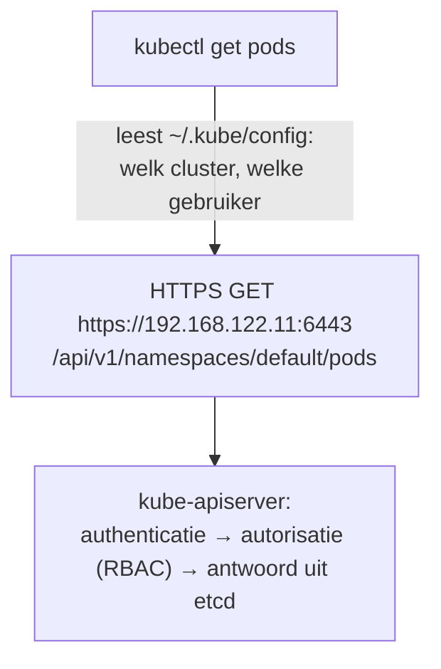

Opbouw van elk commando: **werkwoord · resourcetype · naam · opties** (`kubectl get pod web --namespace=dev --output=yaml`).

| Werkwoord | Doet |
|---|---|
| `get` / `describe` | opvragen (kort / uitgebreid met events) |
| `create` / `run` / `expose` | imperatief aanmaken |
| `apply` / `delete` | declaratief toepassen / verwijderen |
| `edit` / `patch` / `set` / `scale` | wijzigen |
| `logs` / `exec` / `port-forward` | met een container werken |

**Zie het zelf:**
```bash
kubectl get pods --all-namespaces --output=wide
kubectl get pods --namespace=kube-system --v=6 2>&1 | grep -m1 'GET https'   # de echte API-call
```
Bij `--v=6` zie je de URL waar kubectl naartoe gaat: dat is gewoon de API.

**Valkuilen en examentips:**
- kubectl mag maar **één minor-versie** van de cluster afwijken; daarom werk je op cp1 en niet op aristotle (kubectl 1.37).
- Leer de korte namen (`po`, `deploy`, `svc`, `ns`, `cm`, `pvc`) en `--output=wide`, `-o yaml`, `-o jsonpath`.
- Op het examen staat `alias k=kubectl` vaak al ingesteld; anders zet je het zelf (zie [kubeconfig](CONCEPTS.md#kubeconfig) voor contexts).

**Hangt samen met:** [kube-apiserver](CONCEPTS.md#kube-apiserver) · [kubeconfig en contexts](CONCEPTS.md#kubeconfig)

**Bronnen:** [kubectl](https://kubernetes.io/docs/reference/kubectl/) · [Quick Reference](https://kubernetes.io/docs/reference/kubectl/quick-reference/)

---

### imperatief-declaratief

**Imperatief vs declaratief** · Blok 0 · ✅ uitgewerkt

**Wat is het:** Twee manieren om het cluster te veranderen. **Imperatief:** je geeft een opdracht (`kubectl create deployment web --image=nginx`). **Declaratief:** je beschrijft de gewenste toestand in YAML en `kubectl apply -f` laat het cluster daaraan voldoen.

**Waarom bestaat het:** Imperatief is snel voor eenmalige dingen en op het examen. Declaratief is herhaalbaar, staat in git, is reviewbaar en is de basis van GitOps: je kunt hetzelfde bestand honderd keer toepassen en het resultaat blijft gelijk (idempotent).

**Vergeleken met wat je kent:** Imperatief = `docker run`. Declaratief = `docker compose up` met een `compose.yaml`, of Terraform en PowerShell DSC: je beschrijft het eindresultaat, de tool zoekt uit wat er moet gebeuren.

**Hoe werkt het:**

| | Imperatief | Declaratief |
|---|---|---|
| Commando | `create`, `run`, `expose`, `scale`, `set image` | `apply -f bestand.yaml` |
| Bestaat het al? | `create` geeft een fout | `apply` werkt het bij |
| Geschiedenis | alleen in je shell-history | in git |
| Gebruik | examen, snel testen | productie, GitOps |

`kubectl apply` onthoudt wat je de vorige keer toepaste (annotatie of server-side field managers) en kan zo velden verwijderen die je uit het bestand haalt.

**Zie het zelf:**
```bash
kubectl create deployment web --image=nginx:1.27          # imperatief
kubectl create deployment web --image=nginx:1.27          # tweede keer: AlreadyExists
kubectl get deployment web --output=yaml > web.yaml       # vastleggen als bestand
kubectl apply -f web.yaml                                 # declaratief: 'configured' of 'unchanged'
```

**Valkuilen en examentips:**
- Op het examen: **imperatief genereren, declaratief aanpassen**. Maak YAML met [dry-run](CONCEPTS.md#dry-run), pas aan in vim, `kubectl apply -f`.
- Meng niet zomaar `kubectl edit` en `apply` in productie: handmatige wijzigingen worden bij de volgende apply overschreven (dat is precies drift bij GitOps).

**Hangt samen met:** [YAML genereren met dry-run](CONCEPTS.md#dry-run) · [GitOps](CONCEPTS.md#gitops)

**Bronnen:** [Object management](https://kubernetes.io/docs/concepts/overview/working-with-objects/object-management/)

---

### dry-run

**YAML genereren met dry-run** · Blok 0 · ✅ uitgewerkt

**Wat is het:** `--dry-run=client --output=yaml` laat kubectl de YAML van een object tonen zonder het aan te maken.

**Waarom bestaat het:** YAML uit het hoofd typen is traag en foutgevoelig (inspringing, veldnamen). Met dry-run laat je kubectl een correct startbestand maken, dat je daarna alleen nog aanvult.

**Vergeleken met wat je kent:** Zoals `terraform plan` of `-WhatIf` in PowerShell: laten zien wat er zou gebeuren, zonder het te doen. Bij kubectl krijg je bovendien de complete YAML.

**Hoe werkt het:**

| Variant | Wat gebeurt er |
|---|---|
| `--dry-run=client` | kubectl bouwt het object lokaal; niets naar de API-server |
| `--dry-run=server` | de API-server valideert alles (ook admission), maar slaat niets op |

Op cp1 staat `$do` al ingesteld als `--dry-run=client -o yaml`.

**Zie het zelf:**
```bash
kubectl run web --image=nginx:1.27 $do > pod.yaml
kubectl create deployment web --image=nginx:1.27 --replicas=3 $do > deploy.yaml
kubectl create job hallo --image=busybox:1.36 $do -- echo hallo > job.yaml
kubectl expose deployment web --port=80 $do                          # werkt alleen als 'web' al bestaat
kubectl apply -f deploy.yaml --dry-run=server                         # laat de server controleren
```

**Valkuilen en examentips:**
- Niet elk type heeft een `create`-commando (bijv. DaemonSet, PV, PVC, NetworkPolicy). Truc: genereer een Deployment en pas `kind` en velden aan, of kopieer een voorbeeld uit de docs.
- `kubectl run` maakt een **Pod**, `kubectl create deployment` een **Deployment**. Lees de vraag goed.
- Gebruik `--` voor het commando in de container: `kubectl run t --image=busybox:1.36 $do -- sleep 3600`.

**Hangt samen met:** [Imperatief vs declaratief](CONCEPTS.md#imperatief-declaratief) · [kubectl, de CLI](CONCEPTS.md#kubectl)

**Bronnen:** [Quick Reference](https://kubernetes.io/docs/reference/kubectl/quick-reference/)

---

### kubeconfig

**kubeconfig en contexts** · Blok 0 · ✅ uitgewerkt

**Wat is het:** Het bestand (standaard `~/.kube/config`) waarin kubectl leest met welk cluster het praat en als wie. Het bevat drie lijsten: **clusters** (API-adres en CA), **users** (certificaat of token) en **contexts** (een combinatie van cluster, gebruiker en standaard-namespace).

**Waarom bestaat het:** Je werkt vaak met meerdere clusters en identiteiten. Met contexts wissel je met één commando, in plaats van steeds adressen en certificaten op te geven.

**Vergeleken met wat je kent:** `docker context` doet hetzelfde voor Docker-hosts. In Azure lijkt het op `az account set` om van subscription te wisselen, of `az aks get-credentials`, dat juist een kubeconfig-context toevoegt.

**Hoe werkt het:**

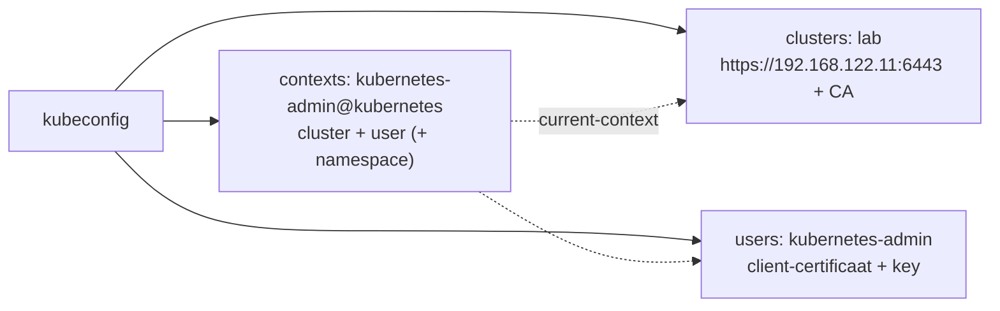

Op cp1 is `~/.kube/config` een kopie van `/etc/kubernetes/admin.conf` (zie `cp-init.sh`).

**Zie het zelf:**
```bash
kubectl config get-contexts                       # * = actieve context
kubectl config view --minify                      # alleen de actieve context, certificaten verborgen
kubectl config set-context --current --namespace=dev   # standaard-namespace wisselen
kubectl config use-context <naam>                 # andere context
```

**Valkuilen en examentips:**
- **Examen:** elke vraag begint met een `kubectl config use-context ...`-regel. Altijd eerst uitvoeren, anders werk je op het verkeerde cluster en is de vraag fout.
- `admin.conf` geeft volledige clusterrechten: niet delen.
- Een andere kubeconfig gebruiken: `kubectl --kubeconfig=/pad/naar/bestand` of `export KUBECONFIG=...`.

**Hangt samen met:** [Namespace](CONCEPTS.md#namespace) · [RBAC](CONCEPTS.md#rbac)

**Bronnen:** [Organizing cluster access](https://kubernetes.io/docs/concepts/configuration/organize-cluster-access-kubeconfig/)

---

### namespace

**Namespace** · Blok 0 · ✅ uitgewerkt

**Wat is het:** Een logische scheiding binnen één cluster. Namen hoeven alleen per namespace uniek te zijn, en RBAC, ResourceQuota, LimitRange en NetworkPolicies werken per namespace.

**Waarom bestaat het:** Om teams, omgevingen of apps in één cluster van elkaar te scheiden en per groep rechten en limieten te geven.

**Vergeleken met wat je kent:** Een beetje als een resource group in Azure: een map voor bij elkaar horende resources, waarop je rechten en beleid zet. Maar een namespace is **geen** netwerk- of beveiligingsgrens op zichzelf: Pods in verschillende namespaces kunnen elkaar standaard gewoon bereiken.

**Hoe werkt het:**

| Namespace | Inhoud |
|---|---|
| `default` | waar je terechtkomt als je niets opgeeft |
| `kube-system` | control plane en systeem-add-ons (CoreDNS, kube-proxy, CNI) |
| `kube-public` | voor iedereen leesbaar, bijv. `cluster-info` (zie [kubeadm join](CONCEPTS.md#kubeadm-join)) |
| `kube-node-lease` | heartbeats van de nodes (Lease-objecten) |

Niet alles zit in een namespace: Nodes, PersistentVolumes, StorageClasses, ClusterRoles en CRD's zijn **cluster-scoped**.

**Zie het zelf:**
```bash
kubectl get namespaces
kubectl api-resources --namespaced=false          # welke types cluster-breed zijn
kubectl create namespace dev && kubectl get pods --namespace=dev
kubectl --namespace=kube-node-lease get leases    # de heartbeats van je nodes
```

**Valkuilen en examentips:**
- Vergeet `--namespace` niet: veel examenvragen noemen een namespace en een object in de verkeerde namespace telt als fout.
- Een Service in een andere namespace bereik je via DNS als `<service>.<namespace>` (zie [CoreDNS](CONCEPTS.md#coredns)).
- `kubectl delete namespace x` verwijdert **alles** erin.

**Hangt samen met:** [RBAC](CONCEPTS.md#rbac) · [ResourceQuota en LimitRange](CONCEPTS.md#resourcequota-limitrange) · [NetworkPolicy](CONCEPTS.md#networkpolicy)

**Bronnen:** [Namespaces](https://kubernetes.io/docs/concepts/overview/working-with-objects/namespaces/)

---

### kubectl-explain

**kubectl explain en api-resources** · Blok 0 · ✅ uitgewerkt

**Wat is het:** Ingebouwde naslag in kubectl. `kubectl explain <type>.<veld>` toont de velden van een object met uitleg; `kubectl api-resources` toont alle types met hun korte naam, API-groep en of ze in een namespace zitten.

**Waarom bestaat het:** De API is groot en verandert per versie. Explain leest het schema rechtstreeks uit **jouw** cluster, dus het klopt altijd met de versie die je gebruikt, ook voor CRD's.

**Vergeleken met wat je kent:** Zoals `Get-Help` in PowerShell of `docker <cmd> --help`, maar dan voor de velden van YAML-objecten.

**Hoe werkt het:**

| Deel | Betekenis |
|---|---|
| `kubectl explain` | het commando |
| `deployment` | het **type** (resource) |
| `.spec.strategy` | het **pad** door de YAML, veld voor veld |

| Commando | Gebruik |
|---|---|
| `kubectl explain pod.spec.containers` | velden van één niveau |
| `kubectl explain pod.spec --recursive` | de hele boom in één keer |
| `kubectl api-resources` | alle types, korte namen, API-groep |
| `kubectl api-versions` | welke API-versies het cluster kent |

**Zie het zelf:**
```bash
kubectl explain pod.spec.containers.livenessProbe
kubectl explain networkpolicy.spec --recursive | less
kubectl api-resources | grep -i -E 'gateway|ingress|networkpolicy'
```

**Valkuilen en examentips:**
- Werkt zonder internet: snel nazoeken hoe een veld heet (bijv. `tolerations`, `nodeSelector`, `volumeMounts`) zonder de docs te openen.
- Voor CRD's werkt het ook, zolang de CRD een schema heeft (zie [CRD en CR](CONCEPTS.md#crd-cr)).

**Hangt samen met:** [kubectl, de CLI](CONCEPTS.md#kubectl) · [CRD en CR (Custom Resource)](CONCEPTS.md#crd-cr)

**Bronnen:** [Quick Reference](https://kubernetes.io/docs/reference/kubectl/quick-reference/)

---

## blok-1

**Blok 1 — Clusterarchitectuur, installatie en configuratie**

### kubeadm-join

**kubeadm join: hoe een node toetreedt** · Blok 1 · ✅ uitgewerkt

**Het probleem dat join oplost:** een nieuwe node en het cluster vertrouwen elkaar nog niet. Dat moet in **twee richtingen**:

1. **De worker moet de API-server vertrouwen.** Anders kan een nepserver zich als jouw cluster voordoen.
2. **De API-server moet de worker vertrouwen.** Anders kan elke machine zich als node aanmelden.

Het join-commando bevat voor beide richtingen een stuk:

| Deel van het join-commando | Wat het is | Welke richting |
|---|---|---|
| `192.168.122.11:6443` | waar de API-server is | — |
| `--token abc123.xyz789` | bootstrap-token: bewijst dat de node mag joinen | 2: het cluster vertrouwt de worker |
| `--discovery-token-ca-cert-hash sha256:4f2e...` | hash van de publieke key van de cluster-CA | 1: de worker vertrouwt het cluster |

**Stap 1: discovery, de worker controleert het cluster**
- De worker haalt de clusterinformatie op (het adres en het CA-certificaat). Die staat in een ConfigMap
  (`cluster-info` in namespace `kube-public`) die iedereen mag lezen.
- Hij berekent de hash van de publieke key van die CA en vergelijkt die met `--discovery-token-ca-cert-hash`.
  Klopt hij, dan praat hij met de **echte** API-server. Je "pint" de CA vooraf, zoals een SSH-fingerprint.

**Stap 2: TLS-bootstrap, het cluster laat de worker toe**

| Output van `kubeadm join` | Wat er gebeurt |
|---|---|
| `[kubelet-start] Writing kubelet configuration` | kubeadm schrijft `/var/lib/kubelet/config.yaml`, met de KubeletConfiguration uit je kubeadm-config (bijv. `cgroupDriver: systemd`) |
| `Waiting for a healthy kubelet` | de kubelet, die sinds node-prep steeds herstartte, heeft nu zijn config en blijft draaien |
| `Waiting for the kubelet to perform the TLS Bootstrap` | de kubelet heeft nog geen eigen certificaat. Hij logt tijdelijk in met het **token** en hoort dan bij de groep `system:bootstrappers`. Die groep mag alleen een certificaataanvraag (CSR) indienen |
| `Certificate signing request was sent to apiserver` | hij vraagt een client-certificaat aan op naam van `system:node:w1` |
| `a response was received` | de controller-manager keurt de CSR automatisch goed, en de cluster-CA ondertekent het certificaat |
| `informed of the new secure connection details` | de kubelet schrijft `/etc/kubernetes/kubelet.conf` met zijn **eigen** certificaat. Het token heeft hij vanaf nu niet meer nodig |

Daarna registreert de kubelet zich als Node-object. Hij blijft **NotReady** tot er een CNI is, maar hij hoort er wel bij.

**Waarom steeds een vers token?** Het token van `kubeadm init` is 24 uur geldig. Wil je later nog een node toevoegen, dan maak
je er een nieuw: `kubeadm token create --print-join-command`.

**Hoe weet je of de join gelukt is?** Een node die in `kubectl get nodes` staat, is gejoind. NotReady komt dan door de
ontbrekende CNI, niet door de join. Per onderdeel controleren zie je in L-03 van het [STUDIEPLAN](STUDIEPLAN.md) (blok 1).

| Wat je ziet | Betekent |
|---|---|
| de worker staat in `kubectl get nodes`, met IP en versie | gejoind: de kubelet is ingelogd en heeft het Node-object aangemaakt |
| per worker een CSR met `Approved,Issued`, aangevraagd door `system:bootstrap:<token-id>` | de TLS-bootstrap is gelukt (het token-ID is het deel van het token vóór de punt) |
| een CSR van `system:node:cp1` | cp1 had geen token nodig: `kubeadm init` gaf cp1 al een eigen identiteit |
| `Ready=False` met *"cni plugin not initialized"*, terwijl `LastHeartbeatTime` blijft bijwerken | alles goed, alleen de CNI ontbreekt. Een kapotte kubelet geeft óók NotReady, maar dan staat de heartbeat stil |

Vergelijk met Docker Swarm: `docker swarm join --token` werkt net zo. Daar zit de CA-hash in het token zelf, bij kubeadm geef je hem apart mee.

**Hangt samen met:** [kubeadm init](CONCEPTS.md#kubeadm-init) · [Certificaten en PKI](CONCEPTS.md#certificaten-pki) · [CNI: het Pod-netwerk](CONCEPTS.md#cni) · [Control plane vs worker (vroeger 'master')](CONCEPTS.md#control-plane)

**Bronnen:** [kubeadm join](https://kubernetes.io/docs/reference/setup-tools/kubeadm/kubeadm-join/) · [Kubelet TLS bootstrapping](https://kubernetes.io/docs/reference/access-authn-authz/kubelet-tls-bootstrapping/)

---

### control-plane

**Control plane vs worker (vroeger 'master')** · Blok 1 · ✅ uitgewerkt

"Master" is de oude naam. Kubeadm zet het label `node-role.kubernetes.io/master` sinds 1.24 niet meer, en de bijbehorende
taint verdween in 1.25. Nu heet het **control plane**. In het lab is dat cp1 (`ROLES control-plane`), en w1 en w2 zijn workers (`<none>`).

| | Control plane (cp1) | Workers (w1, w2) |
|---|---|---|
| Wat draait er | **kube-apiserver** (de voordeur, alles gaat via hem), **etcd** (de database met alle clusterstatus), **kube-scheduler** (kiest per Pod een node), **kube-controller-manager** (houdt bijvoorbeeld het aantal replicas kloppend) | jouw apps |
| Altijd op elke node | kubelet, containerd, kube-proxy | kubelet, containerd, kube-proxy |
| Waar je het ziet | `ls /etc/kubernetes/manifests/` (static Pods) en `kubectl --namespace=kube-system get pods --output=wide` | `kubectl get pods --output=wide` |
| Apps erop? | **nee**, door de taint `node-role.kubernetes.io/control-plane:NoSchedule` | ja |

**Labels die kubeadm op de control plane zet:**
- `node-role.kubernetes.io/control-plane=`: de waarde is leeg, alleen de naam telt. Hieruit haalt `kubectl` de kolom **ROLES**.
- `node.kubernetes.io/exclude-from-external-load-balancers=`: een externe load balancer stuurt geen app-verkeer naar de control plane.

**Taint:** `node-role.kubernetes.io/control-plane:NoSchedule`. De scheduler plaatst hier geen Pods, tenzij een Pod een
bijpassende **toleration** heeft. De control-plane-Pods staan er wel: dat zijn static Pods, die de kubelet zelf start, buiten de
scheduler om. Zolang een node NotReady is, zet Kubernetes er zelf nog een taint bij: `node.kubernetes.io/not-ready:NoSchedule`.
Die verdwijnt na de CNI. Let op: `kubectl describe node | grep Taints` toont maar de eerste regel. Gebruik de jsonpath uit L-03 van het [STUDIEPLAN](STUDIEPLAN.md).

```bash
kubectl taint node cp1 node-role.kubernetes.io/control-plane:NoSchedule-   # weghalen (let op de '-' aan het eind)
kubectl taint node cp1 node-role.kubernetes.io/control-plane:NoSchedule    # terugzetten
```

**Wat gebeurt er als cp1 uitvalt?** De Pods op w1 en w2 blijven draaien, want de kubelets houden ze in leven. Maar er kan
niets meer **veranderen**: geen nieuwe Pods, geen herstel als een Pod crasht en geen `kubectl`. Met één control plane is cp1
dus een single point of failure. In productie draai je er daarom drie. Met drie houdt etcd quorum als er één wegvalt (twee van
de drie is nog een meerderheid). Daarvoor staat `controlPlaneEndpoint` al in de kubeadm-config.

**Examentip:** vragen gaan vaak over "de controlplane-node". Weet dat de componenten daar als static Pods in
`/etc/kubernetes/manifests/` staan. Verander je een bestand daar, dan start de kubelet de component vanzelf opnieuw
(zie `break.sh` scenario 1 en 4).

**Hangt samen met:** [Static Pods](CONCEPTS.md#static-pods) · [Taints en tolerations](CONCEPTS.md#taints-tolerations) · [HA control plane](CONCEPTS.md#ha-control-plane) · [Clusterarchitectuur: de componenten](CONCEPTS.md#cluster-architectuur)

**Bronnen:** [KEP-2067](https://github.com/kubernetes/enhancements/blob/master/keps/sig-cluster-lifecycle/kubeadm/2067-rename-master-label-taint/README.md) · [Taints and tolerations](https://kubernetes.io/docs/concepts/scheduling-eviction/taint-and-toleration/)

---

### cluster-architectuur

**Clusterarchitectuur: de componenten** · Blok 1 · ✅ uitgewerkt

**Wat is het:** Het overzicht van de onderdelen van een Kubernetes-cluster. Een **control plane** neemt beslissingen en bewaart de toestand; **nodes** draaien de containers.

**Waarom bestaat het:** Door de taken te verdelen kan het cluster zichzelf herstellen: de control plane weet wat er moet draaien, de nodes doen het werk en melden terug. Valt een node uit, dan plant de control plane het werk ergens anders in.

**Vergeleken met wat je kent:** In Docker is er één daemon per host die alles doet. In Kubernetes is die rol opgesplitst: één "brein" voor het hele cluster en per machine een agent. Vergelijk het met Azure: Azure Resource Manager (de API en de database) versus de hosts waar je VM's echt draaien.

**Hoe werkt het:**

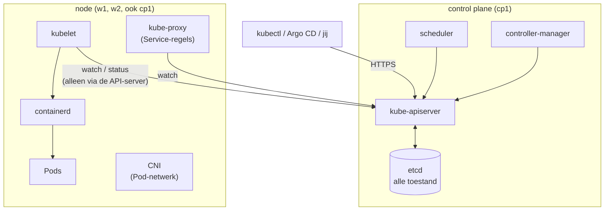

| Component | Waar | Taak |
|---|---|---|
| [kube-apiserver](CONCEPTS.md#kube-apiserver) | control plane | de enige ingang; praat als enige met etcd |
| [etcd](CONCEPTS.md#etcd) | control plane | database met de clustertoestand |
| [kube-scheduler](CONCEPTS.md#kube-scheduler) | control plane | kiest een node voor nieuwe Pods |
| [kube-controller-manager](CONCEPTS.md#kube-controller-manager) | control plane | herstel-loops (replicas, nodes, endpoints) |
| [kubelet](CONCEPTS.md#kubelet) | elke node | start Pods via de runtime, meldt status |
| [kube-proxy](CONCEPTS.md#kube-proxy) | elke node | vertaalt Services naar netwerkregels |
| [container runtime](CONCEPTS.md#container-runtime) | elke node | start de containers (containerd) |

**Zie het zelf:**
```bash
kubectl get pods --namespace=kube-system --output=wide   # wat draait waar
ls /etc/kubernetes/manifests/                             # control plane als static Pods (op cp1)
systemctl status kubelet containerd                       # de node-agents (gewone systemd-services)
```

**Valkuilen en examentips:**
- Alle communicatie loopt via de API-server: componenten praten niet rechtstreeks met elkaar of met etcd.
- kubelet en containerd zijn **systemd-services**, geen Pods. De control-plane-componenten zijn juist **Pods** (static Pods). Bij troubleshooting kijk je dus op twee plekken: `systemctl`/`journalctl` en `crictl`/`kubectl`.

**Hangt samen met:** [Control plane vs worker (vroeger 'master')](CONCEPTS.md#control-plane) · [kube-apiserver](CONCEPTS.md#kube-apiserver) · [kubelet](CONCEPTS.md#kubelet)

**Bronnen:** [Cluster components](https://kubernetes.io/docs/concepts/overview/components/)

---

### kube-apiserver

**kube-apiserver** · Blok 1 · ✅ uitgewerkt

**Wat is het:** De voordeur van het cluster. Alle andere componenten, `kubectl` en tools als Argo CD lezen en schrijven alleen via de API-server. Het is ook de enige component die met etcd praat.

**Waarom bestaat het:** Eén centrale plek waar elk verzoek wordt gecontroleerd (wie ben je, mag je dit, voldoet het aan het beleid) voordat het in etcd komt. Zo blijft de toestand consistent en controleerbaar.

**Vergeleken met wat je kent:** Zoals Azure Resource Manager: elke `az`-opdracht, elke portal-klik en elke Terraform-run gaat via dezelfde API, met dezelfde autorisatie. Bij Docker is dat de Docker Engine-API op `/var/run/docker.sock`, maar zonder echte rechtencontrole.

**Hoe werkt het:** elk verzoek gaat door een vaste keten:

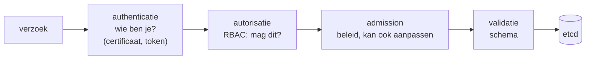

Daarnaast kunnen clients **watchen**: ze krijgen een melding zodra een object verandert. Zo weten kubelet, scheduler en controllers direct dat er werk is.

**Zie het zelf:**
```bash
kubectl get --raw /healthz; echo                    # ok
kubectl get --raw /api/v1/namespaces | head -c 300  # de API zelf, zonder kubectl-opmaak
sudo grep -E 'etcd-servers|authorization-mode|service-cluster-ip-range' /etc/kubernetes/manifests/kube-apiserver.yaml
```

**Valkuilen en examentips:**
- Werkt `kubectl` niet ("connection refused" op poort 6443), dan is meestal de API-server down. Kijk op cp1 met `sudo crictl ps -a | grep apiserver` en `sudo crictl logs <id>`, of in `/var/log/pods/`.
- Een typfout in `/etc/kubernetes/manifests/kube-apiserver.yaml` laat de API-server crashen. De kubelet probeert hem steeds opnieuw te starten (zie `break.sh` scenario 1).

**Hangt samen met:** [etcd](CONCEPTS.md#etcd) · [RBAC](CONCEPTS.md#rbac) · [Control plane vs worker (vroeger 'master')](CONCEPTS.md#control-plane)

**Bronnen:** [Cluster components](https://kubernetes.io/docs/concepts/overview/components/)

---

### etcd

**etcd** · Blok 1 · ✅ uitgewerkt

**Wat is het:** Een gedistribueerde key-value-database waarin Kubernetes de volledige clustertoestand bewaart: alle objecten, hun spec en status.

**Waarom bestaat het:** Kubernetes werkt met "gewenste toestand". Die moet ergens betrouwbaar en consistent bewaard worden, ook als een server uitvalt. etcd gebruikt het Raft-algoritme zodat meerdere leden het altijd eens zijn over de data.

**Vergeleken met wat je kent:** De database achter Azure Resource Manager, of de state-file van Terraform, maar dan live en gedeeld. Kwijt = cluster kwijt: alle Deployments, Secrets en configuratie zijn weg (de containers zelf draaien nog even door).

**Hoe werkt het:**

| Kenmerk | Uitleg |
|---|---|
| Key-value | objecten staan onder sleutels als `/registry/pods/default/web-...` |
| Quorum | een meerderheid moet het eens zijn: bij 3 leden mag er 1 uitvallen, bij 5 leden 2 |
| Alleen via de API-server | geen enkele andere component praat met etcd |
| TLS | client-certificaten uit `/etc/kubernetes/pki/etcd/` |

In het lab draait etcd als static Pod op cp1, met de data in `/var/lib/etcd`.

**Zie het zelf (op cp1):**
```bash
sudo etcdctl --endpoints=https://127.0.0.1:2379 --cacert=/etc/kubernetes/pki/etcd/ca.crt \
  --cert=/etc/kubernetes/pki/etcd/server.crt --key=/etc/kubernetes/pki/etcd/server.key \
  endpoint status --write-out=table
sudo etcdctl --endpoints=https://127.0.0.1:2379 --cacert=/etc/kubernetes/pki/etcd/ca.crt \
  --cert=/etc/kubernetes/pki/etcd/server.crt --key=/etc/kubernetes/pki/etcd/server.key \
  get /registry/namespaces --prefix --keys-only
```

**Valkuilen en examentips:**
- De certificaatpaden voor `etcdctl` staan in `/etc/kubernetes/manifests/etcd.yaml`. Kopieer ze daaruit, niet uit je hoofd.
- Secrets staan standaard **onversleuteld** in etcd (zie [Secret](CONCEPTS.md#secret)).
- Een even aantal leden (2, 4) heeft geen zin: het tolereert niet meer uitval dan het oneven getal eronder.

**Hangt samen met:** [etcd backup en restore](CONCEPTS.md#etcd-backup) · [HA control plane](CONCEPTS.md#ha-control-plane) · [kube-apiserver](CONCEPTS.md#kube-apiserver)

**Bronnen:** [Operating etcd](https://kubernetes.io/docs/tasks/administer-cluster/configure-upgrade-etcd/)

---

### kube-scheduler

**kube-scheduler** · Blok 1 · ✅ uitgewerkt

**Wat is het:** De control-plane-component die voor elke nieuwe Pod zonder node een geschikte node kiest.

**Waarom bestaat het:** Iemand moet beslissen waar werk komt, op basis van vrije capaciteit en regels (taints, affinity, spreiding). De scheduler doet dat centraal, zodat nodes niet overvol raken.

**Vergeleken met wat je kent:** Docker Swarm heeft ook een scheduler; bij `docker run` op één host is er niets te kiezen. In Azure lijkt het op de plaatsing van een VM in een zone of op een host, maar dan per Pod en continu.

**Hoe werkt het:** twee fases per Pod:

| Fase | Wat |
|---|---|
| **Filteren** | welke nodes kúnnen het: genoeg requests vrij, taint getolereerd, nodeSelector/affinity klopt, poort vrij |
| **Scoren** | welke van die nodes is het best: spreiding, minst belast, voorkeuren (preferred affinity) |

Daarna schrijft de scheduler alleen `spec.nodeName` in de Pod (de *binding*). De kubelet van die node ziet dat en start de Pod.

**Zie het zelf:**
```bash
kubectl run sched --image=nginx:1.27
kubectl get pod sched --output=wide                         # NODE-kolom
kubectl get events --field-selector=involvedObject.name=sched   # 'Scheduled ... assigned default/sched to w1'
```

**Valkuilen en examentips:**
- Pod blijft **Pending** zonder node: lees de events. Typische meldingen: *Insufficient cpu/memory*, *untolerated taint*, *didn't match node affinity*.
- Is de scheduler zelf kapot (bijv. verkeerd image in zijn manifest), dan blijven **alle** nieuwe Pods Pending (zie `break.sh` scenario 4).
- Met `spec.nodeName` direct in de Pod-YAML sla je de scheduler over.

**Hangt samen met:** [Requests en limits](CONCEPTS.md#requests-limits) · [Taints en tolerations](CONCEPTS.md#taints-tolerations) · [nodeSelector en affinity](CONCEPTS.md#nodeselector-affinity)

**Bronnen:** [kube-scheduler](https://kubernetes.io/docs/concepts/scheduling-eviction/kube-scheduler/)

---

### kube-controller-manager

**kube-controller-manager en controllers** · Blok 1 · ✅ uitgewerkt

**Wat is het:** Eén proces dat alle ingebouwde **controllers** draait. Een controller is een lus die de gewenste toestand (spec) vergelijkt met de echte toestand (status) en het verschil wegwerkt.

**Waarom bestaat het:** Dit is wat Kubernetes zelfherstellend maakt. Je zegt "3 replicas", en als er een Pod verdwijnt, maakt de ReplicaSet-controller er vanzelf een nieuwe.

**Vergeleken met wat je kent:** PowerShell DSC in *ApplyAndAutoCorrect*: de LCM controleert steeds of de machine nog klopt met de configuratie en corrigeert. Kubernetes doet dat met tientallen controllers tegelijk, elk voor één soort object.

**Hoe werkt het:**

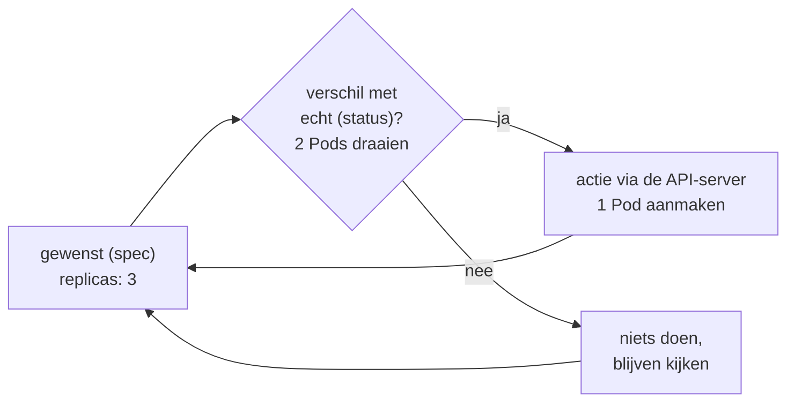

| Voorbeelden van controllers | Taak |
|---|---|
| Deployment / ReplicaSet | aantal Pods en rolling updates |
| Node | merkt uitgevallen nodes op, zet taints |
| EndpointSlice | houdt bij welke Pods achter een Service zitten |
| ServiceAccount, Job, CronJob, Namespace | elk hun eigen object |
| CSR-approving | keurt kubelet-certificaataanvragen goed (zie [kubeadm join](CONCEPTS.md#kubeadm-join)) |

**Zie het zelf:**
```bash
kubectl create deployment heal --image=nginx:1.27 --replicas=3
kubectl delete pod --selector=app=heal --wait=false; kubectl get pods --selector=app=heal --watch   # nieuwe Pods verschijnen
```

**Valkuilen en examentips:**
- Is de controller-manager down, dan draaien bestaande Pods door, maar er gebeurt geen herstel meer: geen nieuwe replicas, geen endpoints-updates.
- Operators (zie [Operator](CONCEPTS.md#operator)) zijn hetzelfde patroon, maar dan als losse Pod voor jouw eigen objecttypes.

**Hangt samen met:** [ReplicaSet](CONCEPTS.md#replicaset) · [Operator](CONCEPTS.md#operator)

**Bronnen:** [Controllers](https://kubernetes.io/docs/concepts/architecture/controller/)

---

### kubelet

**kubelet** · Blok 1 · ✅ uitgewerkt

**Wat is het:** De agent op elke node. Hij haalt op welke Pods op zijn node horen, laat de container runtime ze starten, voert probes uit, mount volumes en meldt de status (heartbeat) aan de API-server. Hij start ook de static Pods.

**Waarom bestaat het:** De control plane beslist, maar iemand op de machine zelf moet het uitvoeren en bewaken. Dat is de kubelet.

**Vergeleken met wat je kent:** Een beetje als de Docker-daemon, maar hij start zelf geen containers: dat laat hij aan containerd over. Vergelijkbaar met de Azure VM-agent of de DSC Local Configuration Manager: een lokale agent die opdrachten van een centrale plek uitvoert en status terugmeldt.

**Hoe werkt het:**

| Onderdeel | Waar |
|---|---|
| Service | `systemctl status kubelet` (systemd, geen Pod) |
| Config | `/var/lib/kubelet/config.yaml` (KubeletConfiguration, door kubeadm geschreven) |
| Vlaggen | `/var/lib/kubelet/kubeadm-flags.env` |
| Kubeconfig (eigen identiteit) | `/etc/kubernetes/kubelet.conf` |
| Static Pods | `/etc/kubernetes/manifests/` (`staticPodPath` in de config) |
| Logs | `journalctl -u kubelet` |

Heartbeat: de kubelet werkt elke paar seconden een Lease bij in `kube-node-lease`. Stopt dat, dan zet de node-controller de node op NotReady (status Unknown).

**Zie het zelf:**
```bash
systemctl status kubelet --no-pager
sudo journalctl -u kubelet --since "10 min ago" --no-pager | tail -20
kubectl get node w1 --output=jsonpath='{.status.conditions[?(@.type=="Ready")]}'; echo
```

**Valkuilen en examentips:**
- Node NotReady: begin **op die node** met `systemctl status kubelet` en `journalctl -u kubelet`. Kubelet gestopt of disabled is een klassieker (zie `break.sh` scenario 2).
- Na het wijzigen van `config.yaml`: `sudo systemctl restart kubelet`.
- Fout in de cgroup-driver of een ontbrekende runtime-socket zie je ook in de kubelet-log.

**Hangt samen met:** [Container runtime en CRI](CONCEPTS.md#container-runtime) · [Static Pods](CONCEPTS.md#static-pods) · [Probes (liveness, readiness, startup)](CONCEPTS.md#probes)

**Bronnen:** [kubelet](https://kubernetes.io/docs/reference/command-line-tools-reference/kubelet/)

---

### kube-proxy

**kube-proxy** · Blok 1 · ✅ uitgewerkt

**Wat is het:** Een component op elke node die [Services](CONCEPTS.md#service) vertaalt naar netwerkregels, zodat verkeer naar een ClusterIP bij een van de Pods achter die Service uitkomt.

**Waarom bestaat het:** Een ClusterIP is virtueel: er is geen machine die dat IP heeft. Op elke node moeten dus regels staan die het verkeer omleiden naar echte Pod-IP's, en die regels moeten meebewegen als Pods komen en gaan.

**Vergeleken met wat je kent:** Docker's port-publishing (`-p 8080:80`) maakt ook iptables-regels, maar per container op één host. kube-proxy doet het voor elke Service op elke node, met load balancing over alle Pods. Vergelijk met een Azure Load Balancer, maar dan als regels in de kernel van elke node.

**Hoe werkt het:**

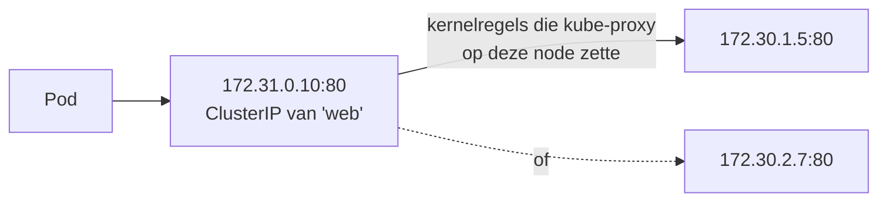

kube-proxy kijkt (watch) naar Services en EndpointSlices en zet regels in **iptables** (standaard op Linux), **IPVS** of **nftables**. Het draait als DaemonSet in `kube-system`. Sommige CNI's, zoals Cilium, kunnen kube-proxy volledig vervangen.

**Zie het zelf:**
```bash
kubectl --namespace=kube-system get daemonset kube-proxy
kubectl --namespace=kube-system get configmap kube-proxy --output=yaml | grep -m1 'mode:'
sudo iptables -t nat -L KUBE-SERVICES | head -15      # op een node: de Service-regels
```

**Valkuilen en examentips:**
- Service geeft geen antwoord: controleer eerst de [EndpointSlices](CONCEPTS.md#endpointslice) (selector, readiness, targetPort). kube-proxy zelf is zelden de oorzaak.
- `ping` naar een ClusterIP werkt meestal niet (alleen de poorten van de Service hebben regels). Test met `wget` of `curl`.

**Hangt samen met:** [Service](CONCEPTS.md#service) · [Endpoints en EndpointSlices](CONCEPTS.md#endpointslice)

**Bronnen:** [Cluster components](https://kubernetes.io/docs/concepts/overview/components/)

---

### container-runtime

**Container runtime en CRI** · Blok 1 · ✅ uitgewerkt

**Wat is het:** De software die echt containers start en stopt. In het lab is dat **containerd**. De kubelet praat ermee via de **Container Runtime Interface (CRI)**, een gRPC-API over een socket (`/run/containerd/containerd.sock`).

**Waarom bestaat het:** Kubernetes wil niet vastzitten aan één runtime. Met een standaard interface (CRI) kun je containerd, CRI-O of een andere runtime gebruiken zonder de kubelet aan te passen.

**Vergeleken met wat je kent:** Docker Engine gebruikt onder water zelf containerd. Kubernetes slaat de Docker-laag over en praat direct met containerd. Je Docker-images werken gewoon: het zijn OCI-images. Docker Engine als runtime (via dockershim) wordt sinds Kubernetes 1.24 niet meer ondersteund.

**Hoe werkt het:**

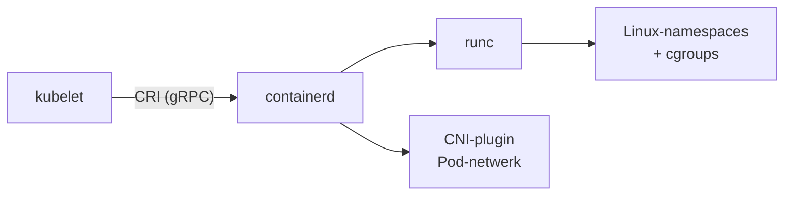

| Instelling | Waarom |
|---|---|
| `SystemdCgroup = true` | dezelfde cgroup-driver als de kubelet (systemd), anders instabiele nodes |
| socket in `/etc/crictl.yaml` | zodat [crictl](CONCEPTS.md#crictl) weet waar containerd luistert |

**Zie het zelf:**
```bash
systemctl status containerd --no-pager
sudo crictl info | head -20
sudo crictl pods && sudo crictl ps
grep SystemdCgroup /etc/containerd/config.toml
```

**Valkuilen en examentips:**
- containerd gestopt: de node wordt NotReady en de kubelet-log meldt dat hij de runtime niet bereikt (zie `break.sh` scenario 3).
- `docker`-commando's bestaan niet op de nodes; gebruik `crictl` (zelfde idee: `ps`, `images`, `logs`, `inspect`).
- Containerd heeft namespaces: Kubernetes-containers staan in `k8s.io` (`sudo ctr --namespace k8s.io containers list`).

**Hangt samen met:** [kubelet](CONCEPTS.md#kubelet) · [crictl](CONCEPTS.md#crictl) · [CNI: het Pod-netwerk](CONCEPTS.md#cni)

**Bronnen:** [Container runtimes](https://kubernetes.io/docs/setup/production-environment/container-runtimes/)

---

### static-pods

**Static Pods** · Blok 1 · ✅ uitgewerkt

**Wat is het:** Pods die de kubelet zelf start vanuit YAML-bestanden in een map op de node (`/etc/kubernetes/manifests/`), zonder scheduler en zonder dat de API-server hoeft te draaien.

**Waarom bestaat het:** Kip-en-ei: de API-server is zelf een Pod. Iets moet hem starten voordat er een API-server is. Dat doet de kubelet, rechtstreeks vanuit bestanden. Zo draait de hele control plane bij kubeadm.

**Vergeleken met wat je kent:** Zoals systemd-unit-bestanden in `/etc/systemd/system/`: leg een bestand neer en de service start. Of als `docker run --restart=always` vanuit een bestand: de kubelet houdt ze in leven.

**Hoe werkt het:**

| Kenmerk | Uitleg |
|---|---|
| Map | `staticPodPath` in `/var/lib/kubelet/config.yaml` (standaard `/etc/kubernetes/manifests`) |
| Bestand wijzigen | de kubelet ziet het en start de Pod opnieuw met de nieuwe inhoud |
| Bestand weghalen | de Pod stopt |
| In `kubectl get pods` | een *mirror Pod* met de nodenaam erachter, bijv. `kube-apiserver-cp1` |
| `kubectl delete` | verwijdert alleen de mirror; de kubelet maakt hem direct opnieuw |

**Zie het zelf:**
```bash
ls /etc/kubernetes/manifests/                                  # op cp1
sudo grep staticPodPath /var/lib/kubelet/config.yaml
kubectl --namespace=kube-system get pods | grep -- '-cp1'      # de mirror Pods
```

**Valkuilen en examentips:**
- Examenvraag "maak een static Pod op node X": genereer YAML met [dry-run](CONCEPTS.md#dry-run), ssh naar die node, zet het bestand in de manifest-map. Klaar; geen `kubectl apply`.
- Control-plane-problemen los je op **in deze bestanden**, niet met `kubectl edit`.
- Zet geen backup-kopieën (`kube-apiserver.yaml.bak`) in dezelfde map: de kubelet probeert ook die te starten.

**Hangt samen met:** [Control plane vs worker (vroeger 'master')](CONCEPTS.md#control-plane) · [kubelet](CONCEPTS.md#kubelet)

**Bronnen:** [Static Pods](https://kubernetes.io/docs/tasks/configure-pod-container/static-pod/)

---

### kubeadm-init

**kubeadm init** · Blok 1 · ✅ uitgewerkt

**Wat is het:** Het kubeadm-commando dat op een lege, voorbereide machine een control plane opzet.

**Waarom bestaat het:** Een control plane met de hand opzetten betekent tientallen certificaten, configbestanden en manifests maken. kubeadm doet dat volgens de best practices, herhaalbaar, en zet het cluster klaar om nodes te laten joinen.

**Vergeleken met wat je kent:** `docker swarm init` doet hetzelfde voor Swarm: de eerste manager maken en een join-token geven. Bij AKS doet Azure dit voor je; daar zie je de control plane niet eens.

**Hoe werkt het:** `kubeadm init` voert fases uit (zie `kubeadm init --help`):

| Fase | Resultaat |
|---|---|
| preflight | controles: swap uit, poorten vrij, runtime bereikbaar, modules geladen |
| certs | CA en certificaten in `/etc/kubernetes/pki/` |
| kubeconfig | `admin.conf`, `kubelet.conf`, `controller-manager.conf`, `scheduler.conf` |
| control-plane / etcd | static-Pod-manifests in `/etc/kubernetes/manifests/` |
| kubelet-start | kubelet-config schrijven en kubelet (her)starten |
| upload-config, mark-control-plane | config als ConfigMap in het cluster, label en taint op de node |
| bootstrap-token | token voor joinen, plus de rechten voor TLS-bootstrap |
| addon | CoreDNS en kube-proxy |

**Zie het zelf:**
```bash
kubeadm config print init-defaults                       # alle instelbare velden
kubeadm init --help | sed -n '/Init workflow/,/^$/p'      # de lijst met fases
kubectl --namespace=kube-system get configmap kubeadm-config --output=yaml | head -30
```
Oefen het echt vanaf snapshot `prepped` (STUDIEPLAN L-02).

**Valkuilen en examentips:**
- Geef de **pod-CIDR** op die je CNI verwacht (`--pod-network-cidr`), anders werkt het Pod-netwerk niet.
- Na init: kubeconfig kopiëren (`mkdir -p ~/.kube && sudo cp /etc/kubernetes/admin.conf ~/.kube/config`), dan een CNI installeren.
- Mislukt? `sudo kubeadm reset -f` ruimt op, daarna opnieuw.

**Hangt samen met:** [kubeadm join: hoe een node toetreedt](CONCEPTS.md#kubeadm-join) · [Certificaten en PKI](CONCEPTS.md#certificaten-pki) · [Static Pods](CONCEPTS.md#static-pods)

**Bronnen:** [kubeadm init](https://kubernetes.io/docs/reference/setup-tools/kubeadm/kubeadm-init/)

---

### certificaten-pki

**Certificaten en PKI** · Blok 1 · ✅ uitgewerkt

**Wat is het:** Alle componenten van het cluster praten via TLS en bewijzen wie ze zijn met certificaten. Die worden ondertekend door de cluster-CA in `/etc/kubernetes/pki/`. Samen heet dat de PKI (public key infrastructure) van het cluster.

**Waarom bestaat het:** Zonder certificaten kan iedereen zich voordoen als API-server of als node. Met wederzijdse TLS (mTLS) controleren beide kanten elkaar, en de naam in het certificaat (bijv. `system:node:w1`) is meteen de identiteit voor RBAC.

**Vergeleken met wat je kent:** Net als je eigen interne CA of Key Vault-certificaten: een CA ondertekent, clients vertrouwen de CA. Verschil: bij kubeadm is de CA van het cluster zelf, en certificaten verlopen standaard na een jaar.

**Hoe werkt het:**

| Bestand (in `/etc/kubernetes/pki/`) | Gebruik |
|---|---|
| `ca.crt` / `ca.key` | cluster-CA (10 jaar geldig) |
| `apiserver.crt` | serving-certificaat van de API-server |
| `apiserver-kubelet-client.crt` | API-server als client naar de kubelets |
| `etcd/ca.crt`, `etcd/server.crt` | aparte CA en certificaten voor etcd |
| `front-proxy-*`, `sa.key`/`sa.pub` | aggregatie-laag en ondertekening van ServiceAccount-tokens |

Client-certificaten van kubeadm zijn **1 jaar** geldig. `kubeadm upgrade` vernieuwt ze automatisch.

**Zie het zelf:**
```bash
sudo kubeadm certs check-expiration
sudo openssl x509 -in /etc/kubernetes/pki/apiserver.crt -noout -subject -dates -ext subjectAltName
```

**Valkuilen en examentips:**
- Handmatig vernieuwen: `sudo kubeadm certs renew all`, daarna de control-plane-Pods herstarten (niet alle componenten laden nieuwe certificaten vanzelf).
- Verlopen certificaten zijn een klassieke oorzaak van "kubectl werkt ineens niet meer" na een jaar.
- `admin.conf` bevat ook een certificaat dat verloopt: kopieer hem opnieuw naar `~/.kube/config` na vernieuwen.

**Hangt samen met:** [kubeadm join: hoe een node toetreedt](CONCEPTS.md#kubeadm-join) · [kube-apiserver](CONCEPTS.md#kube-apiserver)

**Bronnen:** [PKI certificates](https://kubernetes.io/docs/setup/best-practices/certificates/) · [kubeadm certs](https://kubernetes.io/docs/tasks/administer-cluster/kubeadm/kubeadm-certs/)

---

### cluster-upgrade

**Cluster upgraden** · Blok 1 · ✅ uitgewerkt

**Wat is het:** Een kubeadm-cluster naar een nieuwere Kubernetes-versie brengen, één minor-versie per keer (1.35 → 1.36), in een vaste volgorde.

**Waarom bestaat het:** Elke minor-versie wordt ongeveer een jaar ondersteund. Je moet dus regelmatig upgraden voor beveiligingsfixes en nieuwe features. De volgorde voorkomt dat componenten met een te grote versieafstand met elkaar praten.

**Vergeleken met wat je kent:** Bij AKS is het één klik of `az aks upgrade`. Bij kubeadm doe je zelf wat AKS onder water doet: eerst de control plane, dan node voor node, met drain zodat apps blijven draaien. Vergelijkbaar met rolling patching van een cluster Windows-servers.

**Hoe werkt het:**

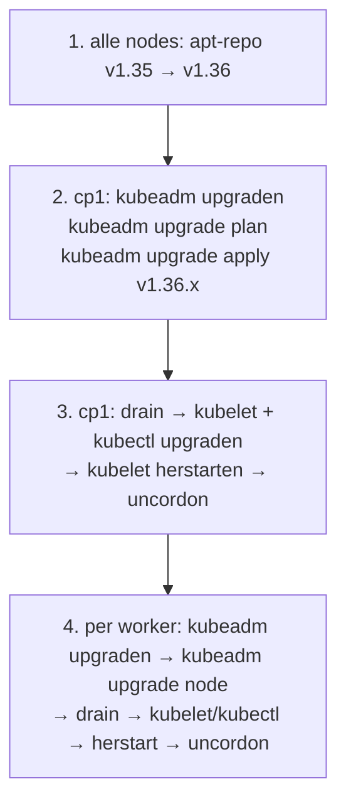

| Regel | Waarom |
|---|---|
| geen minor-versies overslaan | kubeadm ondersteunt alleen +1 |
| control plane eerst | de API-server mag nieuwer zijn dan de kubelets, niet andersom |
| `apt-mark unhold`/`hold` | de pakketten staan vast tegen per-ongeluk-upgrades |

**Zie het zelf:** volg INIT stap 5 (maak eerst `./snapshot.sh save pre-upgrade`) en controleer daarna:
```bash
kubectl get nodes                                  # VERSION per node
kubeadm version -o short && kubelet --version
```

**Valkuilen en examentips:**
- Op het examen staat de upgrade vaak in de vraag als "upgrade de control plane naar versie X". Lees of ook de workers moeten.
- `kubeadm upgrade apply` alleen op de **eerste** control plane; op andere nodes `kubeadm upgrade node`.
- Vergeet `systemctl daemon-reload && systemctl restart kubelet` niet; anders draait de oude kubelet door.
- De officiële docs staan op het examen open: volg die stap voor stap.

**Hangt samen met:** [Drain, cordon en uncordon](CONCEPTS.md#drain-cordon) · [kubeadm init](CONCEPTS.md#kubeadm-init)

**Bronnen:** [kubeadm upgrade](https://kubernetes.io/docs/tasks/administer-cluster/kubeadm/kubeadm-upgrade/)

---

### drain-cordon

**Drain, cordon en uncordon** · Blok 1 · ✅ uitgewerkt

**Wat is het:** Commando's voor node-onderhoud. **Cordon:** geen nieuwe Pods meer op de node. **Drain:** cordon plus de bestaande Pods netjes verwijderen, zodat hun controllers ze elders opnieuw starten. **Uncordon:** de node weer vrijgeven.

**Waarom bestaat het:** Voor onderhoud (upgrade, reboot, hardware) wil je een node leeg hebben zonder dat apps uitvallen.

**Vergeleken met wat je kent:** Vergelijkbaar met een Hyper-V- of failover-clusternode in onderhoudsmodus zetten (rollen verplaatsen). In Docker Swarm: `docker node update --availability drain`.

**Hoe werkt het:**

| Commando | Effect |
|---|---|
| `kubectl cordon w1` | node krijgt `unschedulable` (taint `node.kubernetes.io/unschedulable`) |
| `kubectl drain w1 --ignore-daemonsets` | cordon + Pods evicten, respecteert PodDisruptionBudgets |
| `kubectl uncordon w1` | weer inplanbaar; bestaande Pods komen niet vanzelf terug |

Drain weigert standaard bij: DaemonSet-Pods (daarom `--ignore-daemonsets`), Pods met `emptyDir` (`--delete-emptydir-data`), en losse Pods zonder controller (`--force`; die zijn daarna echt weg).

**Zie het zelf:**
```bash
kubectl create deployment spread --image=nginx:1.27 --replicas=4
kubectl drain w1 --ignore-daemonsets && kubectl get pods --output=wide   # alles staat nu op w2
kubectl get nodes                                                          # w1: SchedulingDisabled
kubectl uncordon w1
```

**Valkuilen en examentips:**
- Na uncordon worden Pods niet teruggezet: de spreiding herstelt pas bij nieuwe Pods of een rollout.
- Een te streng PodDisruptionBudget kan drain laten hangen.
- Drain doe je **vanaf** een machine met kubectl (cp1), niet op de node zelf.

**Hangt samen met:** [Cluster upgraden](CONCEPTS.md#cluster-upgrade) · [Taints en tolerations](CONCEPTS.md#taints-tolerations)

**Bronnen:** [Safely drain a node](https://kubernetes.io/docs/tasks/administer-cluster/safely-drain-node/)

---

### etcd-backup

**etcd backup en restore** · Blok 1 · ✅ uitgewerkt

**Wat is het:** Een snapshot van de etcd-database maken (`etcdctl snapshot save`) en die later terugzetten (`etcdutl snapshot restore`), zodat je de clustertoestand van dat moment terugkrijgt.

**Waarom bestaat het:** etcd is de enige plek met de clustertoestand. Bij corruptie, een foute upgrade of een per ongeluk verwijderde namespace is een snapshot je redding.

**Vergeleken met wat je kent:** Zoals een backup van de Terraform-state of een database-dump. Let op het verschil met je libvirt-snapshots: die zetten de hele VM terug, een etcd-snapshot alleen de Kubernetes-objecten (geen data in PV's).

**Hoe werkt het:**

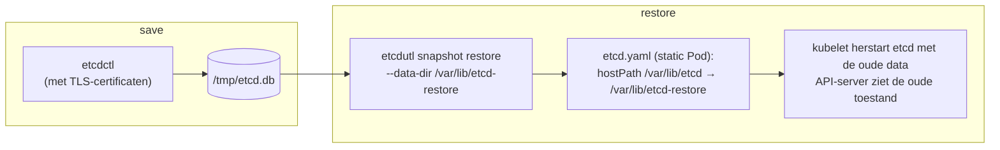

`etcdctl snapshot restore` is deprecated; gebruik `etcdutl` (zelfde versie als etcd; in het lab installeert `cp-init.sh` beide).

**Zie het zelf:** volg INIT stap 5 (maak een namespace ná de backup en zie hem na de restore verdwijnen).
```bash
sudo etcdutl snapshot status /tmp/etcd.db --write-out=table    # klopt de snapshot?
```

**Valkuilen en examentips:**
- De certificaatvlaggen (`--cacert`, `--cert`, `--key`) en het endpoint haal je uit `/etc/kubernetes/manifests/etcd.yaml`.
- Bij restore pas je in `etcd.yaml` het **hostPath** van het data-volume aan. Daarna even wachten: etcd en de API-server herstarten.
- Examen: lees goed waar de snapshot moet komen te staan (exact pad).

**Hangt samen met:** [etcd](CONCEPTS.md#etcd) · [Static Pods](CONCEPTS.md#static-pods)

**Bronnen:** [Operating etcd](https://kubernetes.io/docs/tasks/administer-cluster/configure-upgrade-etcd/)

---

### rbac

**RBAC** · Blok 1 · ✅ uitgewerkt

**Wat is het:** Role-Based Access Control. Een **Role** of **ClusterRole** zegt wat mag (werkwoorden op resources); een **RoleBinding** of **ClusterRoleBinding** koppelt die rechten aan wie (user, group of ServiceAccount).

**Waarom bestaat het:** Niet iedereen en niet elke app mag alles. RBAC geeft per identiteit precies de rechten die nodig zijn (least privilege).

**Vergeleken met wat je kent:** Azure RBAC: een roldefinitie (bijv. Reader) toegewezen aan een principal op een scope. Role ≈ roldefinitie, RoleBinding ≈ roltoewijzing, namespace ≈ scope (resource group), Cluster-varianten ≈ subscription-scope.

**Hoe werkt het:**

| | Geldt in | Koppelen met |
|---|---|---|
| Role | één namespace | RoleBinding |
| ClusterRole | hele cluster, of herbruikbaar per namespace | ClusterRoleBinding (cluster-breed) of RoleBinding (alleen die namespace) |

```yaml
rules:
- apiGroups: [""]            # "" = de core-groep (pods, services, ...)
  resources: ["pods"]
  verbs: ["get", "list", "watch"]
```

RBAC is alleen *toestaan*: er bestaan geen weigerregels. Geen regel = geen toegang.

**Zie het zelf:** volg STUDIEPLAN L-04, en:
```bash
kubectl auth can-i --list --as=system:serviceaccount:dev:ci --namespace=dev
kubectl get clusterroles | grep -E '^(view|edit|admin|cluster-admin) '    # standaardrollen
```

**Valkuilen en examentips:**
- Snel aanmaken: `kubectl create role|clusterrole|rolebinding|clusterrolebinding` met `--verb`, `--resource`, `--serviceaccount=ns:naam` of `--user`.
- Controleer **altijd** met `kubectl auth can-i ... --as=...`.
- Subresources tellen apart: `pods/log` voor logs, `pods/exec` voor exec.
- `list` en `watch` op Secrets geven ook de inhoud: behandel ze als `get`.

**Hangt samen met:** [ServiceAccount](CONCEPTS.md#serviceaccount) · [Namespace](CONCEPTS.md#namespace)

**Bronnen:** [RBAC](https://kubernetes.io/docs/reference/access-authn-authz/rbac/)

---

### serviceaccount

**ServiceAccount** · Blok 1 · ✅ uitgewerkt

**Wat is het:** De identiteit van een Pod (of een proces in het cluster) tegenover de API-server. Rechten krijgt hij via [RBAC](CONCEPTS.md#rbac).

**Waarom bestaat het:** Apps die met de Kubernetes-API praten (operators, CI, monitoring) hebben een eigen identiteit nodig, los van mensen. En met Workload Identity wordt hetzelfde token gebruikt om bij Azure in te loggen.

**Vergeleken met wat je kent:** Een managed identity in Azure: een identiteit die bij een workload hoort, zonder wachtwoord. Bij Workload Identity federeert Entra precies dit ServiceAccount-token.

**Hoe werkt het:**

| Kenmerk | Uitleg |
|---|---|
| Per namespace | elke namespace heeft een `default`-ServiceAccount |
| In de Pod | `spec.serviceAccountName`; het token wordt gemount in `/var/run/secrets/kubernetes.io/serviceaccount/` |
| Token | kortlevend en gebonden aan de Pod (projected token), ondertekend met `sa.key` |
| Uitzetten | `automountServiceAccountToken: false` als de app de API niet nodig heeft |

**Zie het zelf:**
```bash
kubectl create serviceaccount demo
kubectl run sa-test --image=busybox:1.36 --overrides='{"spec":{"serviceAccountName":"demo"}}' -- sleep 3600
kubectl exec sa-test -- cat /var/run/secrets/kubernetes.io/serviceaccount/namespace; echo
kubectl create token demo --duration=10m | cut -d. -f2 | base64 -d 2>/dev/null; echo   # de claims in het token
```

**Valkuilen en examentips:**
- Een ServiceAccount zonder RoleBinding mag (bijna) niets. Rechten geven = RoleBinding met `--serviceaccount=<namespace>:<naam>`.
- `serviceAccountName` van een draaiende Pod kun je niet wijzigen; verander de Deployment.
- Als identiteit in RBAC heet hij `system:serviceaccount:<namespace>:<naam>`.

**Hangt samen met:** [RBAC](CONCEPTS.md#rbac) · [Pod](CONCEPTS.md#pod)

**Bronnen:** [Service accounts](https://kubernetes.io/docs/concepts/security/service-accounts/)

---

### labels-selectors

**Labels en selectors** · Blok 1 · ✅ uitgewerkt

**Wat is het:** Labels zijn key/value-paren op objecten (`app=web`, `tier=frontend`). Selectors kiezen objecten op basis van die labels. Zo koppelt Kubernetes losse objecten aan elkaar.

**Waarom bestaat het:** Kubernetes koppelt niet op naam of ID, maar op labels. Daardoor kan een Service steeds wisselende Pods vinden, en kan een Deployment zijn eigen Pods herkennen.

**Vergeleken met wat je kent:** Tags in Azure, maar dan met een functie: een Azure-tag is metadata, een Kubernetes-label bepaalt actief welke Pods achter een Service zitten. In Docker Compose zou je dit op servicenaam doen.

**Hoe werkt het:**

| Wie selecteert | Op wat |
|---|---|
| Service | `spec.selector` → Pods |
| Deployment / ReplicaSet | `spec.selector.matchLabels` → zijn eigen Pods |
| NetworkPolicy | `podSelector`, `namespaceSelector` |
| Scheduling | `nodeSelector`, affinity → node-labels |

Selectors: gelijkheid (`app=web`, `app!=web`) en verzameling (`env in (prod,acc)`).

**Zie het zelf:**
```bash
kubectl get pods --show-labels
kubectl get pods --selector=app=web
kubectl label pod <pod> tier=frontend && kubectl get pods --label-columns=tier
kubectl get endpointslices --selector=kubernetes.io/service-name=web
```

**Valkuilen en examentips:**
- Service zonder endpoints = bijna altijd een selector die niet klopt met de Pod-labels (typfout, zie `break.sh` scenario 8).
- De selector van een Deployment is na aanmaken niet meer te wijzigen.
- Annotations lijken op labels, maar zijn alleen informatie: je kunt er niet op selecteren.

**Hangt samen met:** [Service](CONCEPTS.md#service) · [Deployment en rolling updates](CONCEPTS.md#deployment) · [nodeSelector en affinity](CONCEPTS.md#nodeselector-affinity)

**Bronnen:** [Labels and selectors](https://kubernetes.io/docs/concepts/overview/working-with-objects/labels/)

---

### csi

**CSI** · Blok 1 · ✅ uitgewerkt

**Wat is het:** De Container Storage Interface: een standaard waarmee opslagleveranciers drivers voor Kubernetes maken. Net als CNI (netwerk) en CRI (runtime) is het een extensie-interface.

**Waarom bestaat het:** Vroeger zat opslagcode in Kubernetes zelf (in-tree). Elke nieuwe opslag vereiste een Kubernetes-release. Met CSI kan elke leverancier een eigen driver bouwen en losstaand bijwerken.

**Vergeleken met wat je kent:** Docker-volume-plugins doen hetzelfde voor Docker. In AKS zijn de Azure Disk- en Azure Files-drivers CSI-drivers; die zie je terug als StorageClasses `managed-csi` en `azurefile-csi`.

**Hoe werkt het:**

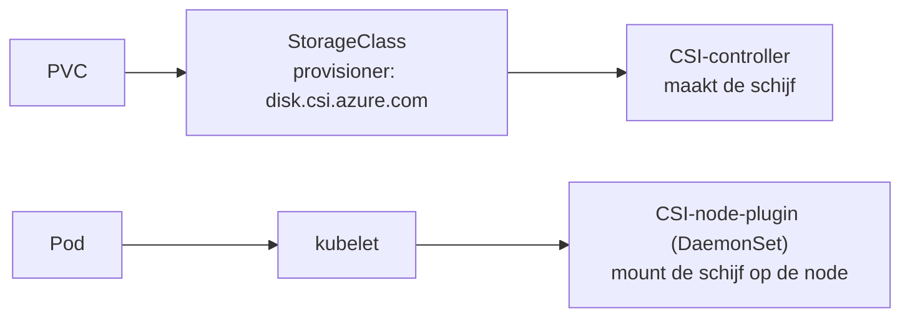

| Interface | Voor | Voorbeeld |
|---|---|---|
| CRI | containers | containerd |
| CNI | netwerk | Calico, Cilium |
| CSI | opslag | Azure Disk, Ceph, local-path (geen echte CSI) |

**Zie het zelf:**
```bash
kubectl get csidrivers
kubectl get storageclass --output=custom-columns=NAME:.metadata.name,PROVISIONER:.provisioner
```
In het lab is de lijst met CSI-drivers waarschijnlijk leeg: local-path is een eenvoudige provisioner zonder CSI.

**Valkuilen en examentips:**
- Op het examen hoef je geen CSI-driver te installeren; wel weten dat CSI, CNI en CRI de drie extensie-interfaces zijn.
- ReadWriteOncePod en volume-snapshots werken alleen met CSI-volumes.

**Hangt samen met:** [StorageClass en dynamische provisioning](CONCEPTS.md#storageclass) · [CNI: het Pod-netwerk](CONCEPTS.md#cni) · [Container runtime en CRI](CONCEPTS.md#container-runtime)

**Bronnen:** [Volumes: CSI](https://kubernetes.io/docs/concepts/storage/volumes/#csi)

---

### helm

**Helm** · Blok 1 · ✅ uitgewerkt

**Wat is het:** De package manager voor Kubernetes. Een **chart** is een pakket YAML-sjablonen met instelbare waarden (`values.yaml`). Een geïnstalleerde chart heet een **release**.

**Waarom bestaat het:** Een app als Traefik of Prometheus bestaat uit tientallen objecten. Helm installeert, upgradet en verwijdert ze als één geheel, met versiebeheer en rollback.

**Vergeleken met wat je kent:** `apt` of `winget` voor Kubernetes. Of een Terraform-module: één pakket met variabelen (`--set` / `values.yaml`) dat veel resources aanmaakt.

**Hoe werkt het:**

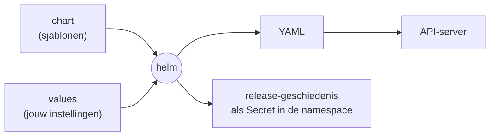

| Commando | Doet |
|---|---|
| `helm repo add` / `helm repo update` | chart-bron toevoegen of bijwerken |
| `helm install <release> <chart> --set x=y` | installeren |
| `helm upgrade --install` | installeren of bijwerken |
| `helm history` / `helm rollback <release> <rev>` | geschiedenis / terug |
| `helm template` | YAML tonen zonder te installeren |

**Zie het zelf:** STUDIEPLAN L-05, en:
```bash
helm list --all-namespaces
kubectl get secrets --all-namespaces --field-selector=type=helm.sh/release.v1   # hier bewaart Helm releases
```

**Valkuilen en examentips:**
- `helm show values <chart>` laat alle instelbare waarden zien.
- Een release hoort bij een namespace; vergeet `--namespace` niet bij `helm list` en `upgrade`.
- In GitOps: Argo CD rendert de chart zelf (`helm template`), Flux voert echt `helm install/upgrade` uit.

**Hangt samen met:** [Kustomize](CONCEPTS.md#kustomize) · [GitOps](CONCEPTS.md#gitops)

**Bronnen:** [Using Helm](https://helm.sh/docs/intro/using_helm/)

---

### kustomize

**Kustomize** · Blok 1 · ✅ uitgewerkt

**Wat is het:** Een tool, ingebouwd in kubectl (`kubectl apply --kustomize` of `-k`), die basis-YAML per omgeving aanpast met **overlays**, zonder sjablonen.

**Waarom bestaat het:** Je wilt dezelfde app in dev, acc en prod, met kleine verschillen (replicas, namespace, image-tag). Kustomize laat de basis onaangeroerd en legt er per omgeving patches overheen.

**Vergeleken met wat je kent:** Helm werkt met sjablonen en variabelen, Kustomize met gewone YAML plus patches. Vergelijkbaar met Terraform-modules met per omgeving een eigen `tfvars`, maar dan door samenvoegen van YAML.

**Hoe werkt het:**

```text
base/                     overlays/prod/
├── deployment.yaml       └── kustomization.yaml
├── service.yaml              resources: [../../base]
└── kustomization.yaml        namespace: prod
                              replicas: [{name: web, count: 5}]
```

**Zie het zelf:** STUDIEPLAN L-05, en:
```bash
kubectl kustomize overlays/prod          # toon de samengevoegde YAML
kubectl apply --kustomize=overlays/prod
```

**Valkuilen en examentips:**
- Het bestand heet altijd `kustomization.yaml`.
- Niet verwarren met de Flux-`Kustomization` (een CR die een map uit git toepast).
- `configMapGenerator` maakt ConfigMaps met een hash in de naam: wijzig je de inhoud, dan rolt de Deployment automatisch uit.

**Hangt samen met:** [Helm](CONCEPTS.md#helm) · [Flux](CONCEPTS.md#flux)

**Bronnen:** [Kustomize](https://kubernetes.io/docs/tasks/manage-kubernetes-objects/kustomization/)

---

### crd-cr

**CRD en CR (Custom Resource)** · Blok 1 · ✅ uitgewerkt

**Wat is het:** Een **CRD** (CustomResourceDefinition) voegt een nieuw objecttype toe aan de Kubernetes-API, bijv. `ExternalSecret` of `Application`. Een **CR** (Custom Resource) is een object van zo'n type: jouw YAML.

**Waarom bestaat het:** Zo kan iedereen Kubernetes uitbreiden met eigen objecten, die je met dezelfde tools beheert (kubectl, RBAC, GitOps) als Pods en Services.

**Vergeleken met wat je kent:** Docker kun je geen eigen objecttypes leren. Vergelijk met een database: de CRD is de tabeldefinitie, een CR een rij, en een controller het programma dat de tabel leest en ernaar handelt.

**Hoe werkt het:**

| Stap | Wie |
|---|---|
| CRD installeren (schema, naam, scope) | de maker van de tool (bijv. ESO-installatie) |
| CR aanmaken | jij, met YAML |
| CR opslaan in etcd | de API-server, zoals elk object |
| Er iets mee doen | een controller of [operator](CONCEPTS.md#operator); zonder controller gebeurt er niets |

**Zie het zelf:** STUDIEPLAN L-06, en:
```bash
kubectl get crd
kubectl api-resources --api-group=crd.projectcalico.org | head      # na Calico
kubectl explain ipaddresspool.spec                                  # na MetalLB
```

**Valkuilen en examentips:**
- Bij het verwijderen van een CRD verdwijnen alle CR's van dat type.
- Examen: CR's kunnen opvragen, bekijken en toepassen. Een CRD zelf schrijven hoeft meestal niet.
- Sommige CRD's zijn zo groot dat je ze met `kubectl apply --server-side` moet installeren.

**Hangt samen met:** [Operator](CONCEPTS.md#operator) · [kubectl explain en api-resources](CONCEPTS.md#kubectl-explain)

**Bronnen:** [Custom Resources](https://kubernetes.io/docs/concepts/extend-kubernetes/api-extension/custom-resources/)

---

### operator

**Operator** · Blok 1 · ✅ uitgewerkt

**Wat is het:** Een controller met domeinkennis die een complexe applicatie beheert via eigen [CR's](CONCEPTS.md#crd-cr): installeren, configureren, failover, backups, upgrades.

**Waarom bestaat het:** Een database of een netwerkplugin vraagt beheerkennis die een Deployment niet heeft (wie is primary, hoe doe je een failover). Een operator legt die kennis vast in software die continu bijstuurt.

**Vergeleken met wat je kent:** Een DBA of beheerder in een Pod. Zoals PowerShell DSC-resources domeinkennis hebben over hoe een rol of feature in te stellen, heeft een operator dat voor zijn app, maar dan continu (reconcile-loop).

**Hoe werkt het:**

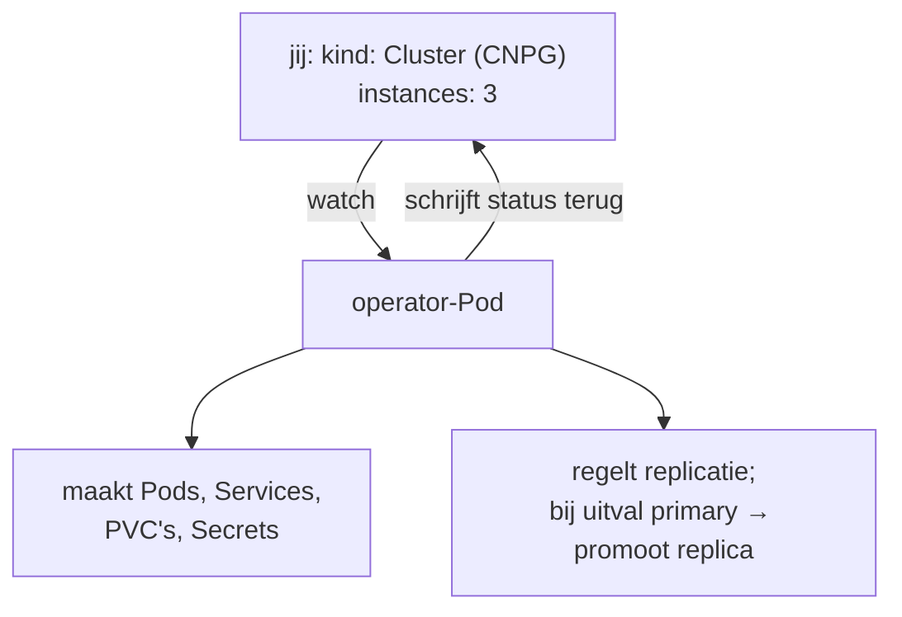

| Voorbeeld | CR |
|---|---|
| Calico (tigera-operator) | `Installation`, `TigeraStatus` |
| CloudNativePG | `Cluster`, `ScheduledBackup` |
| External Secrets | `ExternalSecret`, `SecretStore` |
| Trivy Operator | `VulnerabilityReport` |

**Zie het zelf:**
```bash
kubectl --namespace=tigera-operator get pods            # na Calico
kubectl get installation default --output=yaml | head -40
kubectl get tigerastatus
```

**Valkuilen en examentips:**
- Wijzig objecten die een operator beheert niet met de hand: de operator zet ze terug. Pas de CR aan.
- Problemen? Kijk in de **status** van de CR en in de logs van de operator-Pod.

**Hangt samen met:** [CRD en CR (Custom Resource)](CONCEPTS.md#crd-cr) · [kube-controller-manager en controllers](CONCEPTS.md#kube-controller-manager)

**Bronnen:** [Operator pattern](https://kubernetes.io/docs/concepts/extend-kubernetes/operator/)

---

### ha-control-plane

**HA control plane** · Blok 1 · ✅ uitgewerkt

**Wat is het:** Meerdere control-plane-nodes (meestal drie) achter een load balancer, zodat het cluster beheerbaar blijft als er één uitvalt.

**Waarom bestaat het:** Met één control plane (zoals in het lab) is cp1 een single point of failure: valt hij uit, dan draaien de apps door, maar er kan niets meer veranderen of herstellen.

**Vergeleken met wat je kent:** Een failover-cluster met een quorum, of een Docker Swarm met drie managers. In AKS is de control plane standaard al redundant (met de uptime-SLA-optie).

**Hoe werkt het:**

| Topologie | etcd | Plus | Min |
|---|---|---|---|
| **Stacked** | op dezelfde nodes als de control plane | minder machines, kubeadm-standaard | valt een node uit, dan ook een etcd-lid |
| **Extern etcd** | op eigen machines | onafhankelijk van de control plane | meer machines en beheer |

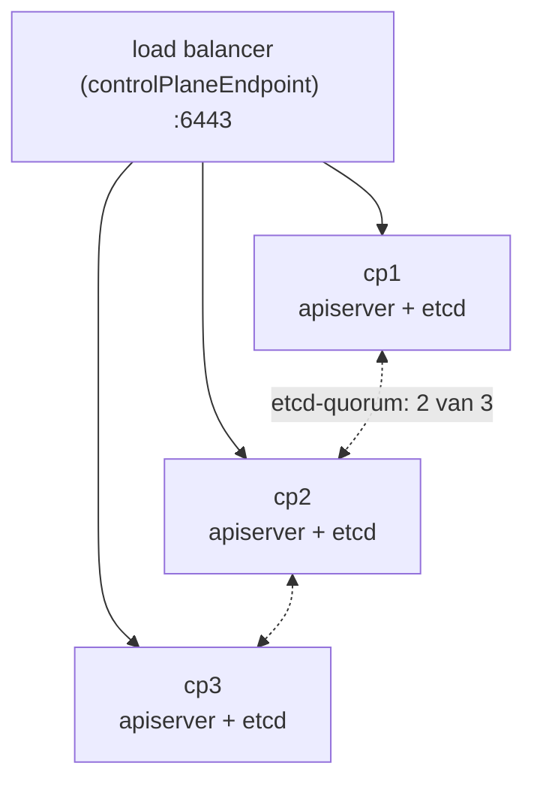

Joinen als extra control plane: `kubeadm join ... --control-plane --certificate-key ...`.

**Zie het zelf:** in het lab heb je één control plane; bekijk wel het voorbereide eindpunt:
```bash
kubectl --namespace=kube-system get configmap kubeadm-config --output=jsonpath='{.data.ClusterConfiguration}' | grep controlPlaneEndpoint
```

**Valkuilen en examentips:**
- `controlPlaneEndpoint` moet je **bij init** instellen; achteraf toevoegen is lastig.
- Altijd een oneven aantal control planes vanwege het etcd-quorum.
- CKA: concept kennen (stacked vs extern), niet volledig opbouwen.

**Hangt samen met:** [Control plane vs worker (vroeger 'master')](CONCEPTS.md#control-plane) · [etcd](CONCEPTS.md#etcd)

**Bronnen:** [HA topology](https://kubernetes.io/docs/setup/production-environment/tools/kubeadm/ha-topology/)

---

### csr-gebruikers

**Gebruikers en certificaten via de CSR-API** · Blok 1 · ✅ uitgewerkt

**Wat is het:** Kubernetes heeft geen gebruikersobjecten. Een "gebruiker" is iemand met een client-certificaat dat de cluster-CA heeft ondertekend; de **CN** is de gebruikersnaam, de **O**-velden zijn de groepen. Met de **CertificateSigningRequest-API** vraag je zo'n certificaat aan en keur je het goed, zonder bij `ca.key` te hoeven.

**Waarom bestaat het:** Om mensen of tools een eigen identiteit te geven, met eigen rechten via [RBAC](CONCEPTS.md#rbac), in plaats van iedereen `admin.conf` te geven.

**Vergeleken met wat je kent:** Een certificaataanvraag bij een interne CA (een CSR in ADCS of Key Vault), maar dan met `kubectl`. Dezelfde API gebruikt de kubelet bij de TLS-bootstrap van [kubeadm join](CONCEPTS.md#kubeadm-join).

**Hoe werkt het:**

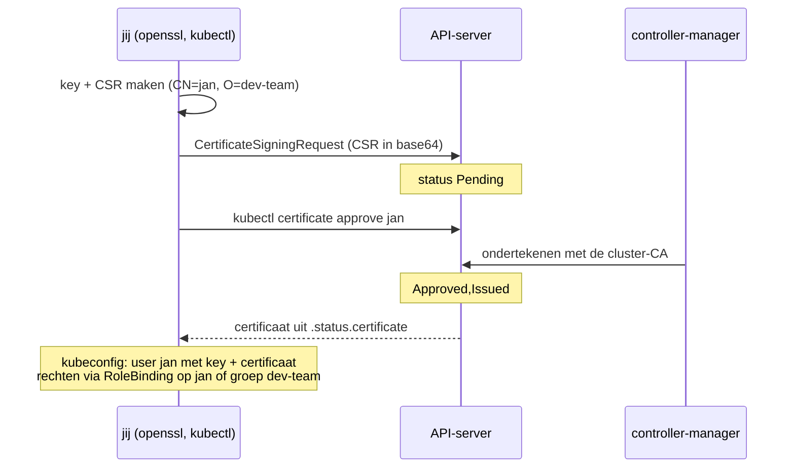

| Veld | Waarde |
|---|---|
| `signerName` | `kubernetes.io/kube-apiserver-client` (client-certificaat voor de API) |
| `usages` | `client auth` |
| `expirationSeconds` | geldigheid, bijv. `86400` (één dag) |

**Zie het zelf:** STUDIEPLAN L-33, of in het kort:
```bash
openssl genrsa -out jan.key 3072 && openssl req -new -key jan.key -out jan.csr -subj "/CN=jan/O=dev-team"
cat <<EOF | kubectl apply -f -
apiVersion: certificates.k8s.io/v1
kind: CertificateSigningRequest
metadata: {name: jan}
spec:
  request: $(base64 -w0 < jan.csr)
  signerName: kubernetes.io/kube-apiserver-client
  expirationSeconds: 86400
  usages: [client auth]
EOF
kubectl certificate approve jan && kubectl get csr jan --output=jsonpath='{.status.certificate}' | base64 -d > jan.crt
```

**Valkuilen en examentips:**
- Een certificaat kun je niet intrekken; houd `expirationSeconds` kort.
- Zonder RoleBinding mag de nieuwe gebruiker niets: controleer met `kubectl auth can-i --list --as=jan`.
- Kubeconfig toevoegen: `kubectl config set-credentials jan --client-key=jan.key --client-certificate=jan.crt --embed-certs` en `kubectl config set-context jan --cluster=kubernetes --user=jan`.

**Hangt samen met:** [RBAC](CONCEPTS.md#rbac) · [Certificaten en PKI](CONCEPTS.md#certificaten-pki) · [kubeconfig](CONCEPTS.md#kubeconfig) · [kubeadm join](CONCEPTS.md#kubeadm-join)

**Bronnen:** [Issue a certificate for an API client](https://kubernetes.io/docs/tasks/tls/certificate-issue-client-csr/) · [Certificate Signing Requests](https://kubernetes.io/docs/reference/access-authn-authz/certificate-signing-requests/)

---

### owners-finalizers

**Owner references, garbage collection en finalizers** · Blok 1 · ✅ uitgewerkt

**Wat is het:** Objecten hebben eigenaars: een Pod hoort bij een ReplicaSet, die bij een Deployment (`metadata.ownerReferences`). Verwijder je de eigenaar, dan ruimt de **garbage collector** de afhankelijke objecten op. Een **finalizer** is een "wacht even"-markering: het object wordt pas echt verwijderd als een controller zijn opruimwerk gedaan heeft en de finalizer weghaalt.

**Waarom bestaat het:** Zodat verwijderen netjes in de goede volgorde gaat: een Deployment neemt zijn Pods mee, een PVC wordt niet verwijderd zolang een Pod hem gebruikt, en een cloud-loadbalancer wordt eerst opgeruimd voordat de Service verdwijnt.

**Vergeleken met wat je kent:** Afhankelijkheden in Terraform (eerst de afhankelijke resource weg), of een resource lock in Azure die verwijderen blokkeert tot iemand hem weghaalt.

**Hoe werkt het:**

| Mechanisme | Effect |
|---|---|
| `ownerReferences` | wie de eigenaar is; zichtbaar in `kubectl get pod -o yaml` |
| cascading delete `--cascade=background` (standaard) | eigenaar weg, afhankelijke objecten daarna |
| `--cascade=foreground` | eerst de afhankelijke objecten, dan de eigenaar |
| `--cascade=orphan` | eigenaar weg, afhankelijke objecten blijven staan |
| `metadata.finalizers` | object krijgt `deletionTimestamp` en blijft in `Terminating` tot de lijst leeg is |

Bekende finalizers: `kubernetes.io/pvc-protection`, `kubernetes.io/pv-protection`, en `kubernetes` in een namespace.

**Zie het zelf:**
```bash
kubectl create deployment gc --image=nginx:1.27
kubectl get pod --selector=app=gc --output=jsonpath='{.items[0].metadata.ownerReferences[0].kind}'; echo
kubectl delete deployment gc --cascade=orphan && kubectl get replicasets,pods --selector=app=gc    # wees-objecten
kubectl get pvc --output=jsonpath='{.items[*].metadata.finalizers}'; echo
```

**Valkuilen en examentips:**
- Een namespace blijft in `Terminating` hangen als er nog objecten met finalizers in staan waarvan de controller weg is (bijv. CR's van een verwijderde operator). Zoek ze met `kubectl api-resources --verbs=list --namespaced -o name | xargs -n1 kubectl get -n <ns> --ignore-not-found`.
- Een finalizer met de hand weghalen (`kubectl patch ... -p '{"metadata":{"finalizers":null}}'`) slaat het opruimwerk over; alleen doen als je weet waarom.

**Hangt samen met:** [ReplicaSet](CONCEPTS.md#replicaset) · [kube-controller-manager](CONCEPTS.md#kube-controller-manager) · [PersistentVolume en PVC](CONCEPTS.md#pv-pvc) · [Namespace](CONCEPTS.md#namespace)

**Bronnen:** [Owners and dependents](https://kubernetes.io/docs/concepts/overview/working-with-objects/owners-dependents/) · [Finalizers](https://kubernetes.io/docs/concepts/overview/working-with-objects/finalizers/) · [Garbage collection](https://kubernetes.io/docs/concepts/architecture/garbage-collection/)

---

### cloud-controller-manager

**Cloud Controller Manager** · Blok 1 · ✅ uitgewerkt

**Wat is het:** Een control-plane-component die Kubernetes koppelt aan een cloudplatform. Hij maakt bijvoorbeeld een load balancer voor een Service van type LoadBalancer, zet routes, en vult node-informatie (zone, IP's) in vanuit de cloud.

**Waarom bestaat het:** Cloudspecifieke code hoort niet in de kern van Kubernetes. Door het in een aparte component te stoppen, kan elke cloudleverancier zijn eigen versie bouwen en los bijwerken.

**Vergeleken met wat je kent:** Het verklaart het verschil tussen je lab en AKS. In je kubeadm-lab draait er geen cloud-controller-manager: daarom blijft `EXTERNAL-IP` op `<pending>` tot je MetalLB installeert. In AKS draait Microsofts versie, die automatisch een Azure Load Balancer maakt.

**Hoe werkt het:**

| Controller in de CCM | Doet |
|---|---|
| node controller | node-labels als zone en instance-type, verwijdert nodes die in de cloud weg zijn |
| route controller | routes in het cloudnetwerk zodat Pods op verschillende nodes elkaar bereiken |
| service controller | maakt, wijzigt en verwijdert cloud-loadbalancers voor `type: LoadBalancer` |

Opslag (disks) zit niet meer in de CCM maar in [CSI-drivers](CONCEPTS.md#csi).

**Zie het zelf:**
```bash
kubectl --namespace=kube-system get pods | grep -i cloud-controller || echo "geen CCM: bare-metal/kubeadm-lab"
kubectl get node <aks-node> --show-labels | tr ',' '\n' | grep -E 'topology.kubernetes.io|instance-type'   # in AKS
```

**Valkuilen en examentips:**
- In AKS draait de CCM in de beheerde control plane; je ziet hem niet als Pod.
- CKA: weten dat hij bestaat en wat hij doet; installeren hoort er niet bij.

**Hangt samen met:** [Service type LoadBalancer en MetalLB](CONCEPTS.md#loadbalancer) · [AKS](CONCEPTS.md#aks) · [Clusterarchitectuur](CONCEPTS.md#cluster-architectuur) · [CSI](CONCEPTS.md#csi)

**Bronnen:** [Cloud Controller Manager](https://kubernetes.io/docs/concepts/architecture/cloud-controller/)

---

## blok-2

**Blok 2 — Workloads en scheduling**

### pod

**Pod** · Blok 2 · ✅ uitgewerkt

**Wat is het:** De kleinste eenheid die Kubernetes beheert: één of meer containers die samen één netwerk (één IP, gedeelde poorten) en volumes delen, en altijd samen op één node draaien.

**Waarom bestaat het:** Soms horen containers onlosmakelijk bij elkaar, zoals een app met een sidecar die logs doorstuurt. De Pod maakt van zo'n groep één eenheid die samen gepland, gestart en gestopt wordt.

**Vergeleken met wat je kent:** Een Pod is ongeveer een groep Docker-containers die met `--network container:<naam>` hetzelfde netwerk delen. Met één container is een Pod bijna gelijk aan `docker run`, maar dan met een eigen IP in het clusternetwerk.

**Hoe werkt het:**

| Onderdeel | Uitleg |
|---|---|
| `containers` | de hoofdcontainer(s) |
| `initContainers` | draaien eerst, één voor één, tot ze klaar zijn |
| `restartPolicy` | `Always` (standaard), `OnFailure`, `Never` |
| status-fases | `Pending` → `Running` → `Succeeded`/`Failed` (plus `Unknown`) |
| containerstatus | bijv. `ContainerCreating`, `CrashLoopBackOff`, `ImagePullBackOff`, `OOMKilled` |

Een Pod is **wegwerp**: gaat hij dood, dan maakt een controller (Deployment, Job) een nieuwe met een nieuw IP. Losse Pods zonder controller komen niet terug.

**Zie het zelf:**
```bash
kubectl run web --image=nginx:1.27
kubectl get pod web --output=wide                 # IP en node
kubectl describe pod web | sed -n '/Events/,$p'   # wat er gebeurde
kubectl exec -it web -- sh -c 'hostname; cat /etc/resolv.conf'
```

**Valkuilen en examentips:**
- De meeste velden van een draaiende Pod zijn niet te wijzigen. Truc: `kubectl get pod web -o yaml > pod.yaml`, aanpassen, `kubectl replace --force -f pod.yaml`.
- Multi-container Pod maken: genereer YAML met [dry-run](CONCEPTS.md#dry-run) en voeg een tweede item onder `containers` toe.
- Containers in één Pod bereiken elkaar via `localhost`.

**Hangt samen met:** [Deployment en rolling updates](CONCEPTS.md#deployment) · [CNI: het Pod-netwerk](CONCEPTS.md#cni) · [Probes (liveness, readiness, startup)](CONCEPTS.md#probes)

**Bronnen:** [Pods](https://kubernetes.io/docs/concepts/workloads/pods/)

---

### deployment

**Deployment en rolling updates** · Blok 2 · ✅ uitgewerkt

**Wat is het:** Het standaardobject voor stateless apps. Een Deployment beheert ReplicaSets en zorgt voor het gewenste aantal replicas, rolling updates naar een nieuwe versie en rollback.

**Waarom bestaat het:** Je wilt een nieuwe versie uitrollen zonder downtime en snel terug kunnen als het misgaat. De Deployment regelt dat stap voor stap en houdt de geschiedenis bij.

**Vergeleken met wat je kent:** Een Docker Compose-service met `replicas` plus `docker service update` uit Swarm (rolling update). In Azure lijkt het op een App Service met deployment slots, maar dan geleidelijk per Pod.

**Hoe werkt het:**

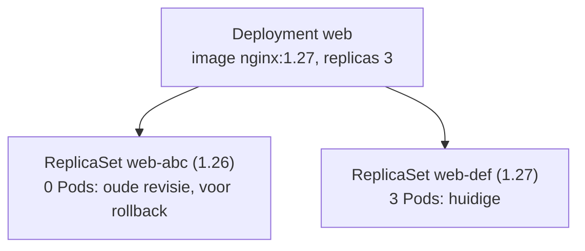

| Instelling | Betekenis |
|---|---|
| `strategy: RollingUpdate` | standaard: geleidelijk vervangen |
| `maxSurge` | hoeveel Pods er tijdelijk extra mogen zijn (standaard 25%) |
| `maxUnavailable` | hoeveel er tijdelijk mogen ontbreken (standaard 25%) |
| `strategy: Recreate` | eerst alles weg, dan nieuw (korte downtime) |
| `revisionHistoryLimit` | hoeveel oude ReplicaSets bewaard blijven |

**Zie het zelf:** STUDIEPLAN L-07, en:
```bash
kubectl set image deployment/web nginx=nginx:1.27 && kubectl rollout status deployment/web
kubectl rollout history deployment/web
kubectl rollout undo deployment/web --to-revision=1
kubectl get replicasets --selector=app=web
```

**Valkuilen en examentips:**
- Een rollout naar een niet-bestaand image blijft hangen; de oude Pods blijven draaien. `kubectl rollout undo` lost het op.
- `kubectl scale deployment web --replicas=5` of `kubectl edit`; vergeet niet dat GitOps het kan terugzetten.
- De containernaam in `set image` is de naam in de Pod-spec (bij `create deployment` gelijk aan de image-naam zonder tag).

**Hangt samen met:** [ReplicaSet](CONCEPTS.md#replicaset) · [Pod](CONCEPTS.md#pod) · [HorizontalPodAutoscaler](CONCEPTS.md#hpa)

**Bronnen:** [Deployments](https://kubernetes.io/docs/concepts/workloads/controllers/deployment/)

---

### replicaset

**ReplicaSet** · Blok 2 · ✅ uitgewerkt

**Wat is het:** Een controller die een vast aantal identieke Pods in leven houdt. Je maakt hem bijna nooit zelf; een [Deployment](CONCEPTS.md#deployment) maakt per versie een ReplicaSet.

**Waarom bestaat het:** De basis van zelfherstel: verdwijnt een Pod, dan maakt de ReplicaSet er een nieuwe bij; zijn er te veel, dan haalt hij er een weg.

**Vergeleken met wat je kent:** Zoals een Azure Virtual Machine Scale Set met een vast aantal instanties, of `docker service scale` in Swarm.

**Hoe werkt het:**

| Veld | Rol |
|---|---|
| `replicas` | gewenst aantal |
| `selector` | welke Pods tellen mee (op labels) |
| `template` | het sjabloon voor nieuwe Pods |

De ReplicaSet "adopteert" elke Pod die aan de selector voldoet, ook als jij die Pod los aanmaakte.

**Zie het zelf:**
```bash
kubectl create deployment rs-demo --image=nginx:1.27 --replicas=2
kubectl get replicasets --selector=app=rs-demo
kubectl get pod --selector=app=rs-demo --output=jsonpath='{.items[0].metadata.ownerReferences[0].kind}'; echo   # ReplicaSet
```

**Valkuilen en examentips:**
- Verander nooit direct de ReplicaSet van een Deployment: de Deployment zet het terug.
- Een Pod met dezelfde labels als de selector kan door de ReplicaSet worden verwijderd ("te veel").

**Hangt samen met:** [Deployment en rolling updates](CONCEPTS.md#deployment) · [kube-controller-manager en controllers](CONCEPTS.md#kube-controller-manager)

**Bronnen:** [ReplicaSet](https://kubernetes.io/docs/concepts/workloads/controllers/replicaset/)

---

### daemonset

**DaemonSet** · Blok 2 · ✅ uitgewerkt

**Wat is het:** Een controller die zorgt dat er op elke node (of op elke node die aan een selector voldoet) precies één Pod draait.

**Waarom bestaat het:** Sommige software hoort op iedere node: de CNI-agent, kube-proxy, log- en monitoring-agents, opslagdrivers. Komt er een node bij, dan krijgt hij automatisch die Pod.

**Vergeleken met wat je kent:** Een Docker Swarm-service in `mode: global`. Of een agent die via een VM-extensie op elke VM in een scale set komt.

**Hoe werkt het:**

| Kenmerk | Uitleg |
|---|---|
| Geen `replicas` | het aantal volgt het aantal (geschikte) nodes |
| Control plane | heeft een taint; een DaemonSet-Pod komt er alleen met een bijpassende toleration |
| Updates | rolling, per node |
| Beperken | met `nodeSelector` of affinity op node-labels |

**Zie het zelf:**
```bash
kubectl get daemonsets --all-namespaces       # kube-proxy, CNI (flannel/calico/cilium)
kubectl create deployment ds --image=busybox:1.36 $do -- sleep 3600 > ds.yaml
# in ds.yaml: kind: DaemonSet, regels 'replicas', 'strategy' en 'status' weghalen; daarna:
kubectl apply -f ds.yaml && kubectl get pods --selector=app=ds --output=wide
```

**Valkuilen en examentips:**
- Er is geen `kubectl create daemonset`: gebruik de Deployment-truc hierboven.
- Wil je hem ook op cp1, voeg dan een toleration voor `node-role.kubernetes.io/control-plane` toe.
- `kubectl drain` vraagt om `--ignore-daemonsets`, omdat DaemonSet-Pods niet verplaatsen.

**Hangt samen met:** [Taints en tolerations](CONCEPTS.md#taints-tolerations) · [CNI: het Pod-netwerk](CONCEPTS.md#cni)

**Bronnen:** [DaemonSet](https://kubernetes.io/docs/concepts/workloads/controllers/daemonset/)

---

### statefulset

**StatefulSet** · Blok 2 · ✅ uitgewerkt

**Wat is het:** Een controller voor apps met identiteit en eigen opslag. Pods krijgen vaste namen (`db-0`, `db-1`), starten en stoppen in een vaste volgorde, en elke Pod krijgt een eigen PersistentVolumeClaim die bij hem blijft.

**Waarom bestaat het:** Databases en clusters (Postgres, Kafka, etcd) moeten weten wie wie is en hun eigen data houden, ook na een herstart op een andere node. Een Deployment geeft willekeurige namen en deelt hooguit één volume.

**Vergeleken met wat je kent:** In Docker zou je `db-0` en `db-1` als losse services met elk een eigen named volume definiëren. Een StatefulSet automatiseert dat. In de praktijk gebruik je vaak een operator (CloudNativePG) bovenop een StatefulSet-achtige opzet.

**Hoe werkt het:**

| Kenmerk | Uitleg |
|---|---|
| Vaste namen | `<naam>-0`, `<naam>-1`, … |
| Headless Service | `serviceName`; geeft elke Pod een eigen DNS-naam: `db-0.db.<ns>.svc.cluster.local` |
| `volumeClaimTemplates` | per Pod een eigen PVC (`data-db-0`, `data-db-1`) |
| Volgorde | aanmaken 0 → 1 → 2, verwijderen andersom |

**Zie het zelf:** (vereist een StorageClass, bijv. local-path)
```bash
kubectl get statefulsets --all-namespaces
kubectl get pvc     # na een StatefulSet: per Pod een eigen claim
```

**Valkuilen en examentips:**
- Bij het verwijderen of verkleinen van een StatefulSet blijven de PVC's bestaan (data blijft bewaard).
- Zonder headless Service werkt de vaste DNS per Pod niet.
- CKA: weten wat het is en wanneer je hem kiest; volledig opbouwen komt minder vaak voor.

**Hangt samen met:** [PersistentVolume en PersistentVolumeClaim](CONCEPTS.md#pv-pvc) · [Service](CONCEPTS.md#service)

**Bronnen:** [StatefulSet](https://kubernetes.io/docs/concepts/workloads/controllers/statefulset/)

---

### job-cronjob

**Job en CronJob** · Blok 2 · ✅ uitgewerkt

**Wat is het:** Een **Job** draait één of meer Pods tot een taak succesvol klaar is. Een **CronJob** maakt volgens een cron-schema steeds een nieuwe Job.

**Waarom bestaat het:** Niet alles is een dienst die altijd draait. Migraties, backups en rapportages moeten één keer of periodiek iets doen en dan stoppen.

**Vergeleken met wat je kent:** `docker run --rm` voor een eenmalige taak; een CronJob is crontab of de Windows Taakplanner, maar dan in het cluster, met herhaalpogingen.

**Hoe werkt het:**

| Veld | Betekenis |
|---|---|
| `completions` | hoeveel keer de taak moet slagen |
| `parallelism` | hoeveel Pods tegelijk |
| `backoffLimit` | hoeveel herkansingen bij falen |
| `activeDeadlineSeconds` | maximale looptijd |
| `restartPolicy` | `Never` of `OnFailure` (niet `Always`) |
| CronJob `schedule` | cron-syntax, bijv. `*/5 * * * *` |
| `successfulJobsHistoryLimit` | hoeveel oude Jobs bewaard blijven |

**Zie het zelf:**
```bash
kubectl create job hallo --image=busybox:1.36 -- echo hallo
kubectl get jobs && kubectl logs job/hallo
kubectl create cronjob tik --image=busybox:1.36 --schedule="*/1 * * * *" -- date
kubectl get cronjobs,jobs --watch           # na een minuut verschijnt een Job
kubectl create job handmatig --from=cronjob/tik   # een CronJob direct laten draaien
```

**Valkuilen en examentips:**
- `restartPolicy: Always` is niet toegestaan in een Job.
- Een mislukte Job: `kubectl describe job` en `kubectl logs` van de Pods (die blijven staan voor onderzoek).
- Cron-tijd is standaard die van de controller-manager (meestal UTC), tenzij je `timeZone` opgeeft.

**Hangt samen met:** [Pod](CONCEPTS.md#pod)

**Bronnen:** [Jobs](https://kubernetes.io/docs/concepts/workloads/controllers/job/) · [CronJob](https://kubernetes.io/docs/concepts/workloads/controllers/cron-jobs/)

---

### configmap

**ConfigMap** · Blok 2 · ✅ uitgewerkt

**Wat is het:** Een object met niet-geheime configuratie als key/value-paren. Een Pod gebruikt het als **env-variabelen** of als **bestanden** (volume).

**Waarom bestaat het:** Configuratie hoort niet in het image. Met een ConfigMap gebruik je hetzelfde image in dev en prod, met andere instellingen.

**Vergeleken met wat je kent:** `docker run -e` of een `.env`-bestand (env), of een bind-mount van een configbestand (volume). Vergelijk met App Settings in een Azure App Service.

**Hoe werkt het:**

| Gebruik | Hoe | Na wijzigen ConfigMap |
|---|---|---|
| Eén variabele | `env.valueFrom.configMapKeyRef` | pas na herstart van de Pod |
| Alle keys als env | `envFrom.configMapRef` | pas na herstart |
| Als bestanden | `volumes.configMap` + `volumeMounts` | na ± een minuut bijgewerkt in de container |
| Met `subPath` | één bestand mounten | **nooit** bijgewerkt |

**Zie het zelf:** STUDIEPLAN L-08, en:
```bash
kubectl create configmap app --from-literal=MODE=prod --from-file=app.conf=/etc/hostname
kubectl get configmap app --output=yaml
kubectl run cm --image=busybox:1.36 $do -- sleep 3600 > cm-pod.yaml   # voeg envFrom/volume toe
```

**Valkuilen en examentips:**
- Een Pod die naar een niet-bestaande ConfigMap verwijst, blijft hangen in `CreateContainerConfigError` (zie `break.sh` scenario 7).
- ConfigMaps hebben een limiet van 1 MiB.
- Voor geheimen gebruik je een [Secret](CONCEPTS.md#secret), niet een ConfigMap.

**Hangt samen met:** [Secret](CONCEPTS.md#secret) · [Volumetypes](CONCEPTS.md#volumes)

**Bronnen:** [ConfigMaps](https://kubernetes.io/docs/concepts/configuration/configmap/)

---

### secret

**Secret** · Blok 2 · ✅ uitgewerkt

**Wat is het:** Een object zoals een ConfigMap, maar voor gevoelige data: wachtwoorden, tokens, certificaten. Te gebruiken als env-variabele of als bestanden.

**Waarom bestaat het:** Om geheimen apart te houden van gewone configuratie, met eigen RBAC, en om ze in `tmpfs` (geheugen) op de node te zetten in plaats van op schijf.

**Vergeleken met wat je kent:** Docker Swarm secrets, of een Key Vault-referentie in App Settings. Belangrijk verschil met Key Vault: een Kubernetes Secret is **geen kluis**. De waarde is base64 (geen versleuteling) en staat standaard onversleuteld in etcd.

**Hoe werkt het:**

| Type | Gebruik |
|---|---|
| `Opaque` | standaard, eigen key/values |
| `kubernetes.io/tls` | certificaat + key (`tls.crt`, `tls.key`) |
| `kubernetes.io/dockerconfigjson` | inloggegevens voor een private registry (`imagePullSecrets`) |

Bescherming in lagen: RBAC (wie mag lezen), encryption at rest in etcd, en liever een externe kluis via External Secrets Operator.

**Zie het zelf:**
```bash
kubectl create secret generic db --from-literal=pw=geheim
kubectl get secret db --output=jsonpath='{.data.pw}' | base64 -d; echo      # leesbaar voor wie get-rechten heeft
kubectl create secret tls web-tls --cert=tls.crt --key=tls.key $do | head    # tls-type
```

**Valkuilen en examentips:**
- Base64 is geen beveiliging; een Secret in git is een gelekt geheim.
- Wie `list` of `watch` op secrets mag, kan ze allemaal lezen.
- Zelfde update-gedrag als een [ConfigMap](CONCEPTS.md#configmap): volume wordt bijgewerkt, env niet.

**Hangt samen met:** [ConfigMap](CONCEPTS.md#configmap) · [RBAC](CONCEPTS.md#rbac) · [etcd](CONCEPTS.md#etcd)

**Bronnen:** [Secrets](https://kubernetes.io/docs/concepts/configuration/secret/)

---

### hpa

**HorizontalPodAutoscaler** · Blok 2 · ✅ uitgewerkt

**Wat is het:** De HorizontalPodAutoscaler past het aantal replicas van een Deployment of StatefulSet automatisch aan op basis van metrics, meestal CPU-gebruik, binnen een minimum en maximum.

**Waarom bestaat het:** Belasting wisselt. Met een HPA schaal je op bij drukte en af als het rustig is, zonder handwerk.

**Vergeleken met wat je kent:** Autoscale-regels van een Azure VM Scale Set of App Service Plan, maar per app en sneller.

**Hoe werkt het:**

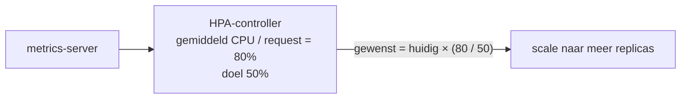

| Voorwaarde | Waarom |
|---|---|
| [metrics-server](CONCEPTS.md#metrics-server) | levert de CPU- en geheugenmetingen |
| `resources.requests.cpu` op de container | het percentage wordt berekend ten opzichte van de request |

**Zie het zelf:** STUDIEPLAN L-10, en:
```bash
kubectl autoscale deployment web --cpu-percent=50 --min=1 --max=5
kubectl get hpa web --watch            # TARGETS: <unknown>/50% = geen metrics of geen requests
```

**Valkuilen en examentips:**
- `<unknown>` in TARGETS: metrics-server ontbreekt, of de container heeft geen CPU-request.
- Afschalen gaat bewust langzaam (stabilisatievenster) om heen-en-weer schalen te voorkomen.
- Zet de replicas van de Deployment niet ook in git vast als een HPA ze beheert, anders vechten GitOps en HPA.

**Hangt samen met:** [metrics-server](CONCEPTS.md#metrics-server) · [Requests en limits](CONCEPTS.md#requests-limits) · [Deployment en rolling updates](CONCEPTS.md#deployment)

**Bronnen:** [HPA](https://kubernetes.io/docs/tasks/run-application/horizontal-pod-autoscale/)

---

### probes

**Probes (liveness, readiness, startup)** · Blok 2 · ✅ uitgewerkt

**Wat is het:** Controles die de kubelet periodiek op een container uitvoert. **Liveness:** leeft de app nog? **Readiness:** kan hij verkeer aan? **Startup:** is hij al opgestart?

**Waarom bestaat het:** Een draaiend proces is niet hetzelfde als een werkende app. Probes laten Kubernetes een vastgelopen app herstarten en een app die nog niet klaar is uit de load balancing houden.

**Vergeleken met wat je kent:** `HEALTHCHECK` in een Dockerfile, maar opgesplitst in drie soorten met elk een eigen gevolg. Vergelijkbaar met de health probe van een Azure Load Balancer (readiness) plus auto-restart (liveness).

**Hoe werkt het:**

| Probe | Faalt hij? |
|---|---|
| liveness | de kubelet herstart de container |
| readiness | de Pod gaat uit de Service-[endpoints](CONCEPTS.md#endpointslice); geen herstart |
| startup | zolang hij niet geslaagd is, worden liveness en readiness uitgesteld |

Soorten controle: `httpGet`, `tcpSocket`, `exec` (commando, exit code 0 = goed), `grpc`. Instellingen: `initialDelaySeconds`, `periodSeconds`, `failureThreshold`, `timeoutSeconds`.

**Zie het zelf:** STUDIEPLAN L-12, en:
```bash
kubectl explain pod.spec.containers.readinessProbe
kubectl describe pod <pod> | grep -E 'Liveness|Readiness|Unhealthy'
```

**Valkuilen en examentips:**
- Een te strenge liveness-probe veroorzaakt eindeloze herstarts (`CrashLoopBackOff`) bij een trage start: gebruik een startup-probe.
- Readiness faalt → `kubectl get endpointslices` toont de Pod als niet-ready; de Service stuurt er niets heen.
- Gebruik voor liveness geen controle die afhangt van een database: dan herstart alles als de database even weg is.

**Hangt samen met:** [kubelet](CONCEPTS.md#kubelet) · [Endpoints en EndpointSlices](CONCEPTS.md#endpointslice)

**Bronnen:** [Probes](https://kubernetes.io/docs/tasks/configure-pod-container/configure-liveness-readiness-startup-probes/)

---

### requests-limits

**Requests en limits** · Blok 2 · ✅ uitgewerkt

**Wat is het:** Per container geef je **requests** (wat hij gegarandeerd krijgt) en **limits** (het maximum) voor CPU en geheugen.

**Waarom bestaat het:** De scheduler moet weten hoeveel ruimte een Pod nodig heeft om hem op een node met genoeg capaciteit te zetten. Limits voorkomen dat één app een hele node opeet.

**Vergeleken met wat je kent:** `docker run --cpus` en `--memory` zijn limits. Requests bestaan in Docker niet: die zijn er voor de planning over meerdere nodes. Vergelijk met het kiezen van een VM-grootte (request) met een harde bovengrens.

**Hoe werkt het:**

| | CPU | Geheugen |
|---|---|---|
| Request | de scheduler plant hierop; gegarandeerd aandeel | de scheduler plant hierop |
| Boven de limit | afgeknepen (throttling), container blijft leven | container wordt gestopt: **OOMKilled** |
| Eenheden | `500m` = halve core | `128Mi`, `1Gi` |

QoS-klasse volgt hieruit: **Guaranteed** (requests = limits), **Burstable** (requests < limits), **BestEffort** (niets opgegeven; als eerste weg bij geheugentekort op de node).

**Zie het zelf:** STUDIEPLAN L-09, en:
```bash
kubectl describe node w1 | sed -n '/Allocated resources/,/Events/p'
kubectl get pod <pod> --output=jsonpath='{.status.qosClass}'; echo
kubectl set resources deployment web --requests=cpu=100m,memory=64Mi --limits=memory=128Mi
```

**Valkuilen en examentips:**
- Pod Pending met *Insufficient cpu*: de **requests** passen niet, ook als de node in werkelijkheid weinig gebruikt.
- `OOMKilled` in `kubectl describe pod` (Last State) = geheugenlimiet te laag of een lek.
- In een namespace met een ResourceQuota op CPU/geheugen zijn requests en limits verplicht.

**Hangt samen met:** [kube-scheduler](CONCEPTS.md#kube-scheduler) · [ResourceQuota en LimitRange](CONCEPTS.md#resourcequota-limitrange) · [HorizontalPodAutoscaler](CONCEPTS.md#hpa)

**Bronnen:** [Resource management](https://kubernetes.io/docs/concepts/configuration/manage-resources-containers/)

---

### resourcequota-limitrange

**ResourceQuota en LimitRange** · Blok 2 · ✅ uitgewerkt

**Wat is het:** **ResourceQuota:** een totaalplafond per namespace (aantal Pods, totale CPU en geheugen, aantal PVC's). **LimitRange:** standaard- en maximumwaarden per container of Pod in een namespace.

**Waarom bestaat het:** In een gedeeld cluster mag één team niet alle capaciteit opgebruiken. Quota begrenzen het totaal, LimitRanges zorgen dat losse containers redelijke waarden hebben.

**Vergeleken met wat je kent:** Azure-subscription-quota's (bijv. maximaal aantal vCPU's per regio) zijn als ResourceQuota. LimitRange lijkt op een Azure Policy die standaardwaarden afdwingt.

**Hoe werkt het:**

| | ResourceQuota | LimitRange |
|---|---|---|
| Scope | totaal van de namespace | per container/Pod |
| Voorbeeld | `pods=10`, `requests.cpu=4` | standaard request 100m, maximum limit 1 CPU |
| Overschreden | aanmaken wordt geweigerd (*exceeded quota*) | aanmaken wordt geweigerd, of standaard ingevuld |

**Zie het zelf:** STUDIEPLAN L-09, en:
```bash
kubectl create quota mini --hard=pods=3,requests.cpu=1 --namespace=dev
kubectl describe quota mini --namespace=dev           # gebruikt / maximum
kubectl get limitrange --all-namespaces
```

**Valkuilen en examentips:**
- Met een quota op `requests.cpu` wordt elke Pod zonder CPU-request geweigerd, tenzij een LimitRange een standaard invult.
- Een Deployment die door de quota geblokkeerd wordt, toont dat niet bij de Pods maar in de events van de **ReplicaSet** (`kubectl describe rs`).

**Hangt samen met:** [Requests en limits](CONCEPTS.md#requests-limits) · [Namespace](CONCEPTS.md#namespace)

**Bronnen:** [Resource quotas](https://kubernetes.io/docs/concepts/policy/resource-quotas/) · [Limit ranges](https://kubernetes.io/docs/concepts/policy/limit-range/)

---

### nodeselector-affinity

**nodeSelector en affinity** · Blok 2 · ✅ uitgewerkt

**Wat is het:** Manieren om te bepalen op welke nodes een Pod mag of liefst moet landen: **nodeSelector** (simpel, op node-labels), **node-affinity** (verplicht of voorkeur) en **pod-(anti-)affinity** (bij of juist weg van andere Pods).

**Waarom bestaat het:** Sommige apps horen op specifieke hardware (SSD, GPU) of in een bepaalde zone, en replicas wil je over nodes spreiden zodat één uitval niet alles raakt.

**Vergeleken met wat je kent:** Docker Swarm placement constraints (`node.labels.disk==ssd`). Of in Azure: VM's over availability zones verdelen (anti-affinity) of in een proximity placement group zetten (affinity).

**Hoe werkt het:**

| Mechanisme | Voorbeeld | Hard of zacht |
|---|---|---|
| `nodeSelector` | `disk: ssd` | hard |
| `requiredDuringSchedulingIgnoredDuringExecution` | node-affinity met operatoren (`In`, `NotIn`, `Exists`) | hard |
| `preferredDuringScheduling...` | met een gewicht | zacht (voorkeur) |
| `podAntiAffinity` + `topologyKey: kubernetes.io/hostname` | niet twee replicas op één node | hard of zacht |

"IgnoredDuringExecution": verander je later de node-labels, dan blijven draaiende Pods staan.

**Zie het zelf:** STUDIEPLAN L-11, en:
```bash
kubectl label node w1 disk=ssd
kubectl get nodes --label-columns=disk
kubectl explain pod.spec.affinity.nodeAffinity
```

**Valkuilen en examentips:**
- Verplichte affinity die geen enkele node haalt = Pod Pending (*didn't match Pod's node affinity/selector*).
- Affinity trekt een Pod naar een node; een [taint](CONCEPTS.md#taints-tolerations) duwt Pods weg. Voor "alleen deze Pods op deze node" heb je vaak beide nodig.
- Kopieer de lange affinity-YAML uit de docs; niemand typt die uit het hoofd.

**Hangt samen met:** [Labels en selectors](CONCEPTS.md#labels-selectors) · [Taints en tolerations](CONCEPTS.md#taints-tolerations) · [kube-scheduler](CONCEPTS.md#kube-scheduler)

**Bronnen:** [Assign Pods to nodes](https://kubernetes.io/docs/concepts/scheduling-eviction/assign-pod-node/)

---

### taints-tolerations

**Taints en tolerations** · Blok 2 · ✅ uitgewerkt

**Wat is het:** Een **taint** op een node houdt Pods weg. Alleen Pods met een bijpassende **toleration** mogen er toch op. Het effect is `NoSchedule`, `PreferNoSchedule` of `NoExecute`.

**Waarom bestaat het:** Om nodes te reserveren (bijv. voor de control plane, GPU-werk of één team) en om Pods weg te houden van nodes met problemen.

**Vergeleken met wat je kent:** Het omgekeerde van affinity: bij affinity kiest de Pod een node, bij een taint weigert de node Pods. In Docker Swarm is het enigszins vergelijkbaar met een node op `pause` zetten, maar dan selectief.

**Hoe werkt het:**

| Effect | Nieuwe Pods | Draaiende Pods |
|---|---|---|
| `NoSchedule` | geweigerd zonder toleration | blijven |
| `PreferNoSchedule` | liever niet | blijven |
| `NoExecute` | geweigerd | worden verwijderd (eventueel na `tolerationSeconds`) |

Kubernetes zet zelf ook taints: `node-role.kubernetes.io/control-plane:NoSchedule`, en bij problemen `node.kubernetes.io/not-ready` of `unreachable`.

**Zie het zelf:** STUDIEPLAN L-11, en:
```bash
kubectl taint node w2 dedicated=db:NoSchedule
kubectl get node w2 --output=jsonpath='{range .spec.taints[*]}{.key}={.value}:{.effect}{"\n"}{end}'
kubectl taint node w2 dedicated=db:NoSchedule-          # weghalen (let op de '-')
```

**Valkuilen en examentips:**
- Een toleration staat een Pod alleen toe op de node; hij **trekt** hem er niet heen. Combineer met nodeSelector of affinity.
- `kubectl describe node | grep Taints` toont alleen de eerste regel; gebruik de jsonpath hierboven.
- Toleration-syntax uit het hoofd: `key`, `operator` (`Equal`/`Exists`), `value`, `effect`.

**Hangt samen met:** [Control plane vs worker (vroeger 'master')](CONCEPTS.md#control-plane) · [nodeSelector en affinity](CONCEPTS.md#nodeselector-affinity) · [Drain, cordon en uncordon](CONCEPTS.md#drain-cordon)

**Bronnen:** [Taints and tolerations](https://kubernetes.io/docs/concepts/scheduling-eviction/taint-and-toleration/)

---

### priorityclass

**PriorityClass** · Blok 2 · ✅ uitgewerkt

**Wat is het:** Een cluster-breed object dat Pods een prioriteit (een getal) geeft. Is er geen ruimte, dan mag de scheduler Pods met een lagere prioriteit verwijderen om een belangrijkere Pod te plaatsen (**preemption**).

**Waarom bestaat het:** Bij krapte moet duidelijk zijn wat voorgaat: systeemcomponenten en productie boven batchwerk en tests.

**Vergeleken met wat je kent:** Vergelijkbaar met Azure Spot-VM's (lage prioriteit, kunnen worden weggehaald) naast gewone VM's, maar dan binnen één cluster.

**Hoe werkt het:**

| Onderdeel | Uitleg |
|---|---|
| `value` | hoe hoger, hoe belangrijker |
| `globalDefault: true` | standaard voor Pods zonder prioriteit (maximaal één) |
| `preemptionPolicy: Never` | hoge prioriteit in de wachtrij, maar verdringt niemand |
| ingebouwd | `system-cluster-critical` en `system-node-critical` voor systeemcomponenten |

In de Pod: `spec.priorityClassName`.

**Zie het zelf:**
```bash
kubectl get priorityclasses
kubectl create priorityclass hoog --value=1000 --description="productie"
kubectl --namespace=kube-system get pods --output=custom-columns=NAME:.metadata.name,PRIO:.spec.priorityClassName
```

**Valkuilen en examentips:**
- Preemption verwijdert echt Pods; gebruik hoge prioriteit spaarzaam.
- PriorityClass is cluster-scoped (geen namespace).

**Hangt samen met:** [kube-scheduler](CONCEPTS.md#kube-scheduler)

**Bronnen:** [Pod priority](https://kubernetes.io/docs/concepts/scheduling-eviction/pod-priority-preemption/)

---

### command-args

**command en args** · Blok 2 · ✅ uitgewerkt

**Wat is het:** In een Pod-spec overschrijft `command` de `ENTRYPOINT` van het image en `args` de `CMD`.

**Waarom bestaat het:** Je wilt hetzelfde image soms anders starten (andere parameters, een debugcommando) zonder een nieuw image te bouwen.

**Vergeleken met wat je kent:** Precies zoals in Docker: `ENTRYPOINT`/`CMD` in de Dockerfile, en `docker run --entrypoint` / de argumenten erachter. Alleen de namen verschillen, en dat verwart.

**Hoe werkt het:**

| Dockerfile | Kubernetes | `kubectl run` |
|---|---|---|
| `ENTRYPOINT` | `command` | `--command -- <cmd>` |
| `CMD` | `args` | `-- <args>` |

| Je zet | Resultaat |
|---|---|
| niets | ENTRYPOINT + CMD van het image |
| alleen `args` | ENTRYPOINT van het image + jouw args |
| alleen `command` | jouw command, CMD van het image wordt genegeerd |
| beide | jouw command + jouw args |

**Zie het zelf:** STUDIEPLAN L-12, en:
```bash
kubectl run a --image=busybox:1.36 $do -- sleep 3600 | grep -A3 args
kubectl run b --image=busybox:1.36 $do --command -- sleep 3600 | grep -A3 command
```

**Valkuilen en examentips:**
- Een verkeerd commando geeft `CrashLoopBackOff`; `kubectl logs --previous` en `kubectl describe pod` (Last State, Exit Code) laten zien waarom.
- Shell-features (pipes, `&&`) werken alleen met een shell: `command: ["sh", "-c", "echo start && sleep 3600"]`.

**Hangt samen met:** [Pod](CONCEPTS.md#pod)

**Bronnen:** [Command and arguments](https://kubernetes.io/docs/tasks/inject-data-application/define-command-argument-container/)

---

### init-sidecar

**Init-containers en sidecar-containers** · Blok 2 · ✅ uitgewerkt

**Wat is het:** Extra containers in een Pod naast de app. **Init-containers** draaien vóór de app, één voor één, en moeten allemaal slagen. **Sidecar-containers** draaien naast de app gedurende de hele levensduur van de Pod (logs doorsturen, een proxy, bestanden synchroniseren).

**Waarom bestaat het:** Voorbereiding (wachten op een database, configuratie ophalen, rechten zetten) en ondersteunend werk horen niet in het app-image. Met aparte containers houd je het image klein en herbruikbaar.

**Vergeleken met wat je kent:** Init-containers lijken op `depends_on` met een conditie in Docker Compose, of een setup-script vóór de service. Een sidecar is een tweede container die met `--network container:` en een gedeeld volume naast de app draait.

**Hoe werkt het:**

| | Init-container | Sidecar-container (sinds 1.33 stable) | Gewone extra container |
|---|---|---|---|
| Waar in de spec | `initContainers` | `initContainers` **met** `restartPolicy: Always` | `containers` |
| Wanneer | vóór de app, één voor één, tot exit 0 | start vóór de app en blijft draaien | tegelijk met de app |
| Pod Ready? | pas als alle init-containers klaar zijn | telt mee voor readiness, heeft eigen probes | telt mee |
| Bij Job-einde | n.v.t. | stopt netjes na de hoofdcontainer | houdt de Pod in leven |

Alle containers in een Pod delen netwerk (`localhost`) en kunnen volumes delen (vaak een `emptyDir`).

**Zie het zelf:** STUDIEPLAN L-34. Status van init-containers:
```bash
kubectl get pod <pod>                         # STATUS: Init:0/2, Init:Error, Init:CrashLoopBackOff
kubectl logs <pod> -c <init-container-naam>   # logs van een specifieke (init-)container
```

**Valkuilen en examentips:**
- Een Pod die op `Init:0/1` blijft staan: de init-container wacht of faalt. `kubectl describe pod` en `kubectl logs -c`.
- Examen: "voeg een sidecar toe die het logbestand van de app leest". Gedeeld `emptyDir`-volume in beide containers mounten.
- Een "oude" sidecar in `containers` laat een Job nooit eindigen; de native sidecar (`initContainers` + `restartPolicy: Always`) wel.

**Hangt samen met:** [Pod](CONCEPTS.md#pod) · [Pod-levenscyclus](CONCEPTS.md#pod-lifecycle) · [Volumetypes](CONCEPTS.md#volumes) · [Probes](CONCEPTS.md#probes)

**Bronnen:** [Init containers](https://kubernetes.io/docs/concepts/workloads/pods/init-containers/) · [Sidecar containers](https://kubernetes.io/docs/concepts/workloads/pods/sidecar-containers/)

---

### pod-lifecycle

**Pod-levenscyclus, beëindiging en lifecycle hooks** · Blok 2 · ✅ uitgewerkt

**Wat is het:** De fases die een Pod doorloopt (`Pending` → `Running` → `Succeeded`/`Failed`), de toestand per container (`Waiting`, `Running`, `Terminated`) en hoe een Pod netjes stopt. **Lifecycle hooks** (`postStart`, `preStop`) laten je iets doen direct na het starten of vlak voor het stoppen.

**Waarom bestaat het:** Om statussen te kunnen lezen bij troubleshooting, en zodat apps zonder dataverlies of afgebroken verzoeken kunnen stoppen bij een rollout, drain of scale-down.

**Vergeleken met wat je kent:** `docker stop` stuurt SIGTERM, wacht 10 seconden en stuurt dan SIGKILL. Kubernetes doet hetzelfde, met standaard **30 seconden** (`terminationGracePeriodSeconds`) en eerst de `preStop`-hook.

**Hoe werkt het:**

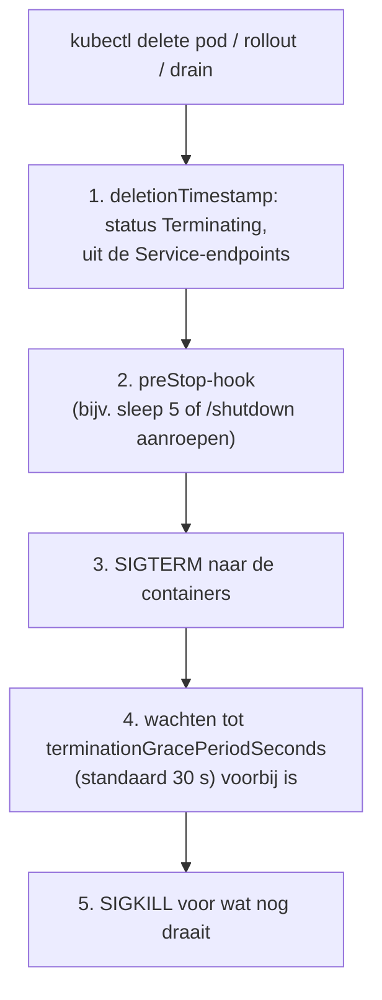

| Status die je ziet | Betekenis |
|---|---|
| `Pending` | nog niet gepland, of images worden gehaald |
| `ContainerCreating` | gepland, volumes en netwerk worden opgezet |
| `CrashLoopBackOff` | container stopt steeds; kubelet wacht steeds langer (backoff) voor de volgende poging |
| `Completed` | klaar met exit 0 (Job) |
| `Terminating` | wordt gestopt; blijft hangen bij finalizers of een onbereikbare node |

`restartPolicy` (`Always`, `OnFailure`, `Never`) bepaalt of de kubelet een gestopte container opnieuw start.

**Zie het zelf:**
```bash
kubectl get pod <pod> --output=jsonpath='{.status.phase} {.status.containerStatuses[0].state}'; echo
kubectl get pod <pod> --output=jsonpath='{.status.conditions[*].type}'; echo    # PodScheduled Initialized ContainersReady Ready
kubectl explain pod.spec.containers.lifecycle.preStop
```

**Valkuilen en examentips:**
- `kubectl delete pod x --force --grace-period=0` (`$now`) slaat het netjes stoppen over; in productie alleen als een node echt weg is.
- Een Pod die op `Terminating` blijft hangen: finalizers (zie [owner references en finalizers](CONCEPTS.md#owners-finalizers)) of een node die niet meer reageert.
- `Last State: Terminated, Reason: OOMKilled, Exit Code: 137` in `kubectl describe pod` = geheugenlimiet.

**Hangt samen met:** [Pod](CONCEPTS.md#pod) · [Probes](CONCEPTS.md#probes) · [Init- en sidecar-containers](CONCEPTS.md#init-sidecar) · [Logs en events](CONCEPTS.md#logs-events)

**Bronnen:** [Pod lifecycle](https://kubernetes.io/docs/concepts/workloads/pods/pod-lifecycle/) · [Container lifecycle hooks](https://kubernetes.io/docs/concepts/containers/container-lifecycle-hooks/)

---

### security-context

**SecurityContext** · Blok 2 · ✅ uitgewerkt

**Wat is het:** Beveiligingsinstellingen per Pod (`spec.securityContext`) of per container (`containers[].securityContext`): als welke gebruiker en groep het proces draait, of het root mag zijn, welke Linux-capabilities het heeft en of het bestandssysteem alleen-lezen is.

**Waarom bestaat het:** Containers draaien standaard vaak als root met meer rechten dan nodig. Een SecurityContext beperkt wat een aanvaller kan als hij de app overneemt.

**Vergeleken met wat je kent:** `docker run --user 1000:1000 --cap-drop ALL --read-only`. Hetzelfde idee als least privilege bij service-accounts op Windows.

**Hoe werkt het:**

| Instelling | Niveau | Effect |
|---|---|---|
| `runAsUser` / `runAsGroup` | Pod of container | UID/GID van het proces |
| `runAsNonRoot: true` | Pod of container | weigert te starten als het image als root draait |
| `fsGroup` | Pod | groep-eigenaar van gemounte volumes |
| `allowPrivilegeEscalation: false` | container | geen `setuid`-trucs |
| `capabilities: {drop: [ALL], add: [NET_BIND_SERVICE]}` | container | alleen de Linux-rechten die nodig zijn |
| `readOnlyRootFilesystem: true` | container | geen schrijven in het image |
| `privileged: true` | container | (bijna) alle rechten van de host; vermijden |

Containerinstellingen gaan voor Podinstellingen.

**Zie het zelf:** STUDIEPLAN L-35, en:
```bash
kubectl run sc --image=busybox:1.36 --overrides='{"spec":{"securityContext":{"runAsUser":1000,"runAsGroup":3000}}}' -- sleep 3600
kubectl exec sc -- id                          # uid=1000 gid=3000
kubectl explain pod.spec.containers.securityContext
```

**Valkuilen en examentips:**
- `runAsNonRoot: true` met een image dat als root draait: de Pod start niet (`CreateContainerConfigError`). Geef dan ook een `runAsUser`.
- Met `readOnlyRootFilesystem` hebben veel apps een schrijfbare `emptyDir` nodig voor `/tmp`.
- Basis voor [Pod Security Standards](CONCEPTS.md#pod-security-admission) (CKS).

**Hangt samen met:** [Pod](CONCEPTS.md#pod) · [Pod Security Standards](CONCEPTS.md#pod-security-admission) · [Volumetypes](CONCEPTS.md#volumes)

**Bronnen:** [Configure a Security Context](https://kubernetes.io/docs/tasks/configure-pod-container/security-context/) · [Linux kernel security constraints](https://kubernetes.io/docs/concepts/security/linux-kernel-security-constraints/)

---

### pdb

**PodDisruptionBudget** · Blok 2 · ✅ uitgewerkt

**Wat is het:** Een object dat zegt hoeveel Pods van een app tegelijk vrijwillig weg mogen (`maxUnavailable`) of moeten blijven (`minAvailable`). **Vrijwillige verstoringen** zijn onder meer `kubectl drain`, node-upgrades en de cluster-autoscaler.

**Waarom bestaat het:** Zodat onderhoud een app niet per ongeluk helemaal platlegt: drain wacht als er anders te weinig replicas overblijven.

**Vergeleken met wat je kent:** Upgrade domains in Azure of de maximale gelijktijdige updates in een scale set: nooit meer dan X tegelijk offline. In AKS respecteren node-upgrades je PDB's.

**Hoe werkt het:**

| Veld | Voorbeeld | Betekenis |
|---|---|---|
| `selector` | `app: web` | welke Pods |
| `minAvailable` | `2` of `50%` | minimaal zoveel moeten blijven draaien |
| `maxUnavailable` | `1` | maximaal zoveel mogen tegelijk weg |

Alleen vrijwillige verstoringen via de **Eviction-API** tellen. Een node die crasht of een `kubectl delete pod` houdt de PDB niet tegen.

**Zie het zelf:** STUDIEPLAN L-36:
```bash
kubectl create deployment web --image=nginx:1.27 --replicas=2
kubectl create poddisruptionbudget web --selector=app=web --min-available=2
kubectl drain w1 --ignore-daemonsets --timeout=30s    # blijft proberen: "Cannot evict pod as it would violate the pod's disruption budget"
kubectl get pdb web                                    # ALLOWED DISRUPTIONS 0
```

**Valkuilen en examentips:**
- `minAvailable` gelijk aan het aantal replicas = drain kan nooit. Gebruik bij 1 replica liever geen PDB, of `maxUnavailable: 1`.
- `kubectl drain` blijft eindeloos wachten; met `--timeout` stopt hij met een foutmelding.

**Hangt samen met:** [Drain, cordon en uncordon](CONCEPTS.md#drain-cordon) · [Deployment](CONCEPTS.md#deployment) · [Cluster upgraden](CONCEPTS.md#cluster-upgrade)

**Bronnen:** [Disruptions](https://kubernetes.io/docs/concepts/workloads/pods/disruptions/) · [Specifying a Disruption Budget](https://kubernetes.io/docs/tasks/run-application/configure-pdb/)

---

### topology-spread

**Pod Topology Spread Constraints** · Blok 2 · ✅ uitgewerkt

**Wat is het:** Regels die Pods gelijkmatig verdelen over **topologiedomeinen**: nodes, zones of regio's, op basis van node-labels. Je geeft op hoe groot het verschil mag zijn (`maxSkew`) en wat er gebeurt als het niet lukt.

**Waarom bestaat het:** Met alleen replicas kunnen alle Pods toevallig op één node of in één zone landen; valt die uit, dan is de app weg. Spread constraints regelen spreiding fijner dan pod-anti-affinity.

**Vergeleken met wat je kent:** Availability zones in Azure: VM's over zones verdelen. Pod-anti-affinity is "nooit twee op één node"; topology spread is "verdeel zo eerlijk mogelijk, met maximaal X verschil".

**Hoe werkt het:**

| Veld | Betekenis |
|---|---|
| `topologyKey` | node-label dat het domein bepaalt: `kubernetes.io/hostname` (per node), `topology.kubernetes.io/zone` (per zone) |
| `maxSkew` | maximaal verschil in aantal Pods tussen domeinen |
| `whenUnsatisfiable` | `DoNotSchedule` (hard) of `ScheduleAnyway` (voorkeur) |
| `labelSelector` | welke Pods meetellen |

**Zie het zelf:**
```bash
kubectl explain pod.spec.topologySpreadConstraints
kubectl get pods --selector=app=web --output=wide    # na een Deployment met maxSkew 1 over kubernetes.io/hostname
```

**Valkuilen en examentips:**
- Met `DoNotSchedule` en te weinig nodes blijven Pods Pending.
- De control plane telt alleen mee als de Pods daar mogen staan (taint).

**Hangt samen met:** [nodeSelector en affinity](CONCEPTS.md#nodeselector-affinity) · [kube-scheduler](CONCEPTS.md#kube-scheduler) · [Labels en selectors](CONCEPTS.md#labels-selectors)

**Bronnen:** [Pod Topology Spread Constraints](https://kubernetes.io/docs/concepts/scheduling-eviction/topology-spread-constraints/)

---

### images-pull

**Images, pull policy en private registries** · Blok 2 · ✅ uitgewerkt

**Wat is het:** Hoe de kubelet (via containerd) container-images ophaalt: welke naam en tag, wanneer opnieuw gedownload wordt (`imagePullPolicy`), en hoe hij inlogt bij een private registry (`imagePullSecrets`).

**Waarom bestaat het:** Fouten met images zijn een van de meest voorkomende oorzaken van Pods die niet starten (`ErrImagePull`, `ImagePullBackOff`).

**Vergeleken met wat je kent:** `docker pull` en `docker login`. Het verschil: niet jij logt in, maar elke node, met credentials uit een Secret. In AKS koppel je een Azure Container Registry meestal via de identiteit van de kubelet, zonder Secret.

**Hoe werkt het:**

| `imagePullPolicy` | Gedrag |
|---|---|
| `IfNotPresent` | alleen downloaden als het image nog niet op de node staat (standaard bij een vaste tag) |
| `Always` | elke keer controleren bij de registry (standaard bij `:latest` of zonder tag) |
| `Never` | nooit downloaden, moet al op de node staan |

Private registry: een Secret van type `kubernetes.io/dockerconfigjson`, en `imagePullSecrets` in de Pod of in de ServiceAccount.

**Zie het zelf:**
```bash
kubectl create secret docker-registry regcred --docker-server=<registry> --docker-username=<user> --docker-password=<token> $do
kubectl run bad --image=nginx:9.99-bestaat-niet && kubectl describe pod bad | sed -n '/Events/,$p'
sudo crictl images                                  # op een node: wat staat er lokaal
```

**Valkuilen en examentips:**
- `ImagePullBackOff`: lees de events. Typfout in naam of tag, registry onbereikbaar, of geen rechten (`unauthorized`).
- Vermijd `:latest`: je weet niet welke versie draait en het gedrag van `imagePullPolicy` verandert.
- `break.sh` scenario 5 oefent dit.

**Hangt samen met:** [Container runtime en CRI](CONCEPTS.md#container-runtime) · [Secret](CONCEPTS.md#secret) · [ServiceAccount](CONCEPTS.md#serviceaccount) · [Pod-levenscyclus](CONCEPTS.md#pod-lifecycle)

**Bronnen:** [Images](https://kubernetes.io/docs/concepts/containers/images/) · [Pull an image from a private registry](https://kubernetes.io/docs/tasks/configure-pod-container/pull-image-private-registry/)

---

## blok-3

**Blok 3 — Services en netwerken**

### cni

**CNI: het Pod-netwerk** · Blok 3 · ✅ uitgewerkt

CNI staat voor **Container Network Interface**. Het is een standaard voor hoe een container zijn netwerk krijgt. Een
**CNI-plugin** is de software die zich aan die standaard houdt en het Pod-netwerk echt bouwt: Flannel, Calico, Cilium.

**Vergeleken met Docker:** in Docker zit het netwerk ingebouwd. Er is de bridge `docker0`, en elke container krijgt een IP en
kan naar buiten. Kubernetes heeft zo'n netwerk **niet** ingebouwd. Het schrijft alleen voor *hoe* het netwerk zich moet
gedragen, en laat het bouwen aan een plugin.

**Wat Kubernetes eist (het netwerkmodel):**
- elke Pod krijgt een **eigen, uniek IP** in het hele cluster;
- Pods praten **rechtstreeks** met elkaar, ook over nodes heen, zonder NAT of proxy.

Op één Docker-host is dat makkelijk. Met drie nodes moet iemand regelen dat een Pod op w1 (bijv. 172.30.1.5) een Pod op
w2 (172.30.2.7) kan bereiken. Dat doet de CNI-plugin.

**Hoe het werkt:**

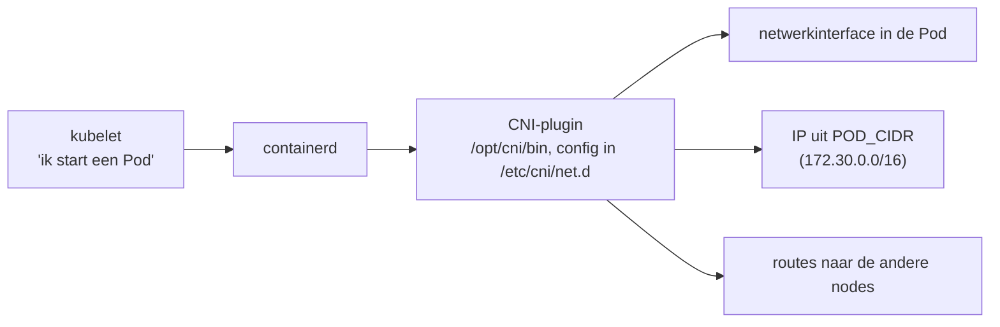

Let op: niet de kubelet maar de **container runtime** (containerd) roept de plugin aan. Dat is zo sinds Kubernetes 1.24.

**Dit verklaart NotReady na `kubeadm init`:** *"cni plugin not initialized"* betekent dat er niets in `/etc/cni/net.d` staat.
Bekijk het op een node met `ls /etc/cni/net.d/ /opt/cni/bin/`. Na `kubectl apply` van een CNI staat daar een config-bestand,
en de nodes worden Ready.

| CNI | Hoe het verkeer tussen nodes gaat | NetworkPolicy? |
|---|---|---|
| Flannel | simpel overlay-netwerk (VXLAN) | nee, wordt genegeerd |
| Calico | routing of overlay, kiesbaar | ja (op het examen meestal deze) |
| Cilium | eBPF in de Linux-kernel | ja, en ook op HTTP-niveau (L7) |

Dat verschil test je in [INIT](INIT.md), stap 4, met de NetworkPolicy-test: dezelfde YAML wordt bij Flannel genegeerd en bij Calico afgedwongen.

**Hangt samen met:** [NetworkPolicy](CONCEPTS.md#networkpolicy) · [Container runtime en CRI](CONCEPTS.md#container-runtime) · [kubeadm join: hoe een node toetreedt](CONCEPTS.md#kubeadm-join) · [Pod](CONCEPTS.md#pod)

**Bronnen:** [Network Plugins](https://kubernetes.io/docs/concepts/extend-kubernetes/compute-storage-net/network-plugins/) · [Het netwerkmodel](https://kubernetes.io/docs/concepts/services-networking/) · [CNI-specificatie](https://github.com/containernetworking/cni)

---

### service

**Service** · Blok 3 · ✅ uitgewerkt

**Wat is het:** Een vast virtueel IP-adres en een DNS-naam voor een wisselende groep Pods, gekozen met een label-selector. Verkeer naar de Service wordt verdeeld over die Pods.

**Waarom bestaat het:** Pods zijn wegwerp en krijgen bij elke herstart een nieuw IP. Andere apps hebben een vast adres nodig. De Service is dat adres.

**Vergeleken met wat je kent:** In Docker Compose bereik je een andere service op haar naam via de ingebouwde DNS; dat is ongeveer een ClusterIP-Service. `docker run -p` lijkt op een NodePort. Een Azure Load Balancer met een backend pool lijkt op type LoadBalancer.

**Hoe werkt het:**

| Type | Bereikbaar vanaf | Hoe |
|---|---|---|
| `ClusterIP` (standaard) | binnen het cluster | virtueel IP uit de service-CIDR (172.31.0.0/16 in het lab) |
| `NodePort` | buiten, via `<node-IP>:<poort>` | poort 30000–32767 op **elke** node |
| `LoadBalancer` | buiten, via een extern IP | NodePort + een externe load balancer (cloud of [MetalLB](CONCEPTS.md#loadbalancer)) |
| Headless (`clusterIP: None`) | binnen | geen virtueel IP; DNS geeft de Pod-IP's terug |
| `ExternalName` | binnen | DNS-alias (CNAME) naar een externe naam |

Poorten: `port` (van de Service) → `targetPort` (in de container). De Pods vindt hij via de [selector](CONCEPTS.md#labels-selectors); de lijst staat in [EndpointSlices](CONCEPTS.md#endpointslice); [kube-proxy](CONCEPTS.md#kube-proxy) zet de regels.

**Zie het zelf:** STUDIEPLAN L-13, en:
```bash
kubectl create deployment web --image=nginx:1.27 --replicas=2
kubectl expose deployment web --port=80 --target-port=80
kubectl get service web && kubectl get endpointslices --selector=kubernetes.io/service-name=web
kubectl run t --image=busybox:1.36 --rm -it --restart=Never -- wget -qO- -T 3 web
```

**Valkuilen en examentips:**
- Geen antwoord? Volgorde: endpoints leeg (selector of readiness) → `targetPort` klopt niet met de containerpoort → NetworkPolicy blokkeert.
- `kubectl expose` neemt de selector over van de Deployment; met `kubectl create service` moet je zelf zorgen dat de selector klopt.
- NodePort kiezen: `--type=NodePort` en eventueel `nodePort` in de YAML.

**Hangt samen met:** [Endpoints en EndpointSlices](CONCEPTS.md#endpointslice) · [kube-proxy](CONCEPTS.md#kube-proxy) · [CoreDNS en Service-DNS](CONCEPTS.md#coredns) · [Labels en selectors](CONCEPTS.md#labels-selectors)

**Bronnen:** [Service](https://kubernetes.io/docs/concepts/services-networking/service/)

---

### endpointslice

**Endpoints en EndpointSlices** · Blok 3 · ✅ uitgewerkt

**Wat is het:** De lijst met Pod-IP's en poorten achter een [Service](CONCEPTS.md#service). Kubernetes houdt hem automatisch bij op basis van de selector en de readiness van de Pods. EndpointSlices zijn de opvolger van het oudere Endpoints-object.

**Waarom bestaat het:** De Service is alleen een adres; iemand moet bijhouden welke Pods er nu achter zitten. kube-proxy en ingress-controllers lezen deze lijst.

**Vergeleken met wat je kent:** De backend pool van een Azure Load Balancer, maar automatisch gevuld en bijgewerkt.

**Hoe werkt het:**

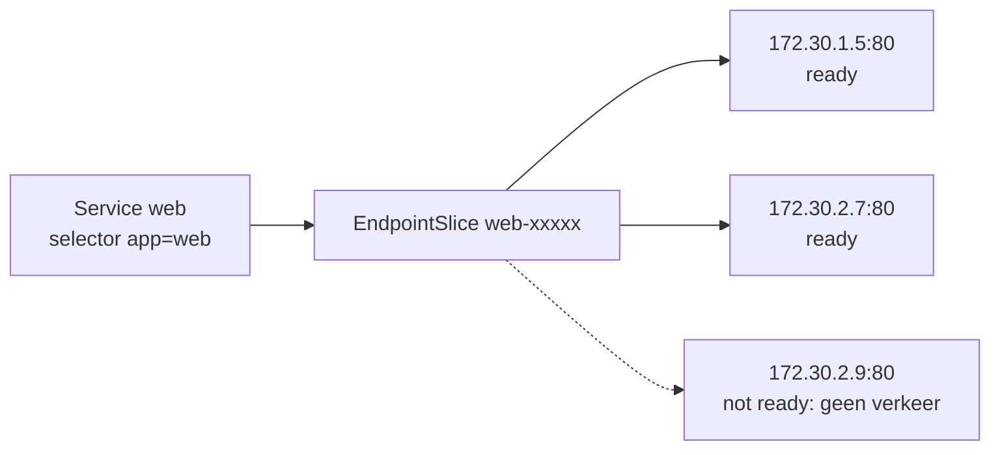

Alleen Pods die **ready** zijn krijgen verkeer. Een Pod die zijn [readiness-probe](CONCEPTS.md#probes) niet haalt, staat er als niet-ready in.

**Zie het zelf:**
```bash
kubectl get endpointslices --selector=kubernetes.io/service-name=web --output=wide
kubectl describe endpointslice --selector=kubernetes.io/service-name=web | grep -E 'Addresses|Ready'
```

**Valkuilen en examentips:**
- **Lege endpoints** = selector klopt niet met de labels, of geen enkele Pod is ready. Vergelijk `kubectl get pods --show-labels` met `kubectl get service web -o yaml`.
- Endpoints wel gevuld, maar toch geen antwoord: controleer de `targetPort` (zie `break.sh` scenario 9).

**Hangt samen met:** [Service](CONCEPTS.md#service) · [Probes (liveness, readiness, startup)](CONCEPTS.md#probes)

**Bronnen:** [EndpointSlices](https://kubernetes.io/docs/concepts/services-networking/endpoint-slices/)

---

### networkpolicy

**NetworkPolicy** · Blok 3 · ✅ uitgewerkt

**Wat is het:** Firewallregels voor Pods. Je selecteert Pods met labels en zegt van wie ze verkeer mogen ontvangen (ingress) en naar wie ze mogen sturen (egress), op basis van Pod-labels, namespaces, IP-blokken en poorten.

**Waarom bestaat het:** Standaard mag in Kubernetes elke Pod met elke Pod praten. Met NetworkPolicies maak je zones (zero trust), zodat een gekaapte Pod niet overal bij kan.

**Vergeleken met wat je kent:** Een NSG in Azure, of de ACL's in je Azure Local-SDN, maar dan op labels in plaats van IP's. Docker kent alleen isolatie via aparte netwerken.

**Hoe werkt het:**

| Regel | Effect |
|---|---|
| geen policy op een Pod | alles toegestaan |
| een policy selecteert de Pod (`podSelector`) | alleen wat expliciet in de policy staat, voor de genoemde richting (`policyTypes`) |
| `podSelector: {}` + geen regels | **default deny** voor alle Pods in de namespace |
| meerdere policies | worden opgeteld (alleen toestaan, geen weigerregels) |

Selectors in `from`/`to`: `podSelector` (zelfde namespace), `namespaceSelector`, beide in één item (EN), of als losse items (OF), en `ipBlock`.

**Zie het zelf:** de NetworkPolicy-test in [INIT](INIT.md) en STUDIEPLAN L-15:
```bash
kubectl get networkpolicies --all-namespaces
kubectl describe networkpolicy default-deny-ingress --namespace=np
```

**Valkuilen en examentips:**
- Werkt alleen met een CNI die policies afdwingt (Calico, Cilium); Flannel negeert ze (zie [CNI](CONCEPTS.md#cni)).
- Een egress-default-deny blokkeert ook **DNS**: sta UDP/TCP 53 naar CoreDNS toe, anders werkt geen enkele naam.
- `namespaceSelector` werkt op namespace-**labels**: elke namespace heeft automatisch `kubernetes.io/metadata.name=<naam>`.
- Let op het verschil tussen één item met podSelector én namespaceSelector (EN) en twee losse items (OF); één streepje verschil in YAML.

**Hangt samen met:** [CNI: het Pod-netwerk](CONCEPTS.md#cni) · [Labels en selectors](CONCEPTS.md#labels-selectors) · [Namespace](CONCEPTS.md#namespace)

**Bronnen:** [Network policies](https://kubernetes.io/docs/concepts/services-networking/network-policies/)

---

### ingress

**Ingress en ingress-controller** · Blok 3 · ✅ uitgewerkt

**Wat is het:** Een **Ingress** beschrijft HTTP- en HTTPS-routing van buiten naar Services: op hostnaam en pad, met TLS. Een **ingress-controller** (in het lab Traefik) voert die regels echt uit.

**Waarom bestaat het:** Je wilt niet voor elke webapp een eigen LoadBalancer-IP. Eén ingang die op hostnaam en pad doorstuurt is goedkoper en beheersbaarder.

**Vergeleken met wat je kent:** Een reverse proxy zoals Traefik of nginx voor je Docker-containers, of een Azure Application Gateway met routeringsregels. De Ingress is de configuratie, de controller de proxy.

**Hoe werkt het:**

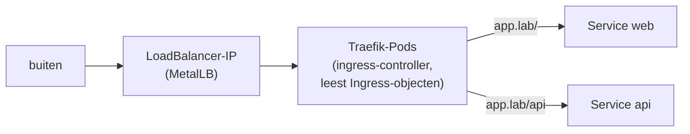

| Veld | Betekenis |
|---|---|
| `ingressClassName` | welke controller deze Ingress uitvoert |
| `rules[].host` / `paths[].path` | routering |
| `pathType` | `Prefix` of `Exact` |
| `tls` | certificaat uit een Secret van type `kubernetes.io/tls` |

**Zie het zelf:** STUDIEPLAN L-16, en:
```bash
kubectl get ingressclass
kubectl create ingress web --class=traefik --rule="web.lab/*=web:80" $do
```

**Valkuilen en examentips:**
- Zonder controller doet een Ingress niets. Controleer `kubectl get ingressclass`.
- ingress-nginx is in maart 2026 met pensioen gegaan; voor nieuwe opzetten is [Gateway API](CONCEPTS.md#gateway-api) de opvolger.
- `kubectl create ingress` met `--rule` is snel op het examen.

**Hangt samen met:** [Gateway API](CONCEPTS.md#gateway-api) · [Service](CONCEPTS.md#service) · [Service type LoadBalancer en MetalLB](CONCEPTS.md#loadbalancer)

**Bronnen:** [Ingress](https://kubernetes.io/docs/concepts/services-networking/ingress/)

---

### gateway-api

**Gateway API** · Blok 3 · ✅ uitgewerkt

**Wat is het:** De opvolger van Ingress, als set CRD's: **GatewayClass** (welke controller), **Gateway** (de ingang: poorten, hostnamen, TLS) en **HTTPRoute** (routering naar Services). Daarnaast bestaan er routes voor andere protocollen.

**Waarom bestaat het:** Ingress was beperkt (alleen HTTP, veel via controller-specifieke annotaties) en mengde de rollen. Gateway API scheidt de verantwoordelijkheden: het platformteam beheert de Gateway, app-teams hun eigen routes.

**Vergeleken met wat je kent:** Een Azure Application Gateway waar het netwerkteam de listeners en certificaten beheert en app-teams hun eigen routeringsregels toevoegen.

**Hoe werkt het:**

| Object | Wie | Inhoud |
|---|---|---|
| GatewayClass | infrastructuur | controller, bijv. Traefik |
| Gateway | platformteam | listeners: poort 80/443, hostnamen, TLS, welke namespaces mogen koppelen |
| HTTPRoute | app-team | `parentRefs` naar de Gateway, hosts, paden, `backendRefs` naar Services, gewichten |

**Zie het zelf:** STUDIEPLAN L-16 (na `./addons.sh gateway-crds traefik`):
```bash
kubectl get gatewayclass,gateway,httproute --all-namespaces
kubectl explain httproute.spec.rules.backendRefs
```

**Valkuilen en examentips:**
- De CRD's zitten niet standaard in Kubernetes; zonder installatie bestaat het type niet.
- Een HTTPRoute die niet koppelt: kijk in de **status** van de route (`kubectl describe httproute`): *Accepted* en *ResolvedRefs*.
- Gateway API staat in het huidige CKA-curriculum; oefen beide (Ingress en Gateway).

**Hangt samen met:** [Ingress en ingress-controller](CONCEPTS.md#ingress) · [CRD en CR (Custom Resource)](CONCEPTS.md#crd-cr)

**Bronnen:** [Gateway API](https://kubernetes.io/docs/concepts/services-networking/gateway/)

---

### coredns

**CoreDNS en Service-DNS** · Blok 3 · ✅ uitgewerkt

**Wat is het:** De DNS-server van het cluster. Elke Service krijgt een naam als `<service>.<namespace>.svc.cluster.local`, en elke Pod gebruikt CoreDNS als nameserver.

**Waarom bestaat het:** Apps moeten elkaar op naam vinden, niet op IP's die steeds veranderen.

**Vergeleken met wat je kent:** De ingebouwde DNS van Docker-netwerken (servicenaam als hostnaam), maar dan cluster-breed en met namespaces. Of een Azure Private DNS-zone die automatisch wordt bijgehouden.

**Hoe werkt het:**

| Naam | Wordt |
|---|---|
| `web` | Service `web` in de **eigen** namespace |
| `web.dev` | Service `web` in namespace `dev` |
| `web.dev.svc.cluster.local` | volledige naam |
| `db-0.db.dev.svc.cluster.local` | één Pod van een StatefulSet (headless Service) |

CoreDNS draait als Deployment `coredns` in `kube-system`, achter de Service `kube-dns`. De configuratie (de Corefile) staat in de ConfigMap `coredns`. In elke Pod verwijst `/etc/resolv.conf` naar het IP van `kube-dns`, met zoekdomeinen voor de korte namen.

**Zie het zelf:** STUDIEPLAN L-14, en:
```bash
kubectl run dns --image=busybox:1.36 --rm -it --restart=Never -- sh -c 'cat /etc/resolv.conf; nslookup kubernetes.default'
kubectl --namespace=kube-system get deployment coredns && kubectl --namespace=kube-system get service kube-dns
```

**Valkuilen en examentips:**
- Namen werken niet meer? Controleer of CoreDNS draait (replicas, zie `break.sh` scenario 10) en of een NetworkPolicy DNS (poort 53) blokkeert.
- Na een CNI-installatie gaat CoreDNS van Pending naar Running: het heeft het Pod-netwerk nodig.
- Wijzigingen in de Corefile worden na een tijdje opgepikt; sneller met `kubectl rollout restart deployment coredns --namespace=kube-system`.

**Hangt samen met:** [Service](CONCEPTS.md#service) · [ConfigMap](CONCEPTS.md#configmap)

**Bronnen:** [DNS for Services and Pods](https://kubernetes.io/docs/concepts/services-networking/dns-pod-service/)

---

### loadbalancer

**Service type LoadBalancer en MetalLB** · Blok 3 · ✅ uitgewerkt

**Wat is het:** Een Service van type `LoadBalancer` krijgt een extern IP-adres. In de cloud regelt de provider dat (in AKS een Azure Load Balancer). Op eigen hardware doet niemand het, en daar vult **MetalLB** het gat.

**Waarom bestaat het:** Apps moeten van buiten het cluster bereikbaar zijn op een vast, eigen IP, zonder NodePorts met hoge poortnummers.

**Vergeleken met wat je kent:** In AKS maakt een LoadBalancer-Service automatisch een frontend-IP op de Azure Load Balancer. MetalLB doet het voor jouw VM's: het geeft een IP uit een eigen pool en laat een node dat IP op het netwerk aankondigen.

**Hoe werkt het:**

```mermaid
flowchart LR
    S["Service type LoadBalancer"] --> C["MetalLB-controller<br/>kiest IP uit IPAddressPool<br/>192.168.122.200-250"]
    S --> SP["MetalLB-speaker (DaemonSet)<br/>antwoordt op ARP voor dat IP (L2)"]
    V["verkeer naar dat IP"] --> N["node"] --> KP["kube-proxy"] --> P["een Pod"]
```

| MetalLB-CR | Rol |
|---|---|
| `IPAddressPool` | welke IP's uitgedeeld mogen worden |
| `L2Advertisement` | aankondigen via ARP (L2); alternatief is BGP met een router |

**Zie het zelf:** (na `./addons.sh metallb`)
```bash
kubectl expose deployment web --name=web-lb --type=LoadBalancer --port=80
kubectl get service web-lb --watch          # EXTERNAL-IP verschijnt
curl -s http://<EXTERNAL-IP> | head -3      # vanaf aristotle
```

**Valkuilen en examentips:**
- EXTERNAL-IP blijft `<pending>`: er is geen load-balancer-implementatie (geen cloud, geen MetalLB) of de pool is leeg.
- In L2-modus gaat al het verkeer voor één IP via één node; het is failover, geen echte load balancing tussen nodes.

**Hangt samen met:** [Service](CONCEPTS.md#service) · [Ingress en ingress-controller](CONCEPTS.md#ingress)

**Bronnen:** [Service: LoadBalancer](https://kubernetes.io/docs/concepts/services-networking/service/#loadbalancer) · [MetalLB](https://metallb.io/)

---

### port-forward-proxy

**Toegang tot apps: port-forward en kubectl proxy** · Blok 3 · ✅ uitgewerkt

**Wat is het:** Twee manieren om vanaf je eigen machine bij iets in het cluster te komen zonder Service, NodePort of Ingress. `kubectl port-forward` maakt een tunnel naar een Pod of Service; `kubectl proxy` maakt de Kubernetes-API lokaal bereikbaar op `localhost`.

**Waarom bestaat het:** Om snel te testen of een app werkt, of een database te bereiken, zonder iets naar buiten open te zetten.

**Vergeleken met wat je kent:** Een SSH-tunnel (`ssh -L`) of Azure Bastion-tunneling: tijdelijk, alleen voor jou, via je eigen inlog.

**Hoe werkt het:**

```mermaid
flowchart LR
    subgraph PF["port-forward (via je kubeconfig, geen netwerkregels nodig)"]
        L1["localhost:8080"] --> K1["kubectl"] --> A1["API-server"] --> KL["kubelet"] --> P["Pod:80"]
    end
    subgraph PX["proxy (REST-API zonder certificaten in je curl)"]
        L2["localhost:8001"] --> K2["kubectl"] --> A2["API-server"]
    end
```

| Commando | Gebruik |
|---|---|
| `kubectl port-forward pod/web 8080:80` | één Pod |
| `kubectl port-forward service/web 8080:80` | via de Service (kiest één Pod) |
| `kubectl port-forward --address 0.0.0.0 ...` | ook bereikbaar voor andere machines; voorzichtig |
| `kubectl proxy --port=8001` | API op `http://localhost:8001` |

**Zie het zelf:**
```bash
kubectl port-forward service/web 8080:80 & sleep 2; curl -s localhost:8080 | head -3; kill %1
kubectl proxy --port=8001 & sleep 2; curl -s localhost:8001/api/v1/namespaces/default/pods | head -20; kill %1
```

**Valkuilen en examentips:**
- port-forward volgt de Pod niet: start hij opnieuw, dan breekt de tunnel.
- Het is geen manier om een app in productie aan te bieden.

**Hangt samen met:** [Service](CONCEPTS.md#service) · [kube-apiserver](CONCEPTS.md#kube-apiserver) · [kubectl](CONCEPTS.md#kubectl)

**Bronnen:** [Use port forwarding](https://kubernetes.io/docs/tasks/access-application-cluster/port-forward-access-application-cluster/) · [Access clusters using the Kubernetes API](https://kubernetes.io/docs/tasks/administer-cluster/access-cluster-api/)

---

## blok-4

**Blok 4 — Storage**

### pv-pvc

**PersistentVolume en PersistentVolumeClaim** · Blok 4 · ✅ uitgewerkt

**Wat is het:** Een **PersistentVolume (PV)** is een stuk opslag in het cluster. Een **PersistentVolumeClaim (PVC)** is de aanvraag van een app ("ik wil 1Gi, ReadWriteOnce"). Kubernetes koppelt (bindt) een passende PV aan de PVC, één op één.

**Waarom bestaat het:** De app hoeft niet te weten waar de opslag vandaan komt (NFS, Azure Disk, lokale schijf). De beheerder of een StorageClass levert de opslag, de app vraagt er alleen om.

**Vergeleken met wat je kent:** Een Docker named volume (`docker volume create`) is ongeveer een PV; het koppelen in `docker run -v` lijkt op de PVC plus `volumeMounts`. In Azure: een managed disk (PV) die je aan een VM koppelt via een aanvraag.

**Hoe werkt het:**

```mermaid
flowchart TB
    P["Pod<br/>volumes: persistentVolumeClaim: data"] --> C["PVC data<br/>1Gi, RWO, storageClassName: local-path"]
    C -->|"binding (één op één)"| V["PV pvc-1234<br/>1Gi, RWO"]
    V --> S[("echte opslag<br/>map op w1, Azure Disk, NFS")]
```

| PV-fase | Betekenis |
|---|---|
| Available | vrij |
| Bound | gekoppeld aan een PVC |
| Released | PVC verwijderd, opslag nog niet opgeruimd |
| Failed | automatisch opruimen mislukt |

Statisch: de beheerder maakt de PV zelf. Dynamisch: een [StorageClass](CONCEPTS.md#storageclass) maakt hem bij een nieuwe PVC.

**Zie het zelf:** STUDIEPLAN L-17 en L-18, en:
```bash
kubectl get pv,pvc --all-namespaces
kubectl describe pvc <naam>          # Events: waarom Pending?
```

**Valkuilen en examentips:**
- PVC blijft **Pending**: geen PV die past (grootte, access mode, `storageClassName`), of de StorageClass gebruikt `WaitForFirstConsumer` en er is nog geen Pod.
- Bij statische binding moet `storageClassName` aan beide kanten gelijk zijn (ook `""` als je geen class wilt).
- Een PVC hoort bij een namespace, een PV niet.

**Hangt samen met:** [StorageClass en dynamische provisioning](CONCEPTS.md#storageclass) · [Access modes en reclaim policy](CONCEPTS.md#access-modes-reclaim) · [Volumetypes](CONCEPTS.md#volumes)

**Bronnen:** [Persistent volumes](https://kubernetes.io/docs/concepts/storage/persistent-volumes/)

---

### access-modes-reclaim

**Access modes en reclaim policy** · Blok 4 · ✅ uitgewerkt

**Wat is het:** **Access modes** zeggen hoe een volume gemount mag worden; de **reclaim policy** zegt wat er met de PV gebeurt nadat de PVC is verwijderd.

**Waarom bestaat het:** Niet elke opslag kan door meerdere nodes tegelijk beschreven worden, en je wilt bepalen of data automatisch weggaat of bewaard blijft.

**Vergeleken met wat je kent:** Een Azure Disk koppel je aan één VM (RWO); Azure Files kan door veel VM's tegelijk (RWX). De reclaim policy lijkt op de keuze of een disk mee verwijderd wordt met de VM.

**Hoe werkt het:**

| Access mode | Betekenis |
|---|---|
| ReadWriteOnce (RWO) | lezen/schrijven door **één node** (meerdere Pods op die node mogen) |
| ReadOnlyMany (ROX) | alleen lezen, door veel nodes |
| ReadWriteMany (RWX) | lezen/schrijven door veel nodes |
| ReadWriteOncePod (RWOP) | lezen/schrijven door **één Pod**; alleen voor CSI-volumes |

| Reclaim policy | Na verwijderen van de PVC |
|---|---|
| Retain | PV en data blijven; de beheerder ruimt handmatig op (fase Released) |
| Delete | PV én de onderliggende opslag worden verwijderd; standaard bij dynamische provisioning |
| Recycle | deprecated |

**Zie het zelf:**
```bash
kubectl get pv --output=custom-columns=NAME:.metadata.name,MODES:.spec.accessModes,RECLAIM:.spec.persistentVolumeReclaimPolicy,STATUS:.status.phase
kubectl patch pv <pv> --patch='{"spec":{"persistentVolumeReclaimPolicy":"Retain"}}'
```

**Valkuilen en examentips:**
- Een PV met Retain blijft na het verwijderen van de PVC op Released staan en wordt niet opnieuw gebonden. Om hem te hergebruiken haal je `spec.claimRef` weg.
- De access mode in de PVC moet door de PV ondersteund worden, anders geen binding.

**Hangt samen met:** [PersistentVolume en PersistentVolumeClaim](CONCEPTS.md#pv-pvc)

**Bronnen:** [Persistent volumes](https://kubernetes.io/docs/concepts/storage/persistent-volumes/)

---

### storageclass

**StorageClass en dynamische provisioning** · Blok 4 · ✅ uitgewerkt

**Wat is het:** Een object dat een soort opslag beschrijft en welke **provisioner** PV's automatisch maakt zodra er een PVC met die class komt (dynamische provisioning).

**Waarom bestaat het:** Zonder StorageClass moet een beheerder elke PV vooraf aanmaken. Met een StorageClass vraagt de app gewoon opslag en verschijnt die vanzelf.

**Vergeleken met wat je kent:** In AKS zijn `managed-csi` (Azure Disk) en `azurefile-csi` StorageClasses. Vergelijkbaar met een disk-SKU kiezen (Standard of Premium SSD) en Azure de disk laten aanmaken.

**Hoe werkt het:**

| Veld | Betekenis |
|---|---|
| `provisioner` | wie de opslag maakt, bijv. `rancher.io/local-path` of een CSI-driver |
| `reclaimPolicy` | standaard `Delete` |
| `volumeBindingMode` | `Immediate` of `WaitForFirstConsumer` (wacht tot de Pod een node heeft) |
| `allowVolumeExpansion` | PVC later vergroten |
| annotatie `storageclass.kubernetes.io/is-default-class` | gebruikt voor PVC's zonder `storageClassName` |

**Zie het zelf:** STUDIEPLAN L-18 (na `./addons.sh local-path`):
```bash
kubectl get storageclass                          # (default) achter de standaardklasse
kubectl get storageclass local-path --output=yaml
```

**Valkuilen en examentips:**
- `WaitForFirstConsumer` houdt de PVC Pending tot er een Pod is. Dat is normaal en zorgt dat de opslag op de goede node komt.
- Twee StorageClasses als default geeft onvoorspelbaar gedrag; zorg voor precies één.

**Hangt samen met:** [PersistentVolume en PersistentVolumeClaim](CONCEPTS.md#pv-pvc) · [CSI](CONCEPTS.md#csi)

**Bronnen:** [Storage classes](https://kubernetes.io/docs/concepts/storage/storage-classes/)

---

### volumes

**Volumetypes** · Blok 4 · ✅ uitgewerkt

**Wat is het:** Manieren om opslag of bestanden in een container te mounten. De belangrijkste: **emptyDir**, **hostPath**, **configMap/secret** en **persistentVolumeClaim**.

**Waarom bestaat het:** Het bestandssysteem van een container is tijdelijk: na een herstart is alles weg. Volumes geven gedeelde, blijvende of ingespoten bestanden.

**Vergeleken met wat je kent:** Docker-volumes en bind-mounts. emptyDir ≈ een anoniem volume dat met de container verdwijnt; hostPath ≈ een bind-mount van een hostmap; PVC ≈ een named volume.

**Hoe werkt het:**

| Type | Levensduur | Gebruik |
|---|---|---|
| `emptyDir` | zolang de Pod bestaat (overleeft een containerherstart) | delen tussen containers in een Pod, cache; met `medium: Memory` in RAM |
| `hostPath` | zolang de node | toegang tot bestanden van de node (agents); riskant |
| `configMap` / `secret` | volgt het object | configuratie als bestanden |
| `persistentVolumeClaim` | los van de Pod | blijvende data |
| `projected` | volgt de bronnen | meerdere bronnen in één map (bijv. ServiceAccount-token) |

In de Pod: `spec.volumes` (wat) en per container `volumeMounts` (waar).

**Zie het zelf:**
```bash
kubectl explain pod.spec.volumes | grep -E '^   [a-z]' | head -30     # alle volumetypes
kubectl explain pod.spec.containers.volumeMounts
```

**Valkuilen en examentips:**
- De naam in `volumeMounts.name` moet exact gelijk zijn aan een `volumes.name`.
- hostPath maakt een Pod afhankelijk van één node en geeft toegang tot het hostbestandssysteem; vermijd het voor apps.
- Een mount over een bestaande map verbergt de inhoud die het image daar had.

**Hangt samen met:** [PersistentVolume en PersistentVolumeClaim](CONCEPTS.md#pv-pvc) · [ConfigMap](CONCEPTS.md#configmap) · [Secret](CONCEPTS.md#secret)

**Bronnen:** [Volumes](https://kubernetes.io/docs/concepts/storage/volumes/)

---

### volume-expansion-ephemeral

**PVC vergroten en ephemeral volumes** · Blok 4 · ✅ uitgewerkt

**Wat is het:** Een PVC kun je **vergroten** als de StorageClass dat toestaat (`allowVolumeExpansion: true`): verhoog `spec.resources.requests.storage`. **Ephemeral volumes** zijn volumes die met de Pod leven en sterven: `emptyDir`, en *generic ephemeral volumes* die per Pod automatisch een PVC uit een StorageClass maken en die weer opruimen.

**Waarom bestaat het:** Data groeit, en niet elke Pod heeft blijvende opslag nodig. Soms wil je wel een echte disk (snel, groot), maar alleen zolang de Pod bestaat.

**Vergeleken met wat je kent:** Een Azure Managed Disk vergroten (kan, verkleinen niet). Een ephemeral volume lijkt op de tijdelijke schijf (D:) van een Azure-VM.

**Hoe werkt het:**

| | Gedrag |
|---|---|
| Vergroten | alleen groter, nooit kleiner; afhankelijk van de driver online of pas na een herstart van de Pod |
| `emptyDir` | map op de node, weg als de Pod weggaat; `sizeLimit` en `medium: Memory` mogelijk |
| generic ephemeral volume | `volumes[].ephemeral.volumeClaimTemplate`; PVC heet `<pod>-<volume>` en hoort bij de Pod |
| local ephemeral storage | `resources.requests/limits.ephemeral-storage`: schijfruimte op de node voor logs, emptyDir en schrijflaag |

**Zie het zelf:**
```bash
kubectl get storageclass --output=custom-columns=NAME:.metadata.name,EXPAND:.allowVolumeExpansion
kubectl patch pvc data --patch='{"spec":{"resources":{"requests":{"storage":"2Gi"}}}}'
kubectl get pvc data --output=jsonpath='{.status.capacity.storage} {.status.conditions}'; echo
```

**Valkuilen en examentips:**
- Zonder `allowVolumeExpansion: true` weigert de API de wijziging.
- local-path (in het lab) ondersteunt geen echte vergroting; oefen het principe, en in AKS echt met Azure Disk.
- Een Pod die te veel `ephemeral-storage` gebruikt, wordt ge-evict (zie [node-pressure eviction](CONCEPTS.md#node-pressure-eviction)).

**Hangt samen met:** [PersistentVolume en PVC](CONCEPTS.md#pv-pvc) · [StorageClass](CONCEPTS.md#storageclass) · [Volumetypes](CONCEPTS.md#volumes)

**Bronnen:** [Persistent Volumes: expanding](https://kubernetes.io/docs/concepts/storage/persistent-volumes/#expanding-persistent-volumes-claims) · [Ephemeral Volumes](https://kubernetes.io/docs/concepts/storage/ephemeral-volumes/) · [Local ephemeral storage](https://kubernetes.io/docs/concepts/storage/ephemeral-storage/)

---

## blok-5

**Blok 5 — Troubleshooting**

### troubleshooting-methode

**Troubleshooting-aanpak** · Blok 5 · ✅ uitgewerkt

**Wat is het:** Een vaste aanpak voor storingen: **status → events en logs → oorzaak → fix → verifiëren**, laag voor laag.

**Waarom bestaat het:** Troubleshooting is 30% van het examen en het meeste werk in de praktijk. Zonder vaste volgorde ga je gokken; met een vaste volgorde vind je de laag waar het misgaat.

**Vergeleken met wat je kent:** Hetzelfde als bij een kapotte VM of SDN-probleem: eerst kijken of de host leeft, dan de dienst, dan de app, dan het netwerk. Bij Docker: `docker ps -a`, `docker logs`, `docker inspect`.

**Hoe werkt het:**

| Laag | Kijk met | Typische oorzaak |
|---|---|---|
| Node | `kubectl get nodes`, op de node `systemctl status kubelet containerd`, `journalctl -u kubelet` | kubelet of containerd gestopt, certificaat verlopen, geen CNI |
| Control plane | `kubectl` werkt niet? → `sudo crictl ps -a`, `crictl logs`, `/etc/kubernetes/manifests/` | typfout in een manifest, etcd niet bereikbaar |
| Pod | `kubectl get pods`, `kubectl describe pod` (Events), `kubectl logs [--previous]` | image bestaat niet, ConfigMap ontbreekt, commando faalt, OOMKilled |
| Scheduling | events: *FailedScheduling* | te weinig requests vrij, taint, affinity, scheduler down |
| Service en netwerk | endpoints, labels, `targetPort`, DNS, NetworkPolicy | selector klopt niet, poort verkeerd, CoreDNS weg |

**Zie het zelf:** `./break.sh random` (zie [INIT](INIT.md), stap 6) en STUDIEPLAN L-19 t/m L-23:
```bash
kubectl get events --all-namespaces --sort-by=.lastTimestamp | tail -20
kubectl get pods --all-namespaces | grep -v -E 'Running|Completed'
```

**Valkuilen en examentips:**
- Lees de foutmelding helemaal; meestal staat de oorzaak er letterlijk in (events onderaan `describe`).
- Verifieer altijd na je fix (Pod Running én app reageert), niet alleen dat het commando slaagde.
- Herstel bij control-plane-problemen het **bestand**, niet het object.

**Hangt samen met:** [crictl](CONCEPTS.md#crictl) · [Logs en events](CONCEPTS.md#logs-events) · [kubelet](CONCEPTS.md#kubelet)

**Bronnen:** [Debugging](https://kubernetes.io/docs/tasks/debug/)

---

### crictl

**crictl** · Blok 5 · ✅ uitgewerkt

**Wat is het:** Een command-line tool die rechtstreeks met de container runtime praat via CRI. Je hulpmiddel op een node, vooral als de API-server niet werkt.

**Waarom bestaat het:** Als `kubectl` het niet doet, kun je de control plane niet via Kubernetes bekijken. crictl laat je de containers op de node zelf zien, ook de static Pods van de control plane.

**Vergeleken met wat je kent:** De `docker`-CLI op een host, met bijna dezelfde commando's (`ps`, `images`, `logs`, `inspect`, `exec`), maar dan tegen containerd.

**Hoe werkt het:**

| crictl | docker-equivalent |
|---|---|
| `crictl ps -a` | `docker ps -a` |
| `crictl pods` | (geen; Pods bestaan niet in Docker) |
| `crictl logs <id>` | `docker logs` |
| `crictl images` / `crictl pull` | `docker images` / `docker pull` |
| `crictl inspect <id>` | `docker inspect` |

Waar hij praat, staat in `/etc/crictl.yaml` (door `node-prep.sh` gezet).

**Zie het zelf:** (op cp1)
```bash
sudo crictl ps -a | grep -E 'apiserver|etcd|scheduler|controller'
sudo crictl logs $(sudo crictl ps -a --name kube-apiserver -q | head -1) 2>&1 | tail -5
```

**Valkuilen en examentips:**
- crictl heeft root nodig (`sudo`).
- Logs van gestopte containers vind je ook in `/var/log/pods/<namespace>_<pod>_<uid>/`.
- Gebruik crictl om te kijken, niet om te beheren: start of stop geen Kubernetes-containers ermee, dat doet de kubelet.

**Hangt samen met:** [Container runtime en CRI](CONCEPTS.md#container-runtime) · [Static Pods](CONCEPTS.md#static-pods)

**Bronnen:** [Debugging with crictl](https://kubernetes.io/docs/tasks/debug/debug-cluster/crictl/)

---

### logs-events

**Logs en events** · Blok 5 · ✅ uitgewerkt

**Wat is het:** **Logs** zijn de output (stdout/stderr) van een container. **Events** zijn meldingen van Kubernetes zelf over wat er met een object gebeurde (gepland, image gehaald, gestart, mislukt).

**Waarom bestaat het:** Logs vertellen wat de app zegt; events vertellen wat Kubernetes deed. Samen geven ze bijna altijd de oorzaak van een probleem.

**Vergeleken met wat je kent:** `docker logs` voor de containeroutput. Events zijn vergelijkbaar met het Activity Log in Azure: wie deed wat met welke resource.

**Hoe werkt het:**

| Commando | Toont |
|---|---|
| `kubectl logs <pod>` | output van de (enige) container |
| `kubectl logs <pod> -c <container>` | één container in een multi-container Pod |
| `kubectl logs <pod> --previous` | output van de vorige, gecrashte container |
| `kubectl logs deployment/web -f` | volgen, van één Pod van de Deployment |
| `kubectl describe <object>` | onderaan: de events van dat object |
| `kubectl get events --sort-by=.lastTimestamp` | alle events in de namespace |

Events worden standaard maar korte tijd bewaard (in de orde van een uur).

**Zie het zelf:**
```bash
kubectl run crash --image=busybox:1.36 -- sh -c 'echo ik start; exit 1'
kubectl logs crash --previous; kubectl describe pod crash | sed -n '/Events/,$p'
```

**Valkuilen en examentips:**
- Bij `CrashLoopBackOff` zijn de huidige logs vaak leeg: gebruik `--previous`.
- Een Pod die niet start (Pending, ImagePullBackOff) heeft geen logs; kijk naar de events.
- Examen: logs naar een bestand schrijven: `kubectl logs <pod> > /pad/bestand`.

**Hangt samen met:** [Troubleshooting-aanpak](CONCEPTS.md#troubleshooting-methode)

**Bronnen:** [Debug running Pods](https://kubernetes.io/docs/tasks/debug/debug-application/debug-running-pod/)

---

### metrics-server

**metrics-server** · Blok 5 · ✅ uitgewerkt

**Wat is het:** Een add-on die het actuele CPU- en geheugengebruik van nodes en Pods verzamelt via de kubelets en aanbiedt via de Metrics API. Nodig voor `kubectl top` en de [HPA](CONCEPTS.md#hpa).

**Waarom bestaat het:** Kubernetes meet zelf geen gebruik voor de API. metrics-server is de lichte bron voor autoscaling en snelle inzage.

**Vergeleken met wat je kent:** `docker stats`, maar voor het hele cluster. Het is geen monitoring: geen geschiedenis, geen grafieken, geen alerts. Daarvoor is Prometheus (zie [Prometheus-stack](CONCEPTS.md#prometheus-stack)), vergelijkbaar met Azure Monitor.

**Hoe werkt het:**

```mermaid
flowchart LR
    T["kubectl top / HPA"] --> A["API-server"] --> M["metrics.k8s.io"] --> MS["metrics-server<br/>(Deployment in kube-system)"]
    MS -->|"haalt op: /metrics/resource"| KL["kubelet<br/>(elke node)"]
```

**Zie het zelf:** (na `./addons.sh metrics-server`)
```bash
kubectl top nodes
kubectl top pods --all-namespaces --sort-by=memory | head
kubectl get apiservice v1beta1.metrics.k8s.io
```

**Valkuilen en examentips:**
- `error: Metrics API not available`: metrics-server is niet geïnstalleerd of niet gezond.
- In een kubeadm-lab heeft hij `--kubelet-insecure-tls` nodig, omdat de kubelets zelfondertekende serving-certificaten hebben. Niet doen in productie.
- Direct na installatie duurt het even voordat er cijfers zijn.

**Hangt samen met:** [HorizontalPodAutoscaler](CONCEPTS.md#hpa) · [Prometheus, Grafana en kube-prometheus-stack](CONCEPTS.md#prometheus-stack)

**Bronnen:** [metrics-server](https://github.com/kubernetes-sigs/metrics-server)

---

### kubectl-debug

**kubectl debug: ephemeral containers en node-debugging** · Blok 5 · ✅ uitgewerkt

**Wat is het:** `kubectl debug` start tijdelijk een extra container om een probleem te onderzoeken: in een draaiende Pod (een **ephemeral container**), als kopie van een Pod, of op een node (een Pod met het bestandssysteem van de node in `/host`).

**Waarom bestaat het:** Veel images hebben geen shell of tools (distroless). En op het examen of in AKS kun je niet altijd via SSH op een node. Met `kubectl debug` krijg je toch tools op de plek van het probleem.

**Vergeleken met wat je kent:** `docker exec` in een container zonder tools lukt niet; dan start je een tweede container in dezelfde namespaces (`docker run --pid container:x --network container:x`). Dat is precies wat een ephemeral container doet. Node-debug lijkt op een tijdelijke jumphost.

**Hoe werkt het:**

| Variant | Commando | Wat je krijgt |
|---|---|---|
| Ephemeral container | `kubectl debug -it <pod> --image=busybox:1.36 --target=<container>` | shell met de processen en het netwerk van die container |
| Kopie van de Pod | `kubectl debug <pod> -it --copy-to=<pod>-debug --container=<c> -- sh` | kopie, ook met ander image of commando, zonder de echte Pod te storen |
| Node | `kubectl debug node/w1 -it --image=ubuntu` | Pod op w1 met de root van de node in `/host` |

Ephemeral containers zijn stable sinds 1.25; ze worden toegevoegd aan een bestaande Pod en kunnen niet weggehaald worden (ze stoppen wel).

**Zie het zelf:** STUDIEPLAN L-37:
```bash
kubectl debug node/w1 -it --image=ubuntu -- bash -c 'chroot /host systemctl status kubelet --no-pager | head -5'
```

**Valkuilen en examentips:**
- De node-debug-Pod blijft na afloop staan: verwijder hem (`kubectl get pods | grep node-debugger`).
- `--target` is nodig om de processen van de doelcontainer te zien.
- Snel alternatief als SSH niet kan, bijvoorbeeld in AKS.

**Hangt samen met:** [Troubleshooting-aanpak](CONCEPTS.md#troubleshooting-methode) · [Logs en events](CONCEPTS.md#logs-events) · [crictl](CONCEPTS.md#crictl) · [Pod](CONCEPTS.md#pod)

**Bronnen:** [Ephemeral containers](https://kubernetes.io/docs/concepts/workloads/pods/ephemeral-containers/) · [Debug running Pods](https://kubernetes.io/docs/tasks/debug/debug-application/debug-running-pod/) · [Debugging a node with kubectl](https://kubernetes.io/docs/tasks/debug/debug-cluster/kubectl-node-debug/)

---

### logging-architectuur

**Logging-architectuur: waar staan de logs?** · Blok 5 · ✅ uitgewerkt

**Wat is het:** Containers schrijven naar stdout en stderr; containerd zet dat in bestanden op de node, en de kubelet beheert en roteert die. `kubectl logs` leest ze via de kubelet. De systeemcomponenten loggen naar journald (kubelet, containerd) of, als static Pod, ook naar `/var/log/pods`.

**Waarom bestaat het:** Als `kubectl logs` niet werkt (API-server down, Pod verdwenen), moet je weten waar je zelf op de node kijkt. En voor productie heb je een centrale logverzamelaar nodig, want logs op de node gaan bij rotatie of het verwijderen van een Pod verloren.

**Vergeleken met wat je kent:** `docker logs` leest de json-logbestanden van de Docker-daemon. Centraal verzamelen is wat Log Analytics/Container Insights in AKS doet.

**Hoe werkt het:**

| Wat | Waar (op de node) | Lezen met |
|---|---|---|
| Container-output | `/var/log/pods/<ns>_<pod>_<uid>/<container>/0.log` (en symlinks in `/var/log/containers/`) | `kubectl logs`, of `sudo tail` op de node |
| Control plane (static Pods) | idem, plus `crictl logs` | `sudo crictl logs <id>` |
| kubelet, containerd | journald | `journalctl -u kubelet`, `journalctl -u containerd` |
| Rotatie | kubelet: `containerLogMaxSize` (standaard 10Mi), `containerLogMaxFiles` (standaard 5) | `/var/lib/kubelet/config.yaml` |

Centraal verzamelen: een agent als **DaemonSet** (bijv. Fluent Bit) leest `/var/log/containers` op elke node en stuurt het door.

**Zie het zelf:**
```bash
ls /var/log/pods/ | head && sudo ls /var/log/containers/ | head     # op een node
sudo journalctl -u kubelet --since "15 min ago" --no-pager | tail -5
kubectl logs <pod> --previous --tail=20
```

**Valkuilen en examentips:**
- `kubectl logs` geeft van een geroteerd log alleen het huidige bestand (maximaal 10 MiB).
- Kapotte API-server: kijk in `/var/log/pods/kube-system_kube-apiserver-*` of met `crictl logs`.

**Hangt samen met:** [Logs en events](CONCEPTS.md#logs-events) · [crictl](CONCEPTS.md#crictl) · [kubelet](CONCEPTS.md#kubelet) · [DaemonSet](CONCEPTS.md#daemonset)

**Bronnen:** [Logging Architecture](https://kubernetes.io/docs/concepts/cluster-administration/logging/) · [System Logs](https://kubernetes.io/docs/concepts/cluster-administration/system-logs/)

---

### node-pressure-eviction

**Node-pressure eviction** · Blok 5 · ✅ uitgewerkt

**Wat is het:** Als een node bijna geen geheugen, schijfruimte of inodes meer heeft, stopt de kubelet zelf Pods (**eviction**) om de node gezond te houden. De node krijgt dan een conditie (`MemoryPressure`, `DiskPressure`, `PIDPressure`) en een taint, zodat er geen nieuwe Pods bij komen.

**Waarom bestaat het:** Een node die vol loopt, kan de kubelet en het OS zelf onderuit halen. Liever een paar Pods netjes weg dan een hele node kwijt.

**Vergeleken met wat je kent:** De Linux-OOM-killer, maar dan eerder en met regels: Kubernetes kiest welke Pods eerst gaan, op basis van [QoS-klasse](CONCEPTS.md#requests-limits) en gebruik boven de requests.

**Hoe werkt het:**

| Signaal | Standaard harde drempel (Linux) |
|---|---|
| `memory.available` | `< 100Mi` |
| `nodefs.available` | `< 10%` |
| `imagefs.available` | `< 15%` |
| `nodefs.inodesFree` | `< 5%` |

Volgorde: eerst Pods die meer gebruiken dan hun requests (BestEffort, dan Burstable), daarna pas Guaranteed. Bij schijfdruk ruimt de kubelet eerst ongebruikte images en dode containers op.

**Zie het zelf:**
```bash
kubectl describe node w1 | grep -A6 Conditions          # MemoryPressure/DiskPressure/PIDPressure
kubectl get pods --all-namespaces --field-selector=status.phase=Failed | grep -i evicted
kubectl describe pod <evicted-pod> | grep -i -A2 reason   # "The node was low on resource: memory"
```

**Valkuilen en examentips:**
- Geëvicte Pods blijven als `Failed`/`Evicted` staan tot je ze opruimt; hun controller maakt elders een nieuwe.
- Dit is iets anders dan de OOM-killer (`OOMKilled` = de container zat boven zijn eigen limit).
- Eviction-drempels staan in `/var/lib/kubelet/config.yaml` (`evictionHard`).

**Hangt samen met:** [Requests en limits](CONCEPTS.md#requests-limits) · [kubelet](CONCEPTS.md#kubelet) · [Taints en tolerations](CONCEPTS.md#taints-tolerations) · [PodDisruptionBudget](CONCEPTS.md#pdb)

**Bronnen:** [Node-pressure Eviction](https://kubernetes.io/docs/concepts/scheduling-eviction/node-pressure-eviction/) · [API-initiated Eviction](https://kubernetes.io/docs/concepts/scheduling-eviction/api-eviction/)

---

## blok-7

**Blok 7 — Platform: GitOps en monitoring**

### gitops

**GitOps** · Blok 7 · ✅ uitgewerkt

**Wat is het:** Een werkwijze waarbij de gewenste toestand van je systemen declaratief in git staat, en een agent in het cluster die toestand ophaalt (pull) en het cluster er continu gelijk aan houdt.

**Waarom bestaat het:** Git wordt de enige bron van waarheid: elke wijziging is een commit (review, geschiedenis, terugdraaien), en handmatige wijzigingen in het cluster (drift) worden zichtbaar of automatisch teruggezet.

**Vergeleken met wat je kent:** PowerShell DSC met een pull-server en *ApplyAndAutoCorrect*: de LCM haalt de configuratie op en corrigeert afwijkingen. Bij CI/CD met push (`terraform apply` vanuit GitHub Actions) duwt de pipeline één keer; bij GitOps blijft de agent continu controleren.

**Hoe werkt het:**

| Principe (OpenGitOps) | Betekenis |
|---|---|
| Declaratief | de gewenste toestand is beschreven, niet de stappen |
| Versiebeheerd en onveranderlijk | in git, met volledige geschiedenis |
| Automatisch opgehaald | een agent haalt de toestand zelf op (pull) |
| Continu gereconcilieerd | afwijkingen worden opgemerkt en gecorrigeerd |

```mermaid
flowchart LR
    J["jij"] -->|"PR + review"| G["git (main)"]
    A["Argo CD / Flux<br/>in het cluster"] -->|pull| G
    A -->|apply| C["cluster"]
    C -.->|"drift? melden of terugzetten"| A
```

**Zie het zelf:** STUDIEPLAN L-24 t/m L-27.

**Valkuilen en examentips:**
- Geen CKA-examenstof, wel dagelijkse praktijk en gespreksstof.
- Secrets horen niet als gewone YAML in git; gebruik External Secrets, Sealed Secrets of SOPS.
- Handmatig `kubectl edit` op een door GitOps beheerd object wordt teruggezet: wijzig via git.

**Hangt samen met:** [Argo CD](CONCEPTS.md#argo-cd) · [Flux](CONCEPTS.md#flux) · [Imperatief vs declaratief](CONCEPTS.md#imperatief-declaratief)

**Bronnen:** [OpenGitOps](https://opengitops.dev/)

---

### argo-cd

**Argo CD** · Blok 7 · ✅ uitgewerkt

**Wat is het:** Een GitOps-tool met een web-UI. Een `Application` (een CR) zegt welke map of chart uit welke repo in welk cluster en welke namespace hoort. Argo CD toont per app of hij **Synced/OutOfSync** en **Healthy/Degraded** is.

**Waarom bestaat het:** Om GitOps zichtbaar en beheersbaar te maken: je ziet per app wat er afwijkt van git, wat er gezond is, en je kunt syncen of terugrollen vanuit de UI.

**Vergeleken met wat je kent:** Een DSC-pull-server met een dashboard. Of een release-pipeline in Azure DevOps, maar dan die continu blijft controleren in plaats van één keer uit te rollen.

**Hoe werkt het:**

| Onderdeel | Rol |
|---|---|
| repo-server | haalt git op en rendert YAML (Helm, Kustomize, plain) |
| application-controller | vergelijkt gerenderd met live, synct |
| server + UI | web-UI en API |
| `Application` | bron (repo, pad, revisie) → bestemming (cluster, namespace) |
| `syncPolicy.automated` | automatisch syncen; `prune` verwijdert wat uit git verdween, `selfHeal` zet drift terug |
| sync waves | volgorde via de annotatie `argocd.argoproj.io/sync-wave` |

**Zie het zelf:** de labs [G-01 t/m G-18](../../gitops-lab/LABS.md) (installeren, sync, drift, app-of-apps,
ApplicationSet, SSO, ...), en:
```bash
kubectl --namespace=argocd get applications
kubectl --namespace=argocd get pods
```

**Valkuilen en examentips:**
- Zonder `selfHeal` meldt Argo CD drift alleen (OutOfSync), maar zet hij niets terug.
- De diepere begrippen (sync waves, hooks, AppProject, ApplicationSet, RBAC) staan in
  [gitops-lab/CONCEPTS.md](../../gitops-lab/CONCEPTS.md).
- Secrets niet laten invullen via een plugin tijdens het renderen: die komen in plaintext in de Redis-cache. Gebruik External Secrets in het cluster.

**Hangt samen met:** [GitOps](CONCEPTS.md#gitops) · [Flux](CONCEPTS.md#flux) · [CRD en CR (Custom Resource)](CONCEPTS.md#crd-cr)

**Bronnen:** [Argo CD](https://argo-cd.readthedocs.io/)

---

### flux

**Flux** · Blok 7 · ✅ uitgewerkt

**Wat is het:** Een GitOps-tool zonder standaard-UI, opgebouwd uit losse controllers: een **source-controller** haalt git of Helm-repo's op, een **kustomize-controller** en **helm-controller** passen ze toe.

**Waarom bestaat het:** Zelfde doel als Argo CD, maar volledig Kubernetes-native en modulair: alles is een CR, je beheert het met kubectl en git.

**Vergeleken met wat je kent:** Een DSC-LCM die alleen met configuratie werkt, zonder dashboard. Vergeleken met Argo CD: Argo is "app-centraal met UI", Flux is "controllers en CR's".

**Hoe werkt het:**

| CR | Rol |
|---|---|
| `GitRepository` | welke repo en branch, hoe vaak ophalen |
| `Kustomization` (Flux) | welk pad uit die bron toepassen, `interval`, `prune`, `dependsOn` voor volgorde |
| `HelmRepository` + `HelmRelease` | Helm-charts installeren en bijwerken |

Volgorde regel je met `dependsOn` (in plaats van Argo's sync waves). SOPS-ontsleuteling zit ingebouwd in de kustomize-controller.

**Zie het zelf:** STUDIEPLAN L-27, en:
```bash
kubectl get gitrepositories,kustomizations.kustomize.toolkit.fluxcd.io --all-namespaces
flux get all --all-namespaces          # met de flux-CLI
```

**Valkuilen en examentips:**
- De Flux-`Kustomization` is iets anders dan het `kustomization.yaml`-bestand van [Kustomize](CONCEPTS.md#kustomize).
- Draai Flux en Argo CD niet allebei op dezelfde objecten: ze gaan tegen elkaar in.

**Hangt samen met:** [GitOps](CONCEPTS.md#gitops) · [Argo CD](CONCEPTS.md#argo-cd) · [Kustomize](CONCEPTS.md#kustomize)

**Bronnen:** [Flux](https://fluxcd.io/flux/)

---

### prometheus-stack

**Prometheus, Grafana en kube-prometheus-stack** · Blok 7 · ✅ uitgewerkt

**Wat is het:** De standaard monitoring-set voor Kubernetes. **Prometheus** haalt metrics op en bewaart ze als tijdreeksen, **Alertmanager** verstuurt alerts, **Grafana** toont dashboards. **kube-prometheus-stack** installeert alles met één Helm-chart, inclusief kube-state-metrics, node-exporter en kant-en-klare dashboards en alertregels.

**Waarom bestaat het:** metrics-server geeft alleen het actuele gebruik. Voor trends, capaciteitsplanning, alerting en troubleshooting achteraf heb je historie en dashboards nodig.

**Vergeleken met wat je kent:** Azure Monitor met Log Analytics, workbooks en alert rules. AKS kan zelfs een beheerde Prometheus (Azure Monitor managed service for Prometheus) gebruiken; dit is de zelfgehoste variant.

**Hoe werkt het:**

| Onderdeel | Rol |
|---|---|
| Prometheus | haalt (pull, *scrape*) periodiek `/metrics` op van targets |
| node-exporter (DaemonSet) | metrics van elke node (CPU, schijf, netwerk) |
| kube-state-metrics | toestand van Kubernetes-objecten (replicas, Pod-status) |
| Alertmanager | groepeert en verstuurt alerts (mail, Teams, Slack) |
| Grafana | dashboards en queries (PromQL) |
| Prometheus Operator | CR's als `ServiceMonitor` en `PrometheusRule` om scrape-targets en alerts te beheren |

**Zie het zelf:** STUDIEPLAN L-26, en:
```bash
kubectl --namespace=monitoring get pods
kubectl --namespace=monitoring port-forward service/<release>-grafana 3000:80   # dan http://localhost:3000
kubectl get servicemonitors --all-namespaces
```

**Valkuilen en examentips:**
- De stack is zwaar voor een klein lab; zorg voor genoeg RAM op de workers.
- Geen CKA-examenstof, wel essentieel in de praktijk.

**Hangt samen met:** [metrics-server](CONCEPTS.md#metrics-server) · [Helm](CONCEPTS.md#helm)

**Bronnen:** [kube-prometheus-stack](https://github.com/prometheus-community/helm-charts/tree/main/charts/kube-prometheus-stack)

---

## blok-8

**Blok 8 — IaC en CI/CD: clusters en resources uitrollen**

### iac-lagen

**Het lagenmodel: wat doet IaC en wat doet GitOps** · Blok 8 · ✅ uitgewerkt

**Wat is het:** Een indeling in vier lagen die voor elk scenario (lab, AKS, AKS op Azure Local) hetzelfde is. Per laag is duidelijk welke tool verantwoordelijk is, zodat tools elkaar niet in de weg zitten.

**Waarom bestaat het:** Zonder duidelijke grens beheert Terraform soms ook Deployments in het cluster, en GitOps ook, en dan gaan ze tegen elkaar in (drift heen en weer). Met een vaste grens weet je bij elk object wie de eigenaar is.

**Vergeleken met wat je kent:** Bij je ALZ-werk doe je dit al: Terraform voor de landing zone en de platformresources, en applicatieteams met hun eigen pipelines erboven. Hier is het hetzelfde, met het cluster als grens.

**Hoe werkt het:**

| Laag | Wat | Tool | Manier |
|---|---|---|---|
| 1. Infrastructuur | VM's en netwerk, of AKS, of AKS op Azure Local; state-opslag, identiteiten | [Terraform](CONCEPTS.md#terraform) via een [pipeline](CONCEPTS.md#ci-cd-pipeline) | push |
| 2. Cluster-bootstrap | kubeadm (lab), of door Azure (AKS); plus de GitOps-agent installeren | scripts / Terraform | push, één keer |
| 3. Platform | CNI-instellingen, ingress, ESO, monitoring, operators | [Flux](CONCEPTS.md#flux) / [Argo CD](CONCEPTS.md#argo-cd) | pull |
| 4. Apps | Deployments, Services, CR's | Flux / Argo CD | pull |

```mermaid
flowchart LR
    G["git"] -->|PR| P["pipeline"]
    P -->|"terraform apply<br/>(push, alleen bij een wijziging)"| L12["laag 1 en 2<br/>infrastructuur + bootstrap"]
    F["Flux / Argo<br/>in het cluster"] -->|"pull, continu"| G
    F --> L34["laag 3 en 4<br/>platform + apps"]
```

In deze map: scenario A = `iac/lab-libvirt`, B = `iac/aks-azure`, C = `iac/aks-azurelocal`. In B installeert Terraform de Flux-extensie (laag 2) en wijst die naar een gitops-repo (laag 3-4).

**Zie het zelf:** vergelijk `iac/aks-azure/main.tf` (laag 1-2) met wat Flux daarna uit de gitops-repo haalt (`kubectl get kustomizations.kustomize.toolkit.fluxcd.io --all-namespaces`).

**Valkuilen en examentips:**
- Beheer een object nooit vanuit twee lagen tegelijk.
- Terraform met de Kubernetes- of Helm-provider in laag 3-4 werkt wel, maar mist het continue terugzetten van drift; daarom doet GitOps die lagen.
- Gespreksvraag: "Waar trek je de grens tussen Terraform en GitOps?" Antwoord: bij het cluster. Alles erbuiten en de bootstrap met Terraform, alles erin met GitOps.

**Hangt samen met:** [Terraform](CONCEPTS.md#terraform) · [GitOps](CONCEPTS.md#gitops) · [Push vs pull](CONCEPTS.md#push-vs-pull) · [AKS](CONCEPTS.md#aks)

**Bronnen:** [OpenGitOps](https://opengitops.dev/) · [Flux op AKS (Microsoft Learn)](https://learn.microsoft.com/en-us/azure/azure-arc/kubernetes/conceptual-gitops-flux2)

---

### terraform

**Terraform: infrastructuur als code** · Blok 8 · ✅ uitgewerkt

**Wat is het:** Een IaC-tool van HashiCorp. Je beschrijft resources in HCL-bestanden (`.tf`), en Terraform maakt, wijzigt of verwijdert ze zodat de werkelijkheid overeenkomt met de code. Via **providers** praat het met elk platform: Azure (`azurerm`, `azapi`), libvirt, Kubernetes, GitHub.

**Waarom bestaat het:** Handwerk en losse scripts zijn niet herhaalbaar en je ziet niet vooraf wat er verandert. Terraform is declaratief, laat met `plan` precies zien wat het gaat doen, en onthoudt in de [state](CONCEPTS.md#terraform-state) wat het beheert.

**Vergeleken met wat je kent:** Je dagelijkse werk. In dit lab zie je het naast `create-vms.sh`: het script zegt *hoe* (virsh-commando's in volgorde), `iac/lab-libvirt/main.tf` zegt *wat* (deze drie VM's, met deze disks). PowerShell DSC is dezelfde gedachte voor de binnenkant van een machine.

**Hoe werkt het:**

| Begrip | Uitleg |
|---|---|
| provider | plugin per platform, versie vastgezet in `required_providers` |
| resource | iets dat Terraform maakt en beheert |
| data source | iets dat al bestaat en dat Terraform alleen leest (bijv. de resource group in scenario B) |
| variable / output | invoer en uitvoer |
| module | herbruikbaar pakket resources, bijv. de AVM-module in scenario C |
| `for_each` | één blok, meerdere exemplaren (de drie VM's in scenario A) |

| Commando | Wat het doet |
|---|---|
| `terraform init` | providers downloaden, backend (state) koppelen |
| `terraform plan` | vergelijken: code ↔ state ↔ werkelijkheid → `+` aanmaken, `~` wijzigen, `-` verwijderen |
| `terraform apply` | het plan uitvoeren, state bijwerken |
| `terraform destroy` | alles uit de state weer weghalen |

**Zie het zelf:**
```bash
cd iac/lab-libvirt && terraform init -backend-config="path=$HOME/.local/state/kubeadm-lab-tf/terraform.tfstate"
terraform plan -var "ssh_public_key=$(cat ~/.ssh/id_ed25519.pub)"
terraform state list && terraform output lab_env
```

**Valkuilen en examentips:**
- **Providerversies vastzetten.** De libvirt-provider 0.9 is een complete herschrijving: code voor 0.8 werkt niet meer. azurerm 6.0 heeft weer een upgrade-guide. Pin daarom `~> 0.9.9`, `~> 5.10`.
- Twee root-modules in één map kunnen botsen op providerversies; daarom heeft scenario C eigen versies (azurerm 4.x, vereist door de AVM-module).
- `terraform fmt` en `terraform validate` in elke pipeline (zie `terraform-checks.yml`).

**Hangt samen met:** [Terraform-state](CONCEPTS.md#terraform-state) · [Het lagenmodel](CONCEPTS.md#iac-lagen) · [CI/CD-pipeline](CONCEPTS.md#ci-cd-pipeline) · [Imperatief vs declaratief](CONCEPTS.md#imperatief-declaratief)

**Bronnen:** [Terraform-documentatie](https://developer.hashicorp.com/terraform/docs) · [libvirt-provider](https://github.com/dmacvicar/terraform-provider-libvirt) · [azurerm-provider](https://registry.terraform.io/providers/hashicorp/azurerm/latest/docs)

---

### terraform-state

**Terraform-state en remote state** · Blok 8 · ✅ uitgewerkt

**Wat is het:** Het bestand waarin Terraform bijhoudt welke echte resource bij welke regel code hoort, met hun laatst bekende eigenschappen. **Remote state** bewaart dat bestand centraal (bijv. in Azure Storage), met **locking** zodat er nooit twee runs tegelijk schrijven.

**Waarom bestaat het:** Zonder state weet Terraform niet wat het zelf gemaakt heeft en kan het niet wijzigen of opruimen. In een pipeline is de runner na elke run weg; de state moet dus ergens anders leven.

**Vergeleken met wat je kent:** Precies je ALZ-state-werk. Vergelijk met etcd voor Kubernetes: de bron van "wat bestaat er", die je goed moet beschermen.

**Hoe werkt het:**

| Scenario | Backend | Waar | Waarom |
|---|---|---|---|
| A (lab) | `local` | `~/.local/state/kubeadm-lab-tf/` op aristotle | runner en libvirt zitten op dezelfde machine; buiten de checkout-map, want `actions/checkout` ruimt ongetrackte bestanden op |
| B en C | `azurerm` | storage account + container `tfstate`, één key per scenario | gedeeld, met locking, ingelogd met Entra ID via OIDC (`ARM_USE_AZUREAD`) |

De backend-waarden staan bewust niet in de code (`backend "azurerm" {}`) maar worden bij `init` meegegeven (`-backend-config=...`): **partial configuration**.

**Zie het zelf:**
```bash
terraform state list                         # wat beheert Terraform?
terraform state show 'libvirt_domain.node["tf-cp1"]'
az storage blob list --account-name <sa> --container-name tfstate --auth-mode login --output table
```

**Valkuilen en examentips:**
- **State bevat secrets** (bijv. kubeconfigs, wachtwoorden) in leesbare vorm. Daarom: geen state in git (`.gitignore`), storage zonder publieke toegang en zonder shared keys, en alleen de pipeline-identiteit met Storage Blob Data Contributor.
- Een vastgelopen lock: `terraform force-unlock <id>`, alleen als je zeker weet dat er geen run meer loopt.
- Met de hand iets wijzigen dat Terraform beheert, geeft bij de volgende `plan` een verschil (drift).

**Hangt samen met:** [Terraform](CONCEPTS.md#terraform) · [OIDC-federatie](CONCEPTS.md#oidc-federatie) · [etcd](CONCEPTS.md#etcd) · [Secret](CONCEPTS.md#secret)

**Bronnen:** [Backend azurerm (HashiCorp)](https://developer.hashicorp.com/terraform/language/backend/azurerm) · [State](https://developer.hashicorp.com/terraform/language/state)

---

### ci-cd-pipeline

**CI/CD-pipeline met GitHub Actions** · Blok 8 · ✅ uitgewerkt

**Wat is het:** Automatisering die bij een gebeurtenis in git (push, pull request, handmatig) stappen uitvoert: controleren (CI) en uitrollen (CD). Bij GitHub heet dat een **workflow** (YAML in `.github/workflows/`), opgebouwd uit **jobs** met **steps**, uitgevoerd op een **runner**.

**Waarom bestaat het:** Zodat niemand meer met de hand vanaf zijn laptop `terraform apply` doet. Elke wijziging gaat via git, wordt gecontroleerd en wordt op dezelfde manier uitgerold, met logs.

**Vergeleken met wat je kent:** Je reusable workflows voor ALZ. Vergelijk ook met Azure DevOps-pipelines: zelfde idee, andere YAML.

**Hoe werkt het:**

| Onderdeel | In deze map |
|---|---|
| `on:` (triggers) | `pull_request`, `push` naar main, `workflow_dispatch` (handmatig, met keuze apply/destroy) |
| `jobs` / `steps` | init → validate → plan → apply |
| `runs-on` | `ubuntu-latest` (door GitHub gehost) of `[self-hosted, linux, aristotle]` |
| `permissions` | `contents: read`, en `id-token: write` voor [OIDC](CONCEPTS.md#oidc-federatie) |
| `environment` | `azure`: bepaalt het OIDC-subject en kan een goedkeuring eisen |
| `concurrency` | nooit twee runs tegelijk op dezelfde state |
| `vars.*` | repository-variabelen (geen geheimen nodig dankzij OIDC) |

| Workflow | Doet |
|---|---|
| `terraform-checks.yml` | fmt + validate voor alle drie de scenario's, plus `bash -n` op de scripts |
| `lab-libvirt.yml` | scenario A op de self-hosted runner, inclusief kubeadm-bootstrap |
| `aks-azure.yml` | scenario B met OIDC; plan op PR, apply via environment |

**Zie het zelf:** in GitHub → **Actions**: elke run met zijn logs; de job summary van een PR toont het plan. Lokaal controleren met actionlint:
```bash
actionlint .github/workflows/*.yml
```

**Valkuilen en examentips:**
- Zet `permissions` altijd expliciet en zo klein mogelijk.
- Pin actions op een versie (`@v7`); voor extra zekerheid op een commit-SHA.
- Een plan uit de PR kan verouderd zijn als main intussen veranderde; daarom plant de apply-job opnieuw.

**Hangt samen met:** [Pull-request-flow](CONCEPTS.md#pull-request-flow) · [OIDC-federatie](CONCEPTS.md#oidc-federatie) · [Self-hosted runner](CONCEPTS.md#self-hosted-runner) · [Push vs pull](CONCEPTS.md#push-vs-pull)

**Bronnen:** [GitHub Actions-documentatie](https://docs.github.com/en/actions) · [Workflow syntax](https://docs.github.com/en/actions/reference/workflows-and-actions/workflow-syntax)

---

### pull-request-flow

**De pull-request-flow: plan op PR, apply na merge** · Blok 8 · ✅ uitgewerkt

**Wat is het:** De vaste route van een infrastructuurwijziging: branch → pull request → de pipeline draait `plan` en toont het resultaat → review → merge naar main → de pipeline draait `apply`, eventueel pas na goedkeuring van een environment.

**Waarom bestaat het:** Zodat elke wijziging eerst zichtbaar en beoordeeld is ("wat gaat er gebeuren?") voordat hij echt iets verandert. Het plan in de PR is het reviewmateriaal.

**Vergeleken met wat je kent:** Een change-proces, maar dan in git: de PR is het change-verzoek, het plan is de impactanalyse, de merge is de goedkeuring, de environment-reviewer is de CAB.

**Hoe werkt het:**

```mermaid
flowchart TB
    FB["feature-branch"] -->|PR| PL["job 'plan'<br/>OIDC-subject: repo:ACCOUNT/REPO:pull_request"]
    PL --> RV["plan in de job summary → review"]
    RV -->|merge| M["main"]
    M --> AP["job 'apply'<br/>environment: azure<br/>OIDC-subject: repo:ACCOUNT/REPO:environment:azure"]
    AP --> AA["opnieuw plan → (goedkeuring) → apply"]
    H["handmatig<br/>(workflow_dispatch)"] -->|"apply of destroy"| AP
```

**Zie het zelf:** STUDIEPLAN L-31: wijzig `node_count` in een branch, open een PR, bekijk het plan, merge.

**Valkuilen en examentips:**
- In deze opzet gebruiken plan en apply dezelfde app-registratie, met dus dezelfde rechten. Strenger: een aparte identiteit voor plan (Reader plus state-toegang) en voor apply.
- Stel bij de environment ook **deployment branches** in (alleen main), anders kan een handmatige run vanaf een andere branch ook de apply-rechten krijgen.

**Hangt samen met:** [CI/CD-pipeline](CONCEPTS.md#ci-cd-pipeline) · [OIDC-federatie](CONCEPTS.md#oidc-federatie) · [Terraform](CONCEPTS.md#terraform)

**Bronnen:** [Deployments en environments](https://docs.github.com/en/actions/how-tos/deploy/configure-and-manage-deployments/manage-environments) · [Terraform in automation](https://developer.hashicorp.com/terraform/tutorials/automation/automate-terraform)

---

### oidc-federatie

**OIDC-federatie: GitHub logt in bij Azure zonder secret** · Blok 8 · ✅ uitgewerkt

**Wat is het:** Workload identity federation tussen GitHub en Microsoft Entra ID. De workflow vraagt bij GitHub een kortlevend OIDC-token aan; Entra controleert het en geeft er een Azure-toegangstoken voor terug. Er staat nergens een wachtwoord of client secret.

**Waarom bestaat het:** Een client secret in GitHub kan lekken, moet geroteerd worden en werkt overal. Een federated credential werkt alleen voor precies die repo en die situatie (PR, branch of environment), en het token leeft maar kort.

**Vergeleken met wat je kent:** Hetzelfde mechanisme als Workload Identity in AKS (ESO naar Key Vault) en je GitHub OIDC voor ALZ: een vertrouwde issuer, een subject en een audience.

**Hoe werkt het:**

```mermaid
sequenceDiagram
    participant W as workflow (id-token: write)
    participant G as GitHub OIDC
    participant E as Microsoft Entra ID
    participant Z as Azure (RBAC)
    W->>G: 1. vraag token aan
    G-->>W: token met iss, sub en aud
    Note over W,G: iss = token.actions.githubusercontent.com<br/>sub = repo:ACCOUNT/REPO:environment:azure<br/>aud = api://AzureADTokenExchange
    W->>E: 2. Terraform (ARM_USE_OIDC=true) ruilt het token in
    Note over E: past het bij de federated credential<br/>van app gh-k8s-lab?
    E-->>W: Azure-token
    W->>Z: 3. werk met de rechten uit Azure RBAC
    Note over Z: Contributor op rg-k8s-lab<br/>Storage Blob Data Contributor op de state
```

| Situatie | Subject |
|---|---|
| job met `environment: azure` | `repo:<account>/<repo>:environment:azure` |
| pull request (zonder environment) | `repo:<account>/<repo>:pull_request` |
| branch | `repo:<account>/<repo>:ref:refs/heads/main` |

**Zie het zelf:** `iac/aks-azure/bootstrap.sh` maakt de app en de twee credentials; bekijk ze met:
```bash
az ad app federated-credential list --id <AZURE_CLIENT_ID> --query "[].{naam:name,subject:subject}" --output table
```

**Valkuilen en examentips:**
- Het subject moet **exact** kloppen; wildcards bestaan niet. Een fout geeft pas bij het inloggen in de workflow een melding, niet bij het aanmaken.
- GitHub schrijft `pull_request` met een underscore; een Microsoft-pagina noemt `pull-request`. GitHub geeft het token uit, dus `pull_request` is leidend.
- `id-token: write` geeft zelf geen rechten in Azure; die komen alleen uit de rollen.

**Hangt samen met:** [ServiceAccount](CONCEPTS.md#serviceaccount) · [CI/CD-pipeline](CONCEPTS.md#ci-cd-pipeline) · [Pull-request-flow](CONCEPTS.md#pull-request-flow) · [AKS](CONCEPTS.md#aks)

**Bronnen:** [OIDC in Azure (GitHub)](https://docs.github.com/en/actions/how-tos/secure-your-work/security-harden-deployments/oidc-in-azure) · [OIDC-reference: subject-claims (GitHub)](https://docs.github.com/en/actions/reference/security/oidc) · [Federated credential aanmaken (Microsoft Learn)](https://learn.microsoft.com/en-us/entra/workload-id/workload-identity-federation-create-trust)

---

### self-hosted-runner

**Self-hosted runner** · Blok 8 · ✅ uitgewerkt

**Wat is het:** Een machine die je zelf beheert en die jobs van GitHub Actions uitvoert, in plaats van een runner van GitHub. In scenario A draait hij op aristotle.

**Waarom bestaat het:** GitHub-runners in de cloud kunnen niet bij je eigen netwerk. Het libvirt-netwerk (192.168.122.0/24) is alleen vanaf aristotle bereikbaar; daar moet de job dus draaien.

**Vergeleken met wat je kent:** Een Azure DevOps-agent of een self-hosted runner voor je GHES. Ook vergelijkbaar met de Arc-agent: software op je eigen machine die zelf naar de cloud belt.

**Hoe werkt het:**

| Kenmerk | Uitleg |
|---|---|
| Verbinding | de runner maakt zelf **uitgaande** HTTPS-verbindingen (poort 443) naar GitHub; je hoeft niets open te zetten |
| Labels | `self-hosted`, `linux` en je eigen label `aristotle`; de workflow kiest met `runs-on` |
| Rechten | draait als een gewone gebruiker; die moet in de groep `libvirt` zitten en een SSH-key hebben |
| Onderhoud | jij werkt OS en tools bij; een runner die 30 dagen niet bijgewerkt is, krijgt geen jobs meer |

**Zie het zelf:** INIT, blok 8 (runner installeren). Daarna:
```bash
systemctl list-units 'actions.runner.*' --no-pager      # de runner als service
```
In GitHub: Settings → Actions → Runners: status *Idle* of *Active*.

**Valkuilen en examentips:**
- **Gebruik een self-hosted runner nooit met een publieke repo.** Iedereen kan een pull request openen en zo code op je machine laten draaien. Houd deze repo **privé**.
- De runner draait code uit je repo met jouw rechten op aristotle. Liever een aparte gebruiker dan je eigen account.
- `actions/checkout` ruimt de werkmap op; bewaar state en andere blijvende bestanden erbuiten.

**Hangt samen met:** [CI/CD-pipeline](CONCEPTS.md#ci-cd-pipeline) · [Terraform-state](CONCEPTS.md#terraform-state) · [Het lagenmodel](CONCEPTS.md#iac-lagen)

**Bronnen:** [Self-hosted runners reference](https://docs.github.com/en/actions/reference/runners/self-hosted-runners) · [Secure use: self-hosted runners](https://docs.github.com/en/actions/reference/security/secure-use)

---

### push-vs-pull

**Push (CI/CD) vs pull (GitOps)** · Blok 8 · ✅ uitgewerkt

**Wat is het:** Twee manieren om een wijziging in git naar een omgeving te krijgen. **Push:** een pipeline buiten de omgeving voert de wijziging door (`terraform apply`, `kubectl apply`). **Pull:** een agent in de omgeving haalt de gewenste toestand zelf op en houdt die continu bij (Flux, Argo CD).

**Waarom bestaat het:** Beide hebben sterke kanten. Push is geschikt voor dingen buiten het cluster en voor eenmalige stappen; pull voor alles in het cluster, omdat het drift terugzet en geen clusterrechten buiten het cluster nodig heeft.

**Vergeleken met wat je kent:** Push = DSC in push-modus of een release-pipeline. Pull = DSC met een pull-server en de LCM op ApplyAndAutoCorrect.

**Hoe werkt het:**

| | Push (pipeline) | Pull (GitOps) |
|---|---|---|
| Wie voert uit | runner buiten de omgeving | agent in het cluster |
| Wanneer | bij een commit of handmatig | continu (interval) |
| Rechten | de pipeline heeft rechten op de omgeving | alleen de agent in het cluster; de pipeline heeft geen clustertoegang nodig |
| Drift | pas zichtbaar bij de volgende run | wordt opgemerkt en (met selfHeal/prune) teruggezet |
| Hier gebruikt voor | laag 1-2 (Terraform) | laag 3-4 (Flux in scenario B, Argo/Flux in blok 7) |

**Zie het zelf:** wijzig in scenario B iets in de gitops-repo en zie Flux het binnen twee minuten toepassen, zonder dat er een workflow draait:
```bash
kubectl get gitrepositories,kustomizations.kustomize.toolkit.fluxcd.io --namespace=flux-system --watch
```

**Valkuilen en examentips:**
- Push en pull op hetzelfde object geeft een eindeloos heen-en-weer.
- Gespreksvraag: "Waarom GitOps als je al CI/CD hebt?" Antwoord: CI/CD bouwt en rolt uit, GitOps houdt het cluster daarna continu gelijk aan git.

**Hangt samen met:** [GitOps](CONCEPTS.md#gitops) · [CI/CD-pipeline](CONCEPTS.md#ci-cd-pipeline) · [Het lagenmodel](CONCEPTS.md#iac-lagen)

**Bronnen:** [OpenGitOps-principes](https://opengitops.dev/) · [Flux](https://fluxcd.io/flux/)

---

### aks

**AKS: Azure Kubernetes Service** · Blok 8 · ✅ uitgewerkt

**Wat is het:** Kubernetes als dienst in Azure. Microsoft beheert de control plane (API-server, etcd, scheduler, controller-manager); jij beheert de **node pools** (VM scale sets) en wat erop draait.

**Waarom bestaat het:** Een control plane opzetten, beveiligen, upgraden en back-uppen (alles wat je in blok 1 met kubeadm oefent) is veel werk. AKS neemt dat over.

**Vergeleken met wat je kent:** Je kubeadm-lab, maar zonder cp1: de control plane zie je niet en kun je niet in. Wat je met kubeadm zelf doet, doet AKS:

| kubeadm-lab | AKS |
|---|---|
| `kubeadm init`, certificaten, etcd-backup | door Azure |
| `kubeadm upgrade` per node | `automatic_upgrade_channel`, of `az aks upgrade` |
| CNI zelf installeren | `network_profile` (in scenario B: Azure CNI overlay met Cilium) |
| MetalLB voor LoadBalancer | Azure Load Balancer, automatisch |
| local-path StorageClass | Azure Disk- en Files-CSI-drivers |
| Flux/Argo zelf installeren | Flux als AKS-extensie (`microsoft.flux`) |

**Hoe werkt het:** keuzes in `iac/aks-azure/main.tf`:

| Instelling | Waarom |
|---|---|
| `sku_tier = "Free"` | geen kosten voor de control plane, geen SLA |
| system node pool: 1 × `Standard_D4as_v5` | system pools vereisen minimaal **4 vCPU en 4 GB**; B-series wordt niet ondersteund. Microsoft raadt 2-3 nodes aan; 1 houdt een lab goedkoop |
| `oidc_issuer_enabled` + `workload_identity_enabled` | Pods kunnen met Workload Identity bij Key Vault en andere Azure-diensten |
| node resource group (`MC_...`) | daar zet AKS de VM's, load balancer en disks; niet met de hand wijzigen |

**Zie het zelf:** na de workflow (STUDIEPLAN L-31):
```bash
az aks get-credentials --resource-group rg-k8s-lab --name aks-k8s-lab
kubectl get nodes --output=wide && kubectl --namespace=kube-system get pods
az aks stop --resource-group rg-k8s-lab --name aks-k8s-lab     # tussendoor geen VM-kosten (start: az aks start)
```

**Valkuilen en examentips:**
- **Kosten:** de nodes kosten geld zolang ze draaien. Draai de workflow met `destroy` als je klaar bent, of gebruik `az aks stop`.
- Je kunt niet op de control plane inloggen; `/etc/kubernetes/manifests` bestaat voor jou niet. Examenvragen over static Pods gaan altijd over kubeadm-clusters.
- Het CKA-examen gebruikt geen AKS; het is wel je werkomgeving.

**Hangt samen met:** [Control plane vs worker](CONCEPTS.md#control-plane) · [AKS op Azure Local](CONCEPTS.md#aks-arc) · [CNI](CONCEPTS.md#cni) · [Flux](CONCEPTS.md#flux) · [OIDC-federatie](CONCEPTS.md#oidc-federatie)

**Bronnen:** [AKS-documentatie](https://learn.microsoft.com/en-us/azure/aks/) · [System node pools](https://learn.microsoft.com/en-us/azure/aks/use-system-pools) · [azurerm_kubernetes_cluster](https://registry.terraform.io/providers/hashicorp/azurerm/latest/docs/resources/kubernetes_cluster)

---

### aks-arc

**AKS op Azure Local (AKS Arc)** · Blok 8 · ✅ uitgewerkt

**Wat is het:** AKS dat op je eigen Azure Local-hardware draait, maar via Azure Arc beheerd wordt alsof het een Azure-resource is. De control-plane- en node-VM's draaien on-prem; het beheer (aanmaken, upgraden, RBAC, extensies zoals Flux) gaat via Azure Resource Manager.

**Waarom bestaat het:** Voor workloads die on-prem moeten blijven (data, latency, regelgeving), met dezelfde manier van beheren als AKS in de cloud.

**Vergeleken met wat je kent:** Je Azure Local-platform op het werk. Ten opzichte van scenario B: dezelfde Terraform-en-pipeline-aanpak, maar het cluster staat op je eigen hosts. Ten opzichte van je kubeadm-lab: Microsoft levert de control plane als VM's en houdt die bij.

**Hoe werkt het:**

| Onderdeel | Rol |
|---|---|
| custom location | het "adres" van je Azure Local-cluster in Azure; daar landen resources |
| logical network | het netwerk op Azure Local waar de cluster-VM's een IP uit krijgen |
| `connectedClusters` (Arc) | het Kubernetes-cluster als Azure-resource |
| `provisionedClusterInstances` | de AKS Arc-instantie zelf (control plane en node pools) |
| control plane IP | vast IP voor de API-server, uit het logical network |

In `iac/aks-azurelocal/main.tf` maakt de AVM-module (`Azure/avm-res-hybridcontainerservice-provisionedclusterinstance/azurerm`, versie 2.0.4) die resources. Die module vereist azurerm 4.x en azapi 2.12+, daarom heeft scenario C eigen providerversies.

**Zie het zelf:** zonder Azure Local kun je alleen lezen en valideren (`terraform-checks.yml`). Op werk, waar het mag:
```bash
az customlocation list --output table
az stack-hci-vm network lnet list --resource-group <rg> --output table
az connectedk8s proxy --name <cluster> --resource-group <rg>     # kubectl via Arc, zonder direct netwerk naar de API
```

**Valkuilen en examentips:**
- Microsoft noemt het aanmaken met Terraform een **preview** (oktober 2026).
- Autoscaling van node pools ondersteunt de module (nog) niet.
- Het control plane IP moet in het logical network liggen, maar buiten de IP-pool die de VM's krijgen.

**Hangt samen met:** [AKS](CONCEPTS.md#aks) · [Het lagenmodel](CONCEPTS.md#iac-lagen) · [HA control plane](CONCEPTS.md#ha-control-plane) · [Terraform](CONCEPTS.md#terraform)

**Bronnen:** [AKS Arc met Terraform (Microsoft Learn)](https://learn.microsoft.com/en-us/azure/aks/aksarc/create-clusters-terraform) · [AVM-module (GitHub)](https://github.com/Azure/terraform-azurerm-avm-res-hybridcontainerservice-provisionedclusterinstance)

---

## blok-ks

**Kubestronaut — begrippen voor CKAD en CKS (geen CKA-kernstof)**

### pod-security-admission

**Pod Security Standards en Pod Security Admission** · Kubestronaut (CKS, CKAD) · ✅ uitgewerkt

**Wat is het:** Drie vaste beveiligingsprofielen voor Pods (**Pod Security Standards**: `privileged`, `baseline`, `restricted`) en een ingebouwde admission controller (**Pod Security Admission**, stable sinds 1.25) die ze per namespace afdwingt via labels.

**Waarom bestaat het:** Zodat niet elke Pod zelf veilige [SecurityContext](CONCEPTS.md#security-context)-instellingen hoeft te onthouden: de namespace weigert of waarschuwt bij onveilige Pods. Het is de opvolger van PodSecurityPolicy (verwijderd in 1.25).

**Vergeleken met wat je kent:** Een Azure Policy-initiatief met drie niveaus, toegewezen op een scope (de namespace), met effect Deny, Audit of alleen een melding.

**Hoe werkt het:**

| Profiel | Wat het toestaat |
|---|---|
| `privileged` | alles (voor systeemcomponenten) |
| `baseline` | geen bekende escalaties: geen `privileged`, geen hostNetwork/hostPID, geen gevaarlijke capabilities |
| `restricted` | baseline plus: `runAsNonRoot`, `allowPrivilegeEscalation: false`, capabilities `drop: [ALL]`, seccomp `RuntimeDefault` |

| Modus (label) | Effect bij overtreding |
|---|---|
| `pod-security.kubernetes.io/enforce` | Pod wordt geweigerd |
| `pod-security.kubernetes.io/warn` | waarschuwing aan de gebruiker, wel toegestaan |
| `pod-security.kubernetes.io/audit` | aantekening in de audit-log, wel toegestaan |

`enforce` werkt op Pods; `warn` en `audit` ook op Deployments en andere workloads (zodat je het al bij `apply` ziet).

**Zie het zelf:**
```bash
kubectl create namespace strikt && kubectl label namespace strikt pod-security.kubernetes.io/enforce=restricted pod-security.kubernetes.io/warn=restricted
kubectl run test --image=nginx:1.27 --namespace=strikt      # geweigerd: lijst met wat er mist
kubectl label --dry-run=server --overwrite namespace default pod-security.kubernetes.io/enforce=baseline   # wat zou er nu falen?
```

**Valkuilen en examentips:**
- Bij `enforce` worden Pods van een Deployment geweigerd, maar de Deployment zelf niet: je ziet het pas in de events van de ReplicaSet. Zet daarom ook `warn`.
- CKS-stof; voor de CKA voldoet weten dat het bestaat.

**Hangt samen met:** [SecurityContext](CONCEPTS.md#security-context) · [Admission control](CONCEPTS.md#admission-control) · [Namespace](CONCEPTS.md#namespace) · [Audit logging](CONCEPTS.md#audit-logging)

**Bronnen:** [Pod Security Standards](https://kubernetes.io/docs/concepts/security/pod-security-standards/) · [Pod Security Admission](https://kubernetes.io/docs/concepts/security/pod-security-admission/) · [Enforce with namespace labels](https://kubernetes.io/docs/tasks/configure-pod-container/enforce-standards-namespace-labels/)

---

### admission-control

**Admission control: controllers, policies en webhooks** · Kubestronaut (CKS) · ✅ uitgewerkt

**Wat is het:** De stap in de [API-server](CONCEPTS.md#kube-apiserver) na authenticatie en autorisatie, vóór opslaan in etcd. **Mutating** admission mag een verzoek aanpassen (bijv. standaardwaarden invullen), **validating** admission mag het alleen goed- of afkeuren. Dat gebeurt door ingebouwde **admission plugins**, door **ValidatingAdmissionPolicy** en **MutatingAdmissionPolicy** (regels in CEL, in het cluster zelf) of door **webhooks** naar een externe service.

**Waarom bestaat het:** RBAC zegt alleen *wie* iets mag. Admission bepaalt *wat* er in het object mag staan: geen `:latest`-images, verplichte labels, limits invullen, Pod Security.

**Vergeleken met wat je kent:** Azure Policy met effecten Deny (validating) en Modify/Append (mutating). Een webhook is een eigen policy-engine (bijv. Kyverno of OPA Gatekeeper) die de API-server bij elk verzoek raadpleegt.

**Hoe werkt het:**

```mermaid
flowchart LR
    V["verzoek"] --> AN["authenticatie"] --> AZ["autorisatie<br/>(RBAC)"] --> MU["MUTATING admission<br/>plugins, MAP, webhooks"] --> SV["schema-validatie"] --> VA["VALIDATING admission<br/>plugins, VAP, webhooks, PSA"] --> E[("etcd")]
```

| Mechanisme | Status | Voorbeeld |
|---|---|---|
| Ingebouwde plugins (`--enable-admission-plugins`) | stable | `NamespaceLifecycle`, `LimitRanger`, `ResourceQuota`, `NodeRestriction`, `PodSecurity` |
| ValidatingAdmissionPolicy (CEL) | stable sinds 1.30 | "replicas maximaal 5" |
| MutatingAdmissionPolicy (CEL) | beta in 1.34–1.35, stable vanaf 1.36 | standaardlabels toevoegen; Calico 3.33 gebruikt dit (daarom de feature gate in je kubeadm-config) |
| Admission webhooks | stable | Kyverno, OPA Gatekeeper |

**Zie het zelf:**
```bash
sudo grep enable-admission-plugins /etc/kubernetes/manifests/kube-apiserver.yaml   # op cp1
kubectl get validatingadmissionpolicies,validatingwebhookconfigurations,mutatingwebhookconfigurations
kubectl explain validatingadmissionpolicy.spec.validations
```

**Valkuilen en examentips:**
- Een kapotte webhook (service down, `failurePolicy: Fail`) kan alle aanmaakverzoeken blokkeren; dat lijkt op een API-probleem.
- Je kubeadm-config zet `MutatingAdmissionPolicy=true` aan voor Calico op 1.35; vanaf 1.36 is dat niet meer nodig.

**Hangt samen met:** [kube-apiserver](CONCEPTS.md#kube-apiserver) · [RBAC](CONCEPTS.md#rbac) · [Pod Security Standards](CONCEPTS.md#pod-security-admission) · [ResourceQuota en LimitRange](CONCEPTS.md#resourcequota-limitrange)

**Bronnen:** [Admission control](https://kubernetes.io/docs/reference/access-authn-authz/admission-controllers/) · [ValidatingAdmissionPolicy](https://kubernetes.io/docs/reference/access-authn-authz/validating-admission-policy/) · [MutatingAdmissionPolicy](https://kubernetes.io/docs/reference/access-authn-authz/mutating-admission-policy/) · [Admission webhooks](https://kubernetes.io/docs/reference/access-authn-authz/extensible-admission-controllers/)

---

### downward-api

**Downward API en projected volumes** · Kubestronaut (CKAD) · ✅ uitgewerkt

**Wat is het:** De **downward API** geeft een container informatie over zichzelf: Pod-naam, namespace, node, IP, labels, en zijn eigen requests en limits, als env-variabele of als bestand. Een **projected volume** zet meerdere bronnen (Secret, ConfigMap, downward API, ServiceAccount-token) samen in één map.

**Waarom bestaat het:** Apps willen soms weten waar ze draaien (voor logging, metrics, clustering) zonder zelf de Kubernetes-API te hoeven bevragen.

**Vergeleken met wat je kent:** Zoals de Azure Instance Metadata Service (169.254.169.254) een VM over zichzelf vertelt, maar dan aangeleverd in env of bestanden.

**Hoe werkt het:**

| Bron | Als env (`valueFrom`) | Als bestand (`downwardAPI`-volume) |
|---|---|---|
| `metadata.name`, `metadata.namespace` | `fieldRef` | ja |
| `spec.nodeName`, `status.podIP` | `fieldRef` | nee (alleen env) |
| `metadata.labels`, `metadata.annotations` | per key | hele set, en bijgewerkt bij wijziging |
| `requests.cpu`, `limits.memory` | `resourceFieldRef` | ja |

**Zie het zelf:**
```bash
kubectl explain pod.spec.containers.env.valueFrom.fieldRef
kubectl explain pod.spec.volumes.projected.sources
```

**Valkuilen en examentips:**
- Env-variabelen veranderen niet na de start; labels als bestand wel.
- De ServiceAccount-token in elke Pod komt zelf uit een projected volume.

**Hangt samen met:** [ConfigMap](CONCEPTS.md#configmap) · [Volumetypes](CONCEPTS.md#volumes) · [ServiceAccount](CONCEPTS.md#serviceaccount)

**Bronnen:** [Downward API](https://kubernetes.io/docs/concepts/workloads/pods/downward-api/) · [Projected volumes](https://kubernetes.io/docs/concepts/storage/projected-volumes/)

---

### vpa-inplace-resize

**Vertical Pod Autoscaler en in-place resize** · Kubestronaut (CKAD) · ✅ uitgewerkt

**Wat is het:** De **VerticalPodAutoscaler** (VPA) past de requests en limits van Pods aan op basis van wat ze werkelijk gebruiken, in plaats van het aantal replicas zoals de [HPA](CONCEPTS.md#hpa). Het is een losse add-on met een CRD. **In-place resize** (stable sinds 1.35) laat je CPU en geheugen van een draaiende container wijzigen zonder hem opnieuw te maken.

**Waarom bestaat het:** Requests goed inschatten is lastig: te hoog verspilt capaciteit, te laag geeft throttling of OOMKills. VPA leert het uit het gebruik. Met in-place resize hoeft een Pod daarvoor niet meer te herstarten.

**Vergeleken met wat je kent:** Een Azure-VM naar een andere grootte schalen (verticaal) tegenover meer instanties in een scale set (horizontaal, HPA). Azure Advisor-aanbevelingen voor "right-sizing" lijken op de `Off`-modus van VPA.

**Hoe werkt het:**

| | HPA | VPA |
|---|---|---|
| Schaalt | aantal replicas | requests/limits per Pod |
| Onderdeel van Kubernetes | ja | nee, add-on (`autoscaling.k8s.io/v1`, kubernetes/autoscaler) |
| Bron | metrics-server | metrics-server (plus geschiedenis) |
| Modi | — | `Off` (alleen aanbevelen), `Initial`, `Recreate`, `InPlaceOrRecreate` |

In-place: `kubectl patch pod <pod> --subresource=resize ...` (kubectl 1.32 of nieuwer); `resizePolicy` per resource bepaalt of de container daarvoor moet herstarten.

**Zie het zelf:**
```bash
kubectl explain pod.spec.containers.resizePolicy
kubectl patch pod <pod> --subresource=resize --patch='{"spec":{"containers":[{"name":"<c>","resources":{"requests":{"cpu":"200m"}}}]}}'
```

**Valkuilen en examentips:**
- HPA en VPA niet allebei op CPU voor dezelfde workload: ze werken elkaar tegen.
- Begin met VPA in `Off`-modus om alleen aanbevelingen te zien.

**Hangt samen met:** [HorizontalPodAutoscaler](CONCEPTS.md#hpa) · [Requests en limits](CONCEPTS.md#requests-limits) · [metrics-server](CONCEPTS.md#metrics-server)

**Bronnen:** [Vertical Pod Autoscaling](https://kubernetes.io/docs/concepts/workloads/autoscaling/vertical-pod-autoscale/) · [Resize container resources](https://kubernetes.io/docs/tasks/configure-pod-container/resize-container-resources/)

---

### encryption-at-rest

**Encryption at rest en KMS** · Kubestronaut (CKS) · ✅ uitgewerkt

**Wat is het:** Versleuteling van Secrets (en desgewenst andere objecten) voordat de API-server ze in etcd opslaat. Je regelt het met een `EncryptionConfiguration`-bestand en de vlag `--encryption-provider-config`. Met **KMS v2** (stable sinds 1.29) zit de hoofdsleutel in een externe kluis.

**Waarom bestaat het:** Standaard staan Secrets **onversleuteld** in etcd. Wie een etcd-backup of de schijf van een control-plane-node heeft, heeft alle Secrets.

**Vergeleken met wat je kent:** Azure Storage Service Encryption met een customer-managed key in Key Vault. In AKS is dit de KMS-etcd-encryptie (opt-in), die je sollicitatiedoc al uitlegt.

**Hoe werkt het:**

| Provider | Beoordeling in de docs |
|---|---|
| `identity` | versleutelt niets |
| `aescbc` | zwak (padding-oracle) |
| `aesgcm` | alleen met automatische sleutelrotatie |
| `secretbox` | sterk, maar minder gangbaar |
| `kms` v2 | sterkst: envelope encryption, de KEK (sleutel-versleutelsleutel) blijft in de KMS: envelope encryption |

De eerste provider in de lijst wordt gebruikt om te schrijven; de rest alleen om te lezen. Bestaande Secrets versleutel je door ze te herschrijven: `kubectl get secrets --all-namespaces -o json | kubectl replace -f -`.

**Zie het zelf:** in het lab zie je eerst het probleem (op cp1, Secret in leesbare tekst in etcd):
```bash
kubectl create secret generic test --from-literal=pw=geheim123 && sudo etcdctl --endpoints=https://127.0.0.1:2379 --cacert=/etc/kubernetes/pki/etcd/ca.crt --cert=/etc/kubernetes/pki/etcd/server.crt --key=/etc/kubernetes/pki/etcd/server.key get /registry/secrets/default/test | strings | grep geheim123
```

**Valkuilen en examentips:**
- De sleutels voor `aescbc`/`aesgcm`/`secretbox` staan in het configbestand op de control plane: daar dus ook goed beveiligen.
- Sleutel of KMS kwijt = Secrets onherstelbaar.

**Hangt samen met:** [Secret](CONCEPTS.md#secret) · [etcd](CONCEPTS.md#etcd) · [kube-apiserver](CONCEPTS.md#kube-apiserver) · [etcd backup en restore](CONCEPTS.md#etcd-backup)

**Bronnen:** [Encrypting data at rest](https://kubernetes.io/docs/tasks/administer-cluster/encrypt-data/) · [Using a KMS provider](https://kubernetes.io/docs/tasks/administer-cluster/kms-provider/)

---

### audit-logging

**Audit logging** · Kubestronaut (CKS) · ✅ uitgewerkt

**Wat is het:** Een logboek van de API-server: wie deed welk verzoek, wanneer, op welk object, met welk resultaat. Wat er gelogd wordt, bepaalt een **audit-policy** (`--audit-policy-file`); waar het heen gaat een **backend** (bijv. een logbestand met `--audit-log-path`).

**Waarom bestaat het:** Voor beveiliging en compliance: achteraf kunnen nagaan wie een Secret las of een Deployment verwijderde.

**Vergeleken met wat je kent:** Het Azure Activity Log en de Key Vault-`AuditEvent`-logs die je in Sentinel gebruikt. In AKS gaan de `kube-audit`-logs via diagnostic settings naar Log Analytics.

**Hoe werkt het:**

| Niveau in de policy | Wat wordt gelogd |
|---|---|
| `None` | niets |
| `Metadata` | wie, wat, wanneer, resultaat (geen inhoud) |
| `Request` | plus de body van het verzoek |
| `RequestResponse` | plus het antwoord |

Zonder `--audit-policy-file` logt de API-server **niets**. De regels worden van boven naar beneden gelezen; de eerste die past, telt.

**Zie het zelf:** op cp1 bekijken of het aan staat:
```bash
sudo grep -E 'audit-(policy-file|log-path)' /etc/kubernetes/manifests/kube-apiserver.yaml || echo "audit logging staat uit"
```
Aanzetten vraagt een policy-bestand, twee vlaggen en twee hostPath-volumes in het static-Pod-manifest van de API-server (zie de bron).

**Valkuilen en examentips:**
- Secrets op niveau `Request` of `RequestResponse` loggen zet hun inhoud in het auditlog. Log Secrets op `Metadata`.
- Volume-mounts vergeten = API-server start niet (CKS-valkuil).

**Hangt samen met:** [kube-apiserver](CONCEPTS.md#kube-apiserver) · [Static Pods](CONCEPTS.md#static-pods) · [Admission control](CONCEPTS.md#admission-control)

**Bronnen:** [Auditing](https://kubernetes.io/docs/tasks/debug/debug-cluster/audit/)

---

### api-versies

**API-groepen, versies en deprecaties** · Kubestronaut (CKAD) · ✅ uitgewerkt

**Wat is het:** Elk objecttype hoort bij een API-groep en versie (`apps/v1` voor Deployments, `networking.k8s.io/v1` voor Ingress). Versies doorlopen `alpha` → `beta` → stable (`v1`). Oude versies worden volgens een vast beleid eerst deprecated en daarna verwijderd.

**Waarom bestaat het:** Zo kan de API verbeteren zonder bestaande clusters meteen te breken. Maar bij een upgrade kunnen manifests met een verwijderde API-versie ineens niet meer toegepast worden.

**Vergeleken met wat je kent:** De `api-version` van Azure-resources (bijv. `@2024-01-01` in azapi): je kiest een versie, en oude previews verdwijnen op een gegeven moment.

**Hoe werkt het:**

| Commando | Gebruik |
|---|---|
| `kubectl api-resources` | alle types met hun groep |
| `kubectl api-versions` | welke groep/versies het cluster kent |
| `kubectl explain <type> --api-version=<groep/versie>` | velden van een specifieke versie |
| `kubectl convert` (plugin) | manifest naar een nieuwere versie omzetten |

Stappen bij een upgrade: kijk in de deprecation guide welke versies verdwijnen, en zoek je manifests (en Helm-charts) daarop na.

**Zie het zelf:**
```bash
kubectl api-versions | sort | head -30
kubectl get deployments.v1.apps --all-namespaces | head -3        # expliciet versie kiezen
```

**Valkuilen en examentips:**
- Een object wordt in één versie opgeslagen; je kunt het in elke ondersteunde versie lezen.
- Lees bij elke clusterupgrade de release notes op verwijderde API's.

**Hangt samen met:** [Cluster upgraden](CONCEPTS.md#cluster-upgrade) · [kubectl explain en api-resources](CONCEPTS.md#kubectl-explain) · [CRD en CR](CONCEPTS.md#crd-cr)

**Bronnen:** [The Kubernetes API](https://kubernetes.io/docs/concepts/overview/kubernetes-api/) · [Deprecated API migration guide](https://kubernetes.io/docs/reference/using-api/deprecation-guide/)

---
