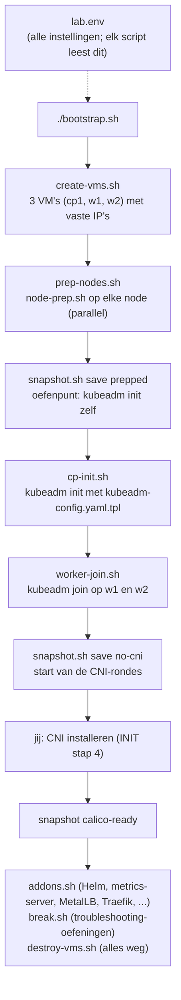
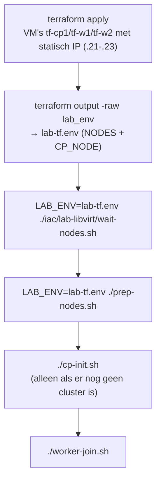

# SCRIPTS.md — wat doen de lab-scripts, en waarom?

Uitleg bij elk script in deze map. De scripts zijn er voor het **bouwen en resetten** van je lab. Op het examen heb je ze niet. Daarom staat bij elk script wat je **handmatig** zou doen.

Overzicht van de documenten:
- [CONCEPTS](CONCEPTS.md) — wat een begrip betekent (kern van de methode).
- [STUDIEPLAN](STUDIEPLAN.md) — wat je leert en in welke volgorde (leidend).
- [INIT](INIT.md) — welke stappen je uitvoert om de omgeving op te zetten.
- **SCRIPTS.md** (dit bestand) — wat de scripts onder water doen.
- [gitops-lab/SCRIPTS.md](../../gitops-lab/SCRIPTS.md) — het Argo CD-script (blok 7), met dezelfde aanpak.
- [secrets-lab/SCRIPTS.md](../../secrets-lab/SCRIPTS.md) — het secrets-script (blok 9), met dezelfde aanpak.

De Kubernetes-begrippen achter de scripts: [kubeadm init](CONCEPTS.md#kubeadm-init) ·
[kubeadm join](CONCEPTS.md#kubeadm-join) · [Container runtime en CRI](CONCEPTS.md#container-runtime) ·
[Static Pods](CONCEPTS.md#static-pods) · [Control plane vs worker](CONCEPTS.md#control-plane) · [etcd](CONCEPTS.md#etcd).

Alle scripts draai je op **aristotle** vanuit deze map, tenzij er "op cp1" staat.

## De volgorde in één plaatje



Elk script begint met `set -euo pipefail`. Dat betekent: stoppen bij de eerste fout, fout bij een niet-bestaande variabele, en ook een fout als één commando in een pipe faalt. Daardoor gaat een script nooit "half" verder.

---

## lab.env — de centrale instellingen

**Wat en wanneer:** geen script maar een instellingenbestand. Elk script doet `source ./lab.env`. Wil je iets veranderen (versie, IP's, RAM), dan doe je dat **alleen hier**.

**Wat erin staat:**

| Instelling | Waarde | Waarom |
|---|---|---|
| `K8S_MINOR` | `v1.35` | de examenversie van de CKA. pkgs.k8s.io heeft één repo per minor-versie, dus dit bepaalt welke kubeadm je krijgt |
| `POD_CIDR` / `SERVICE_CIDR` | `172.30.0.0/16` / `172.31.0.0/16` | eigen ranges die niet overlappen met je LAN, wlan, WireGuard of libvirt. Een overlap geeft rare routeringsfouten |
| `NODES` | naam, IP, MAC, vCPU, RAM | de vaste MAC zorgt via een DHCP-reservering dat elke VM altijd hetzelfde IP krijgt |
| add-on-versies | MetalLB, Gateway API, ... | vastgezet, zodat het lab morgen hetzelfde doet als vandaag |
| `SSH_OPTS` | eigen known_hosts-bestand | zo komen VM-sleutels niet in je gewone `~/.ssh/known_hosts`, en kan `destroy-vms.sh` ze netjes opruimen |

**Hulpfuncties:** `node_ip cp1` geeft het IP van cp1, `node_names` geeft alle nodes, en `vm_ssh w1 'commando'` voert een commando uit op w1. `log` en `die` zijn voor nette meldingen (`die` stopt het script).

**LAB_ENV (blok 8):** zet je `LAB_ENV` naar een bestand, dan leest `lab.env` dat aan het eind in en overschrijft het `NODES` en `CP_NODE`. Zo richten dezelfde scripts ook het Terraform-cluster (tf-cp1, tf-w1, tf-w2) in. Zonder `LAB_ENV` verandert er niets. Zie [iac/ en de workflows](SCRIPTS.md#blok-8-iac-en-workflows).

**Controleren:** `source ./lab.env && node_names && node_ip cp1`

---

## create-vms.sh — de drie VM's maken

**Wat en wanneer:** maakt cp1, w1 en w2 aan in libvirt/KVM. Draait als eerste stap van `bootstrap.sh`. Een VM die al bestaat, slaat hij over.

**Stap voor stap:**

1. **Voorcontroles:** zijn `virsh`, `virt-install`, `qemu-img` en `curl` er, heb je een SSH-key (`~/.ssh/*.pub`) en is het libvirt-netwerk actief? Liever meteen een duidelijke fout dan halverwege.
2. **Base image:** downloadt het Ubuntu 24.04 cloud image één keer en **controleert de SHA256-checksum**. Zo weet je zeker dat het image niet beschadigd of gemanipuleerd is.
3. **Per node:**
   - **DHCP-reservering** (`virsh net-update ... add ip-dhcp-host`): koppelt de MAC aan een vast IP.
   - **Overlay-disk** (`qemu-img create -b base`): elke VM krijgt een eigen qcow2 die alleen de *verschillen* met het base image opslaat. Dat bespaart ruimte en gaat snel.
   - **cloud-init:** bij de eerste boot zet cloud-init de hostname, maakt de gebruiker `ubuntu` met jouw SSH-key en sudo zonder wachtwoord, en installeert `qemu-guest-agent`.
   - **virt-install:** maakt de VM met `--cpu host-passthrough`, zodat de VM de echte CPU-features van je Ryzen ziet.
4. **Wachten:** tot SSH werkt en `cloud-init status --wait` klaar is.

**Handmatig equivalent:** niet nodig voor het examen. Daar staan de machines al klaar.

**Controleren:** `virsh list --all && virsh net-dhcp-leases default`

**Als het misgaat:**
- `libvirt-netwerk 'default' is niet actief` → `sudo virsh net-start default && sudo virsh net-autostart default`.
- Wacht hij eindeloos op SSH? Kijk via de console mee: `virsh console cp1` (verlaten met `Ctrl+]`).

---

## prep-nodes.sh + node-prep.sh — nodes klaarmaken voor kubeadm

**Wat en wanneer:** `prep-nodes.sh` stuurt `node-prep.sh` via SSH naar elke node en draait het daar **parallel**. Per node komt de output in `prep-<node>.log`. Daarna maakt `bootstrap.sh` snapshot `prepped`.

**Stap voor stap (node-prep.sh, op elke node):**

| Stap | Wat | Waarom |
|---|---|---|
| Swap uit | `swapoff -a` en de swap-regel in `/etc/fstab` uitcommentariëren | de kubelet start standaard niet als er swap is |
| Kernel-modules | `overlay` en `br_netfilter`, ook na reboot (`/etc/modules-load.d/k8s.conf`) | `overlay` is het bestandssysteem voor container-lagen; `br_netfilter` laat bridged verkeer door iptables gaan (Flannel heeft dat nodig) |
| sysctl | `net.ipv4.ip_forward = 1` en `bridge-nf-call-iptables = 1` | een node moet verkeer tussen Pods doorsturen, en Services werken via iptables-regels |
| /etc/hosts | regels voor cp1, w1, w2 | de nodes vinden elkaar op naam, ook zonder DNS |
| containerd | installeren, standaardconfig genereren, `SystemdCgroup = true` | kubelet en runtime moeten **dezelfde cgroup-driver** gebruiken. Ubuntu gebruikt systemd, en de kubelet staat in `kubeadm-config` ook op systemd. Een mismatch geeft instabiele nodes |
| Kubernetes-pakketten | repo van `pkgs.k8s.io` voor `K8S_MINOR`, dan `kubelet kubeadm kubectl` | de oude `apt.kubernetes.io`-repo bestaat niet meer; pkgs.k8s.io heeft één repo per minor-versie |
| `apt-mark hold` | de drie pakketten vastzetten | een `apt upgrade` mag de cluster-versie nooit ongemerkt ophogen. Upgraden doe je bewust met `kubeadm upgrade` |
| kubelet aan | `systemctl enable --now kubelet` | de kubelet blijft herstarten tot `kubeadm init/join` zijn config schrijft. **Dat is normaal** |
| crictl | `/etc/crictl.yaml` wijst naar de containerd-socket | `crictl` is je debug-tool als de API-server niet werkt |
| Examen-omgeving | `alias k=kubectl`, completion, `$do` en `$now` | zoals je het op het examen instelt. `k run x --image=nginx $do` geeft YAML, `k delete pod x $now` verwijdert direct |

**Handmatig equivalent:** op het examen zijn de pakketten er meestal al. Wel moet je weten hoe het werkt, voor de vraag "node joint niet" en voor de upgrade-oefening:

```bash
sudo swapoff -a; lsmod | grep br_netfilter; sysctl net.ipv4.ip_forward; grep SystemdCgroup /etc/containerd/config.toml; apt-mark showhold
```

**Controleren:** `tail -1 prep-*.log` laat per node de kubeadm- en containerd-versie zien.

**Als het misgaat:** lees `prep-<node>.log`. Een fout bij de repo is meestal een tikfout in `K8S_MINOR` (die moet `v1.35` zijn, met een `v`).

---

## kubeadm-config.yaml.tpl — de clusterconfiguratie

**Wat en wanneer:** een sjabloon. `cp-init.sh` vult de `__PLACEHOLDERS__` in met waarden uit `lab.env` en zet het resultaat op cp1 als `~/kubeadm-config.yaml`.

**Drie documenten in één bestand** (gescheiden door `---`):

| Document | Belangrijkste velden | Waarom |
|---|---|---|
| `InitConfiguration` | `advertiseAddress`, `criSocket` | op welk IP de API-server luistert, en dat containerd de runtime is |
| `ClusterConfiguration` | `kubernetesVersion`, `controlPlaneEndpoint`, `podSubnet`, `serviceSubnet`, `apiServer.extraArgs` | de CIDR's moeten kloppen met je CNI. De `extraArgs` zetten MutatingAdmissionPolicy aan, wat Calico 3.33 op 1.35 nodig heeft (vanaf 1.36 staat dat standaard aan) |
| `KubeletConfiguration` | `cgroupDriver: systemd` | moet gelijk zijn aan containerd (zie node-prep) |

`apiVersion: kubeadm.k8s.io/v1beta4` is het huidige formaat. Daarin zijn `extraArgs` een lijst van `name`/`value`-paren, en niet meer een map zoals in v1beta3.

**Handmatig equivalent:** op het examen kan het ook zonder configbestand:

```bash
sudo kubeadm init --pod-network-cidr=172.30.0.0/16 --service-cidr=172.31.0.0/16 --apiserver-advertise-address=192.168.122.11
```

Bekijk ook een volledige standaardconfig: `kubeadm config print init-defaults`

---

## cp-init.sh — de control plane opzetten

**Wat en wanneer:** draait `kubeadm init` op cp1, **zonder CNI**. Die installeer je zelf (INIT stap 4).

**Stap voor stap:**

1. Leest de exacte kubeadm-versie van cp1 (bijv. `v1.35.9`) en vult het sjabloon in.
2. `sudo kubeadm init --config ~/kubeadm-config.yaml`. kubeadm maakt dan:
   - de certificaten in `/etc/kubernetes/pki/`;
   - kubeconfigs voor admin, kubelet, controller-manager en scheduler;
   - **static Pod-manifests** in `/etc/kubernetes/manifests/` voor etcd, kube-apiserver, controller-manager en scheduler. De kubelet start die zelf, zonder API-server;
   - de add-ons CoreDNS en kube-proxy.
   De output komt ook in `cp-init.log`.
3. Kopieert `/etc/kubernetes/admin.conf` naar `~/.kube/config`, zodat `kubectl` als gebruiker `ubuntu` werkt.
4. Installeert **etcdctl en etcdutl in precies dezelfde versie** als de etcd van het cluster. De versie leest hij uit het etcd-manifest. Die heb je nodig voor de etcd-backup en -restore (L-08).
5. Toont `kubectl get nodes` en de Pods in kube-system. Nodes staan op **NotReady** en CoreDNS op **Pending**; dat hoort zo zonder CNI.

**Handmatig equivalent:**

```bash
sudo kubeadm init --config kubeadm-config.yaml && mkdir -p ~/.kube && sudo cp /etc/kubernetes/admin.conf ~/.kube/config && sudo chown $(id -u):$(id -g) ~/.kube/config
```

**Oefenen:** `./snapshot.sh revert prepped`, dan op cp1 zelf `kubeadm init` doen.

**Controleren (op cp1):** `ls /etc/kubernetes/manifests/ && sudo crictl ps && k get nodes`

**Als het misgaat:** `sudo journalctl -u kubelet -e` en `sudo crictl ps -a`. Wil je opnieuw beginnen? Doe `sudo kubeadm reset -f`, of terug naar snapshot `prepped`.

---

## worker-join.sh — workers toevoegen

**Wat en wanneer:** laat w1 en w2 joinen. Een node die al gejoind is (`/etc/kubernetes/kubelet.conf` bestaat), slaat hij over.

**Stap voor stap:**

1. Op cp1: `kubeadm token create --print-join-command`. Dat maakt een **vers bootstrap-token** (tijdelijk geldig; het token van `kubeadm init` zelf is 24 uur geldig, dus na een dag werkt het oude join-commando niet meer) en print het complete `kubeadm join`-commando, inclusief de hash van de CA.
2. Voert dat commando uit op elke worker. De kubelet doet dan **TLS-bootstrap**: met het token vraagt hij een eigen client-certificaat aan bij de API-server. Dat zag je in je output als *"Certificate signing request was sent to apiserver"*.

**Handmatig equivalent:** het examen vraagt dit regelmatig:

```bash
# op de control plane
kubeadm token create --print-join-command
# op de worker: plak de output, met sudo ervoor
```

**Controleren (op cp1):** `k get nodes -o wide && k get csr`

**Als het misgaat:** een verlopen token geeft `unauthorized`. Maak een nieuw token. Lijkt de join te hangen? Kijk op de worker naar `sudo journalctl -u kubelet -e`.

---

## bootstrap.sh — alles van fase 1 in één keer

**Wat en wanneer:** roept achter elkaar aan: `create-vms.sh` → `prep-nodes.sh` → snapshot `prepped` → `cp-init.sh` → `worker-join.sh` → snapshot `no-cni`. Duurt zo'n 10 minuten. Dit draai je eigenlijk maar één keer; daarna werk je met snapshots.

**De twee snapshots:**
- `prepped` — nodes klaar, nog geen cluster. Hier oefen je `kubeadm init` en `join` zelf.
- `no-cni` — cluster staat, nog zonder netwerk. Hier begin je elke CNI-ronde.

---

## snapshot.sh — terugspoelen

**Wat en wanneer:** snapshots van alle drie de VM's tegelijk. Het belangrijkste hulpmiddel in je lab: maak gerust iets kapot en spoel terug.

| Commando | Wat |
|---|---|
| `./snapshot.sh save <naam>` | snapshot van cp1, w1 en w2 (inclusief RAM als de VM draait) |
| `./snapshot.sh revert <naam>` | alle drie terug naar dat punt, VM's draaien daarna weer; wacht 20 seconden en toont `kubectl get nodes` |
| `./snapshot.sh list` | snapshots per node |
| `./snapshot.sh delete <naam>` | snapshot weggooien |

**Waarom eerst de cdrom uitwerpen?** De cloud-init-gegevens hangen als cdrom-ISO aan de VM. Een interne libvirt-snapshot kan alleen als alle disks qcow2 zijn. Het script werpt de cdrom daarom eerst uit; na de eerste boot is hij niet meer nodig.

**Waarom `--atomic`?** Dan lukt de snapshot helemaal of helemaal niet, en blijft er geen half snapshot achter.

**Let op:** een snapshot van een draaiende VM bevat ook het RAM, dus na een revert loopt de klok van de VM eerst achter tot de tijdsynchronisatie hem bijwerkt. Staan nodes direct na een revert even op NotReady, wacht dan een minuut. Blijft het zo, kijk dan met `timedatectl` op de node.

**Aanbevolen snapshots:** `prepped`, `no-cni`, `calico-ready`, `addons`, `platform` (zie INIT §Snapshots).

---

## destroy-vms.sh — alles opruimen

**Wat en wanneer:** verwijdert alle lab-VM's met hun disks, snapshots, DHCP-reserveringen en SSH-hostkeys. Vraagt eerst om bevestiging. Met `--base` gaat ook het gedownloade Ubuntu-image weg.

**Wanneer gebruiken:** als je helemaal opnieuw wilt beginnen, of als je in `lab.env` IP's of MAC's hebt veranderd. Daarna: `./bootstrap.sh`.

---

## addons.sh — extra componenten voor de labs

**Wat en wanneer:** installeert add-ons die je nodig hebt voor de labs. Vereist een cluster **met CNI**, dus vanaf `calico-ready`. Alles draait op cp1.

| Add-on | Wat het is | Waarom in het lab |
|---|---|---|
| `helm` | package manager voor Kubernetes (Helm 4) | Traefik en monitoring installeren; Helm staat in het curriculum |
| `metrics-server` | verzamelt CPU/RAM van nodes en Pods | `kubectl top` en de HorizontalPodAutoscaler. In het lab met `--kubelet-insecure-tls`, omdat kubeadm-kubelets zelfondertekende certificaten hebben (**alleen voor een lab**) |
| `local-path` | dynamische StorageClass die mappen op de node gebruikt | een PVC krijgt automatisch een PV (storage-labs) |
| `metallb` | geeft Services van type `LoadBalancer` een IP uit `METALLB_RANGE` (L2-modus) | zonder cloud blijft `EXTERNAL-IP` anders eeuwig `<pending>` |
| `gateway-crds` | de CRD's van de Gateway API | Gateway API staat in het curriculum; de CRD's zitten niet standaard in Kubernetes |
| `traefik` | ingress-controller, voor zowel Ingress als Gateway API | ingress-nginx is in maart 2026 met pensioen gegaan; Traefik doet beide |

Gebruik: `./addons.sh all`, één add-on (`./addons.sh metallb`) of `./addons.sh status`. Daarna: `./snapshot.sh save addons`.

**Tip:** doe elke add-on eerst een keer met de hand (zie STUDIEPLAN). Gebruik het script als je de add-on alleen *nodig hebt* voor een ander lab.

---

## argocd.sh — Argo CD voor blok 7 (GitOps)

**Wat en wanneer:** zet Argo CD in het cluster en doet de stappen die je niet declaratief kunt doen. De labs zelf
staan in [gitops-lab/LABS.md](../../gitops-lab/LABS.md); de volledige uitleg per subcommando in
[gitops-lab/SCRIPTS.md](../../gitops-lab/SCRIPTS.md).

| Commando | Wat het doet |
|---|---|
| `install` | namespace `argocd`, de `install.yaml` van de vastgezette versie (`ARGOCD_VERSION` in `lab.env`) met `--server-side`, wachten op de 7 componenten, Service als NodePort, CLI op cp1 |
| `status` | pods, Applications, ApplicationSets, AppProjects, Service |
| `url` / `password` | UI-adres en admin-wachtwoord |
| `login` | `argocd login` (context `lab`) |
| `bootstrap` | de root-Application toepassen: vanaf hier beheert Argo CD zichzelf |
| `sso enable\|disable` | Dex met één lokale gebruiker + `url` in `argocd-cm` |
| `health-crd enable\|disable` | Lua-health-check voor de Widget-CRD (lab G-16) |
| `image-updater install\|test` | optionele image updater + een registry-query (lab G-17) |
| `cluster add\|list\|rm` | tweede cluster registreren (lab G-15) |
| `reset` | alle lab-apps en -namespaces weg, Argo CD blijft |
| `uninstall` | Argo CD volledig weg (namespace + CRD's) |

**Waarom een script en geen Application?** Een Application kan zichzelf niet installeren en een NodePort niet
aanmaken zonder dat Argo CD er al is. Alles wat *daarna* kan, staat in git (`gitops-lab/clusters/` en
`platform/`). Het script is de handen, git is de bron.

**Wat je hiervan moet kennen voor het examen/gesprek:** de installatiestappen, waarom `--server-side` nodig is
(CRD's zijn te groot voor de `last-applied`-annotatie), dat `argocd-server` zelf TLS doet op 8080, en dat
`argocd-initial-admin-secret` je eerste wachtwoord bevat.

---

## secrets.sh — ESO en Azure Key Vault (blok 9)

**Wat en wanneer:** zet de External Secrets Operator in het cluster en regelt de Azure-kant (Key Vault, service
principals, rollen). De labs staan in [secrets-lab/LABS.md](../../secrets-lab/LABS.md), de uitleg per
subcommando in [secrets-lab/SCRIPTS.md](../../secrets-lab/SCRIPTS.md).

| Commando | Wat het doet |
|---|---|
| `lz` | status van de landing zone (subscription, RG, VNet, vault) |
| `install` | ESO 2.14.0 via Argo CD + namespace secrets-lab |
| `azure init` | Key Vault + lees- en schrijf-identiteit + rollen + cluster-secrets |
| `azure seed` | voorbeeldsecrets in de vault |
| `stores` | SecretStore/ClusterSecretStore renderen en toepassen |
| `status` / `debug <naam>` | overzicht / waarom is deze ExternalSecret niet klaar |
| `rotate` | client-secrets roteren |
| `openbao` | OpenBao (dev) als Azure-vrije backend |
| `reset` / `destroy` | lab-objecten weg / ook vault en SP's weg |

**Waarom een script:** Azure-resources, rollen en het bootstrap-credential kun je niet declaratief in git zetten
zonder het geheim zelf in git te zetten. Het script is de handen; de ExternalSecrets en stores staan in git.

---

## break.sh — troubleshooting-oefeningen

**Wat en wanneer:** maakt met opzet iets kapot. Jij zoekt de oorzaak en herstelt het. Start vanaf `calico-ready`.

| Commando | Wat |
|---|---|
| `./break.sh list` | de 10 scenario's (alleen titels, geen oplossingen) |
| `./break.sh random` | willekeurig scenario; je ziet alleen het symptoom, zoals op het examen |
| `./break.sh <nr>` | een bepaald scenario |
| `./break.sh hint <nr>` | een hint, geen oplossing |
| `./break.sh check <nr>` | controleert of het echt is opgelost (bijv. of DNS weer werkt) |
| `./break.sh restore <nr>` | noodknop: zet de originele situatie terug |

**Hoe het werkt:** voordat het script een bestand op een node verandert, maakt het een backup in `/root/break-backup/`. Daarmee werkt `restore`. In `.break/` houdt het bij welke scenario's actief zijn.

De oplossingen staan hier bewust niet. Volg je eigen aanpak: **symptoom → laag → logs**. Is `kubectl` kapot, kijk dan op de node met `crictl` en `journalctl`. Zie je een Pod-fout, gebruik `describe` en `logs`. Werkt een Service niet, kijk naar de endpoints en de selector.

---

## blok-8-iac-en-workflows

**Blok 8: Terraform-code en GitHub Actions-workflows** · uitleg van de begrippen in [CONCEPTS, blok 8](CONCEPTS.md#blok-8) · handleiding per scenario: [lab-libvirt](iac/lab-libvirt/README.md) · [aks-azure](iac/aks-azure/README.md) · [aks-azurelocal](iac/aks-azurelocal/README.md)

| Bestand | Wat het doet |
|---|---|
| `iac/lab-libvirt/*.tf` | scenario A: pool, base image, per node overlay-disk, cloud-init-ISO (statisch IP via netplan) en VM. Output `lab_env` voor de scripts |
| `iac/lab-libvirt/wait-nodes.sh` | wacht tot de Terraform-VM's SSH en cloud-init klaar hebben (stap 4 van `create-vms.sh`, los gemaakt) |
| `iac/aks-azure/*.tf` | scenario B: AKS (Free tier, 1 × D4as_v5, Azure CNI overlay + Cilium, Workload Identity), Flux-extensie en Flux-configuratie |
| `iac/aks-azure/bootstrap.sh` | eenmalig: state-opslag, resource groups, app-registratie, federated credentials, rollen (least privilege) |
| `iac/aks-azurelocal/*.tf` | scenario C: AKS Arc via de AVM-module, met custom location en logical network |
| `.github/workflows/terraform-checks.yml` | bij elke PR: `terraform fmt -check`, `init -backend=false`, `validate` voor alle drie, en `bash -n` op de scripts |
| `.github/workflows/lab-libvirt.yml` | scenario A op de self-hosted runner: PR → plan; main → apply + kubeadm via `LAB_ENV`; handmatig → destroy |
| `.github/workflows/aks-azure.yml` | scenario B met OIDC: PR → plan in de job summary; main/handmatig → apply of destroy via environment `azure` |
| `.github/actionlint.yaml` | zegt tegen actionlint dat `aristotle` een eigen runner-label is |

**Hoe scenario A de bestaande scripts hergebruikt:**



**Handmatig equivalent:** precies L-28 in het [STUDIEPLAN](STUDIEPLAN.md): `terraform init/plan/apply/destroy` in `iac/lab-libvirt`.

**Controleren:** lokaal hetzelfde als de pipeline:
```bash
for d in iac/*/; do (cd "$d" && terraform fmt -check -recursive && terraform init -backend=false -input=false >/dev/null && terraform validate); done
```

**Als het misgaat:**
- `lab-libvirt` blijft in de wachtrij staan: de runner is offline (Settings → Actions → Runners) of het label klopt niet.
- `permission denied` op libvirt: de runner-gebruiker zit niet in de groep `libvirt` (opnieuw inloggen of de service herstarten na `usermod`).
- `AADSTS700213` of een vergelijkbare fout bij het inloggen in Azure: het subject van de federated credential klopt niet met de job (PR zonder environment = `pull_request`, apply = `environment:azure`).
- SSH weigert een node na destroy + apply: oude hostkey. De destroy-run ruimt ze op; met de hand: `ssh-keygen -f ~/.ssh/kubeadm-lab_known_hosts -R 192.168.122.21`.

---

## Snel opzoeken: waar kijk je bij problemen?

| Laag | Commando |
|---|---|
| VM's | `virsh list --all` · `virsh console cp1` |
| Node (op de node) | `systemctl status kubelet containerd` · `sudo journalctl -u kubelet -e` |
| Control plane zonder API | `sudo crictl ps -a` · `sudo crictl logs <id>` · `ls /etc/kubernetes/manifests/` |
| Cluster | `k get nodes -o wide` · `k -n kube-system get pods` · `k get events -A --sort-by=.lastTimestamp` |
| Script-logs (aristotle) | `prep-<node>.log` · `cp-init.log` |

## Bronnen

- Container runtimes (ip_forward, cgroup-driver): https://kubernetes.io/docs/setup/production-environment/container-runtimes/
- kubeadm installeren (swap, pkgs.k8s.io, hold): https://kubernetes.io/docs/setup/production-environment/tools/kubeadm/install-kubeadm/
- kubeadm init en config (v1beta4): https://kubernetes.io/docs/reference/config-api/kubeadm-config.v1beta4/
- kubeadm join en tokens: https://kubernetes.io/docs/reference/setup-tools/kubeadm/kubeadm-join/
- Static Pods: https://kubernetes.io/docs/tasks/configure-pod-container/static-pod/
- Flannel (br_netfilter): https://github.com/flannel-io/flannel
- kubeadm token (TTL): https://kubernetes.io/docs/reference/setup-tools/kubeadm/kubeadm-token/
- virsh (snapshot-create-as, change-media): https://libvirt.org/manpages/virsh.html
