# Scenario B — AKS in Azure met Terraform, OIDC en Flux

Een AKS-cluster in je eigen Azure-subscriptie, uitgerold door GitHub Actions zonder secrets (OIDC). Na het uitrollen houdt
Flux het cluster gelijk aan je gitops-repo. Hoort bij [STUDIEPLAN](../../STUDIEPLAN.md), blok 8: lab L-31.

**Kosten:** de nodes kosten geld zolang ze draaien. Doe het lab in één sessie en ruim op met de `destroy`-run.

## begrippen

Lees deze eerst, in deze volgorde:

1. [AKS](../../CONCEPTS.md#aks): wat Azure overneemt ten opzichte van je kubeadm-lab.
2. [Het lagenmodel](../../CONCEPTS.md#iac-lagen): Terraform doet laag 1-2 (cluster + Flux-extensie), Flux laag 3-4.
3. [Terraform-state](../../CONCEPTS.md#terraform-state): remote state in Azure Storage, met locking.
4. [OIDC-federatie](../../CONCEPTS.md#oidc-federatie): hoe GitHub inlogt zonder secret, en waarom het subject exact moet kloppen.
5. [Pull-request-flow](../../CONCEPTS.md#pull-request-flow): plan op de PR, apply na merge.
6. [Push vs pull](../../CONCEPTS.md#push-vs-pull) en [Flux](../../CONCEPTS.md#flux): waarom de pipeline na de eerste keer niet meer nodig is voor apps.

## wat-er-gemaakt-wordt

```mermaid
flowchart LR
    subgraph BS["bootstrap.sh (eenmalig, jij)"]
        B1["rg-k8s-tfstate + storage + tfstate"]
        B2["rg-k8s-lab"]
        B3["app gh-k8s-lab + 2 federated credentials"]
        B4["rollen: Contributor op rg-k8s-lab,<br/>Blob Data Contributor op tfstate"]
    end
    subgraph TF["Terraform (pipeline)"]
        T1["azurerm_kubernetes_cluster 'lab'"]
        T2["azurerm_kubernetes_cluster_extension<br/>'flux' (microsoft.flux)"]
        T3["azurerm_kubernetes_flux_configuration 'lab'"]
    end
    subgraph FX["Flux (in het cluster)"]
        F1["GitRepository → gitops-repo"]
        F2["Kustomization → ./clusters/aks"]
        F3["Namespace, Deployment, Service"]
    end
    BS --> TF
    T1 --> T2 --> T3
    T3 --> F1 --> F2 --> F3
```



| Keuze in `main.tf` | Waarom |
|---|---|
| resource group als **data source** | de pipeline heeft alleen rechten óp deze groep, niet om groepen te maken |
| `sku_tier = "Free"` | geen kosten voor de control plane |
| 1 × `Standard_D4as_v5` | system pools vereisen minimaal 4 vCPU en 4 GB; B-series wordt niet ondersteund |
| Azure CNI overlay + Cilium | Pod-IP's niet uit je VNet; Cilium dwingt NetworkPolicies af |
| OIDC-issuer + Workload Identity | Pods kunnen later zonder secrets bij Key Vault (ESO) |
| `automatic_upgrade_channel = "patch"` | AKS doet patch-upgrades zelf |

**Provider:** `hashicorp/azurerm` **~> 5.10** (gecontroleerd tegen de docs van v5.10.0).

## voorwaarden

- Eigen Azure-subscriptie, `az login` met rechten om resource groups, een app-registratie en roltoewijzingen te maken (Owner).
- De repo staat op GitHub, met de GitHub CLI ingelogd (`gh auth status`).
- Een **publieke** gitops-repo (bijv. `k8s-lab-gitops` uit L-25) met `apps/web/`. Publiek, want Flux haalt hem zonder inloggegevens op;
  zet er dus nooit secrets in.

## voorbereiding

Eenmalig ([INIT](../../INIT.md), stap 8c):

```bash
az login && GH_REPO=<account>/kubeadm-lab ./iac/aks-azure/bootstrap.sh
```

Zet daarna de variabelen die het script print (er staat een `gh variable set`-oneliner onder), plus `GITOPS_REPO_URL`,
en maak de environment `azure` aan (alleen branch `main`, eventueel jezelf als reviewer).

In de gitops-repo de map voor dit cluster:

```bash
mkdir -p clusters/aks && printf 'apiVersion: kustomize.config.k8s.io/v1beta1\nkind: Kustomization\nnamespace: web\nresources:\n  - namespace.yaml\n  - ../../apps/web\n' > clusters/aks/kustomization.yaml && printf 'apiVersion: v1\nkind: Namespace\nmetadata:\n  name: web\n' > clusters/aks/namespace.yaml && git add clusters && git commit -m "clusters/aks" && git push
```

## via-de-pipeline

| Gebeurtenis | Job | OIDC-subject | Wat |
|---|---|---|---|
| Pull request die deze map raakt | `plan` | `repo:<repo>:pull_request` | `init`, `fmt`/`validate`, `plan`; het plan staat in de **job summary** |
| Merge naar main | `apply` | `repo:<repo>:environment:azure` | opnieuw `plan`, dan `apply` (na jouw goedkeuring als je reviewer bent) |
| Handmatig (Run workflow) | `apply` | idem | `apply` of **`destroy`** |

Stappen voor L-31: branch → kleine wijziging in deze map (bijv. een tag in `variables.tf`) → PR → plan lezen → merge → goedkeuren.

## met-de-hand

Kan ook zonder pipeline, met je eigen `az login` (je hebt dan zelf Storage Blob Data Contributor op de state nodig):

```bash
cd iac/aks-azure && cp terraform.tfvars.example terraform.tfvars    # vul gitops_repo_url in
export ARM_SUBSCRIPTION_ID=$(az account show --query id -o tsv) ARM_USE_AZUREAD=true
terraform init -backend-config=storage_account_name=<sa> -backend-config=container_name=tfstate -backend-config=key=aks-azure.tfstate
terraform plan && terraform apply
```

## controleren

```bash
az aks get-credentials --resource-group rg-k8s-lab --name aks-k8s-lab
kubectl get nodes -o wide
kubectl get gitrepositories,kustomizations.kustomize.toolkit.fluxcd.io --namespace=flux-system
kubectl get pods --namespace=web
```

Pull in actie: wijzig `replicas` in de gitops-repo en kijk hoe het binnen ± 2 minuten in AKS verandert, zonder dat er een workflow draait.

## opruimen

Actions → **aks-azure** → Run workflow → **destroy**. Controleer daarna in de portal dat `rg-k8s-lab` leeg is
(de `MC_...`-groep verdwijnt met het cluster). Tussendoor pauzeren kan ook: `az aks stop --resource-group rg-k8s-lab --name aks-k8s-lab`.

De bootstrap-resources (state-opslag, app-registratie) kosten vrijwel niets en mag je laten staan voor de volgende keer.

## bestanden

| Bestand | Inhoud |
|---|---|
| `versions.tf` | Terraform- en providerversie, backend `azurerm` (waarden bij `init`) |
| `variables.tf` | resource group, clusternaam, versie, VM-grootte, aantal nodes, gitops-repo en -pad, tags |
| `main.tf` | AKS-cluster, Flux-extensie, Flux-configuratie |
| `outputs.tf` | `get_credentials`-commando, OIDC-issuer-URL, node resource group |
| `bootstrap.sh` | eenmalige Azure-voorbereiding (state, RG's, app, federated credentials, rollen) |
| `terraform.tfvars.example` | voorbeeld voor handmatig gebruik |

## valkuilen

- **Inloggen faalt** met een melding over een ontbrekende federated identity: het subject klopt niet. PR zonder environment = `pull_request`, de apply-job = `environment:azure`.
- **Plan en apply delen één identiteit** in deze opzet. Strenger: een aparte identiteit met alleen leesrechten voor `plan`.
- **Resource provider niet geregistreerd** (`Microsoft.KubernetesConfiguration`): dan faalt de Flux-extensie. `bootstrap.sh` registreert hem.
- **Kosten:** vergeten op te ruimen is de duurste fout. Stel een budget met waarschuwing in.

## bronnen

- [azurerm_kubernetes_cluster](https://registry.terraform.io/providers/hashicorp/azurerm/latest/docs/resources/kubernetes_cluster)
- [azurerm_kubernetes_flux_configuration](https://registry.terraform.io/providers/hashicorp/azurerm/latest/docs/resources/kubernetes_flux_configuration)
- [Backend azurerm (OIDC, Entra ID)](https://developer.hashicorp.com/terraform/language/backend/azurerm)
- [GitHub OIDC in Azure](https://docs.github.com/en/actions/how-tos/secure-your-work/security-harden-deployments/oidc-in-azure)
- [OIDC subject-claims](https://docs.github.com/en/actions/reference/security/oidc)
- [AKS system node pools](https://learn.microsoft.com/en-us/azure/aks/use-system-pools)
- [Flux op AKS](https://learn.microsoft.com/en-us/azure/azure-arc/kubernetes/conceptual-gitops-flux2)
