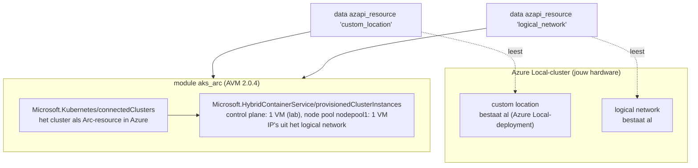

# Scenario C — AKS op Azure Local (AKS Arc) met Terraform

AKS dat op je eigen Azure Local-hardware draait en via Azure Arc beheerd wordt. Buiten je werk heb je geen Azure Local,
dus dit scenario is om te **lezen, te vergelijken en te valideren**. Op je werk kun je het gebruiken, waar dat mag.
Hoort bij [STUDIEPLAN](../../STUDIEPLAN.md), blok 8: lab L-32.

## begrippen

Lees deze eerst, in deze volgorde:

1. [AKS op Azure Local (AKS Arc)](../../CONCEPTS.md#aks-arc): custom location, logical network, control plane IP.
2. [AKS](../../CONCEPTS.md#aks): het verschil met AKS in de cloud (scenario B).
3. [Het lagenmodel](../../CONCEPTS.md#iac-lagen): zelfde lagen, alleen staat laag 1 op je eigen hardware.
4. [Terraform](../../CONCEPTS.md#terraform): modules (hier de Azure Verified Module) en providerversies.
5. [HA control plane](../../CONCEPTS.md#ha-control-plane): waarom productie `control_plane_count = 3` gebruikt.

## wat-er-gemaakt-wordt



| | Scenario B (AKS in Azure) | Scenario C (AKS op Azure Local) |
|---|---|---|
| Waar draaien de VM's | Azure | je eigen Azure Local-hosts |
| Netwerk | Azure CNI overlay in een Azure-VNet | logical network op Azure Local |
| Control plane | onzichtbaar, door Azure | VM's op Azure Local, door Microsoft beheerd via Arc |
| Terraform | `azurerm_kubernetes_cluster` | AVM-module (onder water `azapi`) |
| Providers | azurerm ~> 5.10 | azurerm **~> 4.0** + azapi ~> 2.12 (vereist door de module) |
| Pipeline en state | OIDC + Azure Storage | hetzelfde patroon |
| Status | GA | via Terraform: **preview** (oktober 2026) |

## voorwaarden

Van de beheerder van het Azure Local-cluster heb je nodig (zie `terraform.tfvars.example`):

- de resource group en regio waarin Azure Local geregistreerd is;
- de naam van de **custom location**;
- de naam van een **logical network** met genoeg vrije IP's;
- een vrij **control plane IP** in dat netwerk, buiten de IP-pool;
- object-ID's van de Entra-groep(en) die cluster-admin worden.

Vind de ID's zelf op:

```bash
az customlocation list --output table && az stack-hci-vm network lnet list --resource-group <rg> --output table
```

## lezen-en-valideren

Dit is lab L-32, zonder Azure Local:

1. Lees `main.tf` naast `../aks-azure/main.tf`: wat is gelijk, wat anders (zie de tabel hierboven)?
2. Valideren gebeurt in de pipeline: `terraform-checks.yml` draait bij elke PR `fmt`, `init -backend=false` en `validate`, ook voor deze map.
3. Lokaal hetzelfde (registry nodig voor de module):
   ```bash
   cd iac/aks-azurelocal && terraform fmt -check && terraform init -backend=false && terraform validate
   ```
4. Schrijf op welke rollen een pipeline-identiteit op je werk nodig zou hebben (op de resource group van Azure Local en de custom location).

## op-werk

Alleen waar het mag, tegen een testomgeving:

```bash
cd iac/aks-azurelocal && cp terraform.tfvars.example terraform.tfvars    # waarden van de beheerder invullen
az login && export ARM_SUBSCRIPTION_ID=$(az account show --query id -o tsv) ARM_USE_AZUREAD=true
terraform init -backend-config=storage_account_name=<sa> -backend-config=container_name=tfstate -backend-config=key=aks-azurelocal.tfstate
terraform plan
```

Na `apply` verbind je via Arc, zonder direct netwerk naar de API-server:

```bash
az connectedk8s proxy --name aksarc-k8s-lab --resource-group <rg> &
kubectl get nodes
```

Voor een pipeline kopieer je het patroon van `../../.github/workflows/aks-azure.yml` (andere map, andere state-key).

## bestanden

| Bestand | Inhoud |
|---|---|
| `versions.tf` | azurerm ~> 4.0 en azapi ~> 2.12 (eisen van de module), backend `azurerm` |
| `variables.tf` | resource group, custom location, logical network, admin-groepen, regio, clusternaam, control plane IP, SSH-key |
| `main.tf` | data sources voor custom location en logical network, de AVM-module |
| `terraform.tfvars.example` | welke waarden je van de beheerder nodig hebt |

## valkuilen

- **Providerversies:** de module eist azurerm 4.x. Combineer deze map niet met scenario B in één root-module.
- **Preview:** gedrag en inputs van de module kunnen nog veranderen; pin de versie (`2.0.4`).
- **Autoscaling** van node pools ondersteunt de module (nog) niet.
- **Control plane IP** in de IP-pool van het logical network geeft een conflict; het moet erbuiten liggen.

## bronnen

- [AKS Arc maken met Terraform (Microsoft Learn)](https://learn.microsoft.com/en-us/azure/aks/aksarc/create-clusters-terraform)
- [AVM-module provisionedclusterinstance (GitHub)](https://github.com/Azure/terraform-azurerm-avm-res-hybridcontainerservice-provisionedclusterinstance)
- [Azure Arc-enabled Kubernetes](https://learn.microsoft.com/en-us/azure/azure-arc/kubernetes/overview)
