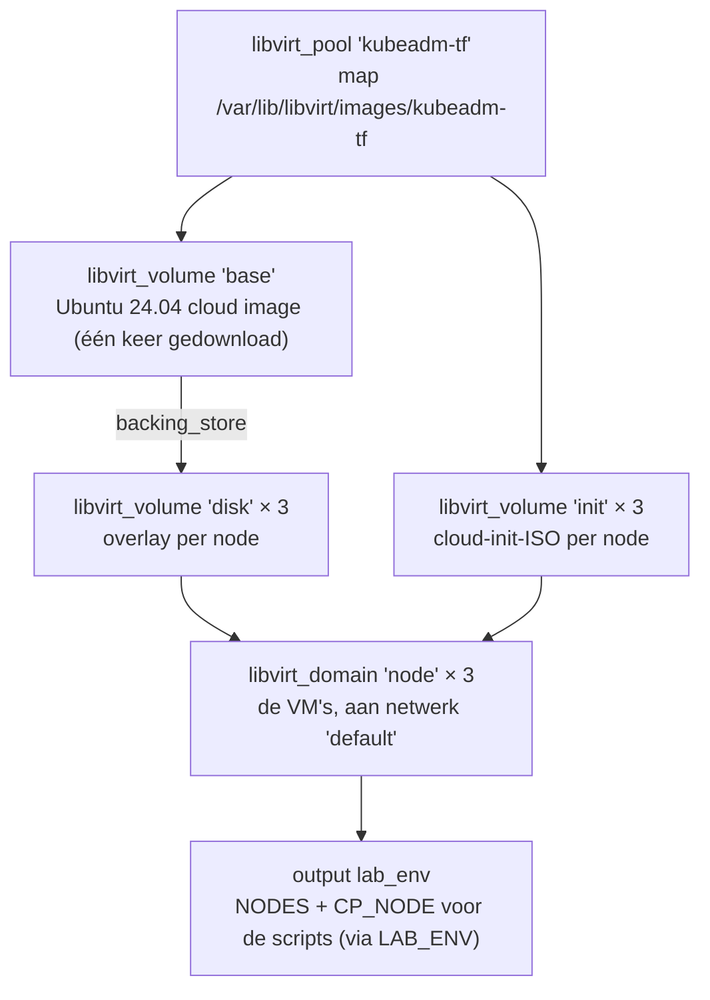

# Scenario A — on-prem lab met Terraform (libvirt op aristotle)

Een **tweede** kubeadm-cluster (`tf-cp1`, `tf-w1`, `tf-w2`), naast je script-lab, maar nu met de VM's als code.
Terraform vervangt `create-vms.sh`; de bestaande scripts doen daarna kubeadm. Hoort bij [STUDIEPLAN](../../STUDIEPLAN.md), blok 8:
labs L-28 (met de hand), L-29 en L-30 (via de pipeline).

## begrippen

Lees deze eerst, in deze volgorde:

1. [Het lagenmodel: wat doet IaC en wat doet GitOps](../../CONCEPTS.md#iac-lagen): dit scenario is laag 1 (VM's) en laag 2 (kubeadm).
2. [Terraform](../../CONCEPTS.md#terraform): providers, resources, `plan`/`apply`/`destroy`.
3. [Terraform-state](../../CONCEPTS.md#terraform-state): waarom de state hier buiten de repo-map staat.
4. [Imperatief vs declaratief](../../CONCEPTS.md#imperatief-declaratief): `create-vms.sh` (hoe) tegenover `main.tf` (wat).
5. Voor de pipeline: [CI/CD-pipeline](../../CONCEPTS.md#ci-cd-pipeline), [Self-hosted runner](../../CONCEPTS.md#self-hosted-runner), [Pull-request-flow](../../CONCEPTS.md#pull-request-flow).
6. Voor de kubeadm-stap: [kubeadm init](../../CONCEPTS.md#kubeadm-init), [kubeadm join](../../CONCEPTS.md#kubeadm-join).

## wat-er-gemaakt-wordt



| | Script-lab (`create-vms.sh`) | Dit scenario (Terraform) |
|---|---|---|
| Nodes | cp1, w1, w2 (.11–.13) | tf-cp1, tf-w1, tf-w2 (.21–.23) |
| Vast IP | DHCP-reservering met `virsh net-update` | statisch via cloud-init (netplan, `network_config`) |
| Disks | `/var/lib/libvirt/images` | eigen pool `kubeadm-tf` |
| Checksum image | ja (SHA256SUMS) | nee (de provider controleert niets) |
| Weten wat er bestaat | nee, het script kijkt of een VM al bestaat | ja, in de state |
| Opruimen | `destroy-vms.sh` | `terraform destroy` |

**Provider:** `dmacvicar/libvirt` **0.9.x**. Dat is een complete herschrijving met een schema dat de libvirt-XML volgt.
Voorbeelden van internet voor 0.8 (`network_interface`, `source = url`, `cloudinit = ...`) werken hier niet.

## voorwaarden

- Op aristotle: Terraform (`yay -S terraform`) of laat de pipeline het installeren.
- Je gebruiker zit in de groep `libvirt` (`id -nG | grep -w libvirt`) en heeft een SSH-key (`~/.ssh/id_ed25519.pub`).
- **RAM:** 3 × 4 GiB extra. Met het script-lab tegelijk aan wordt dat krap op 32 GB. Zet het script-lab even uit
  (`for n in cp1 w1 w2; do virsh shutdown $n; done`) of verlaag het RAM in `terraform.tfvars` (zie het voorbeeldbestand).

## met-de-hand

Dit is lab L-28. Doe het eerst zonder pipeline, zodat je ziet wat Terraform doet.

```bash
cd ~/kubernetes/kubeadm-lab/iac/lab-libvirt
cp terraform.tfvars.example terraform.tfvars && sed -i "s|ssh-ed25519 AAAA... jouw-key|$(cat ~/.ssh/id_ed25519.pub)|" terraform.tfvars
terraform init -backend-config="path=$HOME/.local/state/kubeadm-lab-tf/terraform.tfstate"
terraform plan            # lees het plan: 1 pool, 7 volumes, 3 domains
terraform apply
terraform output          # IP's en lab_env
```

Daarna kubeadm met de bestaande scripts, vanuit de hoofdmap:

```bash
cd ~/kubernetes/kubeadm-lab && terraform -chdir=iac/lab-libvirt output -raw lab_env > /tmp/lab-tf.env && export LAB_ENV=/tmp/lab-tf.env && ./iac/lab-libvirt/wait-nodes.sh && ./prep-nodes.sh && ./cp-init.sh && ./worker-join.sh
```

Oefen daarna met wat Terraform ziet:

```bash
terraform plan                          # "No changes": de werkelijkheid klopt met de code
virsh destroy tf-w2 && terraform plan   # wat vindt Terraform van een met de hand gestopte VM?
```

## via-de-pipeline

Dit zijn labs L-29 en L-30. Eerst eenmalig [INIT](../../INIT.md), stap 8 (privé repo en runner).

| Gebeurtenis | Wat `lab-libvirt.yml` doet |
|---|---|
| Pull request die deze map raakt | `init`, `fmt`/`validate`, `plan` op de runner op aristotle |
| Merge naar main | `plan` + `apply`, daarna `wait-nodes.sh`, `prep-nodes.sh`, `cp-init.sh` (alleen als er nog geen cluster is) en `worker-join.sh` |
| Handmatig (Actions → lab-libvirt → Run workflow) | `apply` of `destroy` |

Een node toevoegen: zet `tf-w3` (.24, MAC `...:24`) in `variables.tf`, via een PR. Na de merge maakt Terraform alleen die VM,
en joint alleen die node; `kubeadm init` draait niet opnieuw.

## controleren

```bash
virsh list --all | grep tf- && virsh vol-list kubeadm-tf
ssh ubuntu@192.168.122.21 'kubectl get nodes -o wide'      # NotReady tot je een CNI installeert (INIT stap 4)
terraform state list
```

## opruimen

```bash
terraform destroy                                            # of de pipeline: Run workflow → destroy
for ip in 192.168.122.21 192.168.122.22 192.168.122.23; do ssh-keygen -f ~/.ssh/kubeadm-lab_known_hosts -R $ip; done
```
De destroy-run van de pipeline ruimt de hostkeys zelf op. `destroy` haalt ook de pool-map weg (`destroy.delete = true`).

## bestanden

| Bestand | Inhoud |
|---|---|
| `versions.tf` | Terraform- en providerversie, lokale backend (pad bij `init`), provider-URI `qemu:///system` |
| `variables.tf` | nodes (naam, IP, MAC, vCPU, RAM), SSH-key, image-URL, diskgrootte, pool-pad, netwerk |
| `main.tf` | pool, base image, overlay-disks, cloud-init, VM's |
| `cloud-init.yaml.tftpl` | hostname, gebruiker `ubuntu`, SSH-key, qemu-guest-agent |
| `outputs.tf` | IP's en `lab_env` voor de scripts |
| `wait-nodes.sh` | wacht op SSH en cloud-init (zoals stap 4 van `create-vms.sh`) |
| `terraform.tfvars.example` | voorbeeld voor je eigen `terraform.tfvars` (die staat in `.gitignore`) |

## valkuilen

- **State kwijt = Terraform kent zijn VM's niet meer.** Bewaar hem buiten de repo-map (`actions/checkout` ruimt ongetrackte bestanden op).
- **Twee keer `kubeadm init`** op dezelfde node faalt; de pipeline controleert eerst of `/etc/kubernetes/admin.conf` bestaat.
- **SSH weigert na destroy + apply:** de nieuwe VM heeft een andere hostkey op hetzelfde IP. Ruim de oude op (zie opruimen).
- **Providerversie:** laat `~> 0.9.9` staan; een sprong naar 0.10 kan het schema weer veranderen.
- **Geen checksum** op het image, anders dan in `create-vms.sh`.

## bronnen

- [libvirt-provider (README, migratie van 0.8)](https://github.com/dmacvicar/terraform-provider-libvirt)
- [cloud-init: network config v2](https://docs.cloud-init.io/en/latest/reference/network-config-format-v2.html)
- [Terraform: local backend](https://developer.hashicorp.com/terraform/language/backend/local)
- [GitHub: self-hosted runners](https://docs.github.com/en/actions/reference/runners/self-hosted-runners)
