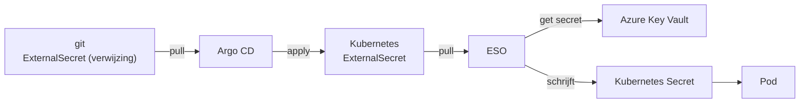

# CONCEPTS — secrets beheren met ESO en een vault

Zelfde opbouw als de andere CONCEPTS-bestanden: **wat is het → waarom → vergeleken met wat je kent → hoe werkt het →
zie het zelf → valkuilen → samenhang → bronnen**.

**Inhoud**

**Basis:** [Secret-hygiëne](#secret-hygiene) · [Kubernetes Secret](#k8s-secret) · [etcd-encryptie](#etcd-encryptie) ·
[GitOps en secrets](#gitops-secrets)

**ESO:** [External Secrets Operator](#eso) · [ESO-architectuur](#eso-architectuur) · [SecretStore](#secretstore) ·
[ExternalSecret](#externalsecret) · [`dataFrom` versus `data`](#datafrom) · [Templating](#templating) ·
[Rotatie](#rotatie) · [Refresh en drift](#drift-secret) · [deletionPolicy](#deletion-policy) ·
[PushSecret](#pushsecret) · [ClusterExternalSecret](#clusterexternalsecret) · [Foutmodes](#foutmodes)

**Azure Key Vault:** [Key Vault-objecten](#kv-objecten) · [RBAC versus access policies](#kv-rbac-vs-policy) ·
[Purge protection en soft-delete](#kv-purge-protectie) · [Netwerk en private endpoints](#kv-netwerk) ·
[Landing zone als payload](#lz-payload)

**Identiteit:** [Service principal](#service-principal) · [Workload identity](#workload-identity) ·
[Bootstrap-credential](#bootstrap-credential)

**Alternatieven:** [Secrets Store CSI-driver](#csi-driver) · [Sealed Secrets](#sealed-secrets) ·
[SOPS en age](#sops-age) · [Vault en OpenBao](#vault-openbao) · [Keycloak](#keycloak)

**Platform:** [Namespace-isolatie](#namespace-isolatie) · [Multi-tenant](#multi-tenant) ·
[Observability](#observability) · [Disaster recovery](#disaster-recovery)

De volledige vergelijking met een keuzematrix staat in [ALTERNATIVES](ALTERNATIVES.md).

---

## secret-hygiene

**Wat is het:** De gewoonte om een geheim nooit in een bestand te zetten dat je deelt, kopieert of versiebeheert.

**Waarom bestaat het:** Git is onveranderlijk. Eén commit met een wachtwoord betekent dat het voor altijd in de
geschiedenis staat, in elke clone, in elke fork en in elke back-up. Roteren is dan de enige oplossing, en dat
breekt vaak iets.

**Vergeleken met wat je kent:** Een wachtwoord in een Word-document op een netwerkschijf. Iedereen die het
bestand ooit had, heeft het nog.

**Hoe werkt het:**

| Regel | Waarom |
|---|---|
| Geen waarden in git, ook niet in een private repo | geschiedenis + clones + forks |
| Geen waarden in een Kubernetes Secret dat je commit | base64 is geen encryptie |
| Wel: een *verwijzing* (ExternalSecret) in git | reviewbaar en herhaalbaar |
| Wel: het credential zelf in een vault of secret-manager | één plek, met audit en rotatie |

**Zie het zelf:** [LABS S-01](LABS.md#s-01).

**Valkuilen:**
- Een secret dat je één keer hebt gecommit en daarna hebt verwijderd, staat er nog. `git rm` helpt niet; je moet
  de geschiedenis herschrijven én roteren.
- Een "tijdelijke" `.env` in een repo is de meest voorkomende oorzaak van een datalek.

**Hangt samen met:** [Kubernetes Secret](#k8s-secret) · [GitOps en secrets](#gitops-secrets) ·
[Sealed Secrets](#sealed-secrets)

**Bronnen:** [OWASP Secrets Management Cheat Sheet](https://cheatsheetseries.owasp.org/cheatsheets/Secrets_Management_Cheat_Sheet.html)

---

## k8s-secret

**Wat is het:** Een Kubernetes-object voor vertrouwelijke gegevens. De waarden staan base64-gecodeerd in het
object (tenzij je encryption-at-rest aanzet, dan versleutelt de API-server ze in etcd).

**Waarom bestaat het:** Zodat je een Pod een wachtwoord kunt geven zonder het in je image of in je
Deployment-YAML te zetten.

**Vergeleken met wat je kent:** Een omgevingsvariabele met een slot erop — maar het slot is de RBAC van je
cluster, niet de codering.

**Hoe werkt het:**

| Eigenschap | Werkelijkheid |
|---|---|
| base64 | codering, geen encryptie: `echo aHVudGVyMg== \| base64 -d` |
| zichtbaar voor wie `get secret` mag | ja, per namespace |
| versleuteld in etcd | alleen met encryption-at-rest ([#etcd-encryptie](#etcd-encryptie)) |
| onveranderlijk te maken | `immutable: true` (niet meer bij te werken) |
| als env of als volume | env = statisch, volume = werkt bij |

**Zie het zelf:** [LABS S-01](LABS.md#s-01) en
[Secret in de vault](../scripts/kubeadm-lab/CONCEPTS.md#secret).

**Valkuilen:**
- Een Secret in een Private repo is nog steeds een secret in git.
- Env-variabelen zijn zichtbaar in `kubectl describe pod` als je ze in `args` gebruikt, en in crashes/dumps.
- Secret-namen en keys zijn namespace-scoped: een Secret in `team-a` bestaat niet in `team-b`.

**Hangt samen met:** [Secret-hygiëne](#secret-hygiene) · [etcd-encryptie](#etcd-encryptie) ·
[RBAC](../scripts/kubeadm-lab/CONCEPTS.md#rbac)

**Bronnen:** [Kubernetes: Secrets](https://kubernetes.io/docs/concepts/configuration/secret/)

---

## etcd-encryptie

**Wat is het:** De optie waarbij de API-server Secret-objecten versleuteld opslaat in etcd.

**Waarom bestaat het:** Zonder dit staat elk Secret leesbaar in de etcd-database en in elke etcd-back-up. Wie
een snapshot heeft, heeft al je wachtwoorden.

**Vergeleken met wat je kent:** BitLocker op je schijf: de bestanden zijn nog steeds bestanden, maar een
gestolen schijf levert niets op.

**Hoe werkt het:**

```yaml
apiVersion: apiserver.config.k8s.io/v1
kind: EncryptionConfiguration
resources:
  - resources: ["secrets"]
    providers:
      - kms: {name: azure-kms, endpoint: ...}   # of aescbc met een sleutel
      - identity: {}                            # leesbaar fallback (nodig bij migratie)
```

**Zie het zelf:** `kubectl get --raw /healthz/etcd` en, op cp1,
`sudo grep -i encryption /etc/kubernetes/manifests/kube-apiserver.yaml`. Zonder `--encryption-provider-config`
is encryptie niet actief.

**Valkuilen:**
- De KMS-provider (bijv. Azure Key Vault) is zelf een afhankelijkheid: valt de sleutel weg, dan start je
  cluster niet meer op.
- Bestaande objecten worden pas versleuteld na een herschrijving
  (`kubectl get secrets -A -o yaml | kubectl replace -f -`).

**Hangt samen met:** [Kubernetes Secret](#k8s-secret) · [Key Vault-objecten](#kv-objecten)

**Bronnen:** [Kubernetes: Encrypting data at rest](https://kubernetes.io/docs/tasks/administer-cluster/encrypt-data/)

---

## gitops-secrets

**Wat is het:** Het patroon waarbij git de **verwijzing** naar een secret bevat en de vault de **waarde**.

**Waarom bestaat het:** Je wilt wel de voordelen van GitOps (review, geschiedenis, continu reconcileren) zonder
de secret in git te zetten. Dat kan: de ExternalSecret is een gewoon YAML-object met een *pointer*.

**Vergeleken met wat je kent:** Een configuratiebestand met een `KeyVault:`-referentie in plaats van een
wachtwoord.

**Hoe werkt het:**



**Zie het zelf:** [LABS S-18](LABS.md#s-18).

**Valkuilen:**
- Twee controllers, twee eigenaren: Argo CD bezit de ExternalSecret, ESO bezit het Secret. Zet het Secret niet
  óók in git.
- Een `ExternalSecret` zonder de bijbehorende store faalt; de store bevat vaak het enige echte geheim
  ([#bootstrap-credential](#bootstrap-credential)).

**Hangt samen met:** [ESO](#eso) · [GitOps](../gitops-lab/CONCEPTS.md#gitops) ·
[Secrets in git](../gitops-lab/CONCEPTS.md#secrets-in-git)

**Bronnen:** [External Secrets Operator](https://external-secrets.io/)

---

## eso

**Wat is het:** De External Secrets Operator: een Kubernetes-operator die waarden uit externe systemen
(Azure Key Vault, AWS Secrets Manager, Vault, GCP, 1Password, ...) omzet in Kubernetes Secrets, op basis van
CRD's.

**Waarom bestaat het:** Zodat je app gewoon een Secret leest (geen SDK, geen code-wijziging) en de waarde toch
op één plek in een vault staat, met rotatie en audit.

**Vergeleken met wat je kent:** Een pull-based DSC die configuratie ophaalt en lokaal neerzet; of een
vault-agent die secrets naar een bestand schrijft.

**Hoe werkt het:**

| CRD | Rol |
|---|---|
| `SecretStore` / `ClusterSecretStore` | hoe kom ik bij de vault (provider + auth) |
| `ExternalSecret` | welke waarde(s), naar welk Kubernetes Secret |
| `ClusterExternalSecret` | één ExternalSecret, veel namespaces |
| `PushSecret` | de omgekeerde richting: cluster → vault |
| `Password`/`Fake`/... | generators (losse wachtwoorden zonder vault) |

**Zie het zelf:** [LABS S-03](LABS.md#s-03) en `./secrets.sh status`.

**Valkuilen:**
- ESO is geen encryptie: het resultaat is een gewoon Kubernetes Secret. Zet
  [etcd-encryptie](#etcd-encryptie) aan als je dat wilt.
- De operator heeft zelf een credential nodig; dat is het lastigste ontwerpvraagstuk
  ([#bootstrap-credential](#bootstrap-credential)).

**Hangt samen met:** [ESO-architectuur](#eso-architectuur) · [SecretStore](#secretstore) ·
[ExternalSecret](#externalsecret) · [ALTERNATIVES](ALTERNATIVES.md)

**Bronnen:** [external-secrets.io](https://external-secrets.io/latest/)

---

## eso-architectuur

**Wat is het:** ESO bestaat uit drie deployments: de **controller** (reconciliëren), de **webhook** (valideren
van CRD's) en de **cert-controller** (certificaten voor de webhook).

**Waarom bestaat het:** De taken hebben verschillende rechten en lifecycle. De webhook moet bijvoorbeeld
draaien vóór er CRD's worden toegepast.

**Vergeleken met wat je kent:** De opzet van veel operators: controller + admission webhook + cert-rotator.

**Hoe werkt het:**

| Component | Taak | Zichtbaar als |
|---|---|---|
| `external-secrets` | vergelijkt ExternalSecret met vault en met live Secret | deployment |
| `external-secrets-webhook` | valideert/bewaakt CRD's | deployment + `ValidatingWebhookConfiguration` |
| `external-secrets-cert-controller` | injecteert CA in de webhook | deployment |

**Zie het zelf:** `kubectl --namespace=external-secrets get pods` (drie pods) en
`kubectl get crd | grep external-secrets | wc -l` (25 CRD's, versie 2.14.0).

**Valkuilen:**
- De webhook kan een sync blokkeren als zijn certificaat verlopen is: dan faalt *elke* wijziging aan een
  ExternalSecret.
- De CRD's zijn groot; met Argo CD heb je `ServerSideApply=true` nodig.

**Hangt samen met:** [ESO](#eso) · [Admission control](../scripts/kubeadm-lab/CONCEPTS.md#admission-control)

**Bronnen:** [ESO: architecture](https://external-secrets.io/latest/introduction/overview/)

---

## secretstore

**Wat is het:** De definitie van *hoe* je bij een vault komt: provider, endpoint en authenticatie. `SecretStore`
is namespace-scoped, `ClusterSecretStore` is clusterbreed.

**Waarom bestaat het:** Zonder deze scheiding zou elke ExternalSecret de authenticatie opnieuw moeten bevatten —
en dus het credential.

**Vergeleken met wat je kent:** Een connection string, maar dan als object met een eigen lifecycle en RBAC.

**Hoe werkt het:**

```yaml
apiVersion: external-secrets.io/v1
kind: ClusterSecretStore
metadata:
  name: azure-kv
spec:
  conditions:
    - namespaceSelector:
        matchLabels:
          secrets.maxilabs.dev/azure-kv: "true"
  provider:
    azurekv:
      vaultUrl: https://ml-kv-k8ssec-28a5.vault.azure.net
      tenantId: <tenant>
      authType: ServicePrincipal
      authSecretRef:
        clientId:     {name: azure-sp-reader, namespace: external-secrets, key: ClientID}
        clientSecret: {name: azure-sp-reader, namespace: external-secrets, key: ClientSecret}
```

**Zie het zelf:** `kubectl get clustersecretstore` → `STATUS: Valid`, `CAPABILITIES: ReadWrite`.
Bij een fout zie je `InvalidProviderConfig` met de reden in de conditie.

**Valkuilen:**
- Bij een `ClusterSecretStore` moet je bij het auth-secret een `namespace` opgeven; anders zoekt ESO in de
  namespace van de ExternalSecret en vindt niets.
- Zonder `conditions` is een ClusterSecretStore overal bruikbaar — inclusief namespaces waar je dat niet wilt.

**Hangt samen met:** [ExternalSecret](#externalsecret) · [Namespace-isolatie](#namespace-isolatie) ·
[Service principal](#service-principal)

**Bronnen:** [ESO: SecretStore](https://external-secrets.io/latest/api/secretstore/)

---

## externalsecret

**Wat is het:** De CR die zegt: haal *deze* waarde(n) uit *die* store en zet ze in *dit* Kubernetes Secret, met
*deze* vorm en *dit* eigenaarschap.

**Waarom bestaat het:** Het is de enige plek waar de koppeling tussen vault en workload staat — reviewbaar in
git, zonder de waarde.

**Vergeleken met wat je kent:** Een `helm value` die naar een vault verwijst, maar dan als object dat blijft
controleren.

**Hoe werkt het:**

| Veld | Betekenis |
|---|---|
| `refreshInterval` | hoe vaak opnieuw ophalen (30s–1h) |
| `refreshPolicy` | `Periodic` (default) of `CreatedOnce` |
| `secretStoreRef` | welke store (en of dat een SecretStore of ClusterSecretStore is) |
| `target.name` | naam van het resulterende Kubernetes Secret |
| `target.creationPolicy` | `Owner` (beheert het) of `Merge` |
| `target.deletionPolicy` | `Retain` / `Merge` / `Delete` |
| `data[]` | losse sleutels (`secretKey` + `remoteRef`) |
| `dataFrom[]` | hele objecten (`extract`) of zoekopdrachten (`find`) |

**Zie het zelf:** [LABS S-04](LABS.md#s-04), en `kubectl get externalsecret` →
`STATUS: SecretSynced`, `READY: True`.

**Valkuilen:**
- Twee ExternalSecrets met dezelfde `target.name` → `SecretOwnedByOther`.
- `dataFrom.extract` neemt de sleutelnamen letterlijk over: `api_key` wordt `api_key`, geen `API_KEY`.
- Een Secret dat als `envFrom` binnenkomt, verandert niet mee met een refresh ([#rotatie](#rotatie)).

**Hangt samen met:** [`dataFrom` versus `data`](#datafrom) · [Templating](#templating) ·
[deletionPolicy](#deletion-policy)

**Bronnen:** [ESO: ExternalSecret](https://external-secrets.io/latest/api/externalsecret/)

---

## datafrom

**Wat is het:** Twee manieren om waarden te beschrijven: `data` (per sleutel) en `dataFrom` (per object of
zoekopdracht).

**Waarom bestaat het:** Een Key Vault-secret bevat vaak een JSON-object met meerdere velden. Die wil je in één
keer overnemen, niet veld voor veld.

**Vergeleken met wat je kent:** `SELECT *` versus losse kolommen.

**Hoe werkt het:**

| Vorm | Resultaat |
|---|---|
| `data: [{secretKey: pw, remoteRef: {key: db, property: password}}]` | één sleutel `pw` |
| `dataFrom: [{extract: {key: app-config}}]` | alle velden uit dat object |
| `dataFrom: [{find: {name: {regexp: "^app-"}}}]` | alle matchende objecten |

**Zie het zelf:** [LABS S-06](LABS.md#s-06): één Key Vault-secret met JSON levert vier Kubernetes-keys.

**Valkuilen:**
- `find` vraagt `list`-rechten op de vault; met alleen `get` werkt het niet.
- Bij `extract` van een secret dat geen JSON is, krijg je één sleutel met de hele waarde.

**Hangt samen met:** [ExternalSecret](#externalsecret) · [Key Vault-objecten](#kv-objecten)

**Bronnen:** [ESO: dataFrom](https://external-secrets.io/latest/guides/getallsecrets/)

---

## templating

**Wat is het:** Waarden herschrijven of combineren tijdens het syncen, met de Go-template-engine van ESO
(`engineVersion: v2`, inclusief Sprig).

**Waarom bestaat het:** Je app wil één `DATABASE_URL`, geen losse gebruiker en wachtwoord. En je wilt soms een
checksum om een rollout af te dwingen.

**Vergeleken met wat je kent:** Een Helm-template, maar over vault-waarden in plaats van values.

**Hoe werkt het:**

```yaml
target:
  template:
    engineVersion: v2
    data:
      DATABASE_URL: "postgres://{{ .username }}:{{ .password }}@db:5432/app"
      CONFIG_CHECKSUM: "{{ .api_key | sha256sum }}"
```

**Zie het zelf:** [LABS S-07](LABS.md#s-07). Beschikbaar zijn o.a. `sha256sum`, `trunc`, `default`, `b64enc`,
`upper`, `printf`.

**Valkuilen:**
- De gerenderde waarde bestaat kort in het geheugen van de ESO-controller; log die niet.
- Een typefout in de template geeft een sync-fout (`SecretSyncedError`) met de template-regel erbij — lees die
  melding, hij is precies.

**Hangt samen met:** [ExternalSecret](#externalsecret) · [Rotatie](#rotatie)

**Bronnen:** [ESO: templating](https://external-secrets.io/latest/guides/templating/)

---

## rotatie

**Wat is het:** Het periodiek vervangen van een geheim — en het zorgen dat je workloads het nieuwe geheim gaan
gebruiken.

**Waarom bestaat het:** Een geheim dat nooit roteert, is een geheim dat ooit uitlekt en dan voor altijd geldig
is.

**Vergeleken met wat je kent:** Wachtwoordverloop op een account, maar dan voor machine-credentials.

**Hoe werkt het:**

| Laag | Rotatie |
|---|---|
| waarde in de vault | `az keyvault secret set` (nieuwe versie) |
| Kubernetes Secret | ESO, binnen `refreshInterval` |
| Pod met `env`/`envFrom` | pas na herstart |
| Pod met volume-mount | binnen ±1 minuut |
| bootstrap-credential (SP) | nieuwe client-secret + Secret + ESO herstart ([LABS S-14](LABS.md#s-14)) |

**Zie het zelf:** [LABS S-08](LABS.md#s-08): nieuwe waarde in de vault, binnen 30 seconden in het Secret.

**Valkuilen:**
- Een oude client-secret blijft geldig tot je hem intrekt: roteren is toevoegen + uitfaseren, niet vervangen.
- `refreshPolicy: CreatedOnce` zet rotatie effectief uit.

**Hangt samen met:** [Refresh en drift](#drift-secret) · [Service principal](#service-principal)

**Bronnen:** [ESO: rotation](https://external-secrets.io/latest/guides/rotation/)

---

## drift-secret

**Wat is het:** Het verschil tussen het Kubernetes Secret en de waarde in de vault, meestal ontstaan door een
handmatige `kubectl patch`.

**Waarom bestaat het:** Zodat je weet wie de baas is: de vault. Een handmatige wijziging verdwijnt bij de
volgende refresh.

**Vergeleken met wat je kent:** [Drift](../gitops-lab/CONCEPTS.md#drift) bij Argo CD, maar dan voor de inhoud
van één Secret.

**Hoe werkt het:** ESO vergelijkt elke `refreshInterval` de vault-waarde met het Secret en corrigeert.

**Zie het zelf:** [LABS S-10](LABS.md#s-10): je patch wordt binnen een minuut teruggedraaid.

**Valkuilen:**
- Tijdens een incident is `kubectl patch` verleidelijk; de daaropvolgende reconciliatie maakt je fix ongedaan.
- Wil je echt iets anders, wijzig dan de vault of de ExternalSecret.

**Hangt samen met:** [Rotatie](#rotatie) · [ExternalSecret](#externalsecret)

**Bronnen:** [ESO: FAQ](https://external-secrets.io/latest/faq/)

---

## deletion-policy

**Wat is het:** De keuze wat er met het Kubernetes Secret gebeurt als de ExternalSecret verdwijnt:
`Retain`, `Merge` of `Delete`.

**Waarom bestaat het:** Omdat 'prune' in GitOps anders je productieconfiguratie kan verwijderen als iemand een
bestand uit git haalt.

**Vergeleken met wat je kent:** De reclaim policy van een PV, of `Retain` bij CloudFormation.

**Hoe werkt het:**

| Policy | Secret blijft? | Gebruik |
|---|---|---|
| `Retain` | ja | standaard; veilig |
| `Merge` | ja, sleutels blijven | meerdere bronnen in één Secret |
| `Delete` | nee | alleen als de app zonder kan |

**Zie het zelf:** [LABS S-09](LABS.md#s-09).

**Valkuilen:**
- `Delete` in combinatie met Argo CD `prune: true` is een voetangsel: één verkeerde commit en je Secret is weg.
- `creationPolicy: Merge` laat oude sleutels staan; een verwijderde sleutel in de vault verdwijnt dan niet.

**Hangt samen met:** [ExternalSecret](#externalsecret) · [Prune](../gitops-lab/CONCEPTS.md#prune)

**Bronnen:** [ESO: deletion policy](https://external-secrets.io/latest/guides/deletion-policy/)

---

## pushsecret

**Wat is het:** Een CR die een Kubernetes Secret **naar** de vault schrijft (`v1alpha1`).

**Waarom bestaat het:** Voor waarden die in het cluster ontstaan: bootstrap-tokens, gegenereerde certificaten,
of een migratie van "secrets in YAML" naar een echte vault.

**Vergeleken met wat je kent:** Een back-up van je Secret naar een kluis, maar dan continu.

**Hoe werkt het:**

```yaml
apiVersion: external-secrets.io/v1alpha1
kind: PushSecret
spec:
  updatePolicy: Replace      # of Amend
  deletionPolicy: None       # Delete = ook uit de vault halen
  secretStoreRefs: [{name: azure-kv-writer, kind: SecretStore}]
  selector: {secret: {name: push-source}}
  data: [{match: {secretKey: token, remoteRef: {remoteKey: pushed-token}}}]
```

**Zie het zelf:** [LABS S-12](LABS.md#s-12) — en controleer het resultaat in Azure:
`az keyvault secret show --name pushed-token`.

**Valkuilen:**
- Schrijven vraagt andere rechten dan lezen: gebruik een aparte identiteit
  ([least privilege](LABS.md#s-14)).
- `deletionPolicy: Delete` verwijdert het object in de vault als je de PushSecret opruimt.

**Hangt samen met:** [Service principal](#service-principal) · [Key Vault-objecten](#kv-objecten)

**Bronnen:** [ESO: PushSecret](https://external-secrets.io/latest/api/pushsecret/)

---

## clusterexternalsecret

**Wat is het:** Eén definitie die ESO in elke passende namespace een eigen ExternalSecret laat aanmaken.

**Waarom bestaat het:** Bij twintig team-namespaces wil je niet twintig bestanden in git, maar één.

**Vergeleken met wat je kent:** Een ApplicationSet in Argo CD: één CR, veel gegenereerde objecten.

**Hoe werkt het:**

| Veld | Betekenis |
|---|---|
| `namespaceSelector` | welke namespaces (label!) |
| `externalSecretName` | naam van de ExternalSecret in elke namespace |
| `refreshTime` | hoe vaak de namespace-lijst opnieuw bekeken wordt |
| `externalSecretSpec` | de inhoud van elke ExternalSecret |

**Zie het zelf:** [LABS S-11](LABS.md#s-11): label een namespace, en de ExternalSecret verschijnt.

**Valkuilen:**
- Een nieuwe namespace zonder het label krijgt niets — dat is meestal gewenst, soms vergeten.
- De gegenereerde ExternalSecrets zijn eigendom van de ClusterExternalSecret: handmatig aanpassen wordt
  overschreven.

**Hangt samen met:** [ApplicationSet](../gitops-lab/CONCEPTS.md#applicationset) ·
[Namespace-isolatie](#namespace-isolatie)

**Bronnen:** [ESO: ClusterExternalSecret](https://external-secrets.io/latest/api/clusterexternalsecret/)

---

## foutmodes

**Wat is het:** De verzameling manieren waarop secret-sync misgaat, met hun herkenbare melding.

**Waarom bestaat het:** 90% van de tijd is het één van vijf dingen, en de melding wijst ze bijna altijd aan.

**Vergeleken met wat je kent:** De `CrashLoopBackOff`-checklist, maar dan voor secrets.

**Hoe werkt het:**

| Melding | Oorzaak | Fix |
|---|---|---|
| `AADSTS7000215` / `invalid client secret` | secret verlopen of geroteerd | nieuwe credential, Secret bijwerken |
| `ForbiddenByRbac` / `403` | rol ontbreekt op de vault | rol toekennen (en propagatie afwachten) |
| `InvalidProviderConfig` | store-config fout (URL, tenant, secretnaam) | `kubectl describe clustersecretstore` |
| `SecretNotFound` | `remoteRef.key` bestaat niet | naam in de vault controleren |
| `SecretOwnedByOther` | twee ExternalSecrets, één Secret | andere `target.name` |
| `CreateContainerConfigError` | Pod verwijst naar een Secret dat (nog) niet bestaat | ordening: sync-wave of wachten |

**Zie het zelf:** [LABS S-13](LABS.md#s-13) en `./secrets.sh debug <naam>`.

**Valkuilen:**
- Roltoewijzingen in Azure hebben propagatietijd (seconden tot minuten). Direct testen na een `role assignment`
  geeft soms onterecht een 403.
- `kubectl describe externalsecret` toont de conditie `Ready=False` met de echte reden; dat is altijd je eerste
  stap.

**Hangt samen met:** [ESO](#eso) · [Key Vault RBAC](#kv-rbac-vs-policy)

**Bronnen:** [ESO: troubleshooting](https://external-secrets.io/latest/guides/troubleshooting/)

---

## kv-objecten

**Wat is het:** Key Vault kent drie soorten objecten: **secrets** (strings), **keys** (cryptografische sleutels)
en **certificates** (X.509 + private key).

**Waarom bestaat het:** Ze hebben verschillende operaties en rechten. Een sleutel gebruik je om te
versleutelen/ondertekenen; een secret om een wachtwoord te bewaren.

**Vergeleken met wat je kent:** Een kluis met drie soorten vakjes, elk met eigen sleutels.

**Hoe werkt het:**

| Object | Gebruik met ESO | Rol |
|---|---|---|
| secret | `ExternalSecret` (dit lab) | Key Vault Secrets User/Officer |
| key | niet via ESO; gebruik de Key Vault API/SDK | Key Vault Crypto User |
| certificate | `ExternalSecret` met `type: kubernetes.io/tls` (cert + key) | Key Vault Certificate User |

**Zie het zelf:** `az keyvault secret list --vault-name "$KV"` en
`az keyvault certificate list --vault-name "$KV"`.

**Valkuilen:**
- Certificaten die je via ESO ophaalt, worden door Key Vault **niet** automatisch verlengd tenzij je een
  rotatiebeleid instelt; ESO levert alleen wat er staat.
- Een "secret" in Key Vault mag maximaal 25 kB zijn; grotere bestanden horen in Blob Storage.

**Hangt samen met:** [`dataFrom` versus `data`](#datafrom) · [CSI-driver](#csi-driver)

**Bronnen:** [Key Vault: keys, secrets, certificates](https://learn.microsoft.com/en-us/azure/key-vault/general/about-keys-secrets-certificates)

---

## kv-rbac-vs-policy

**Wat is het:** Twee manieren om toegang tot Key Vault te regelen: **Azure RBAC** (rollen, aanbevolen) en de
oudere **access policies** (permissies op de vault zelf).

**Waarom bestaat het:** RBAC geeft één model voor je hele Azure-omgeving, met rollen zoals
`Key Vault Secrets User`. Access policies zijn fijner maar los van de rest.

**Vergeleken met wat je kent:** Azure RBAC versus een losse ACL op een share.

**Hoe werkt het:**

| Rol | Mag |
|---|---|
| `Key Vault Secrets User` | secrets lezen (+ lijst) |
| `Key Vault Secrets Officer` | lezen + schrijven + verwijderen van secrets |
| `Key Vault Reader` | metadata van de vault, geen secrets |
| `Key Vault Administrator` | alles, inclusief access policies |

**Zie het zelf:** [LABS S-14](LABS.md#s-14): lezer en schrijver hebben verschillende rollen, op dezelfde vault.

**Valkuilen:**
- De **maker** van een vault krijgt geen data-plane rechten. Je moet jezelf expliciet een rol geven.
- Een vault heeft één modus; je kunt RBAC en access policies niet mengen.
- Rollen hebben propagatietijd.

**Hangt samen met:** [Service principal](#service-principal) · [Least privilege](LABS.md#s-14)

**Bronnen:** [Key Vault RBAC](https://learn.microsoft.com/en-us/azure/key-vault/general/rbac-guide)

---

## kv-purge-protectie

**Wat is het:** Key Vault heeft altijd **soft-delete** (een verwijderde vault of secret blijft herstelbaar) en
optioneel **purge protection** (je kunt hem in die periode niet definitief verwijderen).

**Waarom bestaat het:** Zodat een aanval of fout je sleutels niet definitief wist. Voor compliance is het vaak
verplicht.

**Vergeleken met wat je kent:** De prullenbak met een vergrendeling erop.

**Hoe werkt het:**

| Instelling | Effect |
|---|---|
| soft-delete (altijd) | 7–90 dagen herstelbaar; de **naam** is gereserveerd |
| purge protection aan | in die periode niet te purgen → naam 90 dagen bezet |
| policy `Deny` (zoals in deze landing zone) | vaults zonder purge protection worden geweigerd |

**Zie het zelf:** In dit lab: `az keyvault show --query properties.enablePurgeProtection` geeft `true`.
Daarom maakt `secrets.sh` een unieke naam (`ml-kv-k8ssec-xxxx`) in plaats van een vaste.

**Valkuilen:**
- Na `destroy` kun je dezelfde vaultnaam niet opnieuw gebruiken; dat is geen fout maar de policy.
- Purge protection kun je (eenmaal aan) niet meer uitzetten.

**Hangt samen met:** [Landing zone als payload](#lz-payload) · [Disaster recovery](#disaster-recovery)

**Bronnen:** [Key Vault soft-delete](https://learn.microsoft.com/en-us/azure/key-vault/general/soft-delete-overview)

---

## kv-netwerk

**Wat is het:** De netwerkregels van Key Vault: publiek bereikbaar, firewall-regels, service endpoints of een
**private endpoint**.

**Waarom bestaat het:** Een vault die publiek bereikbaar is, is alleen door RBAC beschermd. Voor strengere
eisen wil je dat alleen jouw netwerk erbij kan.

**Vergeleken met wat je kent:** Een database met 'public access: disabled' en een private endpoint.

**Hoe werkt het:**

| Stand | Wie komt erbij | Gevolg voor ESO |
|---|---|---|
| publiek | iedereen (met rechten) | werkt direct |
| firewall / IP-regels | genoemde netwerken | cluster-egress-IP toevoegen |
| private endpoint | alleen je VNet | ESO moet in dat VNet kunnen komen |

**Zie het zelf:** `az keyvault show --query properties.networkAcls` en
`az keyvault private-endpoint-connection list --name "$KV"`.

**Valkuilen:**
- Met een private endpoint heeft je **laptop** geen toegang meer; seed dan vanuit het cluster of via een
  sprongserver.
- DNS is het lastigste deel: de vault moet in het VNet naar het private IP verwijzen, anders werkt het niet.

**Hangt samen met:** [Key Vault-objecten](#kv-objecten) · [Observability](#observability)

**Bronnen:** [Key Vault network security](https://learn.microsoft.com/en-us/azure/key-vault/general/network-security)

---

## lz-payload

**Wat is het:** De JSON waarmee je in dit platform een landing zone aanvraagt; de
[vending machine](https://github.com/maxilabs/solutions/tree/main/landing-zone-vending-machine) maakt daar
subscription, management group-plaatsing, resource group, VNet, opslag en identiteit van.

**Waarom bestaat het:** Zodat een omgeving niet "even met de hand" ontstaat maar reproduceerbaar en met dezelfde
tags, policies en RBAC.

**Vergeleken met wat je kent:** Een Terraform-module met een tfvars-bestand, maar dan als self-service request.

**Hoe werkt het:**

| Deel | Betekenis |
|---|---|
| `payload_id` | naam van de aanvraag (ook de state-key) |
| `subscription.create_new` | nieuwe subscription of bestaande adopteren |
| `metadata.management_group_id` | waar de subscription komt te hangen |
| `resources.*` | wat er aangemaakt wordt (RG, VNet, storage, identiteit) |
| `tags` | kostenplaats, eigenaar, `managed-by` |

**Zie het zelf:** [LABS S-02](LABS.md#s-02). De payload voor dit lab:
`landing-zone-vending-machine/payloads/k8s-secrets-dev-20261026.json`.

**Valkuilen (allemaal echt tegengekomen bij het bouwen van dit lab):**
- `create_new: true` faalt bij het tenant-limiet met `SubscriptionCountReachedLimit`.
- Een geannuleerde subscription houdt een slot vast.
- De payload heeft een `key_vault`-blok, maar de Terraform-module deployt **geen** Key Vault.
- Policies op de management group (purge protection, RBAC) bepalen wat je kunt maken.

**Hangt samen met:** [Het lagenmodel](../scripts/kubeadm-lab/CONCEPTS.md#iac-lagen) ·
[Terraform](../scripts/kubeadm-lab/CONCEPTS.md#terraform) · [Purge protection](#kv-purge-protectie)

**Bronnen:** `landing-zone-vending-machine/README.md` en `USAGE.md` in de solutions-repo

---

## service-principal

**Wat is het:** Een Entra ID-identiteit voor een applicatie (app-registratie), met een client-secret of
certificaat als credential.

**Waarom bestaat het:** Iets moet namens ESO bij Key Vault inloggen. Op een cluster zonder managed identity is
dat een service principal.

**Vergeleken met wat je kent:** Een service account met een wachtwoord, maar met een eigen object-ID en rollen.

**Hoe werkt het:**

| Onderdeel | Waar |
|---|---|
| app-registratie | Entra ID (`az ad app`) |
| service principal | Entra ID (`az ad sp`) — dit is wat rollen krijgt |
| client-secret | eenmalig zichtbaar bij aanmaken/roteren |
| rol | op de vault (niet op de subscription) |

**Zie het zelf:** `./secrets.sh azure init` maakt `sp-eso-k8s-reader` en `sp-eso-k8s-writer` en zet hun
credentials in het cluster (niet in git).

**Valkuilen:**
- Een app kan bestaan zonder service principal (na een gedeeltelijke delete) — dan kun je geen rol toekennen.
- Secrets verlopen; zet een herinnering of roteer via je pipeline.
- Een certificaat in plaats van een secret is veiliger (geen string die je kunt kopiëren).

**Hangt samen met:** [Workload identity](#workload-identity) · [Bootstrap-credential](#bootstrap-credential) ·
[Key Vault RBAC](#kv-rbac-vs-policy)

**Bronnen:** [Entra: service principals](https://learn.microsoft.com/en-us/entra/identity-platform/app-objects-and-service-principals)

---

## workload-identity

**Wat is het:** Een federatie tussen een Kubernetes ServiceAccount en een Entra ID-identiteit, zodat je Pod
zonder secret een token kan krijgen.

**Waarom bestaat het:** Het haalt het laatste geheim weg: geen client-secret meer dat kan Lekken of verlopen.

**Vergeleken met wat je kent:** Een managed identity op een VM, maar dan voor een Pod.

**Hoe werkt het:**

| Stap | Wat |
|---|---|
| 1 | cluster heeft een **publiek** bereikbare OIDC-issuer |
| 2 | Entra: federated credential op de app/MI met subject `system:serviceaccount:ns:naam` |
| 3 | Pod krijgt een ServiceAccount-token (projected volume) |
| 4 | ESO wisselt dat token bij Entra voor een Azure-token |

**Zie het zelf:** [LABS S-15](LABS.md#s-15): op dit kubeadm-cluster is de issuer niet publiek, dus het kan
hier niet.

**Valkuilen:**
- De issuer moet HTTPS en publiek zijn; een intern cluster kan dit niet zonder extra componenten.
- Op AKS heb je `--enable-oidc-issuer --enable-workload-identity` nodig; daarna is het een kwestie van
  labels en annotaties.

**Hangt samen met:** [Service principal](#service-principal) · [ServiceAccount](../scripts/kubeadm-lab/CONCEPTS.md#serviceaccount)

**Bronnen:** [Azure workload identity](https://learn.microsoft.com/en-us/azure/aks/workload-identity-overview)

---

## bootstrap-credential

**Wat is het:** Het enige geheim dat je niet uit een vault kunt halen: het credential waarmee je bij de vault
komt.

**Waarom bestaat het:** Kip-en-ei. Elke oplossing heeft een wortel: een secret, een certificaat, of een
federatie met een identiteit die je al vertrouwt.

**Vergeleken met wat je kent:** De eerste wachtwoordzin van een wachtwoordmanager.

**Hoe werkt het:**

| Oplossing | Wortel | Beter/slechter |
|---|---|---|
| SP met client-secret in een K8s Secret | het secret | simpel, maar een secret in het cluster |
| SP met certificaat in een K8s Secret | het certificaat | stiller, maar nog steeds een bestand |
| workload identity | geen (federatie) | beste, vereist publieke OIDC |
| Sealed Secrets / SOPS | een sleutel in het cluster | het geheim staat in git, versleuteld |

**Zie het zelf:** in dit lab staat het in `~/.config/secrets-lab/*.json` (600) en als Secret in
`external-secrets`; **niet** in git.

**Valkuilen:**
- Vergeet dit credential niet te roteren: het is je zwakste punt.
- Zet het niet in dezelfde vault die het ontsluit.

**Hangt samen met:** [Service principal](#service-principal) · [Sealed Secrets](#sealed-secrets) ·
[SOPS en age](#sops-age)

**Bronnen:** [ESO: authentication](https://external-secrets.io/latest/guides/multi-tenancy/)

---

## csi-driver

**Wat is het:** De Secrets Store CSI Driver: een DaemonSet die secrets uit een vault als **volume** in een Pod
mount, zonder dat er een Kubernetes Secret bestaat.

**Waarom bestaat het:** Voor teams die eisen dat de waarde nooit als Secret-object in etcd staat.

**Vergeleken met wat je kent:** Een geheime schijf die je in een container mount.

**Hoe werkt het:**

| | CSI-driver | ESO |
|---|---|---|
| Resultaat | volume (tmpfs) | Kubernetes Secret |
| `envFrom` | nee | ja |
| Rotatie in Pod | ja (volume) | ja (volume) / nee (env) |
| Delen tussen workloads | `SecretProviderClass` | Secret of ClusterExternalSecret |
| Componenten | driver + provider per node | één operator |
| Zichtbaar in `kubectl get secrets` | nee | ja |

**Zie het zelf:** [LABS S-16](LABS.md#s-16) beschrijft de afweging; installeren kan later.

**Valkuilen:**
- De driver draait per node (DaemonSet): meer bewegende delen.
- Veel apps verwachten env-variabelen; dan moet je ze uit het bestand lezen.

**Hangt samen met:** [ESO](#eso) · [ALTERNATIVES](ALTERNATIVES.md#csi-driver)

**Bronnen:** [secrets-store-csi-driver](https://secrets-store-csi-driver.sigs.k8s.io/)

---

## sealed-secrets

**Wat is het:** Een controller die een versleutelde Secret (**SealedSecret**) in git laat staan en die in het
cluster ontsleutelt met een privésleutel die alleen in het cluster bestaat.

**Waarom bestaat het:** Je wilt je GitOps-repo self-contained houden: ook de secrets staan in git, maar
onleesbaar.

**Vergeleken met wat je kent:** Een GPG-versleuteld bestand in je repo, maar met automatische ontsleuteling.

**Hoe werkt het:** `kubeseal` versleutelt met de publieke sleutel van de controller; alleen die controller kan
het ontsleutelen. De SealedSecret is namespace- en naamgebonden.

**Zie het zelf:** [ALTERNATIVES](ALTERNATIVES.md#sealed-secrets) heeft de exacte commando's.

**Valkuilen:**
- De privésleutel is je bootstrap-credential: back-up en bescherming zijn cruciaal, anders is je hele repo
  onbruikbaar.
- Je kunt een SealedSecret niet naar een andere namespace kopiëren zonder opnieuw te sealen.

**Hangt samen met:** [Bootstrap-credential](#bootstrap-credential) · [SOPS en age](#sops-age) ·
[Secrets in git](../gitops-lab/CONCEPTS.md#secrets-in-git)

**Bronnen:** [Sealed Secrets](https://github.com/bitnami-labs/sealed-secrets)

---

## sops-age

**Wat is het:** SOPS versleutelt *waarden* in een YAML/JSON-bestand (niet het hele bestand), met age, GPG of een
cloud-KMS. Diffen blijft daardoor leesbaar.

**Waarom bestaat het:** Ideaal voor GitOps: je ziet wélke sleutel veranderde, niet de waarde. En met een
cloud-KMS is er geen privésleutel in je cluster.

**Vergeleken met wat je kent:** Een versleutelde kolom in een database in plaats van een versleuteld bestand.

**Hoe werkt het:** `sops -e -i secret.yaml` met een `.sops.yaml`-regel per pad; ontsleutelen door de
ESO-SOPS-provider, Flux of een init-container.

**Zie het zelf:** [ALTERNATIVES](ALTERNATIVES.md#sops).

**Valkuilen:**
- Met age heb je een privésleutel in het cluster (bootstrap-credential); met Azure KMS niet, maar dan hang je
  aan Azure.
- SOPS versleutelt alleen de waarden; de structuur blijft zichtbaar (dat is meestal gewenst).

**Hangt samen met:** [Sealed Secrets](#sealed-secrets) · [Bootstrap-credential](#bootstrap-credential)

**Bronnen:** [SOPS](https://github.com/getsops/sops)

---

## vault-openbao

**Wat is het:** HashiCorp Vault is de bekendste secret-manager; **OpenBao** is de open-source fork (MPL-2.0,
Linux Foundation) na de licentie-wijziging van Vault naar BSL.

**Waarom bestaat het:** Vault is leverancier-onafhankelijk, heeft dynamische secrets (korte-lived database-
credentials) en veel auth-methoden. OpenBao geeft je hetzelfde zonder de BSL-beperkingen.

**Vergeleken met wat je kent:** Key Vault, maar zelf gehost en met meer nadruk op dynamische secrets.

**Hoe werkt het:**

| Onderdeel | Betekenis |
|---|---|
| mount | een secrets-engine, bijv. `kv/` of `database/` |
| policy | wat een token/rol mag lezen |
| auth method | Kubernetes, AppRole, OIDC, ... |
| lease | hoe lang een dynamisch secret geldig is |
| seal/unseal | de vault ontgrendelen na een herstart |

**Zie het zelf:** [LABS S-17](LABS.md#s-17) draait OpenBao in dev-modus en leest er met ESO uit.

**Valkuilen:**
- Dev-modus is géén productie: alles in geheugen, geen unseal, root-token.
- Zonder persistente opslag en een verzegelprocedure verlies je alles bij een herstart.
- Dynamische secrets zijn Vaults sterkste punt — en het punt waar Key Vault minder biedt.

**Hangt samen met:** [ESO](#eso) · [ALTERNATIVES](ALTERNATIVES.md#vault)

**Bronnen:** [OpenBao](https://openbao.org/) · [Vault](https://developer.hashicorp.com/vault/docs)

---

## keycloak

**Wat is het:** Keycloak is **geen** secret store maar een **identity provider**: het regelt wie je bent (login,
tokens, SSO) met OIDC/SAML.

**Waarom staat het hier:** Omdat "Keycloak vault" een begrijpelijke maar onjuiste combinatie is — en omdat
Keycloak zelf een `Vault SPI` heeft, wat de verwarring verklaart.

**Vergeleken met wat je kent:** Entra ID of ADFS. In dit lab gebruik je Dex (meegeleverd met Argo CD) voor hetzelfde
doel: inloggen.

**Hoe werkt het:**

| Vraag | Keycloak | Key Vault / Vault |
|---|---|---|
| Wie mag inloggen? | ja | nee |
| Wachtwoorden van **mensen** | ja (hashes, beleid, MFA) | nee |
| Secrets van **applicaties** | alleen als "vault" voor zijn eigen configuratie | ja, dat is het doel |
| Tokens uitgeven | ja (OIDC/SAML) | nee |

**De `Vault SPI` van Keycloak:** daarmee haalt Keycloak *zijn eigen* secrets (SMTP-wachtwoord, client-secrets,
LDAP-bind) uit een externe bron in plaats van uit `keycloak.conf`. Het is dus een **consument** van een vault,
geen vault.

**Zie het zelf:** als je Keycloak wilt gebruiken, is het de IdP naast Argo CD
([SSO met Dex](../gitops-lab/CONCEPTS.md#sso-dex)) — en Keycloak leest zijn eigen DB-wachtwoord via de Vault SPI
uit Azure Key Vault of OpenBao.

**Valkuilen:**
- Keycloak als "vault" gebruiken betekent je applicatie-secrets in een IdP stoppen: verkeerde tool, verkeerde
  audit, verkeerde rotatie.
- De client-secrets van Keycloak zelf zijn wél secrets die je uit een vault wilt halen (Vault SPI).

**Hangt samen met:** [SSO met Dex](../gitops-lab/CONCEPTS.md#sso-dex) · [ALTERNATIVES](ALTERNATIVES.md#keycloak)

**Bronnen:** [Keycloak](https://www.keycloak.org/) · [Keycloak Vault SPI](https://www.keycloak.org/docs/latest/server_admin/#vault-spi)

---

## namespace-isolatie

**Wat is het:** Het principe dat een secret (en een SecretStore) alleen beschikbaar is waar je het expliciet
toestaat — met namespaces, labels en RBAC.

**Waarom bestaat het:** Eén cluster met meerdere teams betekent dat een verkeerde ExternalSecret anders andermans
vault kan lezen.

**Vergeleken met wat je kent:** Resource groups met RBAC in Azure.

**Hoe werkt het:**

| Grendel | Waar |
|---|---|
| SecretStore (niet clusterbreed) | per namespace |
| ClusterSecretStore met `conditions.namespaceSelector` | alleen gelabelde namespaces |
| RBAC op de ExternalSecret-CRD | wie mag hem maken |
| Azure-rol per vault | de identiteit, niet de namespace |

**Zie het zelf:** [LABS S-11](LABS.md#s-11): zonder het label `secrets.maxilabs.dev/azure-kv=true` werkt de
store niet in die namespace.

**Valkuilen:**
- Een `ClusterSecretStore` zonder condities is overal bruikbaar; dat is bijna nooit de bedoeling.
- Namespace-isolatie is geen security-grens als iedereen `get secrets` mag in die namespace.

**Hangt samen met:** [Multi-tenant](#multi-tenant) · [SecretStore](#secretstore)

**Bronnen:** [ESO: multi-tenancy](https://external-secrets.io/latest/guides/multi-tenancy/)

---

## multi-tenant

**Wat is het:** Meerdere teams of workloads in één cluster, met gescheiden secrets en rechten.

**Waarom bestaat het:** Kosten en eenvoud: één cluster, veel teams. Maar secrets mogen elkaar niet raken.

**Vergeleken met wat je kent:** Een gedeeld Azure-abonnement met resource groups per team.

**Hoe werkt het:**

| Model | secrets per team | Beheer |
|---|---|---|
| namespace per team + ClusterSecretStore met condities | eigen ExternalSecrets | centraal platform |
| ClusterExternalSecret | gedeelde config | één definitie |
| aparte vault per team | sterkste scheiding | meer Azure-objecten |

**Zie het zelf:** [LABS S-11](LABS.md#s-11) laat de eerste twee zien.

**Valkuilen:**
- Eén identiteit voor alle teams betekent dat een fout in team A bij de vault van team B kan.
- Quota en LimitRange per namespace zijn geen echte grens; RBAC en netwerk zijn dat wel.

**Hangt samen met:** [Namespace-isolatie](#namespace-isolatie) · [ClusterExternalSecret](#clusterexternalsecret)

**Bronnen:** [ESO: multi-tenancy](https://external-secrets.io/latest/guides/multi-tenancy/)

---

## observability

**Wat is het:** Meten of je secret-sync werkt: metrics, condities, events en alerts.

**Waarom bestaat het:** Een verlopen client-secret valt niet op tot een Pod niet meer start. Je wilt het weten
vóórdat het misgaat.

**Vergeleken met wat je kent:** Dezelfde aanpak als voor Argo CD: `Synced`/`Healthy` is pas nuttig als je erop
alert.

**Hoe werkt het:**

| Signaal | Waar |
|---|---|
| `externalsecret_status_condition` | ESO-metrics (poort 8080) |
| `externalsecret_sync_calls_error` | ESO-metrics |
| conditie `Ready=False` + reason | `kubectl describe externalsecret` |
| events | `kubectl get events --field-selector involvedObject.name=...` |

**Zie het zelf:** [LABS S-19](LABS.md#s-19).

**Valkuilen:**
- Alleen op `Ready` alarmeren geeft ruis tijdens een rollout; combineer met een duration (`for: 10m`).
- Het verlopen van het SP-secret is een Azure-signaal, niet een ESO-metric: monitor ook
  `az ad app credential list` of gebruik certificate-based auth.

**Hangt samen met:** [Foutmodes](#foutmodes) · [Prometheus-stack](../gitops-lab/CONCEPTS.md#prometheus-stack)

**Bronnen:** [ESO: metrics](https://external-secrets.io/latest/guides/metrics/)

---

## disaster-recovery

**Wat is het:** Je secret-keten opnieuw opbouwen na verlies van het cluster, de operator of de namespace.

**Waarom bestaat het:** Het is de enige test die bewijst dat je bronnen op de juiste plek staan. En het maakt
zichtbaar wat je met de hand had gedaan.

**Vergeleken met wat je kent:** Een restore-test van een back-up: pas dan weet je of hij werkt.

**Hoe werkt het:**

| Laag | Herstel |
|---|---|
| ExternalSecrets, stores | Argo CD synct uit git |
| waarden | blijven in de vault |
| bootstrap-credential | opnieuw zetten (`secrets.sh azure init`) |
| vault zelf | soft-deleted: herstellen binnen 90 dagen, anders naam kwijt |

**Zie het zelf:** [LABS S-20](LABS.md#s-20).

**Valkuilen:**
- Purge protection maakt "even opnieuw beginnen" met dezelfde vaultnaam onmogelijk.
- Een vault die je verwijdert en herstelt, heeft zijn access policies/rollen niet automatisch terug.

**Hangt samen met:** [Purge protection](#kv-purge-protectie) ·
[Disaster recovery (Argo CD)](../gitops-lab/CONCEPTS.md#disaster-recovery)

**Bronnen:** [Key Vault recovery](https://learn.microsoft.com/en-us/azure/key-vault/general/key-vault-recovery)
